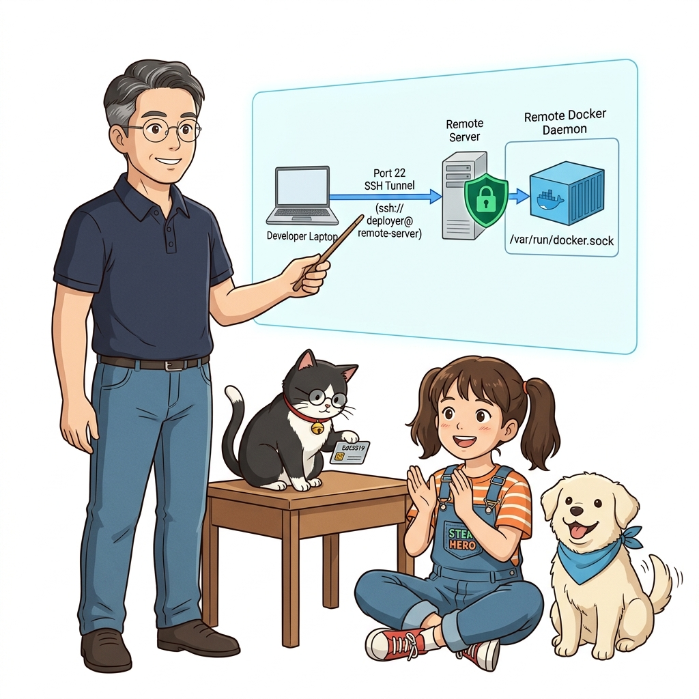
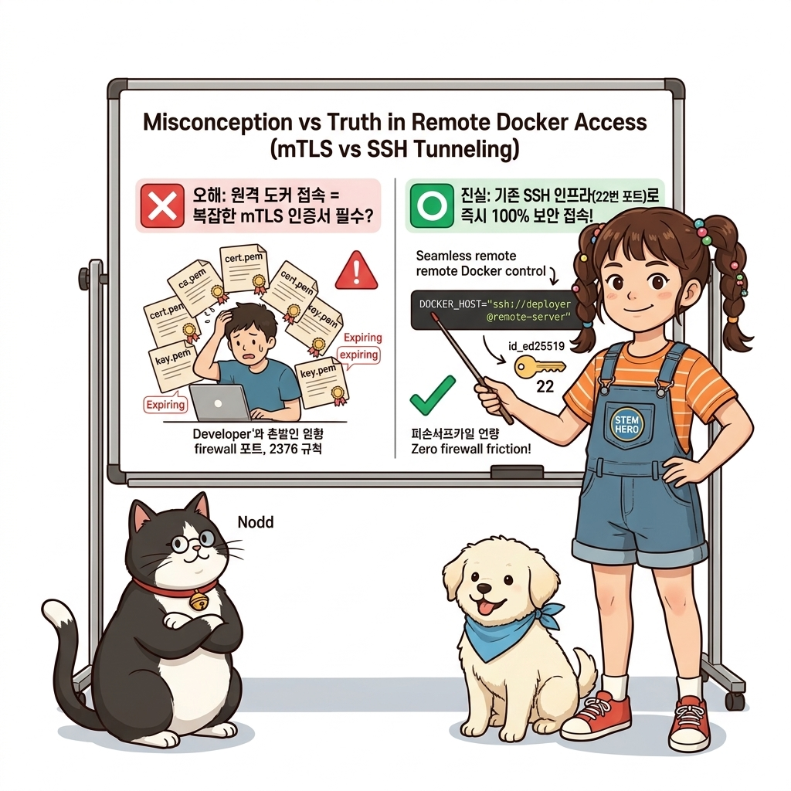
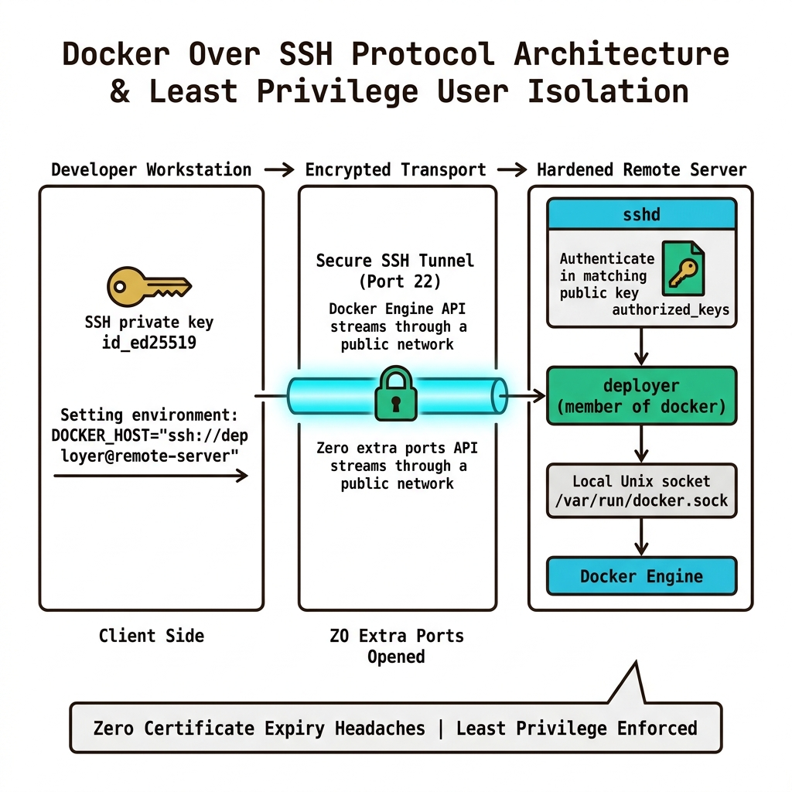
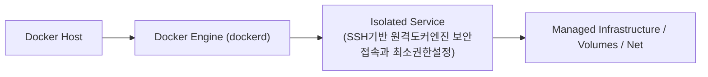
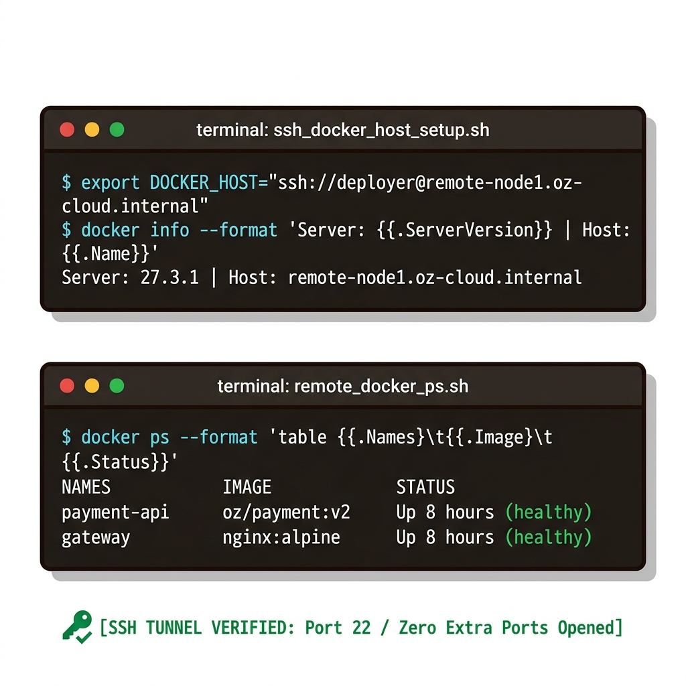
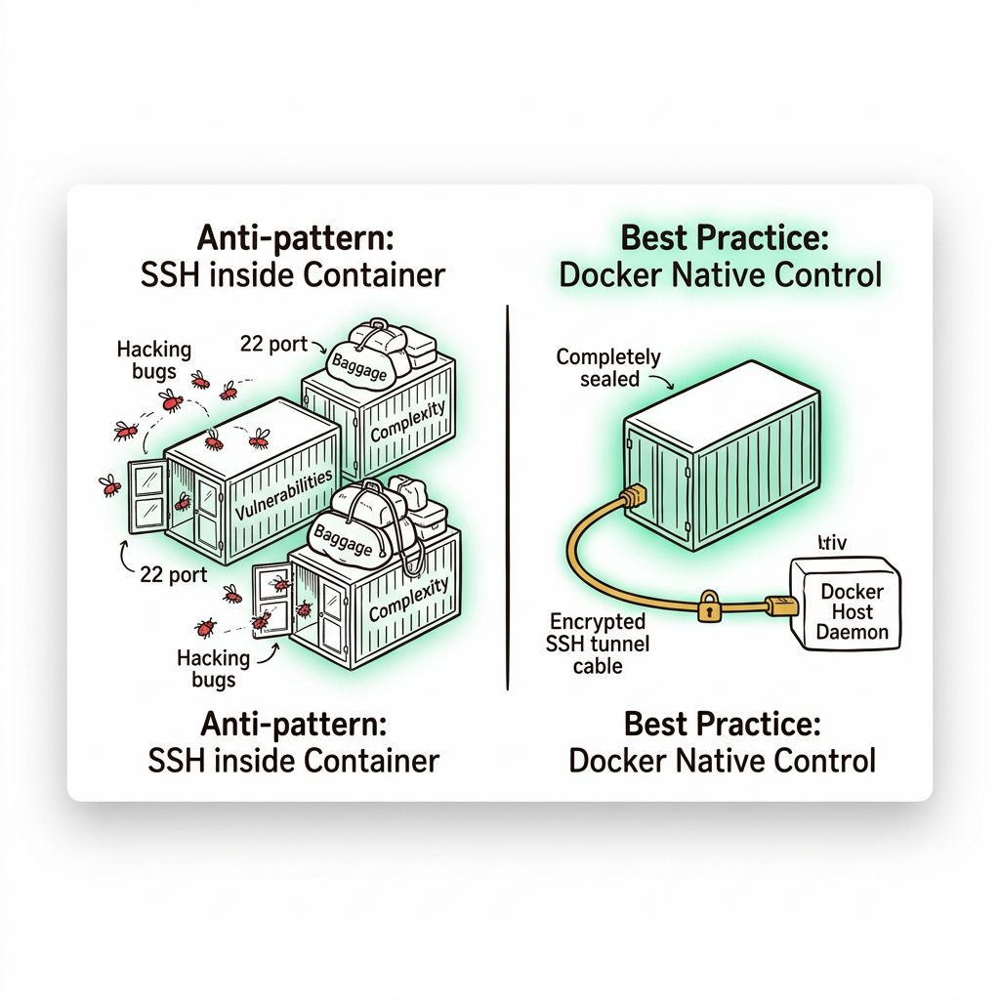
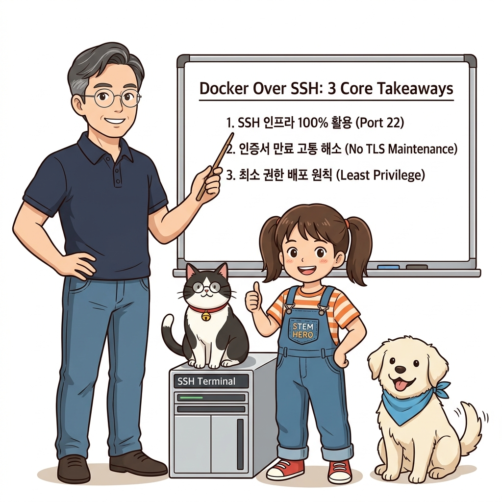
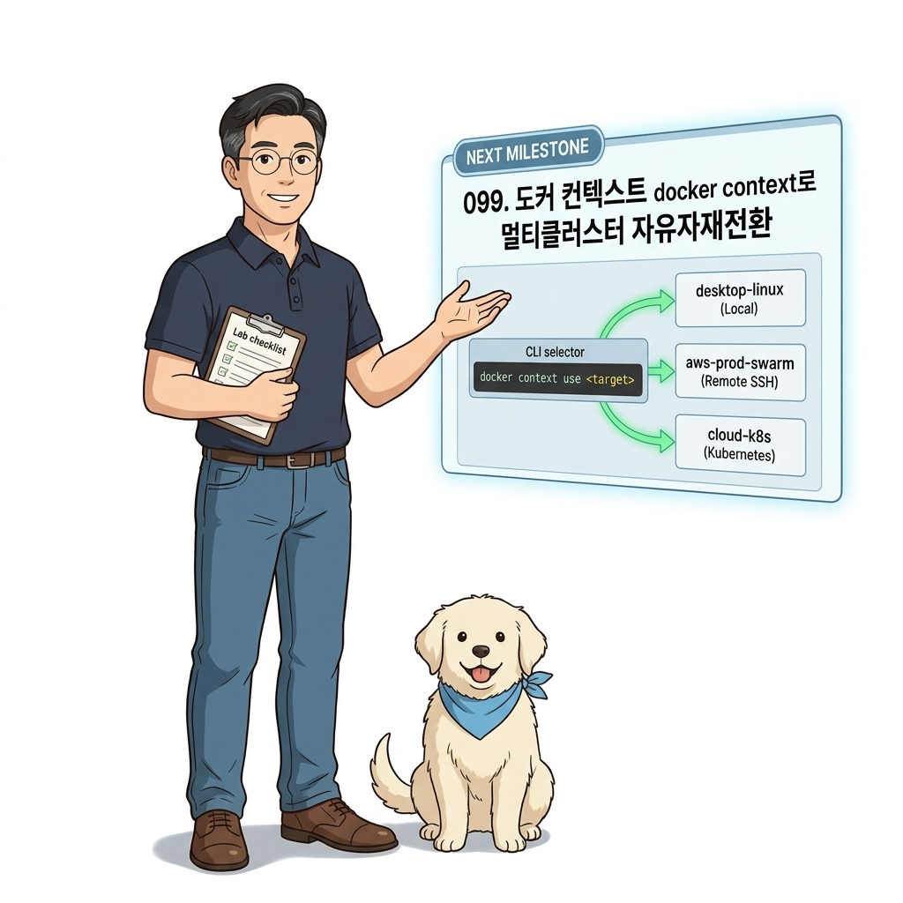

# 098. SSH기반 원격도커엔진 보안접속과 최소권한설정

TLS 인증서를 직접 생성·배포·갱신하는 번거로움 없이, 이미 구축되어 있는 **SSH 인프라(`ssh://user@host`)**를 그대로 활용해 원격 서버의 도커 엔진과 안전하게 터널링하는 법을 배웁니다.


**그림 07-3-1** SSH기반 원격도커엔진 보안접속과 최소권한설정의 필요성과 현대 클라우드 아키텍처 관점의 개요

---

### 098.1 왜 SSH기반 원격도커엔진 보안접속과 최소권한설정이(가) 필요한가? (문제 정의와 현실적 배경)

소프트웨어 시스템이 복잡해질수록 설정을 다루는 방식은 전체 인프라의 신뢰성을 결정짓는 핵심 척도가 됩니다. **SSH기반 원격도커엔진 보안접속과 최소권한설정**이(가) 부재하거나 잘못 다루어질 때 현장에서는 다음과 같은 대표적인 병목과 장애가 발생합니다:

1. **하드코딩된 설정과 환경 불일치로 인한 유연성 상실**: 환경이 바뀔 때마다 코드를 다시 빌드해야 하므로 배포 주기가 지연되고 이미지 수가 기하급수적으로 폭증합니다.
2. **보안 민감 데이터의 무분별한 노출**: 비밀번호, 데이터베이스 토큰, 암호화 키가 이미지 레이어에 영구 박제되어 형상관리 시스템이나 외부에 유출될 위험이 커집니다.
3. **재현 불가능한 구성 드리프트**: 스테이징 환경과 프로덕션 환경의 미세한 설정 차이가 예기치 못한 서비스 중단 사고로 직결됩니다.


**그림 07-3-2** SSH기반 원격도커엔진 보안접속과 최소권한설정에 대한 대표적인 오해와 실제 프로덕션 현장의 엔지니어링 진실

---

### 098.2 핵심 아키텍처와 엔지니어링 메커니즘

비밀번호 없는 SSH 공개키(`id_ed25519`) 인증을 구성하고, `DOCKER_HOST="ssh://admin@remote-server"` 환경 변수로 원격 서버의 컨테이너를 내 로컬처럼 다루는 실무 기법을 실습합니다.


**그림 07-3-3** SSH기반 원격도커엔진 보안접속과 최소권한설정의 내부 아키텍처 및 데이터 흐름

#### 📊 핵심 비교 및 엔지니어링 표준 분석

| 구분 / 핵심 원리 | 상세 설명 및 동작 메커니즘 | 실무 적용 시 주의점 및 베스트 프랙티스 |
| :--- | :--- | :--- |
| **SSH 도커 엔드포인트 (`ssh://`)** | 도커 18.09+부터 지원하는 공식 기능으로, 별도 포트 개방 없이 기존 SSH(22번 포트) 보안 터널을 통해 도커 소켓 연결 | 방화벽에 추가 포트(2376)를 열 필요가 없어 네트워크 보안 심사를 쉽게 통과 |
| **SSH 에이전트 포워딩 연동** | `ssh-agent` 및 `ssh-add`로 개인키를 등록해 두면 암호 입력 없이 원격 도커 명령을 안전하게 실행 | CI/CD 배포 스크립트에서도 매우 깔끔하게 원격 배포 자동화 가능 |
| **최소 권한 운영 계정** | `root` 계정 대신 `docker` 그룹에 속한 전용 배포 사용자(예: `deployer`)를 생성하고 SSH 접속 제한 | 침해 사고 발생 시 피해 범위를 최소화하는 방어적 서버 구성 |

---

### 098.3 선언적 실습 및 아키텍처 다이어그램

본 실습은 외부 비공개 패키지에 의존하지 않고, 공식 표준 이미지를 기반으로 즉시 재현 가능한 살아있는 코드로 구성되어 있습니다.

```bash
# SSH 프로토콜을 통한 원격 도커 호스트 연결 구조 검증
# (로컬 SSH 에이전트 또는 키 경로를 통해 ssh://user@remote-ip 로 직접 명령 전달 가능!)
echo "export DOCKER_HOST='ssh://devops@remote-node1.oz-cloud.internal'"
echo "docker container ls" 
```

#### 🔍 아키텍처 흐름도 (Mermaid Diagram)




**그림 07-3-4** 선언적 인프라 명세를 통한 SSH기반 원격도커엔진 보안접속과 최소권한설정 검증 파이프라인

---

<!-- BIBLE_INTEGRATION_book6_deep_098 -->
---

### 098.C 📚 도커 바이블 심화: 트러블슈팅: 컨테이너 내부 SSHD 설치 안티패턴과 도커 네이티브 원격 제어 보안
*출처 도서: 『트러블 슈팅 도커』 핵심 분석 (트러블 슈팅 도커 제1장 (1.171 특정 컨테이너 SSH 접속 차단 및 관리))*

과거 가상머신(VM) 운영 방식에 익숙한 엔지니어들이 도커를 처음 접할 때 가장 흔히 저지르는 심각한 안티패턴은 **"모든 컨테이너마다 OpenSSH 서버(`sshd`)를 설치하고 22번 포트를 열어두는 것"**입니다.

#### 왜 컨테이너에 SSHD를 띄우면 안 되는가? (3대 치명적 결함):
1. **PID 1 단일 책임 원칙 붕괴**:
   * 컨테이너는 원래 애플리케이션 하나만 관리해야 합니다. `sshd`를 함께 띄우려면 `supervisord` 같은 무거운 프로세스 관리자가 추가되어 컨테이너가 다시 미니 VM으로 퇴화합니다.
2. **보안 공격 표면(Attack Surface)의 급증**:
   * 컨테이너마다 SSH 포트를 열면 무차별 비밀번호 대입 공격(Brute Force)의 타깃이 되며, SSH 키 쌍 관리와 사용자 계정 관리가 기하급수적으로 복잡해집니다.
3. **불변 인프라 파괴**:
   * 개발자가 SSH로 들어가서 직접 설정 파일을 고치거나 패키지를 설치하면, 해당 컨테이너는 재부팅 시 사라지는 '눈송이 서버(Snowflake Server)'가 됩니다.
* **올바른 대안**: 컨테이너 접속은 오직 호스트 도커 데몬을 통한 **`docker exec -it`**나 **Docker Context 원격 SSH 소켓 터널링**을 통해서만 이루어져야 합니다.


**그림 098-B-2** 컨테이너마다 SSHD를 설치하는 위험한 안티패턴과 도커 소켓 터널링을 통한 안전한 제어 비교도

```bash
# [실습] SSH 없이 호스트에서 도커 소켓 터널링으로 안전하게 원격 컨테이너 제어
# 1. 도커 컨텍스트를 활용한 원격 도커 호스트 안전 연결 (컨테이너 내부에 sshd 불필요!)
# docker context create remote-server --docker "host=ssh://deploy@192.168.1.50"
# docker context use remote-server

# 2. 로컬 터미널에서 원격 컨테이너 목록 및 디버깅 수행
# docker container ls
# docker container exec -it my-app sh
```

> 👨‍🏫 **이호진 교수님의 바이블 멘토링 노트**:
> "컨테이너에 sshd를 까는 개발자를 보면 즉시 말리셔야 합니다. 컨테이너는 원격 접속해서 머무는 방이 아니라, 작업을 수행하고 사라지는 공장의 로봇 팔입니다."
>
> 👧 **도로시의 깨달음**:
> "상자마다 따로 자물쇠와 문(SSH)을 달아두면 도둑이 들어올 구멍만 많아지니까, 집주인(도커 데몬)의 중앙 통제실 문 하나만 단단히 잠그는 게 맞네요!"
>
> 🐱 **조교 지니의 아키텍처 체크포인트**:
> "도커 18.09부터 도입된 `DOCKER_HOST=ssh://user@host` 기능을 쓰면 로컬 docker CLI가 원격 호스트의 도커 소켓으로 자동 SSH 터널을 뚫어주므로 컨테이너 내부 sshd는 100% 불필요합니다."


### 098.4 핵심 정리: 캐릭터 대화와 3대 교훈

> 👧 **도로시**: "교수님! **SSH기반 원격도커엔진 보안접속과 최소권한설정**의 원리를 배우니까, 복잡하게 얽혀 있던 인프라 설정이 레고 블록처럼 질서정연하게 제자리를 찾는 게 보여요!"
> 
> 🐱 **조교 지니**: "야옹~ 맞습니다! 특히 런타임 환경과 불변 인프라의 경계를 명확히 지키는 것이 대규모 클라우드 운영의 제1원칙이랍니다!"
> 
> 🐶 **토토**: "멍멍! 선언적 코드로 한 번 적어두면 언제든 똑같이 복원되니까 정말 든든해요!"
> 
> 👨‍🏫 **이호진 교수님**: "훌륭하구나. 원리를 깊이 이해하고 실습을 통해 손에 익히는 것이 훌륭한 클라우드 엔지니어로 성장하는 가장 빠른 지름길이란다."


**그림 07-3-5** SSH기반 원격도커엔진 보안접속과 최소권한설정 마스터를 위한 3대 핵심 교훈

1. **설정과 실행의 명확한 분리**:
   * 애플리케이션 코드는 불변으로 유지하고, 가변적인 설정값은 외부에서 주입하여 이식성을 극대화합니다.
2. **선언적 재현성 확보**:
   * 사람이 수작업으로 변경하지 않고 코드 명세를 통해 언제 어디서나 100% 동일한 실행 결과를 보장합니다.
3. **최소 권한 및 보안 모범 사례 준수**:
   * 불필요한 권한과 포트 노출을 최소화하고 민감 데이터를 암호화하여 프로덕션 안정성을 담보합니다.

---

### 098.5 랩노트 피날레와 다음 강의 예고


**그림 07-3-6** 연구실에서 다음 마일스톤인 [도커컨텍스트 docker context로 멀티클러스터 자유자재전환] 실습을 예고하는 교수님과 토토

> 💡 **다음 강의 안내**:
> [도커컨텍스트 docker context로 멀티클러스터 자유자재전환](../099_도커컨텍스트_docker_context로_멀티클러스터_자유자재전환/)에서는 더욱 심화된 실전 엔지니어링 실습과 아키텍처를 다룹니다!

---

## 🧭 강의 네비게이션
* [◀️ 이전 강의: 097_상호TLS_mTLS_인증서생성_CA_서버키_클라이언트키](../097_상호TLS_mTLS_인증서생성_CA_서버키_클라이언트키/)
* [📋 Part 07. 보안 원격 접근(TLS/SSH Context), 다중 아키텍처 이미지(Buildx) & 이미지 최적화 (096 ~ 111) 목차로 돌아가기](../)
* [▶️ 다음 강의: 099_도커컨텍스트_docker_context로_멀티클러스터_자유자재전환](../099_도커컨텍스트_docker_context로_멀티클러스터_자유자재전환/)
