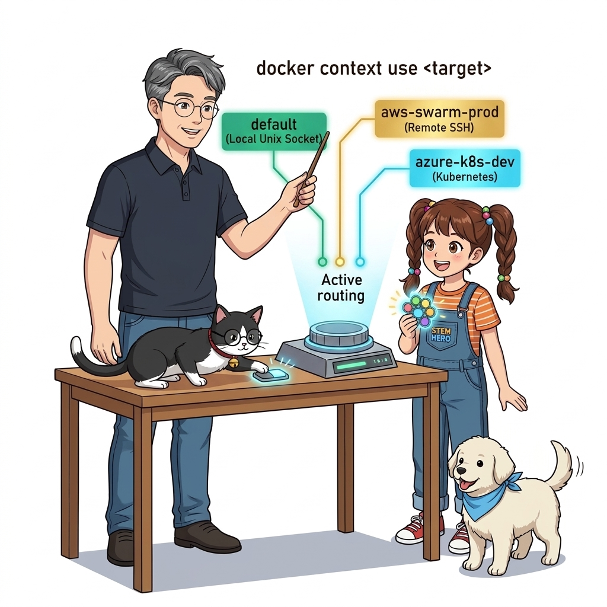
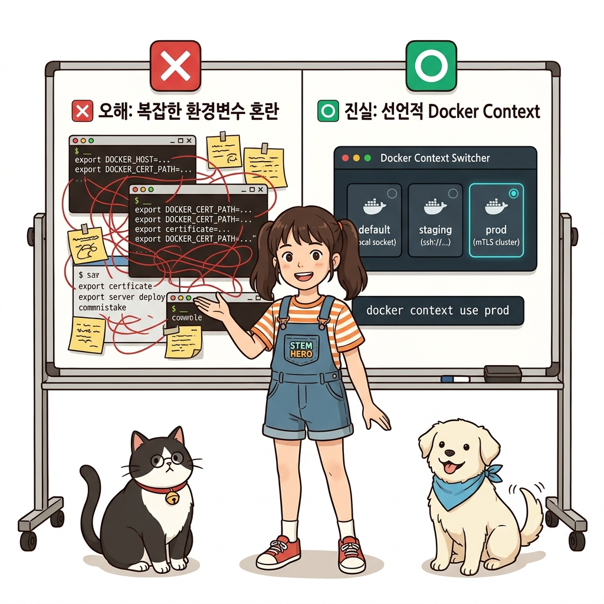
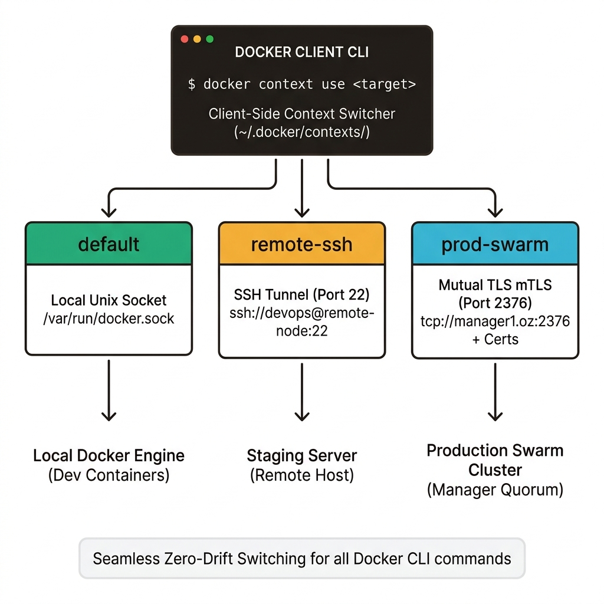
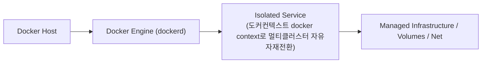
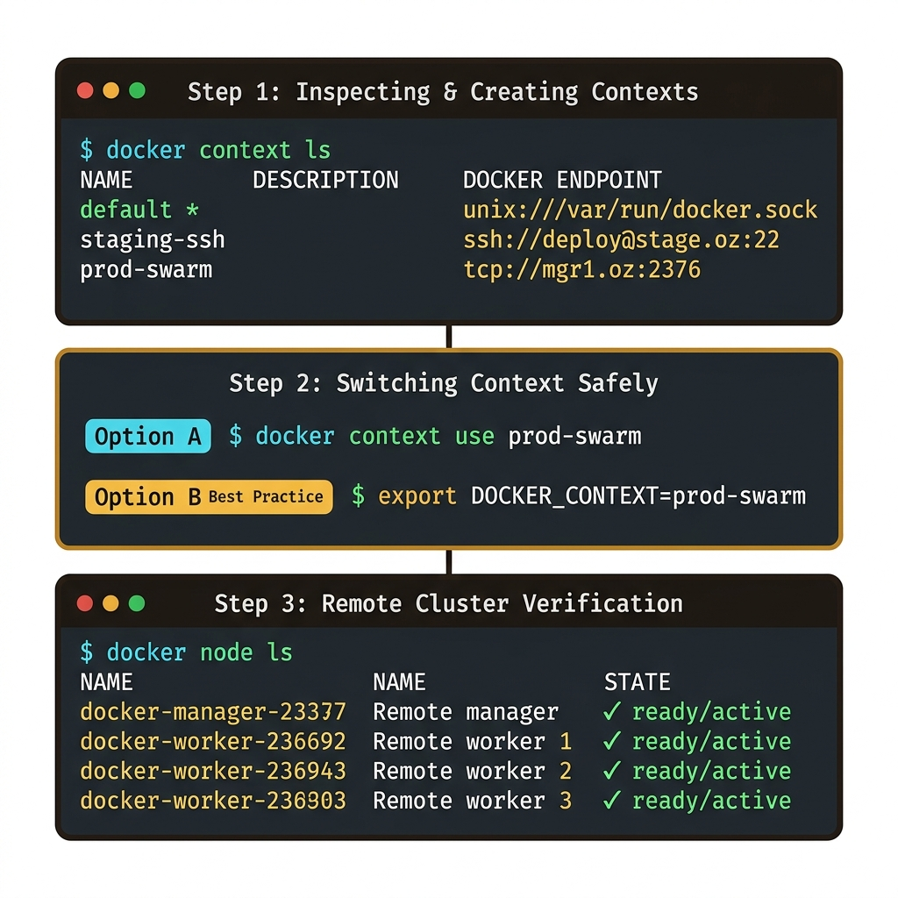
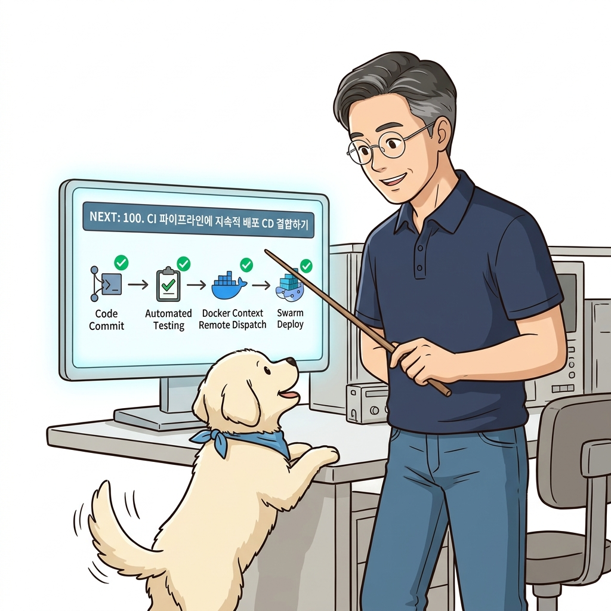

# 099. 도커컨텍스트 docker context로 멀티클러스터 자유자재전환

과거에는 원격 도커를 제어할 때마다 긴 환경 변수(`DOCKER_HOST`, `DOCKER_CERT_PATH`)를 매번 변경해야 했습니다.


**그림 07-4-1** 도커컨텍스트 docker context로 멀티클러스터 자유자재전환의 필요성과 현대 클라우드 아키텍처 관점의 개요

---

### 099.1 왜 도커컨텍스트 docker context로 멀티클러스터 자유자재전환이(가) 필요한가? (문제 정의와 현실적 배경)

소프트웨어 시스템이 복잡해질수록 설정을 다루는 방식은 전체 인프라의 신뢰성을 결정짓는 핵심 척도가 됩니다. **도커컨텍스트 docker context로 멀티클러스터 자유자재전환**이(가) 부재하거나 잘못 다루어질 때 현장에서는 다음과 같은 대표적인 병목과 장애가 발생합니다:

1. **하드코딩된 설정과 환경 불일치로 인한 유연성 상실**: 환경이 바뀔 때마다 코드를 다시 빌드해야 하므로 배포 주기가 지연되고 이미지 수가 기하급수적으로 폭증합니다.
2. **보안 민감 데이터의 무분별한 노출**: 비밀번호, 데이터베이스 토큰, 암호화 키가 이미지 레이어에 영구 박제되어 형상관리 시스템이나 외부에 유출될 위험이 커집니다.
3. **재현 불가능한 구성 드리프트**: 스테이징 환경과 프로덕션 환경의 미세한 설정 차이가 예기치 못한 서비스 중단 사고로 직결됩니다.


**그림 07-4-2** 도커컨텍스트 docker context로 멀티클러스터 자유자재전환에 대한 대표적인 오해와 실제 프로덕션 현장의 엔지니어링 진실

---

### 099.2 핵심 아키텍처와 엔지니어링 메커니즘

현대 도커 CLI의 핵심 기능인 **도커 컨텍스트(`docker context`)**를 사용해 로컬(`default`), 테스트(`test-ssh`), 운영(`prod-swarm`) 연결 정보를 이름으로 저장하고, `docker context use` 및 터미널 세션별 환경 변수(`DOCKER_CONTEXT`)로 안전하게 전환하는 법을 마스터합니다!


**그림 07-4-3** 도커컨텍스트 docker context로 멀티클러스터 자유자재전환의 내부 아키텍처 및 데이터 흐름

#### 📊 핵심 비교 및 엔지니어링 표준 분석

| 구분 / 핵심 원리 | 상세 설명 및 동작 메커니즘 | 실무 적용 시 주의점 및 베스트 프랙티스 |
| :--- | :--- | :--- |
| **`docker context create`** | 로컬 소켓, 원격 TLS, 원격 SSH 연결 정보를 이름(Name)을 가진 독립된 컨텍스트 객체로 영구 저장 | 인증서 파일 경로까지 컨텍스트 안에 함께 패키징되어 보관됨 |
| **안전한 전환: `DOCKER_CONTEXT` 환경 변수** | `docker context use`는 전체 시스템 기본값을 바꾸므로 다른 터미널 창에도 영향을 줌! 실무에서는 **`export DOCKER_CONTEXT=prod-cluster`**로 현재 터미널 세션만 안전하게 전환하는 것을 강력 권장 | 터미널 세션 간 혼선 없이 개별 클러스터 안전 제어 |
| **클러스터와 스택의 결합** | 컨텍스트를 바꾼 뒤 `docker stack deploy`를 치면 해당 원격 클러스터로 스택이 즉시 배포됨! | 다음 강의에서 CI 파이프라인과 완벽히 결합되는 핵심 연결 고리 |

---

### 099.3 선언적 실습 및 아키텍처 다이어그램

본 실습은 외부 비공개 패키지에 의존하지 않고, 공식 표준 이미지를 기반으로 즉시 재현 가능한 살아있는 코드로 구성되어 있습니다.

```bash
# 현재 컨텍스트 목록 확인 및 신규 컨텍스트 생성/전환 실습
docker context ls
docker context inspect default --format 'Endpoint: {{.Endpoints.docker.Host}}'

# 예시: SSH 기반 컨텍스트 생성 (문법 레퍼런스)
# docker context create prod-cluster --docker "host=ssh://deploy@prod.oz-cloud.com"
# docker context use prod-cluster
```

#### 🔍 아키텍처 흐름도 (Mermaid Diagram)




**그림 07-4-4** 선언적 인프라 명세를 통한 도커컨텍스트 docker context로 멀티클러스터 자유자재전환 검증 파이프라인

---

### 099.4 핵심 정리: 캐릭터 대화와 3대 교훈

> 👧 **도로시**: "교수님! **도커컨텍스트 docker context로 멀티클러스터 자유자재전환**의 원리를 배우니까, 복잡하게 얽혀 있던 인프라 설정이 레고 블록처럼 질서정연하게 제자리를 찾는 게 보여요!"
> 
> 🐱 **조교 지니**: "야옹~ 맞습니다! 특히 런타임 환경과 불변 인프라의 경계를 명확히 지키는 것이 대규모 클라우드 운영의 제1원칙이랍니다!"
> 
> 🐶 **토토**: "멍멍! 선언적 코드로 한 번 적어두면 언제든 똑같이 복원되니까 정말 든든해요!"
> 
> 👨‍🏫 **이호진 교수님**: "훌륭하구나. 원리를 깊이 이해하고 실습을 통해 손에 익히는 것이 훌륭한 클라우드 엔지니어로 성장하는 가장 빠른 지름길이란다."


**그림 07-4-5** 도커컨텍스트 docker context로 멀티클러스터 자유자재전환 마스터를 위한 3대 핵심 교훈

1. **설정과 실행의 명확한 분리**:
   * 애플리케이션 코드는 불변으로 유지하고, 가변적인 설정값은 외부에서 주입하여 이식성을 극대화합니다.
2. **선언적 재현성 확보**:
   * 사람이 수작업으로 변경하지 않고 코드 명세를 통해 언제 어디서나 100% 동일한 실행 결과를 보장합니다.
3. **최소 권한 및 보안 모범 사례 준수**:
   * 불필요한 권한과 포트 노출을 최소화하고 민감 데이터를 암호화하여 프로덕션 안정성을 담보합니다.

---

### 099.5 랩노트 피날레와 다음 강의 예고


**그림 07-4-6** 연구실에서 다음 마일스톤인 [CI파이프라인에 지속적배포 CD 결합하기] 실습을 예고하는 교수님과 토토

> 💡 **다음 강의 안내**:
> [CI파이프라인에 지속적배포 CD 결합하기](../100_CI파이프라인에_지속적배포_CD_결합하기/)에서는 더욱 심화된 실전 엔지니어링 실습과 아키텍처를 다룹니다!

---

## 🧭 강의 네비게이션
* [◀️ 이전 강의: 098_SSH기반_원격도커엔진_보안접속과_최소권한설정](../098_SSH기반_원격도커엔진_보안접속과_최소권한설정/)
* [📋 Part 07. 보안 원격 접근(TLS/SSH Context), 다중 아키텍처 이미지(Buildx) & 이미지 최적화 (096 ~ 111) 목차로 돌아가기](../)
* [▶️ 다음 강의: 100_CI파이프라인에_지속적배포_CD_결합하기](../100_CI파이프라인에_지속적배포_CD_결합하기/)
