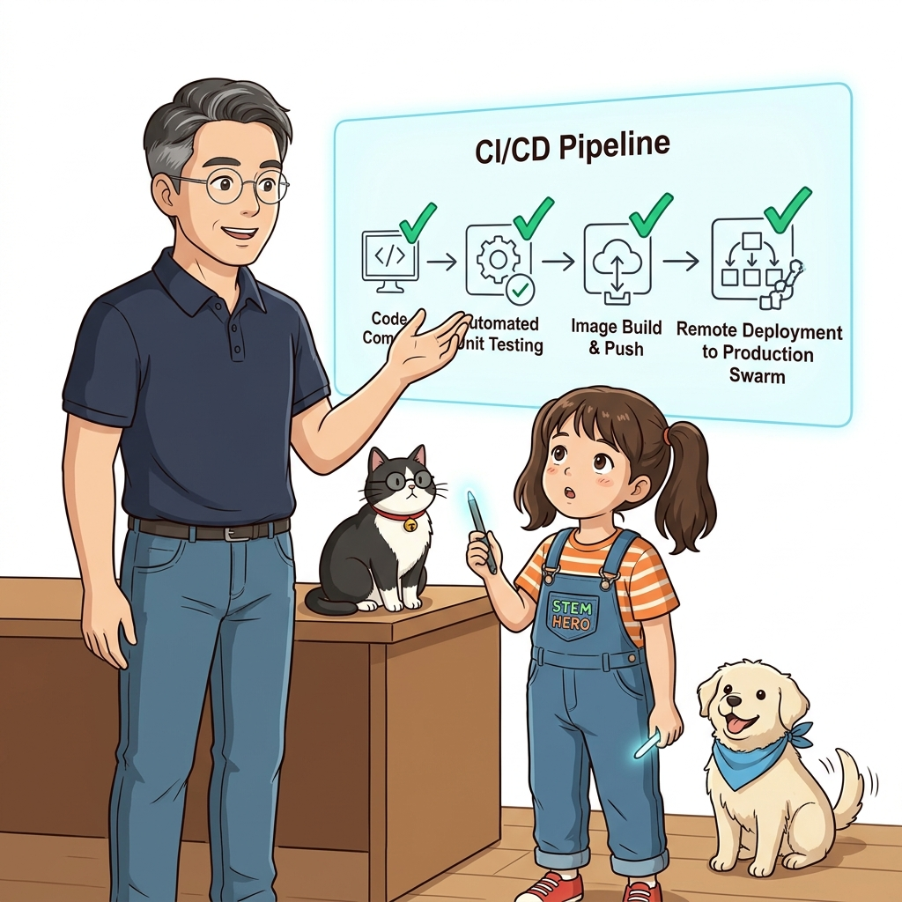
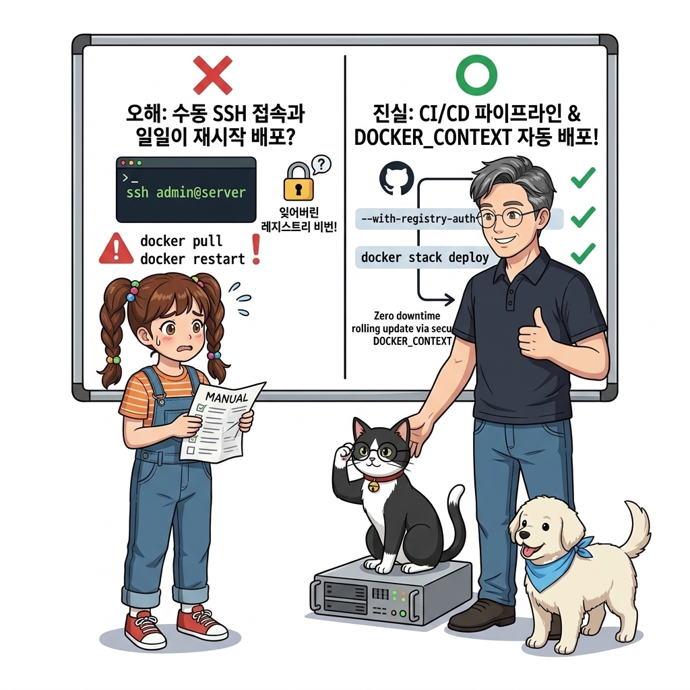
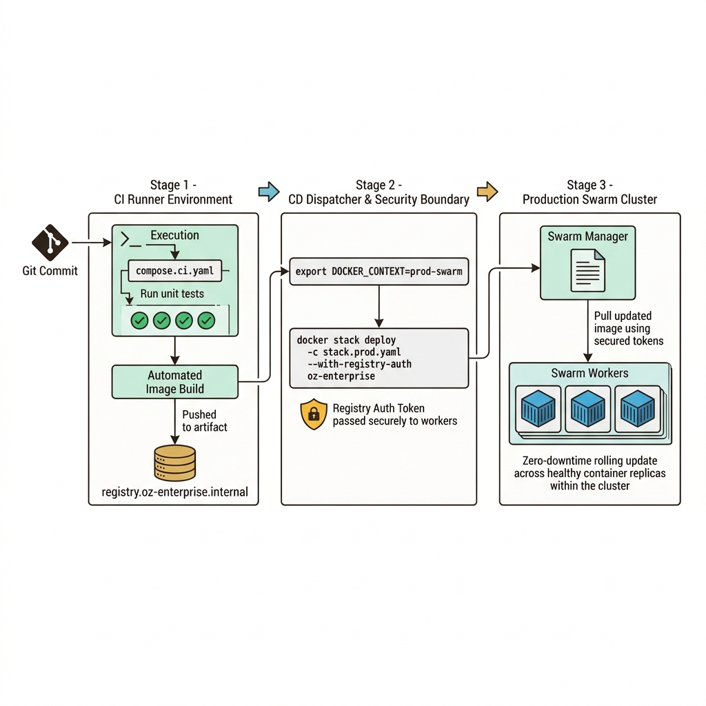
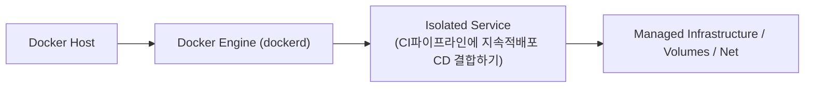
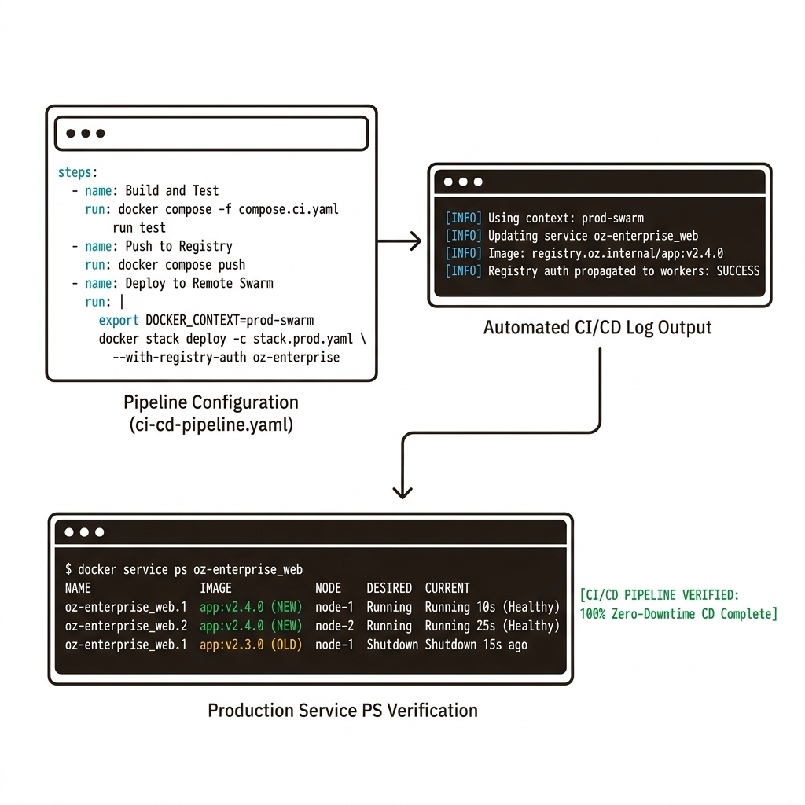

# 100. CI파이프라인에 지속적배포 CD 결합하기

Part 05에서 구축했던 CI(지속적 통합) 파이프라인의 마지막 단계에 **지속적 배포(CD, Continuous Deployment)**를 결합합니다.


**그림 07-5-1** CI파이프라인에 지속적배포 CD 결합하기의 필요성과 현대 클라우드 아키텍처 관점의 개요

---

### 100.1 왜 CI파이프라인에 지속적배포 CD 결합하기이(가) 필요한가? (문제 정의와 현실적 배경)

소프트웨어 시스템이 복잡해질수록 설정을 다루는 방식은 전체 인프라의 신뢰성을 결정짓는 핵심 척도가 됩니다. **CI파이프라인에 지속적배포 CD 결합하기**이(가) 부재하거나 잘못 다루어질 때 현장에서는 다음과 같은 대표적인 병목과 장애가 발생합니다:

1. **하드코딩된 설정과 환경 불일치로 인한 유연성 상실**: 환경이 바뀔 때마다 코드를 다시 빌드해야 하므로 배포 주기가 지연되고 이미지 수가 기하급수적으로 폭증합니다.
2. **보안 민감 데이터의 무분별한 노출**: 비밀번호, 데이터베이스 토큰, 암호화 키가 이미지 레이어에 영구 박제되어 형상관리 시스템이나 외부에 유출될 위험이 커집니다.
3. **재현 불가능한 구성 드리프트**: 스테이징 환경과 프로덕션 환경의 미세한 설정 차이가 예기치 못한 서비스 중단 사고로 직결됩니다.


**그림 07-5-2** CI파이프라인에 지속적배포 CD 결합하기에 대한 대표적인 오해와 실제 프로덕션 현장의 엔지니어링 진실

---

### 100.2 핵심 아키텍처와 엔지니어링 메커니즘

CI 러너 컨테이너가 원격 클러스터의 도커 컨텍스트를 로드한 뒤, `docker stack deploy --with-registry-auth` 명령을 실행해 새 버전 이미지를 운영 스웜 클러스터에 무중단으로 배포하는 완전 자동화 CI/CD 파이프라인을 완성합니다!


**그림 07-5-3** CI파이프라인에 지속적배포 CD 결합하기의 내부 아키텍처 및 데이터 흐름

#### 📊 핵심 비교 및 엔지니어링 표준 분석

| 구분 / 핵심 원리 | 상세 설명 및 동작 메커니즘 | 실무 적용 시 주의점 및 베스트 프랙티스 |
| :--- | :--- | :--- |
| **`--with-registry-auth` 플래그** | 매니저 노드가 사설 레지스트리 인증 토큰을 워커 노드들에게 안전하게 전달하여, 워커들이 새 버전 이미지를 `pull` 받을 수 있게 보장 | 사설 레지스트리를 쓰는 스웜 클러스터 배포 시 반드시 붙여야 하는 필수 옵션! |
| **배포 승인 게이트 (Manual Gate)** | 개발/스테이징은 커밋 즉시 자동 배포(Continuous Deployment), 운영 환경은 관리자 클릭 한 번으로 배포(Continuous Delivery) | 조직의 릴리스 정책에 맞춰 파이프라인 흐름을 유연하게 제어 |
| **완전 자동화의 가치** | 코드 커밋부터 단위 테스트, 멀티 스테이지 빌드, OCI 레이블 각인, 레지스트리 푸시, 운영 클러스터 무중단 롤링 업데이트까지 사람 손을 0번 거치는 현대적 데브옵스 달성 | 배포 소요 시간을 1주일에서 5분으로 단축 |

---

### 100.3 선언적 실습 및 아키텍처 다이어그램

본 실습은 외부 비공개 패키지에 의존하지 않고, 공식 표준 이미지를 기반으로 즉시 재현 가능한 살아있는 코드로 구성되어 있습니다.

```yaml
# [ci-cd-pipeline.yaml] CI 테스트 통과 후 원격 도커 컨텍스트로 무중단 배포(CD)를 수행하는 단계 명세
steps:
  - name: Build and Test
    run: docker compose -f compose.ci.yaml run test-runner
  - name: Push to Registry
    run: docker compose -f compose.ci.yaml push
  - name: Deploy to Remote Swarm (CD)
    run: |
      export DOCKER_CONTEXT=prod-swarm
      docker stack deploy -c stack.prod.yaml --with-registry-auth oz-enterprise
```

#### 🔍 아키텍처 흐름도 (Mermaid Diagram)




**그림 07-5-4** 선언적 인프라 명세를 통한 CI파이프라인에 지속적배포 CD 결합하기 검증 파이프라인

---

### 100.4 핵심 정리: 캐릭터 대화와 3대 교훈

> 👧 **도로시**: "교수님! **CI파이프라인에 지속적배포 CD 결합하기**의 원리를 배우니까, 복잡하게 얽혀 있던 인프라 설정이 레고 블록처럼 질서정연하게 제자리를 찾는 게 보여요!"
> 
> 🐱 **조교 지니**: "야옹~ 맞습니다! 특히 런타임 환경과 불변 인프라의 경계를 명확히 지키는 것이 대규모 클라우드 운영의 제1원칙이랍니다!"
> 
> 🐶 **토토**: "멍멍! 선언적 코드로 한 번 적어두면 언제든 똑같이 복원되니까 정말 든든해요!"
> 
> 👨‍🏫 **이호진 교수님**: "훌륭하구나. 원리를 깊이 이해하고 실습을 통해 손에 익히는 것이 훌륭한 클라우드 엔지니어로 성장하는 가장 빠른 지름길이란다."


**그림 07-5-5** CI파이프라인에 지속적배포 CD 결합하기 마스터를 위한 3대 핵심 교훈

1. **설정과 실행의 명확한 분리**:
   * 애플리케이션 코드는 불변으로 유지하고, 가변적인 설정값은 외부에서 주입하여 이식성을 극대화합니다.
2. **선언적 재현성 확보**:
   * 사람이 수작업으로 변경하지 않고 코드 명세를 통해 언제 어디서나 100% 동일한 실행 결과를 보장합니다.
3. **최소 권한 및 보안 모범 사례 준수**:
   * 불필요한 권한과 포트 노출을 최소화하고 민감 데이터를 암호화하여 프로덕션 안정성을 담보합니다.

---

### 100.5 랩노트 피날레와 다음 강의 예고


**그림 07-5-6** 연구실에서 다음 마일스톤인 [도커리소스 접근모델과 역할기반권한 이미지서명검증] 실습을 예고하는 교수님과 토토

> 💡 **다음 강의 안내**:
> [도커리소스 접근모델과 역할기반권한 이미지서명검증](../101_도커리소스_접근모델과_역할기반권한_이미지서명검증/)에서는 더욱 심화된 실전 엔지니어링 실습과 아키텍처를 다룹니다!

---

## 🧭 강의 네비게이션
* [◀️ 이전 강의: 099_도커컨텍스트_docker_context로_멀티클러스터_자유자재전환](../099_도커컨텍스트_docker_context로_멀티클러스터_자유자재전환/)
* [📋 Part 07. 보안 원격 접근(TLS/SSH Context), 다중 아키텍처 이미지(Buildx) & 이미지 최적화 (096 ~ 111) 목차로 돌아가기](../)
* [▶️ 다음 강의: 101_도커리소스_접근모델과_역할기반권한_이미지서명검증](../101_도커리소스_접근모델과_역할기반권한_이미지서명검증/)
