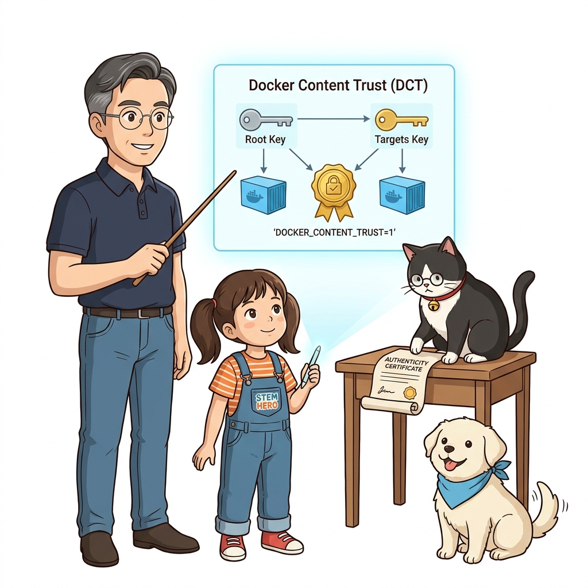
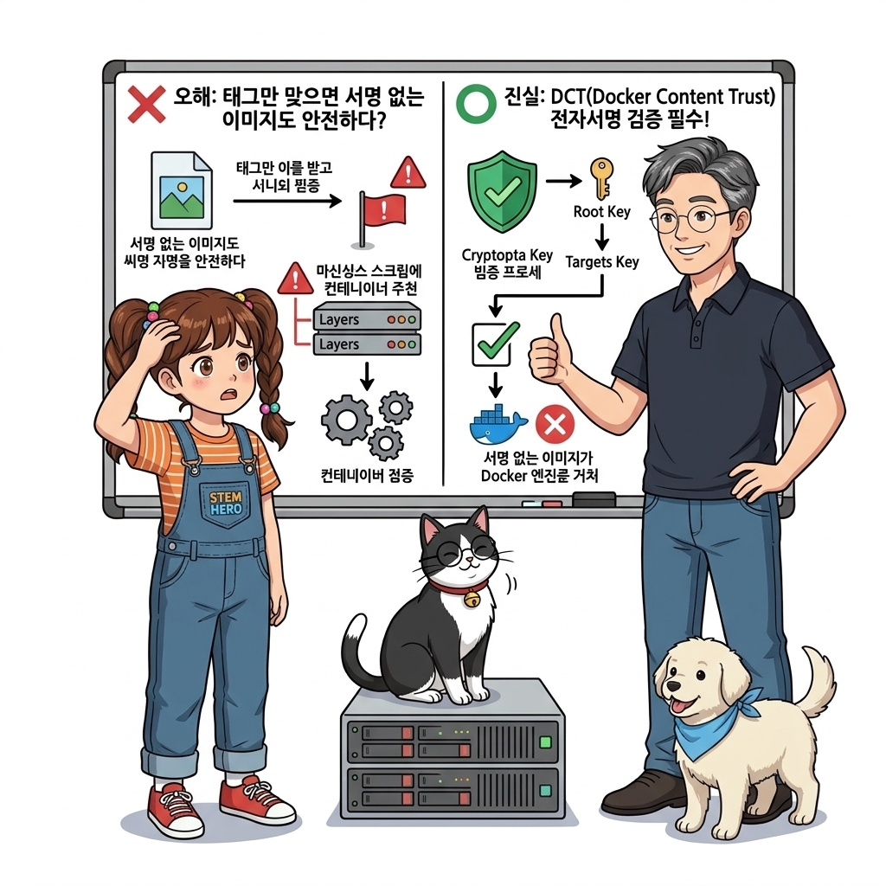
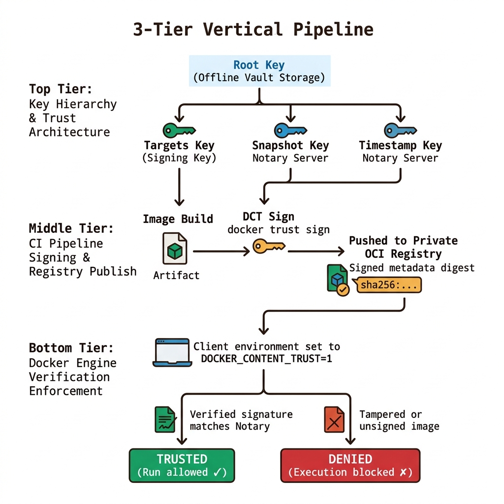
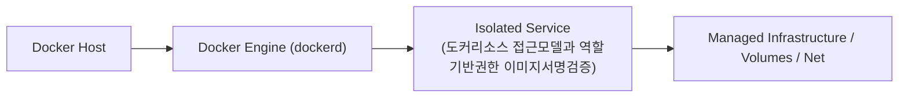
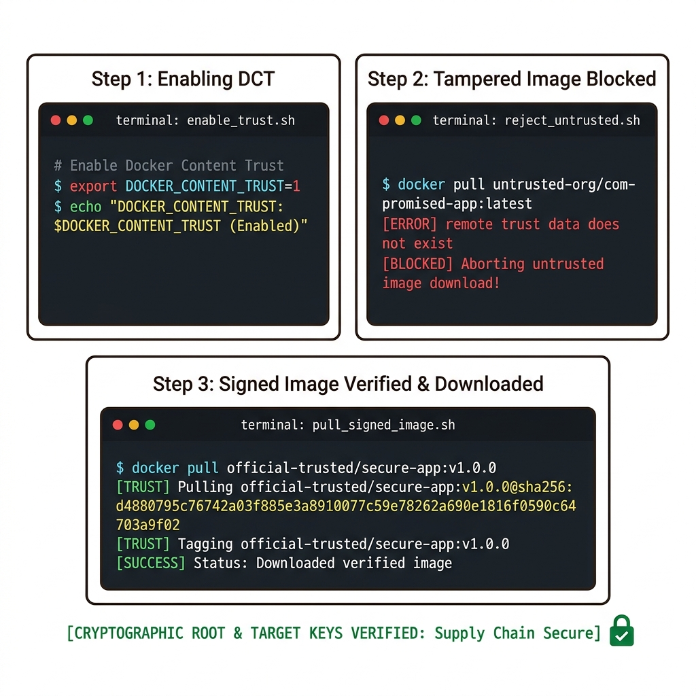
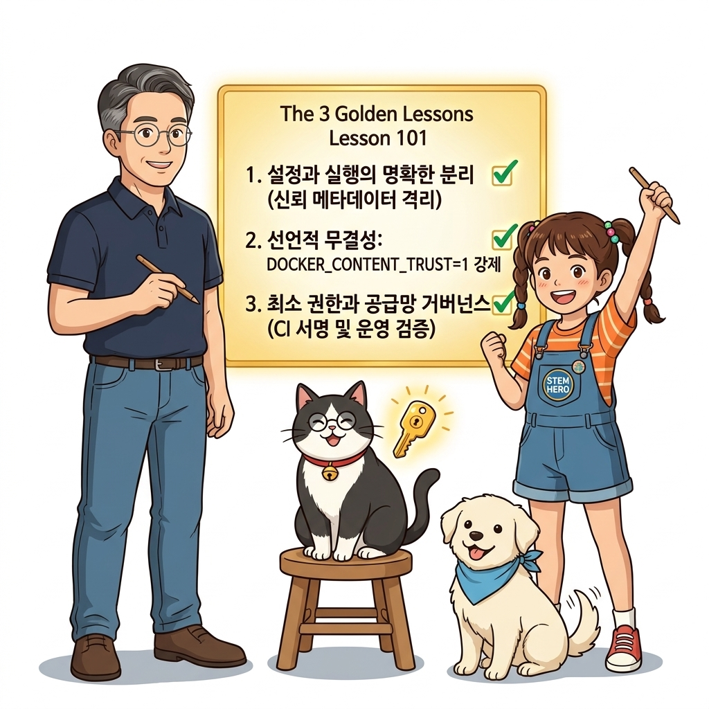
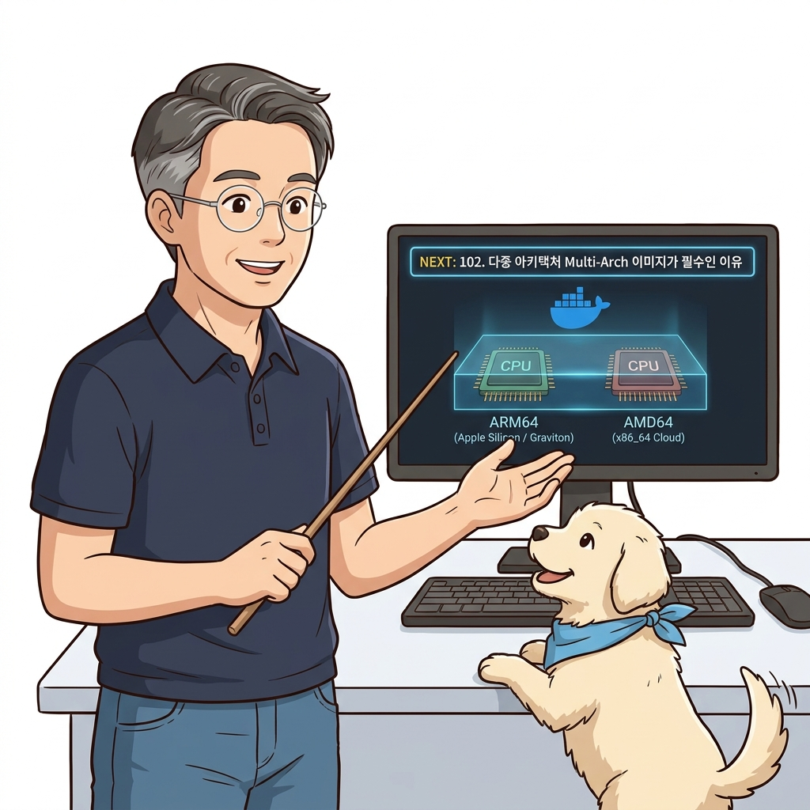

# 101. 도커리소스 접근모델과 역할기반권한 이미지서명검증

엔터프라이즈 환경에서 아무나 컨테이너를 실행하거나 외부의 오염된 이미지를 내려받지 못하도록 통제하는 **역할 기반 접근 제어(RBAC)** 모델을 살펴봅니다.


**그림 07-6-1** 도커리소스 접근모델과 역할기반권한 이미지서명검증의 필요성과 현대 클라우드 아키텍처 관점의 개요

---

### 101.1 왜 도커리소스 접근모델과 역할기반권한 이미지서명검증이(가) 필요한가? (문제 정의와 현실적 배경)

소프트웨어 시스템이 복잡해질수록 설정을 다루는 방식은 전체 인프라의 신뢰성을 결정짓는 핵심 척도가 됩니다. **도커리소스 접근모델과 역할기반권한 이미지서명검증**이(가) 부재하거나 잘못 다루어질 때 현장에서는 다음과 같은 대표적인 병목과 장애가 발생합니다:

1. **하드코딩된 설정과 환경 불일치로 인한 유연성 상실**: 환경이 바뀔 때마다 코드를 다시 빌드해야 하므로 배포 주기가 지연되고 이미지 수가 기하급수적으로 폭증합니다.
2. **보안 민감 데이터의 무분별한 노출**: 비밀번호, 데이터베이스 토큰, 암호화 키가 이미지 레이어에 영구 박제되어 형상관리 시스템이나 외부에 유출될 위험이 커집니다.
3. **재현 불가능한 구성 드리프트**: 스테이징 환경과 프로덕션 환경의 미세한 설정 차이가 예기치 못한 서비스 중단 사고로 직결됩니다.


**그림 07-6-2** 도커리소스 접근모델과 역할기반권한 이미지서명검증에 대한 대표적인 오해와 실제 프로덕션 현장의 엔지니어링 진실

---

### 101.2 핵심 아키텍처와 엔지니어링 메커니즘

이미지 빌드 시 개인키로 디지털 서명을 남기고, 도커 엔진이 서명 검증을 통과한 신뢰할 수 있는 이미지만 실행하도록 강제하는 **Docker Content Trust(DCT / Notary / Cosign)** 무결성 보장 체계를 실습합니다.


**그림 07-6-3** 도커리소스 접근모델과 역할기반권한 이미지서명검증의 내부 아키텍처 및 데이터 흐름

#### 📊 핵심 비교 및 엔지니어링 표준 분석

| 구분 / 핵심 원리 | 상세 설명 및 동작 메커니즘 | 실무 적용 시 주의점 및 베스트 프랙티스 |
| :--- | :--- | :--- |
| **Docker Content Trust (DCT)** | `export DOCKER_CONTENT_TRUST=1` 설정 시 도커 엔진이 이미지 다이제스트와 디지털 서명을 엄격히 검증 | 중간자 공격(MITM)이나 레지스트리 해킹으로 이미지가 변조되었을 때 실행을 원천 차단 |
| **공급망 보안 (Supply Chain Security)** | 소스 코드 ➔ CI 빌드 ➔ 이미지 서명 ➔ 클러스터 검증으로 이어지는 소프트웨어 공급망 보안의 핵심 축 | 최근 엔터프라이즈 및 금융권 클라우드 전환 시 필수 규정 준수(Compliance) 요건 |
| **거버넌스 원칙** | 개발자에게는 빌드/테스트 환경 권한만 부여하고 운영 클러스터 배포 권한은 CI/CD 파이프라인 서비스 계정에만 위임 | 실수로 인한 프로덕션 장애와 내부자 보안 사고를 예방 |

---

### 101.3 선언적 실습 및 아키텍처 다이어그램

본 실습은 외부 비공개 패키지에 의존하지 않고, 공식 표준 이미지를 기반으로 즉시 재현 가능한 살아있는 코드로 구성되어 있습니다.

```bash
# Docker Content Trust(DCT) 활성화 및 서명 검증 플래그 확인
# export DOCKER_CONTENT_TRUST=1
# docker pull nginx:alpine  # 공식 서명이 없는 변조 이미지는 다운로드 즉시 차단됨!
echo "DOCKER_CONTENT_TRUST variable: ${DOCKER_CONTENT_TRUST:-0 (Disabled by default)}" 
```

#### 🔍 아키텍처 흐름도 (Mermaid Diagram)




**그림 07-6-4** 선언적 인프라 명세를 통한 도커리소스 접근모델과 역할기반권한 이미지서명검증 검증 파이프라인

---

### 101.4 핵심 정리: 캐릭터 대화와 3대 교훈

> 👧 **도로시**: "교수님! **도커리소스 접근모델과 역할기반권한 이미지서명검증**의 원리를 배우니까, 복잡하게 얽혀 있던 인프라 설정이 레고 블록처럼 질서정연하게 제자리를 찾는 게 보여요!"
> 
> 🐱 **조교 지니**: "야옹~ 맞습니다! 특히 런타임 환경과 불변 인프라의 경계를 명확히 지키는 것이 대규모 클라우드 운영의 제1원칙이랍니다!"
> 
> 🐶 **토토**: "멍멍! 선언적 코드로 한 번 적어두면 언제든 똑같이 복원되니까 정말 든든해요!"
> 
> 👨‍🏫 **이호진 교수님**: "훌륭하구나. 원리를 깊이 이해하고 실습을 통해 손에 익히는 것이 훌륭한 클라우드 엔지니어로 성장하는 가장 빠른 지름길이란다."


**그림 07-6-5** 도커리소스 접근모델과 역할기반권한 이미지서명검증 마스터를 위한 3대 핵심 교훈

1. **설정과 실행의 명확한 분리**:
   * 애플리케이션 코드는 불변으로 유지하고, 가변적인 설정값은 외부에서 주입하여 이식성을 극대화합니다.
2. **선언적 재현성 확보**:
   * 사람이 수작업으로 변경하지 않고 코드 명세를 통해 언제 어디서나 100% 동일한 실행 결과를 보장합니다.
3. **최소 권한 및 보안 모범 사례 준수**:
   * 불필요한 권한과 포트 노출을 최소화하고 민감 데이터를 암호화하여 프로덕션 안정성을 담보합니다.

---

### 101.5 랩노트 피날레와 다음 강의 예고


**그림 07-6-6** 연구실에서 다음 마일스톤인 [다중아키텍처 Multi Arch 이미지가 필수인 이유] 실습을 예고하는 교수님과 토토

> 💡 **다음 강의 안내**:
> [다중아키텍처 Multi Arch 이미지가 필수인 이유](../102_다중아키텍처_Multi_Arch_이미지가_필수인_이유/)에서는 더욱 심화된 실전 엔지니어링 실습과 아키텍처를 다룹니다!

---

## 🧭 강의 네비게이션
* [◀️ 이전 강의: 100_CI파이프라인에_지속적배포_CD_결합하기](../100_CI파이프라인에_지속적배포_CD_결합하기/)
* [📋 Part 07. 보안 원격 접근(TLS/SSH Context), 다중 아키텍처 이미지(Buildx) & 이미지 최적화 (096 ~ 111) 목차로 돌아가기](../)
* [▶️ 다음 강의: 102_다중아키텍처_Multi_Arch_이미지가_필수인_이유](../102_다중아키텍처_Multi_Arch_이미지가_필수인_이유/)
