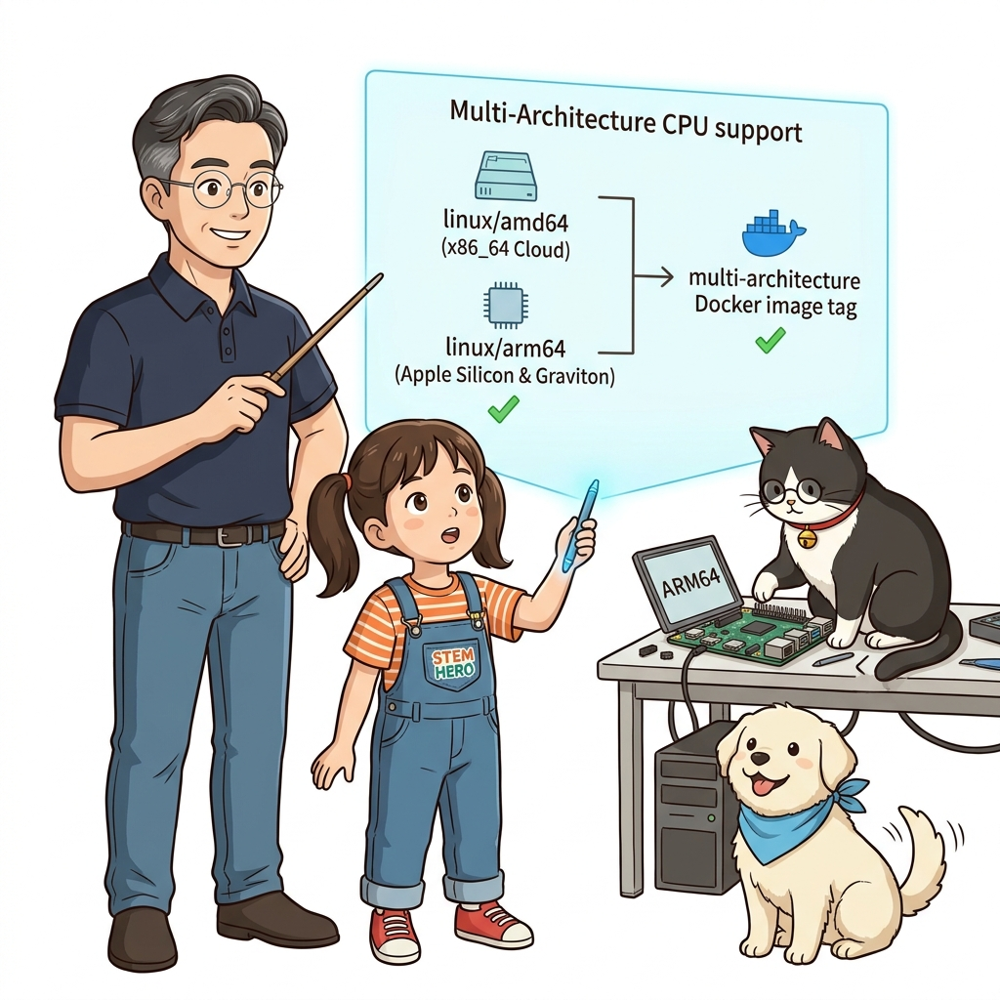
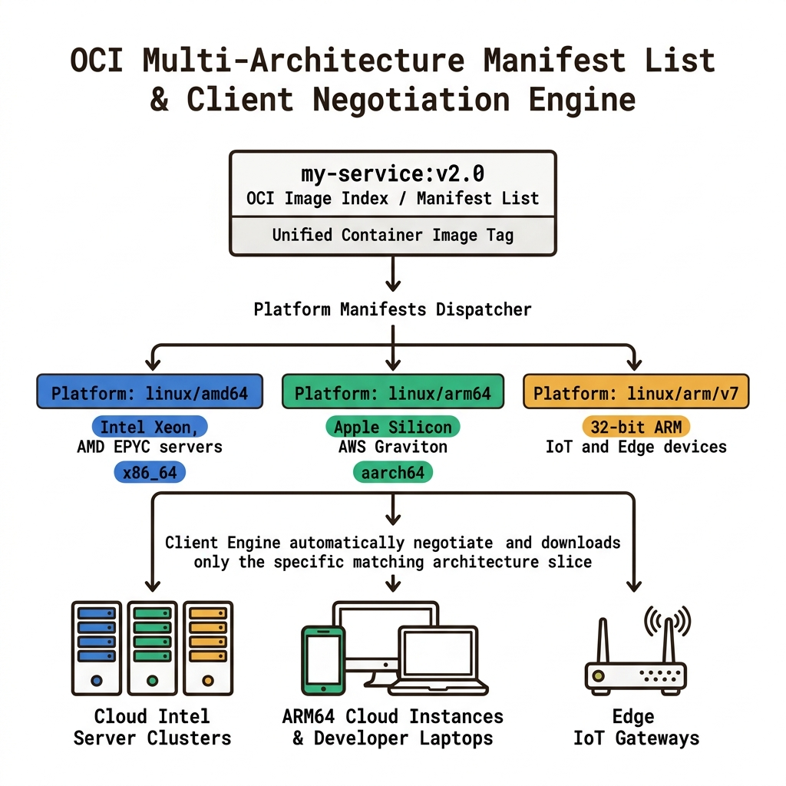
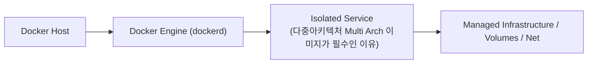
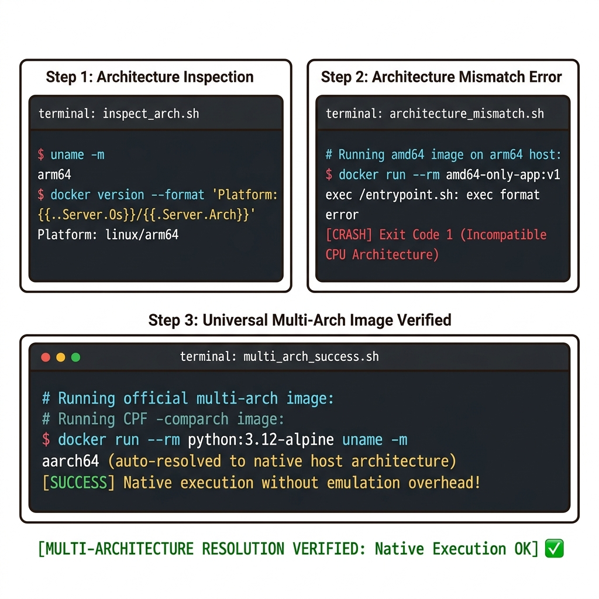
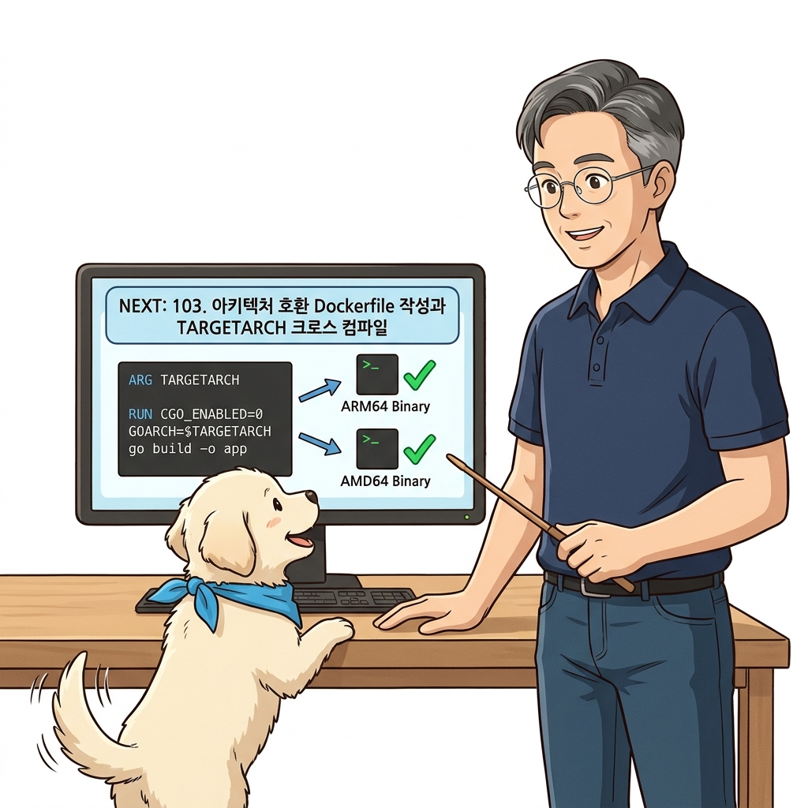

# 102. 다중아키텍처 Multi Arch 이미지가 필수인 이유

CPU 아키텍처(**`linux/amd64` x86-64 vs `linux/arm64` aarch64 vs `linux/arm/v7`**)의 차이로 인해 발생하는 악명 높은 `exec user process caused: exec format error`의 원인을 규명합니다.


**그림 07-7-1** 다중아키텍처 Multi Arch 이미지가 필수인 이유의 필요성과 현대 클라우드 아키텍처 관점의 개요

---

### 102.1 왜 다중아키텍처 Multi Arch 이미지가 필수인 이유이(가) 필요한가? (문제 정의와 현실적 배경)

소프트웨어 시스템이 복잡해질수록 설정을 다루는 방식은 전체 인프라의 신뢰성을 결정짓는 핵심 척도가 됩니다. **다중아키텍처 Multi Arch 이미지가 필수인 이유**이(가) 부재하거나 잘못 다루어질 때 현장에서는 다음과 같은 대표적인 병목과 장애가 발생합니다:

1. **하드코딩된 설정과 환경 불일치로 인한 유연성 상실**: 환경이 바뀔 때마다 코드를 다시 빌드해야 하므로 배포 주기가 지연되고 이미지 수가 기하급수적으로 폭증합니다.
2. **보안 민감 데이터의 무분별한 노출**: 비밀번호, 데이터베이스 토큰, 암호화 키가 이미지 레이어에 영구 박제되어 형상관리 시스템이나 외부에 유출될 위험이 커집니다.
3. **재현 불가능한 구성 드리프트**: 스테이징 환경과 프로덕션 환경의 미세한 설정 차이가 예기치 못한 서비스 중단 사고로 직결됩니다.


**그림 07-7-2** 다중아키텍처 Multi Arch 이미지가 필수인 이유에 대한 대표적인 오해와 실제 프로덕션 현장의 엔지니어링 진실

---

### 102.2 핵심 아키텍처와 엔지니어링 메커니즘

동일한 이미지 태그(예: `python:3.12-alpine`) 하나로 인텔 클라우드 서버, Apple Silicon Mac, 라즈베리 파이 5 어디서나 투명하게 실행될 수 있는 **다중 아키텍처(Multi-Architecture) 컨테이너**의 필요성을 정립합니다.


**그림 07-7-3** 다중아키텍처 Multi Arch 이미지가 필수인 이유의 내부 아키텍처 및 데이터 흐름

#### 📊 핵심 비교 및 엔지니어링 표준 분석

| 구분 / 핵심 원리 | 상세 설명 및 동작 메커니즘 | 실무 적용 시 주의점 및 베스트 프랙티스 |
| :--- | :--- | :--- |
| **`exec format error`의 정체** | 컴파일된 기계어 바이너리가 현재 호스트 CPU의 명령어 셋(x86 vs ARM)과 맞지 않아 운영체제 커널이 프로세스를 깨우지 못하는 치명적 에러 | 개발자 노트북(Apple Silicon ARM64)과 배포 서버(Intel AMD64)가 다를 때 가장 빈번하게 발생! |
| **ARM64 서버의 대세화** | AWS Graviton, Google Tau T2A, Azure Ampere, 라즈베리 파이 5 등 클라우드 시장에서 가성비와 전력 효율이 뛰어난 ARM64 프로세서 점유율 급증 | 모든 상용 이미지는 반드시 `amd64`와 `arm64`를 동시에 지원해야 하는 시대 도래! |
| **다중 아키텍처의 마법** | 사용자는 아키텍처를 고민할 필요 없이 `docker run my-app:1.0`만 치면 도커 엔진이 자신의 CPU에 맞는 변종 이미지를 알아서 선택 | 이 마법을 가능하게 하는 기술을 다음 강의에서 배웁니다! |

---

### 102.3 선언적 실습 및 아키텍처 다이어그램

본 실습은 외부 비공개 패키지에 의존하지 않고, 공식 표준 이미지를 기반으로 즉시 재현 가능한 살아있는 코드로 구성되어 있습니다.

```bash
# 현재 호스트의 CPU 아키텍처와 도커 엔진의 기본 빌드 아키텍처 확인
echo "[Host CPU Architecture]   : $(uname -m)"
docker version --format '[Docker Engine Platform] : {{.Server.Os}}/{{.Server.Arch}}'
```

#### 🔍 아키텍처 흐름도 (Mermaid Diagram)




**그림 07-7-4** 선언적 인프라 명세를 통한 다중아키텍처 Multi Arch 이미지가 필수인 이유 검증 파이프라인

---

### 102.4 핵심 정리: 캐릭터 대화와 3대 교훈

> 👧 **도로시**: "교수님! **다중아키텍처 Multi Arch 이미지가 필수인 이유**의 원리를 배우니까, 복잡하게 얽혀 있던 인프라 설정이 레고 블록처럼 질서정연하게 제자리를 찾는 게 보여요!"
> 
> 🐱 **조교 지니**: "야옹~ 맞습니다! 특히 런타임 환경과 불변 인프라의 경계를 명확히 지키는 것이 대규모 클라우드 운영의 제1원칙이랍니다!"
> 
> 🐶 **토토**: "멍멍! 선언적 코드로 한 번 적어두면 언제든 똑같이 복원되니까 정말 든든해요!"
> 
> 👨‍🏫 **이호진 교수님**: "훌륭하구나. 원리를 깊이 이해하고 실습을 통해 손에 익히는 것이 훌륭한 클라우드 엔지니어로 성장하는 가장 빠른 지름길이란다."


**그림 07-7-5** 다중아키텍처 Multi Arch 이미지가 필수인 이유 마스터를 위한 3대 핵심 교훈

1. **설정과 실행의 명확한 분리**:
   * 애플리케이션 코드는 불변으로 유지하고, 가변적인 설정값은 외부에서 주입하여 이식성을 극대화합니다.
2. **선언적 재현성 확보**:
   * 사람이 수작업으로 변경하지 않고 코드 명세를 통해 언제 어디서나 100% 동일한 실행 결과를 보장합니다.
3. **최소 권한 및 보안 모범 사례 준수**:
   * 불필요한 권한과 포트 노출을 최소화하고 민감 데이터를 암호화하여 프로덕션 안정성을 담보합니다.

---

### 102.5 랩노트 피날레와 다음 강의 예고


**그림 07-7-6** 연구실에서 다음 마일스톤인 [아키텍처호환 Dockerfile 작성과 TARGETARCH 크로스컴파일] 실습을 예고하는 교수님과 토토

> 💡 **다음 강의 안내**:
> [아키텍처호환 Dockerfile 작성과 TARGETARCH 크로스컴파일](../103_아키텍처호환_Dockerfile_작성과_TARGETARCH_크로스컴파일/)에서는 더욱 심화된 실전 엔지니어링 실습과 아키텍처를 다룹니다!

---

## 🧭 강의 네비게이션
* [◀️ 이전 강의: 101_도커리소스_접근모델과_역할기반권한_이미지서명검증](../101_도커리소스_접근모델과_역할기반권한_이미지서명검증/)
* [📋 Part 07. 보안 원격 접근(TLS/SSH Context), 다중 아키텍처 이미지(Buildx) & 이미지 최적화 (096 ~ 111) 목차로 돌아가기](../)
* [▶️ 다음 강의: 103_아키텍처호환_Dockerfile_작성과_TARGETARCH_크로스컴파일](../103_아키텍처호환_Dockerfile_작성과_TARGETARCH_크로스컴파일/)
