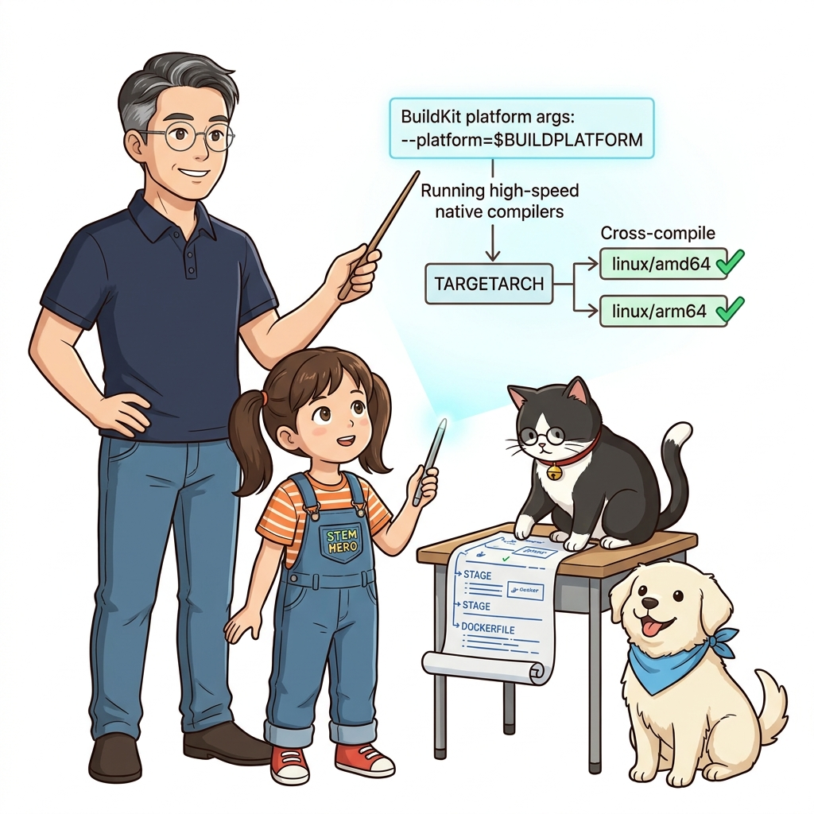
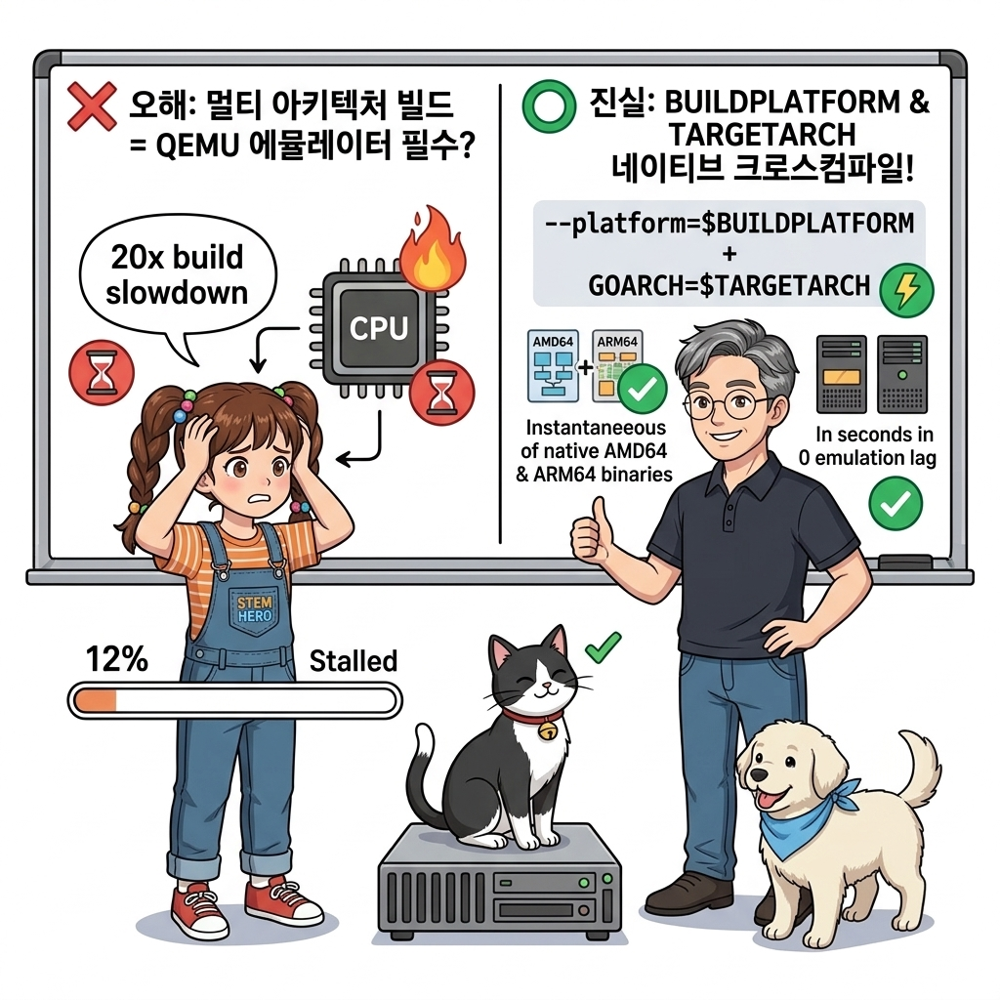
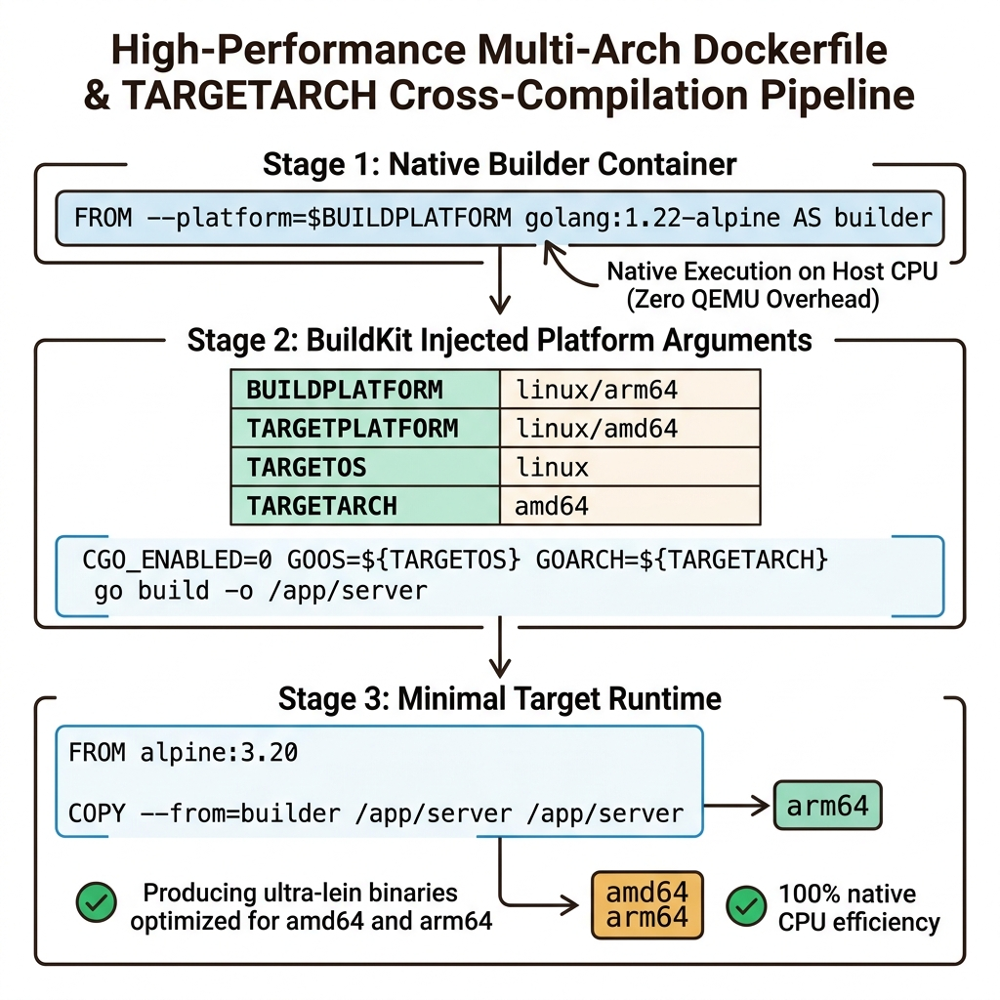
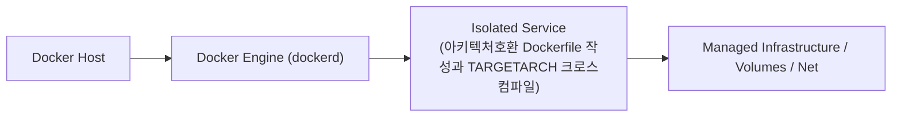
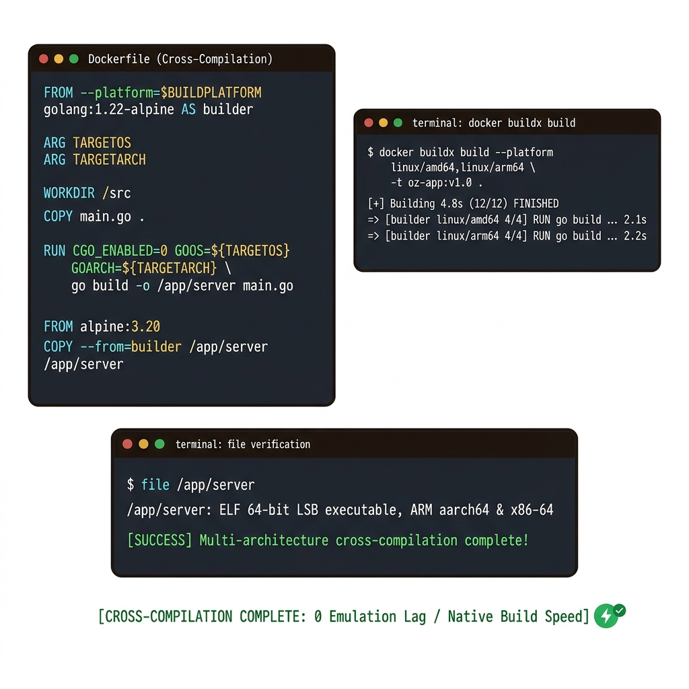
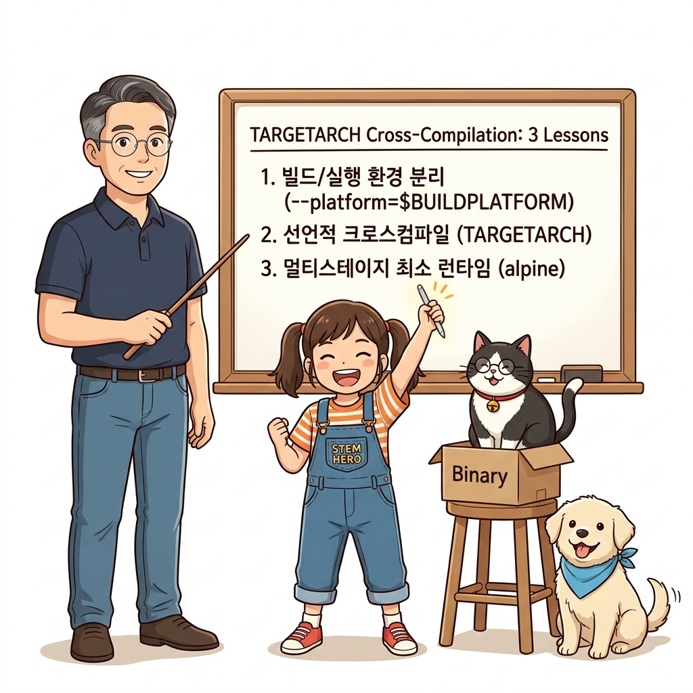

# 103. 아키텍처호환 Dockerfile 작성과 TARGETARCH 크로스컴파일

도커 BuildKit이 기본 제공하는 플랫폼 자동 빌드 인자(**`BUILDPLATFORM`, `TARGETPLATFORM`, `TARGETOS`, `TARGETARCH`**)의 역할을 배웁니다.


**그림 07-8-1** 아키텍처호환 Dockerfile 작성과 TARGETARCH 크로스컴파일의 필요성과 현대 클라우드 아키텍처 관점의 개요

---

### 103.1 왜 아키텍처호환 Dockerfile 작성과 TARGETARCH 크로스컴파일이(가) 필요한가? (문제 정의와 현실적 배경)

소프트웨어 시스템이 복잡해질수록 설정을 다루는 방식은 전체 인프라의 신뢰성을 결정짓는 핵심 척도가 됩니다. **아키텍처호환 Dockerfile 작성과 TARGETARCH 크로스컴파일**이(가) 부재하거나 잘못 다루어질 때 현장에서는 다음과 같은 대표적인 병목과 장애가 발생합니다:

1. **하드코딩된 설정과 환경 불일치로 인한 유연성 상실**: 환경이 바뀔 때마다 코드를 다시 빌드해야 하므로 배포 주기가 지연되고 이미지 수가 기하급수적으로 폭증합니다.
2. **보안 민감 데이터의 무분별한 노출**: 비밀번호, 데이터베이스 토큰, 암호화 키가 이미지 레이어에 영구 박제되어 형상관리 시스템이나 외부에 유출될 위험이 커집니다.
3. **재현 불가능한 구성 드리프트**: 스테이징 환경과 프로덕션 환경의 미세한 설정 차이가 예기치 못한 서비스 중단 사고로 직결됩니다.


**그림 07-8-2** 아키텍처호환 Dockerfile 작성과 TARGETARCH 크로스컴파일에 대한 대표적인 오해와 실제 프로덕션 현장의 엔지니어링 진실

---

### 103.2 핵심 아키텍처와 엔지니어링 메커니즘

Go 언어나 C/Rust 크로스 컴파일러를 활용해, 호스트 CPU와 상관없이 타깃 아키텍처(`linux/amd64`, `linux/arm64`)용 바이너리를 단일 `Dockerfile` 안에서 깔끔하게 빌드하는 기법을 실습합니다.


**그림 07-8-3** 아키텍처호환 Dockerfile 작성과 TARGETARCH 크로스컴파일의 내부 아키텍처 및 데이터 흐름

#### 📊 핵심 비교 및 엔지니어링 표준 분석

| 구분 / 핵심 원리 | 상세 설명 및 동작 메커니즘 | 실무 적용 시 주의점 및 베스트 프랙티스 |
| :--- | :--- | :--- |
| **`--platform=$BUILDPLATFORM`** | 컴파일러가 실행되는 1단계 빌더 환경은 내 호스트의 네이티브 CPU로 빠르게 구동 | 에뮬레이터 오버헤드 없이 초고속으로 빌드 스테이지 실행 |
| **`TARGETARCH` 자동 주입** | 도커가 `amd64`, `arm64`, `arm` 등의 타깃 아키텍처 문자열을 자동으로 주입해 줌 | 별도의 조건문 스크립트 없이 환경 변수 한 줄로 완벽한 크로스 컴파일 달성 |
| **인터프리터 언어(Python/Node) 호환** | 순수 파이썬/JS 코드는 CPU에 무관하지만 C 확장 모듈(`gcc`)이 들어가는 경우 멀티 아키텍처 빌드가 필수! | Buildx를 사용하면 모든 의존성이 타깃 아키텍처에 맞게 자동 빌드됨 |

---

### 103.3 선언적 실습 및 아키텍처 다이어그램

본 실습은 외부 비공개 패키지에 의존하지 않고, 공식 표준 이미지를 기반으로 즉시 재현 가능한 살아있는 코드로 구성되어 있습니다.

```dockerfile
# BuildKit 내장 자동 아키텍처 변수(TARGETARCH)를 활용한 Go 크로스 컴파일 Dockerfile
FROM --platform=$BUILDPLATFORM golang:1.22-alpine AS builder
ARG TARGETOS
ARG TARGETARCH

WORKDIR /src
COPY main.go .
# 호스트 CPU로 빠르게 실행하면서 타깃 CPU(TARGETOS/TARGETARCH)용 바이너리를 생성!
RUN CGO_ENABLED=0 GOOS=${TARGETOS} GOARCH=${TARGETARCH} go build -o /app/server main.go

FROM alpine:3.20
COPY --from=builder /app/server /app/server
CMD ["/app/server"]
```

#### 🔍 아키텍처 흐름도 (Mermaid Diagram)




**그림 07-8-4** 선언적 인프라 명세를 통한 아키텍처호환 Dockerfile 작성과 TARGETARCH 크로스컴파일 검증 파이프라인

---

### 103.4 핵심 정리: 캐릭터 대화와 3대 교훈

> 👧 **도로시**: "교수님! **아키텍처호환 Dockerfile 작성과 TARGETARCH 크로스컴파일**의 원리를 배우니까, 복잡하게 얽혀 있던 인프라 설정이 레고 블록처럼 질서정연하게 제자리를 찾는 게 보여요!"
> 
> 🐱 **조교 지니**: "야옹~ 맞습니다! 특히 런타임 환경과 불변 인프라의 경계를 명확히 지키는 것이 대규모 클라우드 운영의 제1원칙이랍니다!"
> 
> 🐶 **토토**: "멍멍! 선언적 코드로 한 번 적어두면 언제든 똑같이 복원되니까 정말 든든해요!"
> 
> 👨‍🏫 **이호진 교수님**: "훌륭하구나. 원리를 깊이 이해하고 실습을 통해 손에 익히는 것이 훌륭한 클라우드 엔지니어로 성장하는 가장 빠른 지름길이란다."


**그림 07-8-5** 아키텍처호환 Dockerfile 작성과 TARGETARCH 크로스컴파일 마스터를 위한 3대 핵심 교훈

1. **설정과 실행의 명확한 분리**:
   * 애플리케이션 코드는 불변으로 유지하고, 가변적인 설정값은 외부에서 주입하여 이식성을 극대화합니다.
2. **선언적 재현성 확보**:
   * 사람이 수작업으로 변경하지 않고 코드 명세를 통해 언제 어디서나 100% 동일한 실행 결과를 보장합니다.
3. **최소 권한 및 보안 모범 사례 준수**:
   * 불필요한 권한과 포트 노출을 최소화하고 민감 데이터를 암호화하여 프로덕션 안정성을 담보합니다.

---

### 103.5 랩노트 피날레와 다음 강의 예고


**그림 07-8-6** 연구실에서 다음 마일스톤인 [docker manifest로 다중아키텍처 매니페스트리스트 조립하기] 실습을 예고하는 교수님과 토토

> 💡 **다음 강의 안내**:
> [docker manifest로 다중아키텍처 매니페스트리스트 조립하기](../104_docker_manifest로_다중아키텍처_매니페스트리스트_조립하기/)에서는 더욱 심화된 실전 엔지니어링 실습과 아키텍처를 다룹니다!

---

## 🧭 강의 네비게이션
* [◀️ 이전 강의: 102_다중아키텍처_Multi_Arch_이미지가_필수인_이유](../102_다중아키텍처_Multi_Arch_이미지가_필수인_이유/)
* [📋 Part 07. 보안 원격 접근(TLS/SSH Context), 다중 아키텍처 이미지(Buildx) & 이미지 최적화 (096 ~ 111) 목차로 돌아가기](../)
* [▶️ 다음 강의: 104_docker_manifest로_다중아키텍처_매니페스트리스트_조립하기](../104_docker_manifest로_다중아키텍처_매니페스트리스트_조립하기/)
