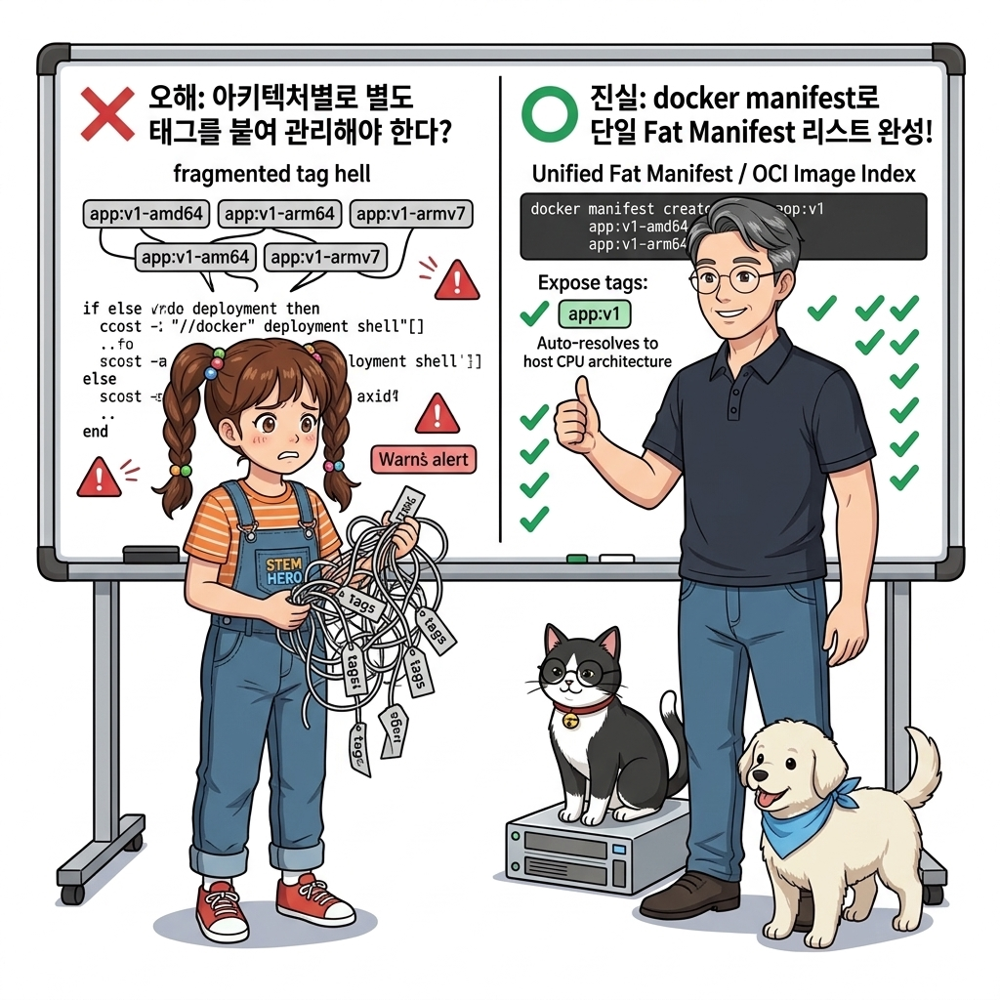
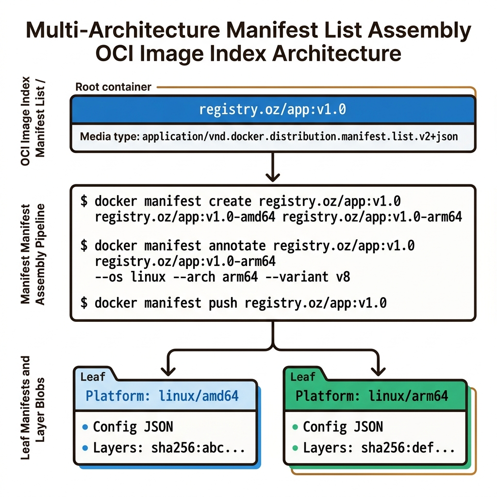
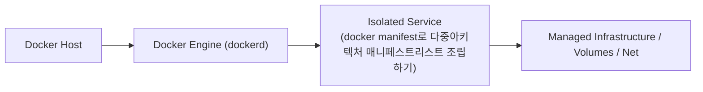
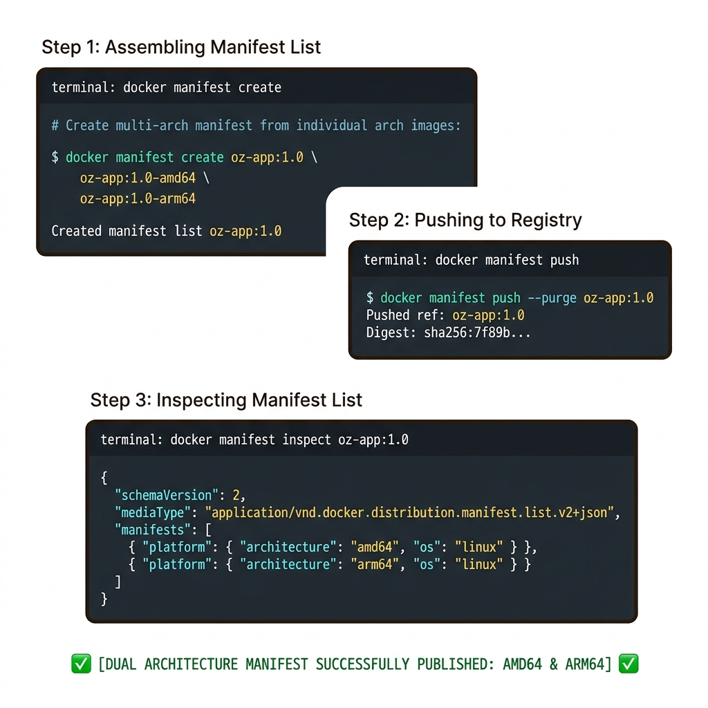
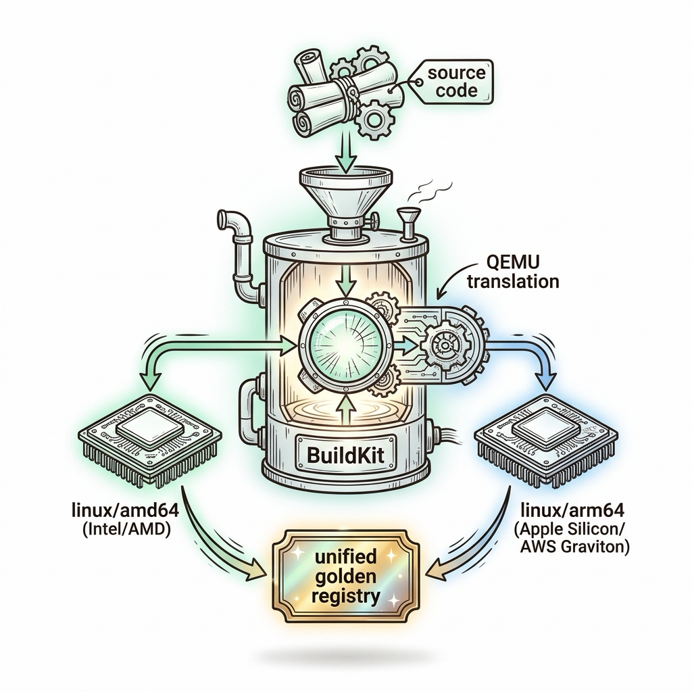

# 104. docker manifest로 다중아키텍처 매니페스트리스트 조립하기

도커 레지스트리에서 다중 아키텍처 이미지를 표현하는 표준 규격인 **OCI 매니페스트 리스트(Manifest List / Fat Manifest)**의 구조를 해부합니다.


**그림 07-9-1** docker manifest로 다중아키텍처 매니페스트리스트 조립하기의 필요성과 현대 클라우드 아키텍처 관점의 개요

---

### 104.1 왜 docker manifest로 다중아키텍처 매니페스트리스트 조립하기이(가) 필요한가? (문제 정의와 현실적 배경)

소프트웨어 시스템이 복잡해질수록 설정을 다루는 방식은 전체 인프라의 신뢰성을 결정짓는 핵심 척도가 됩니다. **docker manifest로 다중아키텍처 매니페스트리스트 조립하기**이(가) 부재하거나 잘못 다루어질 때 현장에서는 다음과 같은 대표적인 병목과 장애가 발생합니다:

1. **하드코딩된 설정과 환경 불일치로 인한 유연성 상실**: 환경이 바뀔 때마다 코드를 다시 빌드해야 하므로 배포 주기가 지연되고 이미지 수가 기하급수적으로 폭증합니다.
2. **보안 민감 데이터의 무분별한 노출**: 비밀번호, 데이터베이스 토큰, 암호화 키가 이미지 레이어에 영구 박제되어 형상관리 시스템이나 외부에 유출될 위험이 커집니다.
3. **재현 불가능한 구성 드리프트**: 스테이징 환경과 프로덕션 환경의 미세한 설정 차이가 예기치 못한 서비스 중단 사고로 직결됩니다.


**그림 07-9-2** docker manifest로 다중아키텍처 매니페스트리스트 조립하기에 대한 대표적인 오해와 실제 프로덕션 현장의 엔지니어링 진실

---

### 104.2 핵심 아키텍처와 엔지니어링 메커니즘

`docker manifest create`로 여러 CPU용 개별 이미지들을 하나의 대표 태그로 묶고, `docker manifest annotate`로 아키텍처 메타데이터를 부여한 뒤 `push`하는 저수준 원리를 배웁니다.


**그림 07-9-3** docker manifest로 다중아키텍처 매니페스트리스트 조립하기의 내부 아키텍처 및 데이터 흐름

#### 📊 핵심 비교 및 엔지니어링 표준 분석

| 구분 / 핵심 원리 | 상세 설명 및 동작 메커니즘 | 실무 적용 시 주의점 및 베스트 프랙티스 |
| :--- | :--- | :--- |
| **매니페스트 리스트 (Fat Manifest)** | 실제 파일 레이어를 직접 담는 대신, 각 아키텍처별 이미지들의 다이제스트 해시 목록을 담고 있는 얇은 목차 인덱스 파일 | 도커 클라이언트가 `pull` 요청 시 이 목차를 먼저 읽고 자기 CPU와 일치하는 하위 이미지만 골라서 다운로드! |
| **`docker manifest create` 문법** | `docker manifest create 대표태그 변종태그1 변종태그2` | 서로 다른 빌드 서버(인텔 서버 + ARM 맥북)에서 각각 빌드해 올린 뒤 매니페스트만 조립할 때 유용 |
| **현대적 통합 도구** | 수동으로 매니페스트를 만들 필요 없이 다음 강의의 **Docker Buildx**를 쓰면 빌드부터 매니페스트 생성 및 푸시까지 단 한 줄로 끝남! | 내부 원리를 이해했으니 이제 가장 편리한 Buildx 도구로 진화합니다 |

---

### 104.3 선언적 실습 및 아키텍처 다이어그램

본 실습은 외부 비공개 패키지에 의존하지 않고, 공식 표준 이미지를 기반으로 즉시 재현 가능한 살아있는 코드로 구성되어 있습니다.

```bash
# docker manifest 명령어로 멀티 아키텍처 이미지 조립 및 레지스트리 검사(inspect) 실습
# 공식 alpine 이미지의 매니페스트 리스트 구조 확인 (amd64, arm64, arm/v7, s390x, ppc64le 등 포함!)
docker manifest inspect alpine:3.20 | grep -E "architecture|os" | head -n 12
```

#### 🔍 아키텍처 흐름도 (Mermaid Diagram)




**그림 07-9-4** 선언적 인프라 명세를 통한 docker manifest로 다중아키텍처 매니페스트리스트 조립하기 검증 파이프라인

---

<!-- BIBLE_INTEGRATION_book7_deep_104 -->
---

### 104.C 📚 도커 바이블 심화: Buildx와 QEMU binfmt_misc를 활용한 크로스 플랫폼(x86_64 & ARM64) 멀티 아키텍처 빌드
*출처 도서: 『도커 교과서』 핵심 분석 (도커 교과서 제16장 (어디서든 실행할 수 있는 도커 이미지 만들기))*

Apple Silicon(M1/M2/M3, ARM64) Mac에서 빌드한 도커 이미지를 Intel/AMD(x86_64) 클라우드 서버에 배포했을 때 흔히 마주치는 치명적인 에러는 다음과 같습니다:
`standard_init_linux.go: exec user process caused: exec format error`

#### 다중 아키텍처 이미지의 구동 원리:
1. **OCI Image Index (매니페스트 리스트)**:
   * 동일한 이미지 태그(`mycorp/app:v1.0`) 아래에 서로 다른 CPU 아키텍처(linux/amd64, linux/arm64/v8)용 바이너리 매니페스트를 묶어둔 상위 메타데이터 규격입니다.
   * 클라이언트가 `docker pull`을 실행하면, 도커 데몬은 호스트 OS의 CPU 아키텍처를 자동 감지하여 자신의 CPU에 딱 맞는 레이어만 다운로드합니다.
2. **Docker Buildx와 QEMU binfmt_misc**:
   * 리눅스 커널의 `binfmt_misc` 모듈을 통해 서로 다른 CPU 아키텍처의 기계어 바이너리를 QEMU 에뮬레이터로 가상 변환하여 단일 Mac/PC에서 x86_64와 ARM64 이미지를 동시에 병렬 빌드합니다.


**그림 104-B-2** 단일 Buildx 파이프라인에서 QEMU를 거쳐 x86_64와 ARM64 듀얼 바이너리를 굽는 멀티 아키텍처 도식

```bash
# [실습] Buildx 인스턴스 생성 및 다중 아키텍처 동시 빌드/푸시
# 1. 멀티플랫폼 지원 buildx 빌더 인스턴스 생성
docker buildx create --name multi-builder --driver docker-container --use
docker buildx inspect --bootstrap

# 2. x86_64와 ARM64를 동시에 빌드하여 OCI 매니페스트로 배포
# docker buildx build --platform linux/amd64,linux/arm64 -t mycorp/multi-app:v1.0 --push .

# 3. 배포된 이미지의 매니페스트 리스트 다중 아키텍처 지원 검증
# docker buildx imagetools inspect mycorp/multi-app:v1.0
```

> 👨‍🏫 **이호진 교수님의 바이블 멘토링 노트**:
> "현대 클라우드는 AWS Graviton처럼 ARM 기반 인스턴스가 비용 대비 성능이 40% 이상 뛰어납니다. Mac에서 개발하고 클라우드에 배포할 때 Buildx 멀티 아키텍처 빌드는 선택이 아닌 필수 역량입니다."
>
> 👧 **도로시의 깨달음**:
> "사과 컴퓨터(ARM)에서도 팽귄 서버(x86)에서도 척척 돌아갈 수 있도록 두 가지 옷을 한 번에 지어주는 멋진 재단사(Buildx)네요!"
>
> 🐱 **조교 지니의 아키텍처 체크포인트**:
> "`--push` 플래그를 붙이지 않으면 멀티 아키텍처 이미지는 로컬 도커 엔진의 단일 플랫폼 이미지 스토리지에 저장될 수 없으므로 원격 레지스트리로 다이렉트 푸시해야 합니다."


### 104.4 핵심 정리: 캐릭터 대화와 3대 교훈

> 👧 **도로시**: "교수님! **docker manifest로 다중아키텍처 매니페스트리스트 조립하기**의 원리를 배우니까, 복잡하게 얽혀 있던 인프라 설정이 레고 블록처럼 질서정연하게 제자리를 찾는 게 보여요!"
> 
> 🐱 **조교 지니**: "야옹~ 맞습니다! 특히 런타임 환경과 불변 인프라의 경계를 명확히 지키는 것이 대규모 클라우드 운영의 제1원칙이랍니다!"
> 
> 🐶 **토토**: "멍멍! 선언적 코드로 한 번 적어두면 언제든 똑같이 복원되니까 정말 든든해요!"
> 
> 👨‍🏫 **이호진 교수님**: "훌륭하구나. 원리를 깊이 이해하고 실습을 통해 손에 익히는 것이 훌륭한 클라우드 엔지니어로 성장하는 가장 빠른 지름길이란다."


**그림 07-9-5** docker manifest로 다중아키텍처 매니페스트리스트 조립하기 마스터를 위한 3대 핵심 교훈

1. **설정과 실행의 명확한 분리**:
   * 애플리케이션 코드는 불변으로 유지하고, 가변적인 설정값은 외부에서 주입하여 이식성을 극대화합니다.
2. **선언적 재현성 확보**:
   * 사람이 수작업으로 변경하지 않고 코드 명세를 통해 언제 어디서나 100% 동일한 실행 결과를 보장합니다.
3. **최소 권한 및 보안 모범 사례 준수**:
   * 불필요한 권한과 포트 노출을 최소화하고 민감 데이터를 암호화하여 프로덕션 안정성을 담보합니다.

---

### 104.5 랩노트 피날레와 다음 강의 예고


**그림 07-9-6** 연구실에서 다음 마일스톤인 [Docker Buildx와 QEMU에뮬레이터 원스톱멀티아키텍처빌드] 실습을 예고하는 교수님과 토토

> 💡 **다음 강의 안내**:
> [Docker Buildx와 QEMU에뮬레이터 원스톱멀티아키텍처빌드](../105_Docker_Buildx와_QEMU에뮬레이터_원스톱멀티아키텍처빌드/)에서는 더욱 심화된 실전 엔지니어링 실습과 아키텍처를 다룹니다!

---

## 🧭 강의 네비게이션
* [◀️ 이전 강의: 103_아키텍처호환_Dockerfile_작성과_TARGETARCH_크로스컴파일](../103_아키텍처호환_Dockerfile_작성과_TARGETARCH_크로스컴파일/)
* [📋 Part 07. 보안 원격 접근(TLS/SSH Context), 다중 아키텍처 이미지(Buildx) & 이미지 최적화 (096 ~ 111) 목차로 돌아가기](../)
* [▶️ 다음 강의: 105_Docker_Buildx와_QEMU에뮬레이터_원스톱멀티아키텍처빌드](../105_Docker_Buildx와_QEMU에뮬레이터_원스톱멀티아키텍처빌드/)
