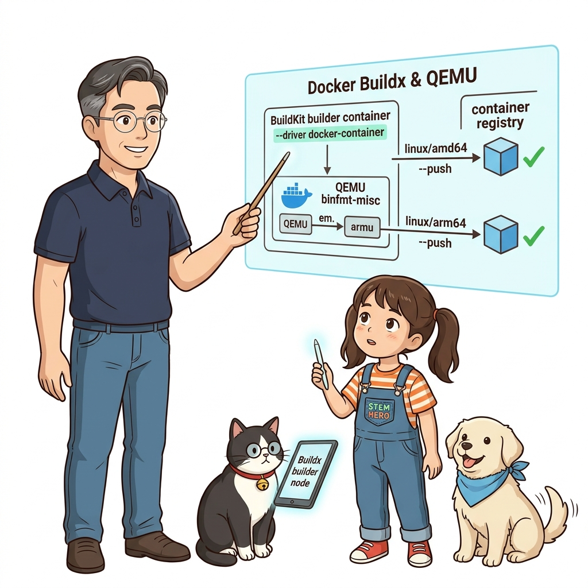
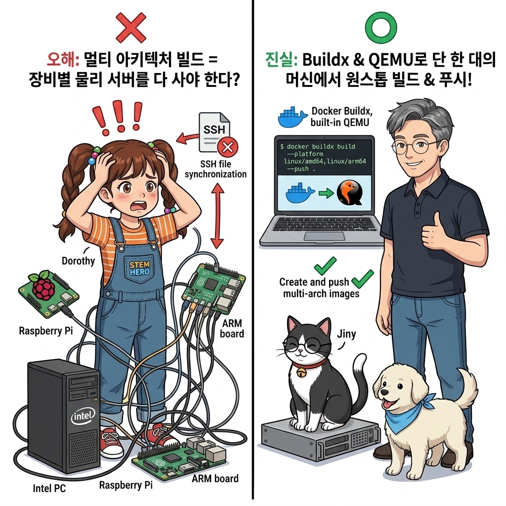
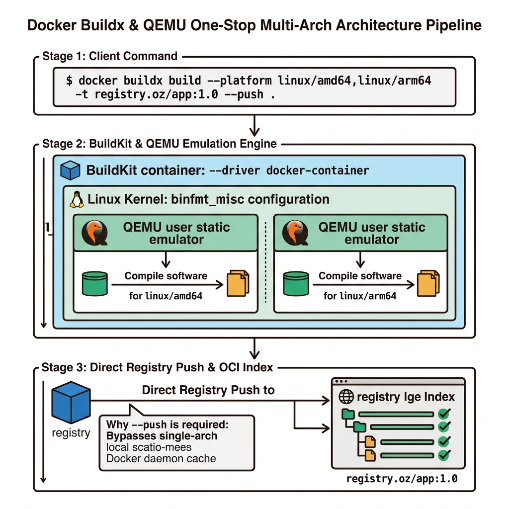
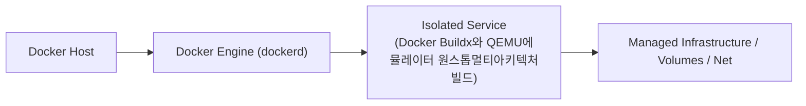
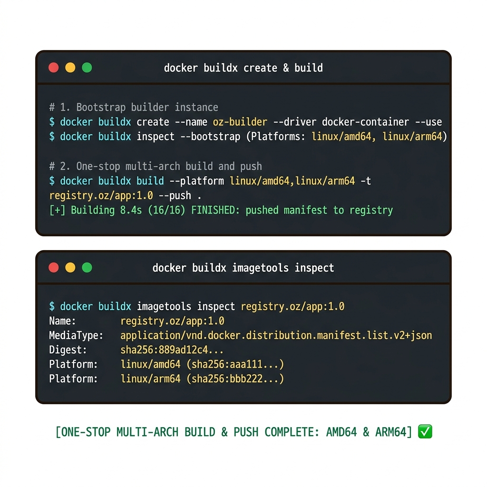
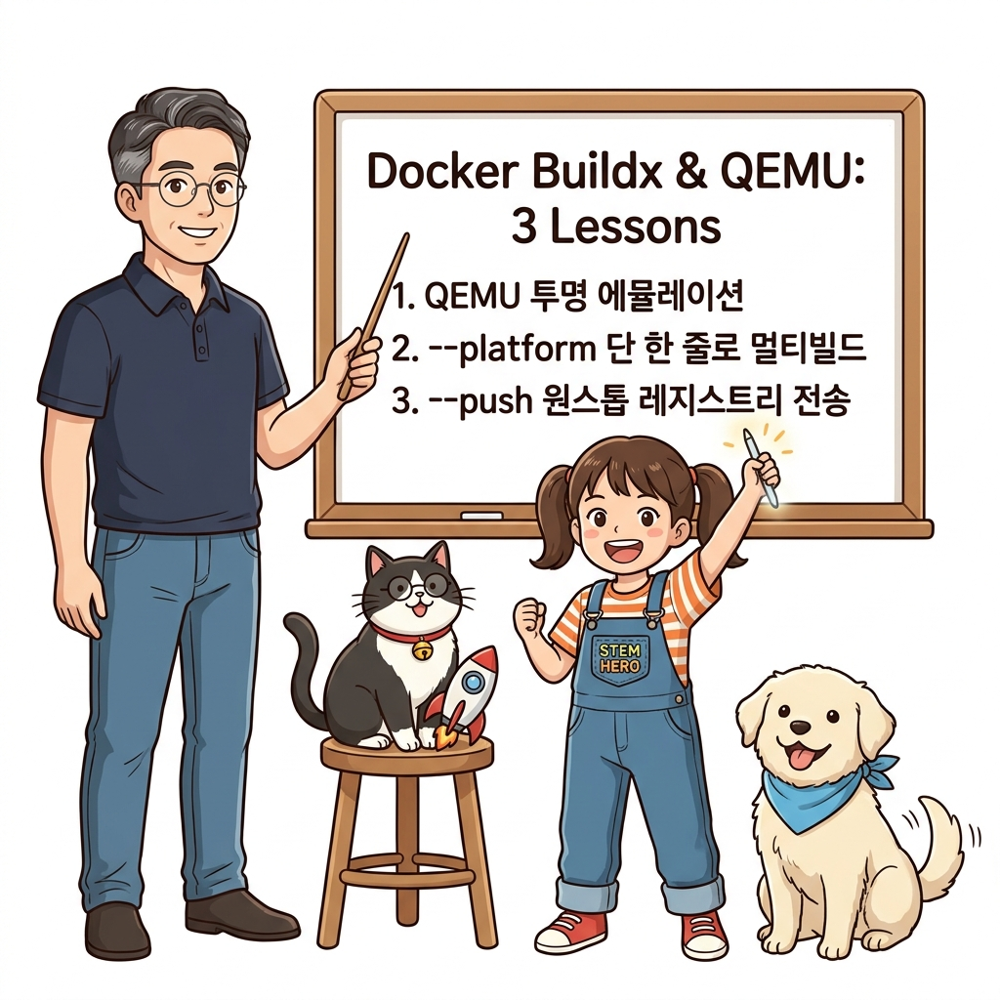
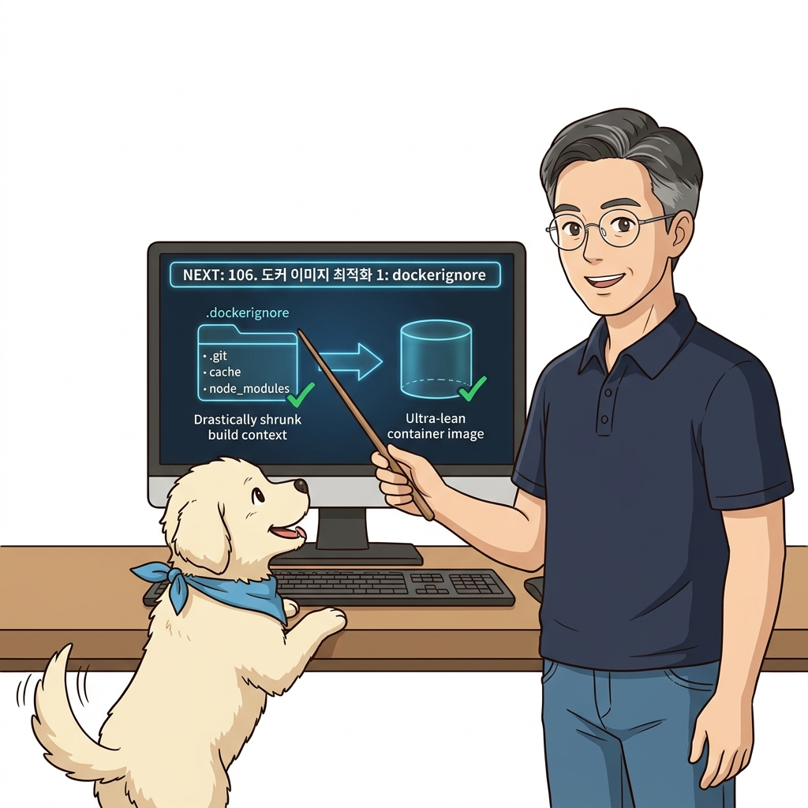

# 105. Docker Buildx와 QEMU에뮬레이터 원스톱멀티아키텍처빌드

도커 공식 차세대 빌드 툴킷인 **Docker Buildx**와 CPU 에뮬레이터 **QEMU**를 결합한 현대적 빌드 워크플로를 실습합니다.


**그림 07-10-1** Docker Buildx와 QEMU에뮬레이터 원스톱멀티아키텍처빌드의 필요성과 현대 클라우드 아키텍처 관점의 개요

---

### 105.1 왜 Docker Buildx와 QEMU에뮬레이터 원스톱멀티아키텍처빌드이(가) 필요한가? (문제 정의와 현실적 배경)

소프트웨어 시스템이 복잡해질수록 설정을 다루는 방식은 전체 인프라의 신뢰성을 결정짓는 핵심 척도가 됩니다. **Docker Buildx와 QEMU에뮬레이터 원스톱멀티아키텍처빌드**이(가) 부재하거나 잘못 다루어질 때 현장에서는 다음과 같은 대표적인 병목과 장애가 발생합니다:

1. **하드코딩된 설정과 환경 불일치로 인한 유연성 상실**: 환경이 바뀔 때마다 코드를 다시 빌드해야 하므로 배포 주기가 지연되고 이미지 수가 기하급수적으로 폭증합니다.
2. **보안 민감 데이터의 무분별한 노출**: 비밀번호, 데이터베이스 토큰, 암호화 키가 이미지 레이어에 영구 박제되어 형상관리 시스템이나 외부에 유출될 위험이 커집니다.
3. **재현 불가능한 구성 드리프트**: 스테이징 환경과 프로덕션 환경의 미세한 설정 차이가 예기치 못한 서비스 중단 사고로 직결됩니다.


**그림 07-10-2** Docker Buildx와 QEMU에뮬레이터 원스톱멀티아키텍처빌드에 대한 대표적인 오해와 실제 프로덕션 현장의 엔지니어링 진실

---

### 105.2 핵심 아키텍처와 엔지니어링 메커니즘

`docker buildx create --use`로 다중 플랫폼 빌더 인스턴스를 만들고, **`docker buildx build --platform linux/amd64,linux/arm64 -t 내계정/앱:1.0 --push .`** 단 한 줄로 모든 아키텍처용 이미지 빌드와 매니페스트 조립, 푸시를 원스톱 완료합니다!


**그림 07-10-3** Docker Buildx와 QEMU에뮬레이터 원스톱멀티아키텍처빌드의 내부 아키텍처 및 데이터 흐름

#### 📊 핵심 비교 및 엔지니어링 표준 분석

| 구분 / 핵심 원리 | 상세 설명 및 동작 메커니즘 | 실무 적용 시 주의점 및 베스트 프랙티스 |
| :--- | :--- | :--- |
| **Buildx의 QEMU 에뮬레이션** | 내 PC가 인텔 CPU여도 QEMU를 통해 내부적으로 ARM64 명령어를 가상 실행하여 바이너리 빌드 및 패키지 설치 가능 | 별도의 ARM 물리 서버 없이도 노트북 한 대에서 전 세계 모든 CPU용 이미지 제작! |
| **`--driver docker-container`** | 도커 데몬의 기본 빌더 대신 독립된 BuildKit 컨테이너 인스턴스를 띄워 고급 캐싱과 멀티 플랫폼 병렬 빌드를 수행 | 빌드 속도와 기능이 대폭 확장됨 |
| **`--push` 플래그의 이유** | 로컬 도커 엔진의 기본 이미지 저장소는 단일 아키텍처만 보관할 수 있으므로, 다중 플랫폼 빌드 결과는 직접 레지스트리로 바로 `--push`하거나 OCI tarball로 추출해야 함 | CI/CD 배포 파이프라인의 표준 빌드 명령 |

---

### 105.3 선언적 실습 및 아키텍처 다이어그램

본 실습은 외부 비공개 패키지에 의존하지 않고, 공식 표준 이미지를 기반으로 즉시 재현 가능한 살아있는 코드로 구성되어 있습니다.

```bash
# Docker Buildx 빌더 생성 및 다중 아키텍처 빌드 환경 확인
docker buildx create --name oz-builder --driver docker-container --use 2>/dev/null || docker buildx use oz-builder
docker buildx inspect --bootstrap | grep "Platforms:"

echo "실행 명령어: docker buildx build --platform linux/amd64,linux/arm64 -t my-repo/app:1.0 --push ." 
```

#### 🔍 아키텍처 흐름도 (Mermaid Diagram)




**그림 07-10-4** 선언적 인프라 명세를 통한 Docker Buildx와 QEMU에뮬레이터 원스톱멀티아키텍처빌드 검증 파이프라인

---

### 105.4 핵심 정리: 캐릭터 대화와 3대 교훈

> 👧 **도로시**: "교수님! **Docker Buildx와 QEMU에뮬레이터 원스톱멀티아키텍처빌드**의 원리를 배우니까, 복잡하게 얽혀 있던 인프라 설정이 레고 블록처럼 질서정연하게 제자리를 찾는 게 보여요!"
> 
> 🐱 **조교 지니**: "야옹~ 맞습니다! 특히 런타임 환경과 불변 인프라의 경계를 명확히 지키는 것이 대규모 클라우드 운영의 제1원칙이랍니다!"
> 
> 🐶 **토토**: "멍멍! 선언적 코드로 한 번 적어두면 언제든 똑같이 복원되니까 정말 든든해요!"
> 
> 👨‍🏫 **이호진 교수님**: "훌륭하구나. 원리를 깊이 이해하고 실습을 통해 손에 익히는 것이 훌륭한 클라우드 엔지니어로 성장하는 가장 빠른 지름길이란다."


**그림 07-10-5** Docker Buildx와 QEMU에뮬레이터 원스톱멀티아키텍처빌드 마스터를 위한 3대 핵심 교훈

1. **설정과 실행의 명확한 분리**:
   * 애플리케이션 코드는 불변으로 유지하고, 가변적인 설정값은 외부에서 주입하여 이식성을 극대화합니다.
2. **선언적 재현성 확보**:
   * 사람이 수작업으로 변경하지 않고 코드 명세를 통해 언제 어디서나 100% 동일한 실행 결과를 보장합니다.
3. **최소 권한 및 보안 모범 사례 준수**:
   * 불필요한 권한과 포트 노출을 최소화하고 민감 데이터를 암호화하여 프로덕션 안정성을 담보합니다.

---

### 105.5 랩노트 피날레와 다음 강의 예고


**그림 07-10-6** 연구실에서 다음 마일스톤인 [도커이미지 최적화1 dockerignore와 불필요한파일제거] 실습을 예고하는 교수님과 토토

> 💡 **다음 강의 안내**:
> [도커이미지 최적화1 dockerignore와 불필요한파일제거](../106_도커이미지_최적화1_dockerignore와_불필요한파일제거/)에서는 더욱 심화된 실전 엔지니어링 실습과 아키텍처를 다룹니다!

---

## 🧭 강의 네비게이션
* [◀️ 이전 강의: 104_docker_manifest로_다중아키텍처_매니페스트리스트_조립하기](../104_docker_manifest로_다중아키텍처_매니페스트리스트_조립하기/)
* [📋 Part 07. 보안 원격 접근(TLS/SSH Context), 다중 아키텍처 이미지(Buildx) & 이미지 최적화 (096 ~ 111) 목차로 돌아가기](../)
* [▶️ 다음 강의: 106_도커이미지_최적화1_dockerignore와_불필요한파일제거](../106_도커이미지_최적화1_dockerignore와_불필요한파일제거/)
