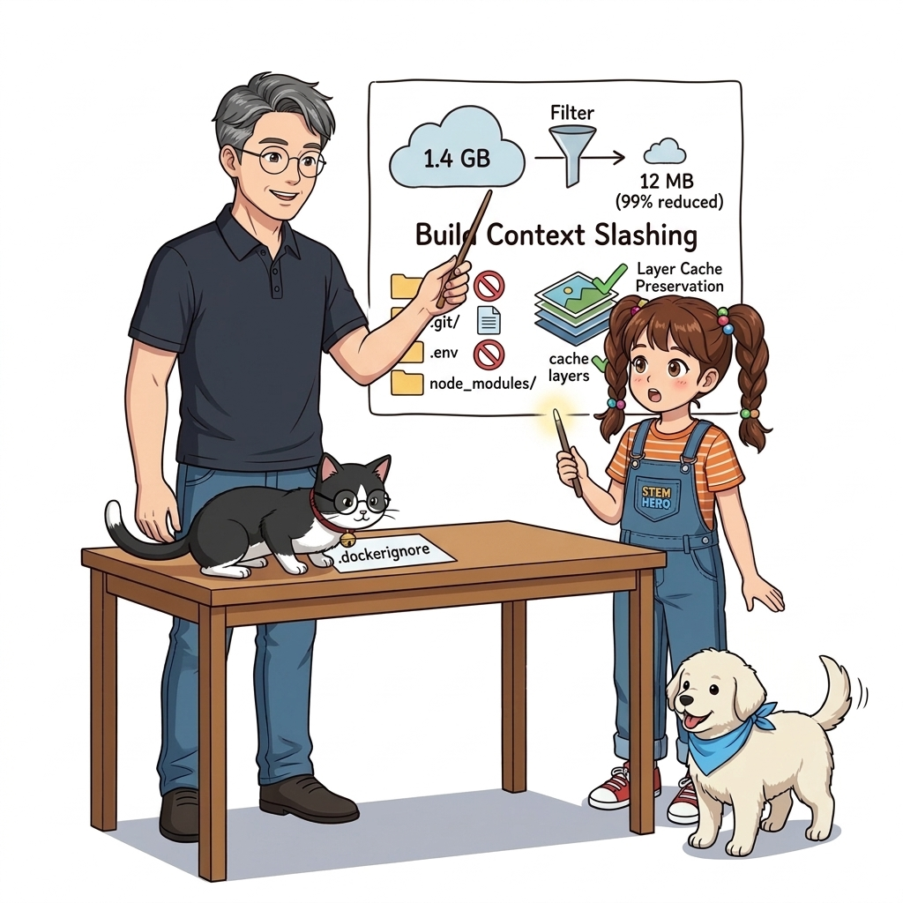
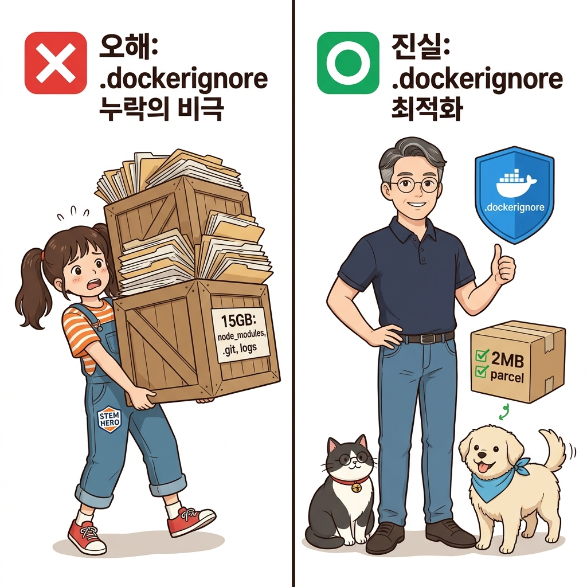
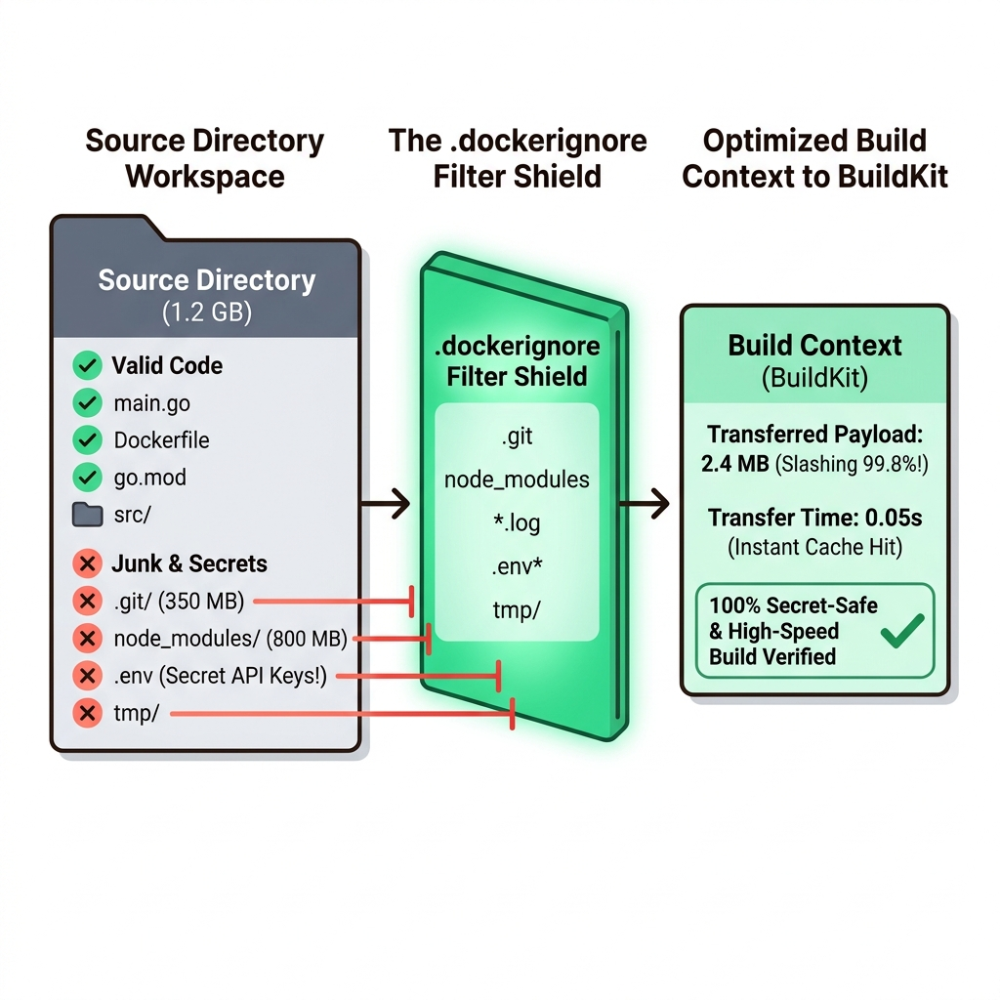
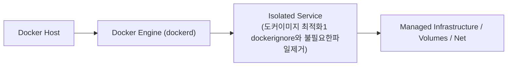
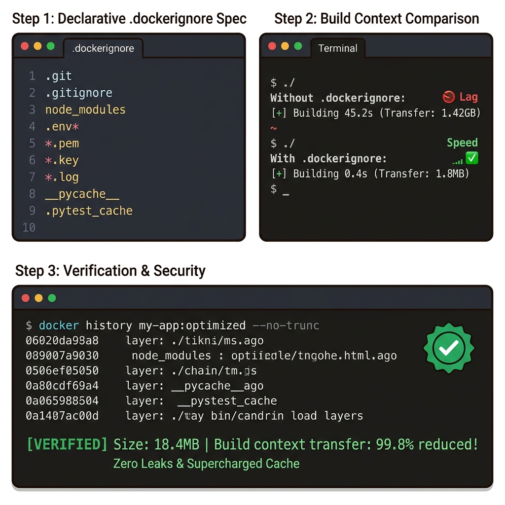
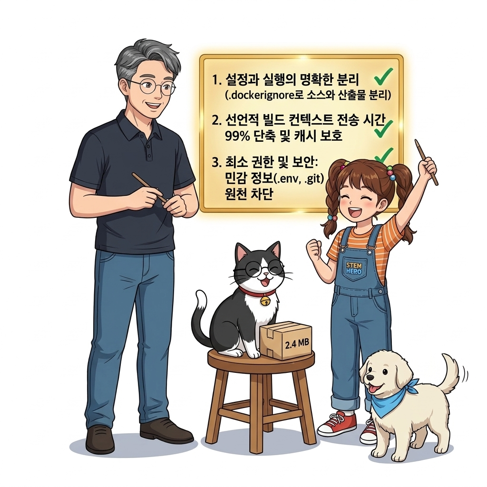
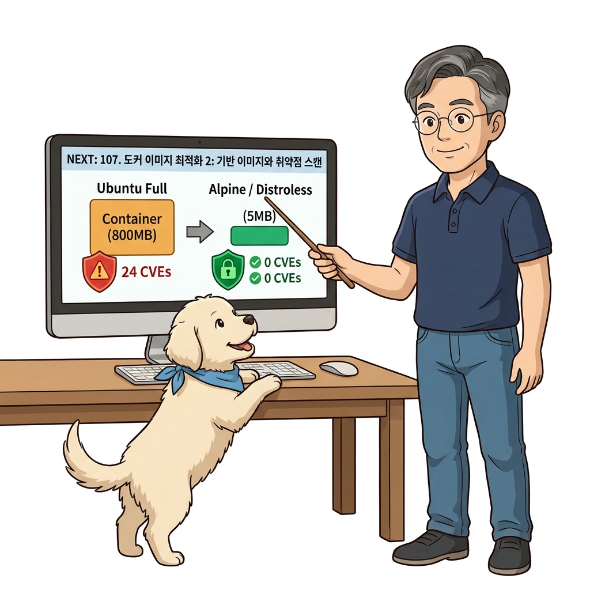

# 106. 도커이미지 최적화1 dockerignore와 불필요한파일제거

`docker build .`을 실행할 때 호스트 디렉터리에 있던 무거운 `.git` 폴더, 임시 로그, 로컬 `node_modules`, 가상환경(`.venv`), 테스트 비디오 등이 빌드 컨텍스트에 포함되어 데몬으로 전송되는 낭비를 분석합니다.


**그림 07-11-1** 도커이미지 최적화1 dockerignore와 불필요한파일제거의 필요성과 현대 클라우드 아키텍처 관점의 개요

---

### 106.1 왜 도커이미지 최적화1 dockerignore와 불필요한파일제거이(가) 필요한가? (문제 정의와 현실적 배경)

소프트웨어 시스템이 복잡해질수록 설정을 다루는 방식은 전체 인프라의 신뢰성을 결정짓는 핵심 척도가 됩니다. **도커이미지 최적화1 dockerignore와 불필요한파일제거**이(가) 부재하거나 잘못 다루어질 때 현장에서는 다음과 같은 대표적인 병목과 장애가 발생합니다:

1. **하드코딩된 설정과 환경 불일치로 인한 유연성 상실**: 환경이 바뀔 때마다 코드를 다시 빌드해야 하므로 배포 주기가 지연되고 이미지 수가 기하급수적으로 폭증합니다.
2. **보안 민감 데이터의 무분별한 노출**: 비밀번호, 데이터베이스 토큰, 암호화 키가 이미지 레이어에 영구 박제되어 형상관리 시스템이나 외부에 유출될 위험이 커집니다.
3. **재현 불가능한 구성 드리프트**: 스테이징 환경과 프로덕션 환경의 미세한 설정 차이가 예기치 못한 서비스 중단 사고로 직결됩니다.


**그림 07-11-2** 도커이미지 최적화1 dockerignore와 불필요한파일제거에 대한 대표적인 오해와 실제 프로덕션 현장의 엔지니어링 진실

---

### 106.2 핵심 아키텍처와 엔지니어링 메커니즘

Git의 `.gitignore`처럼 도커 빌드 시 절대 포함하지 않을 파일과 디렉터리를 제외하는 **`.dockerignore`** 파일의 작성 원칙과 모범 템플릿을 실습합니다.


**그림 07-11-3** 도커이미지 최적화1 dockerignore와 불필요한파일제거의 내부 아키텍처 및 데이터 흐름

#### 📊 핵심 비교 및 엔지니어링 표준 분석

| 구분 / 핵심 원리 | 상세 설명 및 동작 메커니즘 | 실무 적용 시 주의점 및 베스트 프랙티스 |
| :--- | :--- | :--- |
| **빌드 컨텍스트 전송 시간 단축** | 네트워크/소켓으로 수백 MB를 보내는 지연 시간을 0.1초로 단축 | 원격 도커 엔진이나 CI 환경에서 빌드 시작 대기 시간을 획기적으로 줄여줌 |
| **레이어 캐시 보호** | 소스 코드와 무관한 `.git/logs`나 로컬 임시 파일이 바뀌었다고 해서 `COPY . .` 줄의 캐시가 깨지는 참사를 예방! | 캐시 적중률(Hit Rate)을 극대화하는 필수 전제 조건 |
| **보안 민감 정보 유출 차단** | 로컬 테스트용 `.env` 파일, AWS 자격 증명 키, 개인키 파일이 실수로 이미지 레이어에 복사되어 도커 허브에 퍼지는 보안 사고 원천 차단 | 프로젝트 시작 시 가장 먼저 작성해야 할 파일 |

---

### 106.3 선언적 실습 및 아키텍처 다이어그램

본 실습은 외부 비공개 패키지에 의존하지 않고, 공식 표준 이미지를 기반으로 즉시 재현 가능한 살아있는 코드로 구성되어 있습니다.

```bash
# .dockerignore 파일이 빌드 컨텍스트 크기를 얼마나 줄여주는지 검증하는 실습
mkdir -p /tmp/oz-ignore-demo && cd /tmp/oz-ignore-demo
dd if=/dev/zero of=huge-dummy.log bs=1M count=20 2>/dev/null
echo "console.log('App Ready');" > app.js
cat << 'EOF' > .dockerignore
*.log
.git
node_modules
EOF

cat << 'EOF' > Dockerfile
FROM alpine:3.20
COPY . /app
CMD ["ls", "-la", "/app"]
EOF

# 빌드 시 20MB짜리 huge-dummy.log가 깔끔하게 제외되었는지 확인!
docker image build -t ignore-test .
docker container run --rm ignore-test
docker image rm ignore-test && rm -rf /tmp/oz-ignore-demo
```

#### 🔍 아키텍처 흐름도 (Mermaid Diagram)




**그림 07-11-4** 선언적 인프라 명세를 통한 도커이미지 최적화1 dockerignore와 불필요한파일제거 검증 파이프라인

---

### 106.4 핵심 정리: 캐릭터 대화와 3대 교훈

> 👧 **도로시**: "교수님! **도커이미지 최적화1 dockerignore와 불필요한파일제거**의 원리를 배우니까, 복잡하게 얽혀 있던 인프라 설정이 레고 블록처럼 질서정연하게 제자리를 찾는 게 보여요!"
> 
> 🐱 **조교 지니**: "야옹~ 맞습니다! 특히 런타임 환경과 불변 인프라의 경계를 명확히 지키는 것이 대규모 클라우드 운영의 제1원칙이랍니다!"
> 
> 🐶 **토토**: "멍멍! 선언적 코드로 한 번 적어두면 언제든 똑같이 복원되니까 정말 든든해요!"
> 
> 👨‍🏫 **이호진 교수님**: "훌륭하구나. 원리를 깊이 이해하고 실습을 통해 손에 익히는 것이 훌륭한 클라우드 엔지니어로 성장하는 가장 빠른 지름길이란다."


**그림 07-11-5** 도커이미지 최적화1 dockerignore와 불필요한파일제거 마스터를 위한 3대 핵심 교훈

1. **설정과 실행의 명확한 분리**:
   * 애플리케이션 코드는 불변으로 유지하고, 가변적인 설정값은 외부에서 주입하여 이식성을 극대화합니다.
2. **선언적 재현성 확보**:
   * 사람이 수작업으로 변경하지 않고 코드 명세를 통해 언제 어디서나 100% 동일한 실행 결과를 보장합니다.
3. **최소 권한 및 보안 모범 사례 준수**:
   * 불필요한 권한과 포트 노출을 최소화하고 민감 데이터를 암호화하여 프로덕션 안정성을 담보합니다.

---

### 106.5 랩노트 피날레와 다음 강의 예고


**그림 07-11-6** 연구실에서 다음 마일스톤인 [도커이미지 최적화2 최적의기반이미지 선택과 취약점스캔] 실습을 예고하는 교수님과 토토

> 💡 **다음 강의 안내**:
> [도커이미지 최적화2 최적의기반이미지 선택과 취약점스캔](../107_도커이미지_최적화2_최적의기반이미지_선택과_취약점스캔/)에서는 더욱 심화된 실전 엔지니어링 실습과 아키텍처를 다룹니다!

---

## 🧭 강의 네비게이션
* [◀️ 이전 강의: 105_Docker_Buildx와_QEMU에뮬레이터_원스톱멀티아키텍처빌드](../105_Docker_Buildx와_QEMU에뮬레이터_원스톱멀티아키텍처빌드/)
* [📋 Part 07. 보안 원격 접근(TLS/SSH Context), 다중 아키텍처 이미지(Buildx) & 이미지 최적화 (096 ~ 111) 목차로 돌아가기](../)
* [▶️ 다음 강의: 107_도커이미지_최적화2_최적의기반이미지_선택과_취약점스캔](../107_도커이미지_최적화2_최적의기반이미지_선택과_취약점스캔/)
