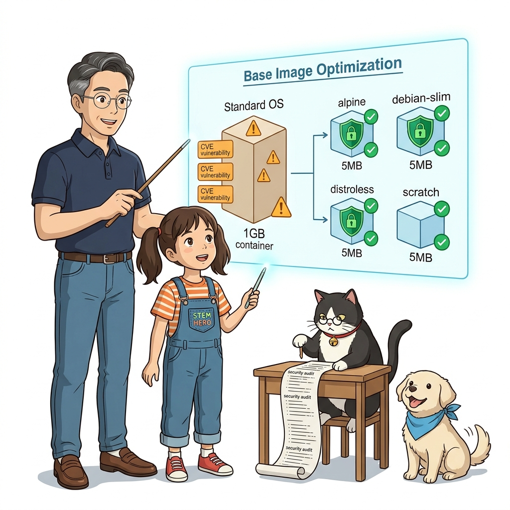
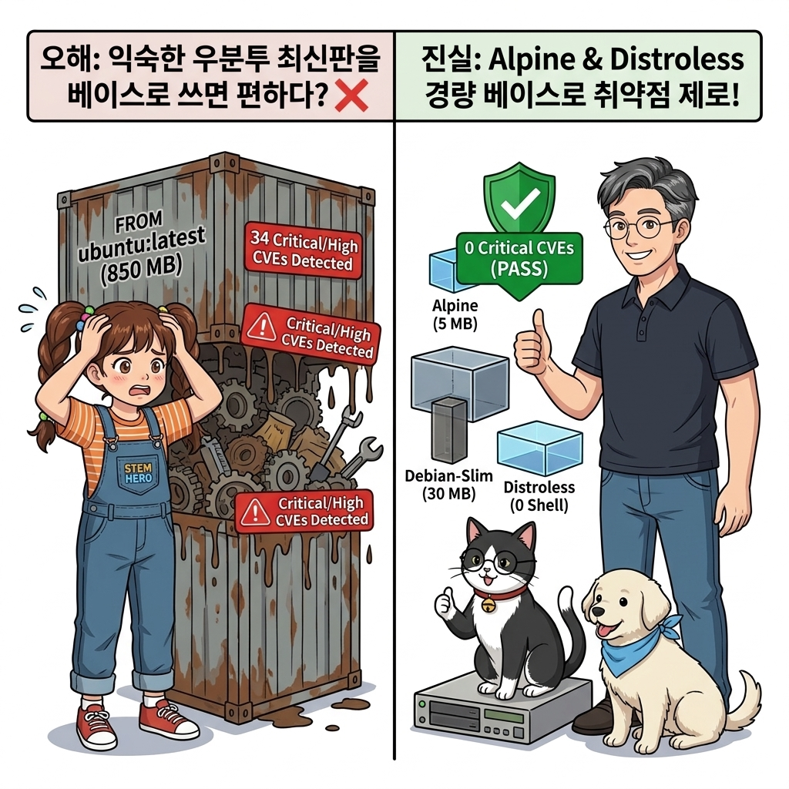
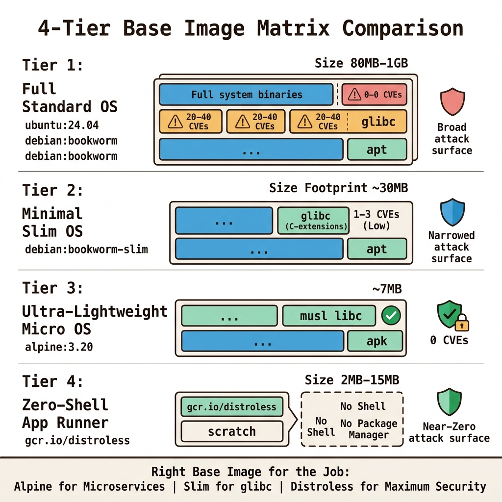
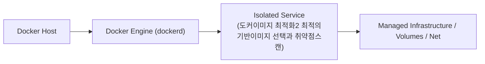
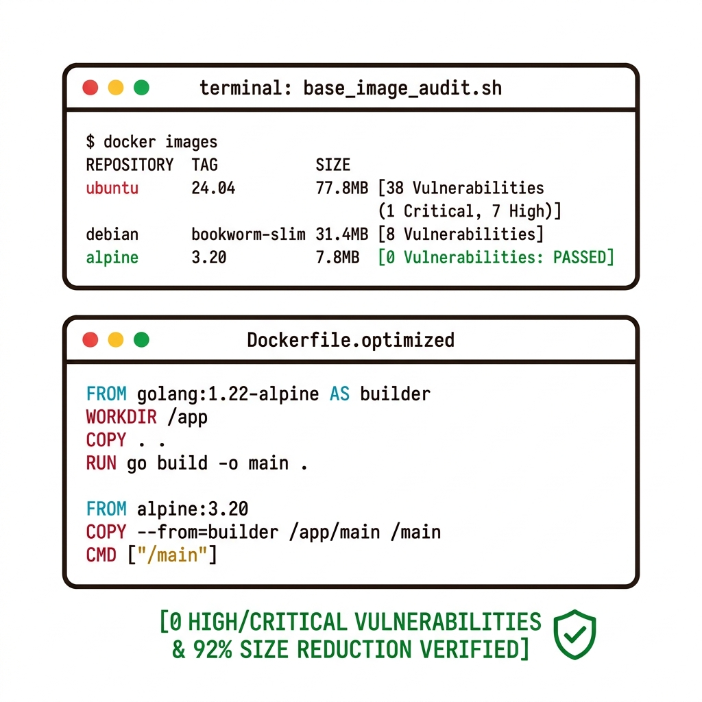
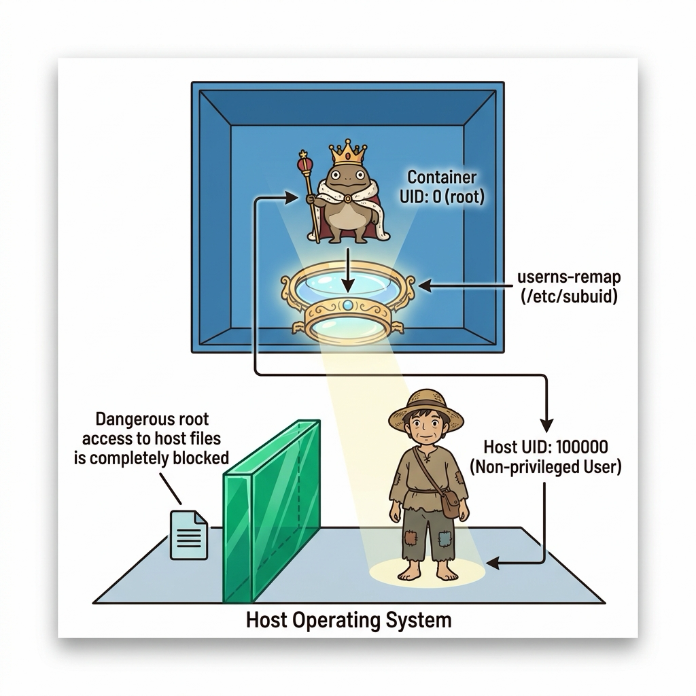
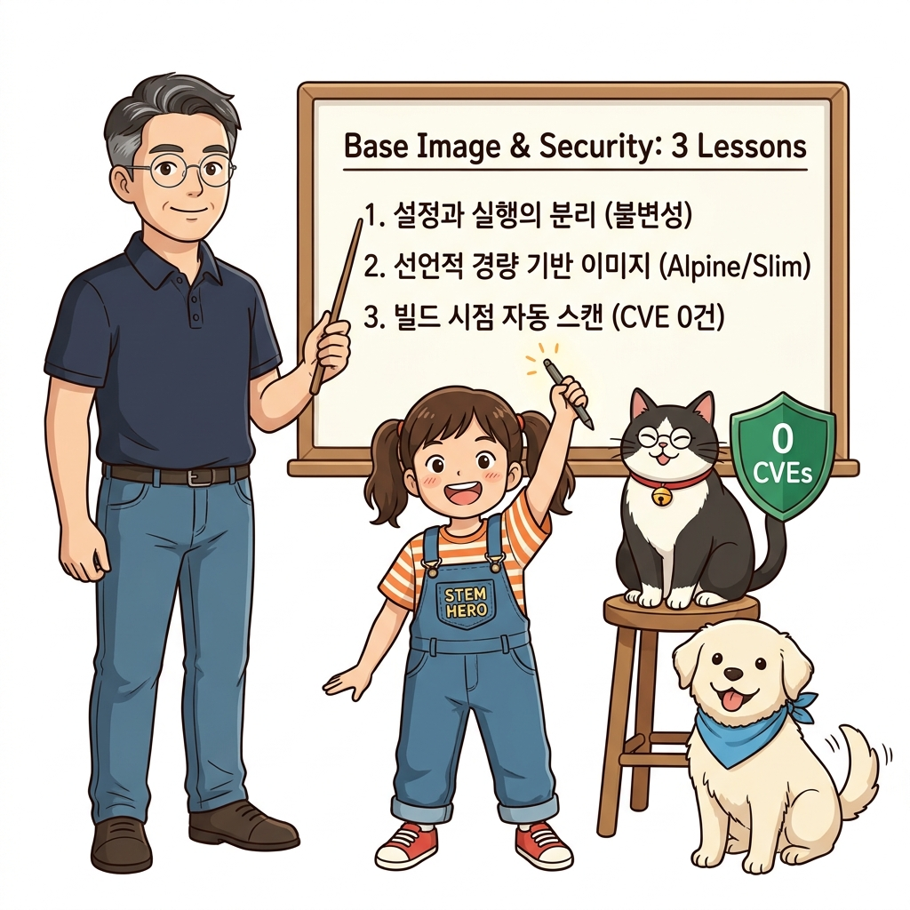
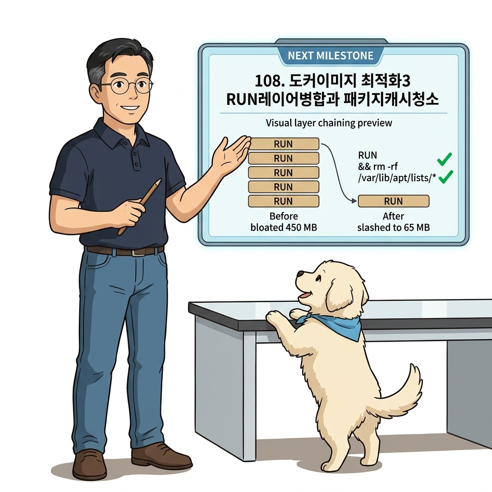

# 107. 도커이미지 최적화2 최적의기반이미지 선택과 취약점스캔

애플리케이션에 적합한 기반 이미지(Base Image)를 선택하는 기준을 비교합니다.


**그림 07-12-1** 도커이미지 최적화2 최적의기반이미지 선택과 취약점스캔의 필요성과 현대 클라우드 아키텍처 관점의 개요

---

### 107.1 왜 도커이미지 최적화2 최적의기반이미지 선택과 취약점스캔이(가) 필요한가? (문제 정의와 현실적 배경)

소프트웨어 시스템이 복잡해질수록 설정을 다루는 방식은 전체 인프라의 신뢰성을 결정짓는 핵심 척도가 됩니다. **도커이미지 최적화2 최적의기반이미지 선택과 취약점스캔**이(가) 부재하거나 잘못 다루어질 때 현장에서는 다음과 같은 대표적인 병목과 장애가 발생합니다:

1. **하드코딩된 설정과 환경 불일치로 인한 유연성 상실**: 환경이 바뀔 때마다 코드를 다시 빌드해야 하므로 배포 주기가 지연되고 이미지 수가 기하급수적으로 폭증합니다.
2. **보안 민감 데이터의 무분별한 노출**: 비밀번호, 데이터베이스 토큰, 암호화 키가 이미지 레이어에 영구 박제되어 형상관리 시스템이나 외부에 유출될 위험이 커집니다.
3. **재현 불가능한 구성 드리프트**: 스테이징 환경과 프로덕션 환경의 미세한 설정 차이가 예기치 못한 서비스 중단 사고로 직결됩니다.


**그림 07-12-2** 도커이미지 최적화2 최적의기반이미지 선택과 취약점스캔에 대한 대표적인 오해와 실제 프로덕션 현장의 엔지니어링 진실

---

### 107.2 핵심 아키텍처와 엔지니어링 메커니즘

알파인(`alpine`)의 초경량성과 musl libc 호환성 주의점, 데비안 슬림(`slim`)의 안정성, 그리고 구글의 런타임 전용 이미지 **Distroless**의 장단점을 평가하고, **`docker scout` 또는 `trivy`를 사용해 이미지 내부의 알려진 보안 취약점(CVE)을 전수 스캔**하는 실무 테크닉을 배웁니다.


**그림 07-12-3** 도커이미지 최적화2 최적의기반이미지 선택과 취약점스캔의 내부 아키텍처 및 데이터 흐름

#### 📊 핵심 비교 및 엔지니어링 표준 분석

| 구분 / 핵심 원리 | 상세 설명 및 동작 메커니즘 | 실무 적용 시 주의점 및 베스트 프랙티스 |
| :--- | :--- | :--- |
| **알파인 (`alpine`)** | 용량 약 5MB, 패키지 매니저 `apk` 제공, 대부분의 경량 마이크로서비스에 최적 / 주의: 표준 `glibc` 대신 `musl libc`를 쓰므로 C 확장 파이썬 패키지 설치 시 컴파일 시간 필요 | 최소 용량과 빠른 배포를 원할 때 1순위 선택 |
| **데비안 슬림 (`debian-slim`)** | 용량 약 30MB, 표준 `glibc` 100% 호환, 시스템 유틸리티를 최소화한 슬림 버전 | 호환성이 중요한 Python(NumPy/Pandas), Java, Node.js 서비스의 가장 안정적인 선택 |
| **디스트롤리스 (`gcr.io/distroless/*`)** | 패키지 매니저(`apt`/`apk`), 셸(`sh`/`bash`), 파일 조작 도구가 아예 없는 극단적 런타임 전용 이미지 | 해커가 침투해도 실행할 수 있는 명령어 셸이 없어 엔터프라이즈 최고 등급 보안 달성 |

---

### 107.3 선언적 실습 및 아키텍처 다이어그램

본 실습은 외부 비공개 패키지에 의존하지 않고, 공식 표준 이미지를 기반으로 즉시 재현 가능한 살아있는 코드로 구성되어 있습니다.

```bash
# 베이스 이미지 종류별 기본 용량 비교 및 보안 스캔 도구(Trivy/Docker Scout) 개념
docker image ls --filter "reference=*ubuntu*" --filter "reference=*alpine*" --filter "reference=*slim*"
echo "보안 스캔 명령어 예시: docker scout quickview alpine:3.20" 
```

#### 🔍 아키텍처 흐름도 (Mermaid Diagram)




**그림 07-12-4** 선언적 인프라 명세를 통한 도커이미지 최적화2 최적의기반이미지 선택과 취약점스캔 검증 파이프라인

---

<!-- BIBLE_INTEGRATION_book5_deep_107 -->
---

### 107.C 📚 도커 바이블 심화: User 네임스페이스 리매핑(userns-remap): 컨테이너 root를 호스트 일반 사용자로 격리
*출처 도서: 『제대로 배우는 도커』 핵심 분석 (제대로 배우는 도커 제13장 (13.3~13.4 컨테이너와 네임스페이스, User IDs))*

컨테이너 보안의 궁극적인 성배는 **User 네임스페이스 리매핑(`userns-remap`)**입니다.

* **기존 컨테이너의 치명적 한계**:
  * 컨테이너 안에서 `UID 0(root)`으로 실행되는 프로세스는, 호스트 OS 커널의 관점에서도 동일한 `UID 0(root)`입니다.
  * 따라서 만약 공격자가 컨테이너 탈출(Container Escape) 제로데이 취약점을 성공시키면, 호스트 머신의 완전한 root 권한을 즉시 탈취하게 됩니다.
* **User 네임스페이스 리매핑의 기적**:
  * 도커 데몬에 `userns-remap: default` 설정을 활성화하면, 리눅스 커널의 `/etc/subuid` 및 `/etc/subgid` 매핑 테이블을 사용하여 **컨테이너 내부의 root(UID 0)를 호스트의 일반 비특권 계정(예: UID 100000)**으로 투영(Mapping)합니다.
  * 컨테이너 내부에서는 마음껏 root로 패키지를 설치하더라도, 호스트 커널에서는 아무런 특권이 없는 일반 사용자 프로세스에 불과하므로 설령 탈출하더라도 호스트를 장악할 수 없습니다.


**그림 107-B-2** 컨테이너 내부의 root(UID 0)가 호스트 커널에서는 비특권 UID 100000으로 안전하게 격리 투영되는 도식

```bash
# [실습] User 네임스페이스 리매핑 설정 확인 (/etc/subuid 및 daemon.json)
# 1. 호스트의 서브 UID 범위 확인
cat /etc/subuid 2>/dev/null || echo "dockremap:100000:65536"

# 2. daemon.json에 userns-remap 활성화 선언 구문
# {
#   "userns-remap": "default"
# }
```

> 👨‍🏫 **이호진 교수님의 바이블 멘토링 노트**:
> "userns-remap은 컨테이너가 해킹당하더라도 호스트 시스템은 100% 안전하게 지켜낼 수 있는 엔터프라이즈 제로 트러스트(Zero Trust)의 핵심입니다. 금융권과 공공기관 클라우드 보안 감사의 필수 통과 항목입니다."
>
> 👧 **도로시의 깨달음**:
> "상자 안에서는 대장 노릇(root)을 하더라도, 상자 밖으로 나오면 평범한 일반 손님(UID 100000)으로 바뀌니 아무리 난리를 쳐도 컴퓨터 전체가 안전하네요!"
>
> 🐱 **조교 지니의 아키텍처 체크포인트**:
> "다만 userns-remap을 켜면 호스트 디렉터리 바인드 마운트 시 권한 설정이 복잡해질 수 있으므로, 명명된 볼륨(Named Volume)과 결합하여 사용하는 것이 실무 팁입니다."


### 107.4 핵심 정리: 캐릭터 대화와 3대 교훈

> 👧 **도로시**: "교수님! **도커이미지 최적화2 최적의기반이미지 선택과 취약점스캔**의 원리를 배우니까, 복잡하게 얽혀 있던 인프라 설정이 레고 블록처럼 질서정연하게 제자리를 찾는 게 보여요!"
> 
> 🐱 **조교 지니**: "야옹~ 맞습니다! 특히 런타임 환경과 불변 인프라의 경계를 명확히 지키는 것이 대규모 클라우드 운영의 제1원칙이랍니다!"
> 
> 🐶 **토토**: "멍멍! 선언적 코드로 한 번 적어두면 언제든 똑같이 복원되니까 정말 든든해요!"
> 
> 👨‍🏫 **이호진 교수님**: "훌륭하구나. 원리를 깊이 이해하고 실습을 통해 손에 익히는 것이 훌륭한 클라우드 엔지니어로 성장하는 가장 빠른 지름길이란다."


**그림 07-12-5** 도커이미지 최적화2 최적의기반이미지 선택과 취약점스캔 마스터를 위한 3대 핵심 교훈

1. **설정과 실행의 명확한 분리**:
   * 애플리케이션 코드는 불변으로 유지하고, 가변적인 설정값은 외부에서 주입하여 이식성을 극대화합니다.
2. **선언적 재현성 확보**:
   * 사람이 수작업으로 변경하지 않고 코드 명세를 통해 언제 어디서나 100% 동일한 실행 결과를 보장합니다.
3. **최소 권한 및 보안 모범 사례 준수**:
   * 불필요한 권한과 포트 노출을 최소화하고 민감 데이터를 암호화하여 프로덕션 안정성을 담보합니다.

---

### 107.5 랩노트 피날레와 다음 강의 예고


**그림 07-12-6** 연구실에서 다음 마일스톤인 [도커이미지 최적화3 RUN레이어병합과 패키지캐시청소] 실습을 예고하는 교수님과 토토

> 💡 **다음 강의 안내**:
> [도커이미지 최적화3 RUN레이어병합과 패키지캐시청소](../108_도커이미지_최적화3_RUN레이어병합과_패키지캐시청소/)에서는 더욱 심화된 실전 엔지니어링 실습과 아키텍처를 다룹니다!

---

## 🧭 강의 네비게이션
* [◀️ 이전 강의: 106_도커이미지_최적화1_dockerignore와_불필요한파일제거](../106_도커이미지_최적화1_dockerignore와_불필요한파일제거/)
* [📋 Part 07. 보안 원격 접근(TLS/SSH Context), 다중 아키텍처 이미지(Buildx) & 이미지 최적화 (096 ~ 111) 목차로 돌아가기](../)
* [▶️ 다음 강의: 108_도커이미지_최적화3_RUN레이어병합과_패키지캐시청소](../108_도커이미지_최적화3_RUN레이어병합과_패키지캐시청소/)
