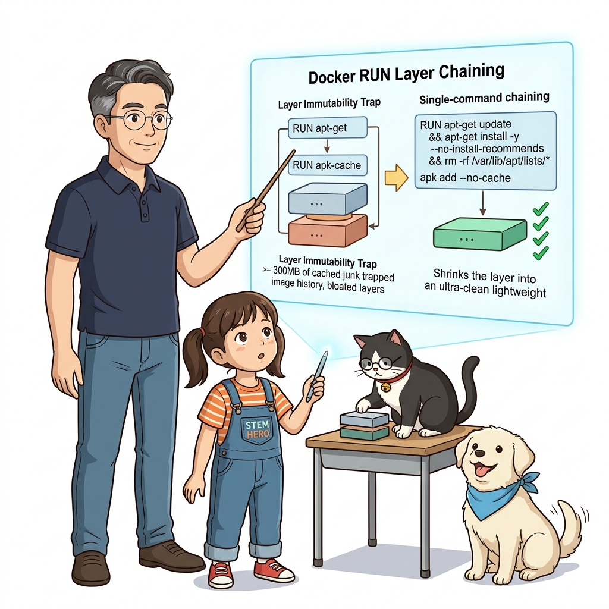
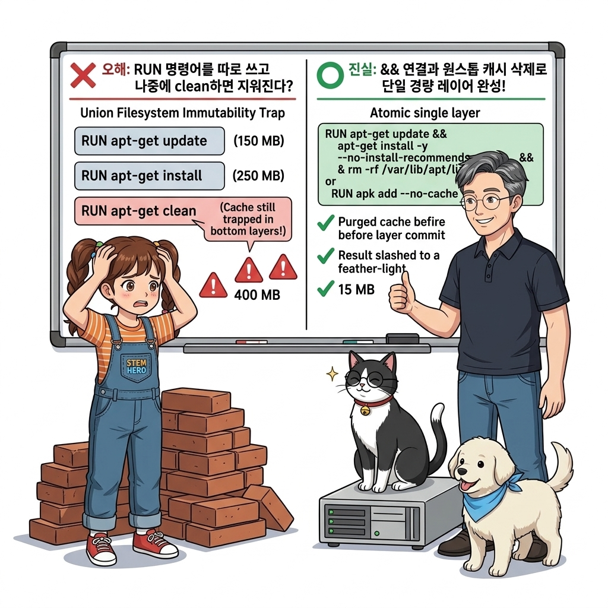
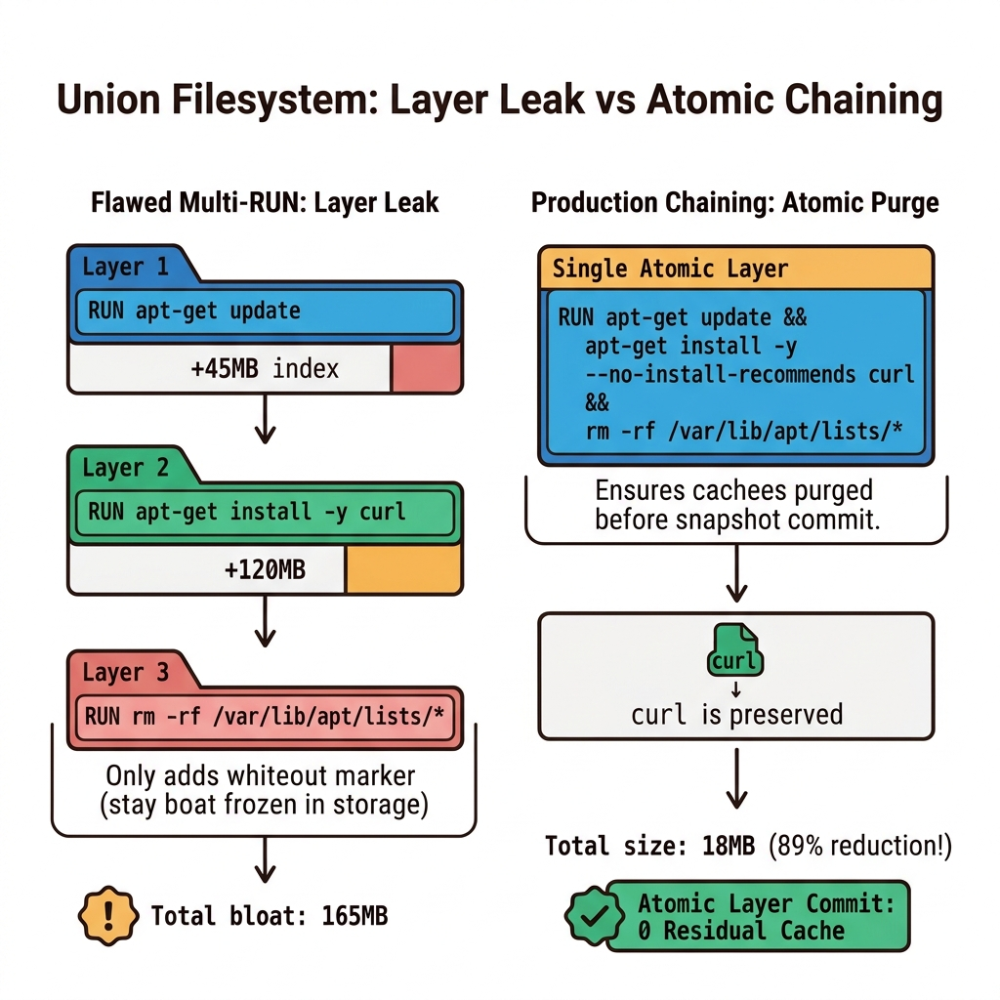
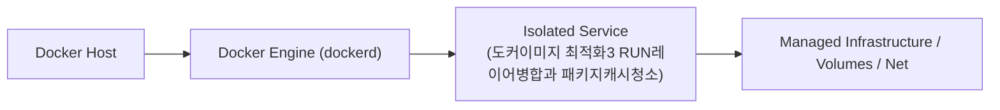
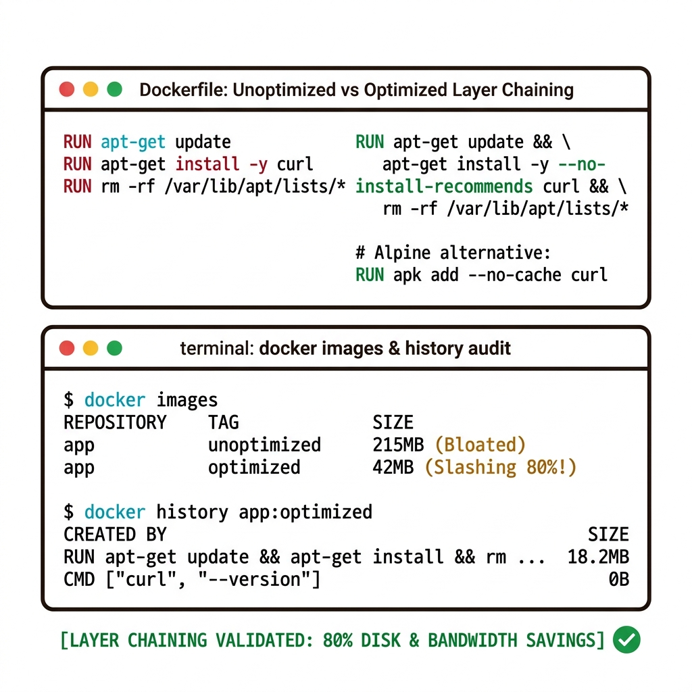
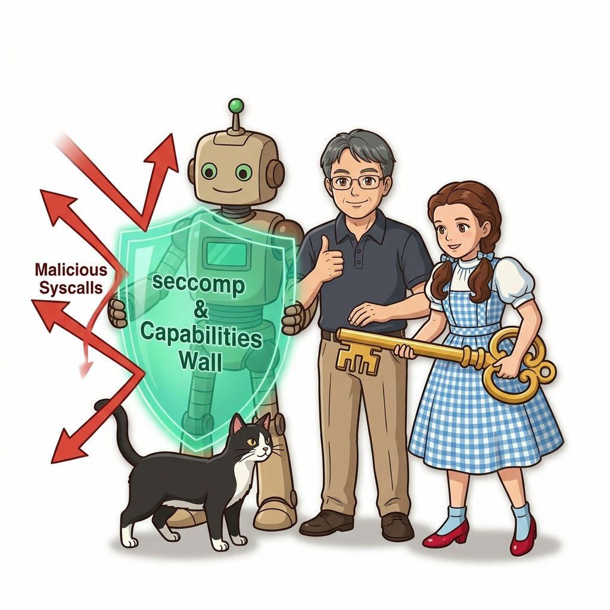
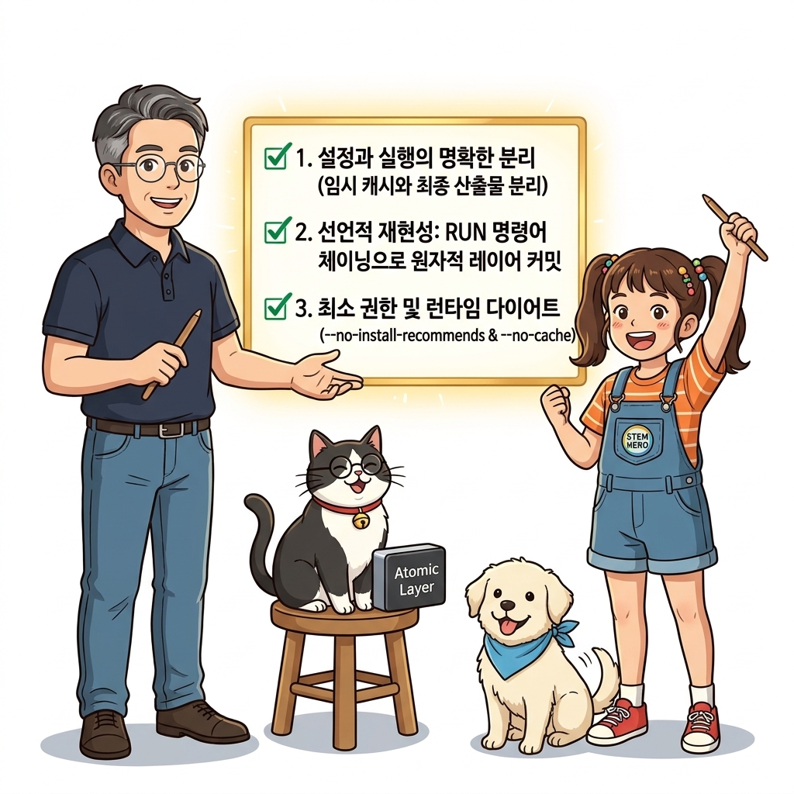
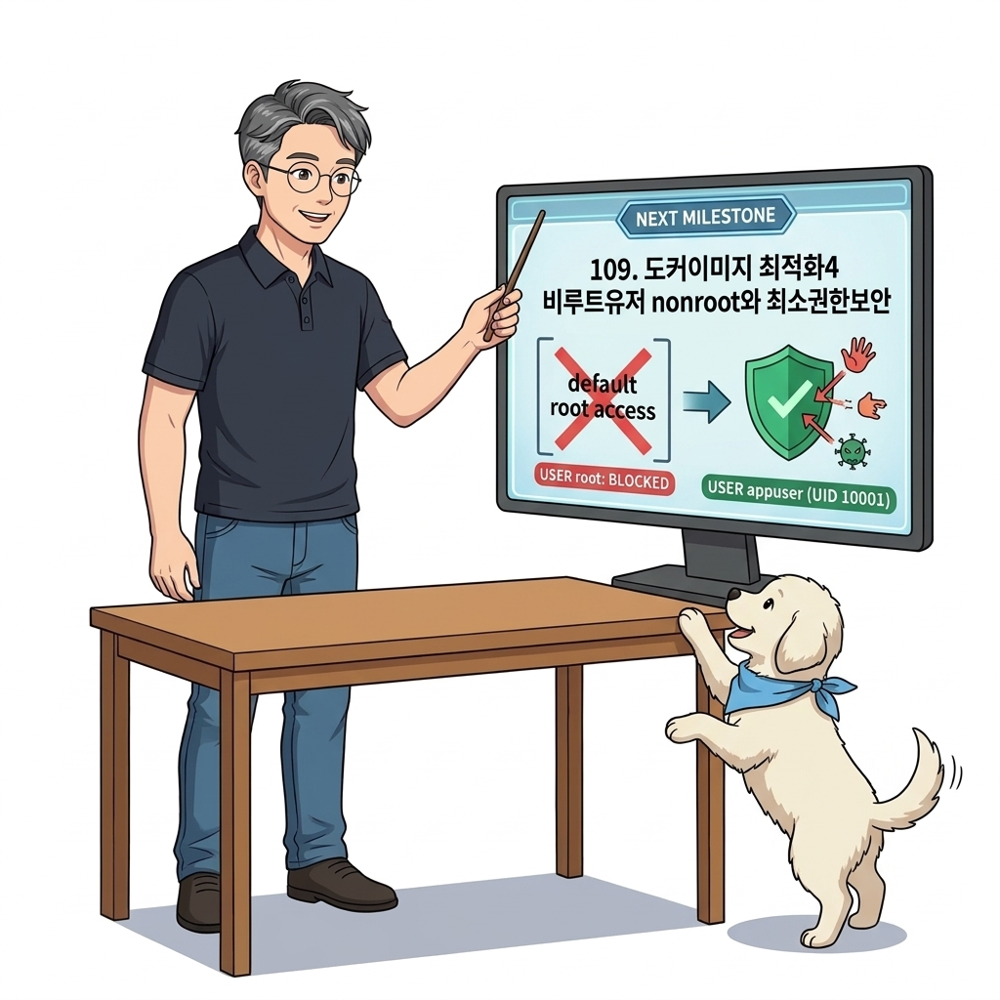

# 108. 도커이미지 최적화3 RUN레이어병합과 패키지캐시청소

도커 이미지 레이어는 '이전 레이어 위에 누적되는 스냅샷'이므로, 1번 레이어에서 다운로드한 100MB의 패키지 설치 캐시를 2번 레이어에서 `rm`으로 지워도 **이미지 전체 크기는 단 1바이트도 줄어들지 않는다**는 치명적 함정을 증명합니다.


**그림 07-13-1** 도커이미지 최적화3 RUN레이어병합과 패키지캐시청소의 필요성과 현대 클라우드 아키텍처 관점의 개요

---

### 108.1 왜 도커이미지 최적화3 RUN레이어병합과 패키지캐시청소이(가) 필요한가? (문제 정의와 현실적 배경)

소프트웨어 시스템이 복잡해질수록 설정을 다루는 방식은 전체 인프라의 신뢰성을 결정짓는 핵심 척도가 됩니다. **도커이미지 최적화3 RUN레이어병합과 패키지캐시청소**이(가) 부재하거나 잘못 다루어질 때 현장에서는 다음과 같은 대표적인 병목과 장애가 발생합니다:

1. **하드코딩된 설정과 환경 불일치로 인한 유연성 상실**: 환경이 바뀔 때마다 코드를 다시 빌드해야 하므로 배포 주기가 지연되고 이미지 수가 기하급수적으로 폭증합니다.
2. **보안 민감 데이터의 무분별한 노출**: 비밀번호, 데이터베이스 토큰, 암호화 키가 이미지 레이어에 영구 박제되어 형상관리 시스템이나 외부에 유출될 위험이 커집니다.
3. **재현 불가능한 구성 드리프트**: 스테이징 환경과 프로덕션 환경의 미세한 설정 차이가 예기치 못한 서비스 중단 사고로 직결됩니다.


**그림 07-13-2** 도커이미지 최적화3 RUN레이어병합과 패키지캐시청소에 대한 대표적인 오해와 실제 프로덕션 현장의 엔지니어링 진실

---

### 108.2 핵심 아키텍처와 엔지니어링 메커니즘

패키지 업데이트, 설치, 그리고 임시 캐시 삭제를 **단 하나의 `RUN` 인스트럭션 안에서 셸 연산자(`&&`)로 묶어 처리(Chaining)**하여 최종 레이어에 쓰레기를 남기지 않는 정석 기법을 실습합니다.


**그림 07-13-3** 도커이미지 최적화3 RUN레이어병합과 패키지캐시청소의 내부 아키텍처 및 데이터 흐름

#### 📊 핵심 비교 및 엔지니어링 표준 분석

| 구분 / 핵심 원리 | 상세 설명 및 동작 메커니즘 | 실무 적용 시 주의점 및 베스트 프랙티스 |
| :--- | :--- | :--- |
| **레이어 불변성의 함정** | 이전 레이어에 기록된 파일은 상위 레이어에서 삭제 표시(Whiteout)만 될 뿐, 하위 레이어 데이터는 이미지 파일 속에 영구 박제됨 | 임시 파일이나 압축 해제 원본은 반드시 **그 파일을 생성한 바로 그 `RUN` 줄에서 즉시 삭제**해야 함! |
| **`--no-install-recommends`** | 우분투/데비안 APT 설치 시 권장(Recommends)되는 수십 개의 불필요한 보조 문서/패키지 설치를 건너뜀 | 패키지 설치 용량을 30~50% 줄여주는 필수 플래그 |
| **알파인의 `--no-cache`** | `apk add --no-cache curl`을 사용하면 `/var/cache/apk/`에 인덱스 캐시를 남기지 않고 즉시 설치 및 청소 완료 | 알파인 도커 파일에서 가장 깔끔한 패키지 설치법 |

---

### 108.3 선언적 실습 및 아키텍처 다이어그램

본 실습은 외부 비공개 패키지에 의존하지 않고, 공식 표준 이미지를 기반으로 즉시 재현 가능한 살아있는 코드로 구성되어 있습니다.

```dockerfile
# [나쁜 예: 용량이 줄지 않음]
# RUN apt-get update
# RUN apt-get install -y curl
# RUN rm -rf /var/lib/apt/lists/*

# [좋은 예: 단일 레이어에서 설치 후 캐시 즉시 청소! 용량 40MB 절약]
FROM debian:12-slim
RUN apt-get update && apt-get install -y --no-install-recommends     curl     ca-certificates  && rm -rf /var/lib/apt/lists/*
```

#### 🔍 아키텍처 흐름도 (Mermaid Diagram)




**그림 07-13-4** 선언적 인프라 명세를 통한 도커이미지 최적화3 RUN레이어병합과 패키지캐시청소 검증 파이프라인

---

<!-- BIBLE_INTEGRATION_book5_capabilities_seccomp_security -->
---

### 108.B 📚 도커 바이블 심화: 컨테이너 보안 경계 강화: Linux Capabilities 최소화와 seccomp 시스템 콜 필터링
*출처 도서: 『제대로 배우는 도커』 핵심 분석*

컨테이너 내부에서 `root` 사용자(UID 0)로 프로세스가 실행된다고 해서, 호스트 OS의 슈퍼유저와 완전히 동일한 전지전능한 권한을 갖는 것은 아닙니다. 도커는 **리눅스 커널의 Capabilities와 seccomp 필터**를 통해 기본적으로 위험한 권한을 박탈합니다.

1. **최소 권한의 원칙 (Drop Capabilities)**:
   * 컨테이너는 기본적으로 `CAP_CHOWN`, `CAP_NET_BIND_SERVICE` 등 14개 권한만 부여받습니다.
   * 프로덕션 보안을 극대화하려면 먼저 모든 권한을 박탈(`--cap-drop=ALL`)한 뒤, 애플리케이션 실행에 반드시 필요한 권한만 개별 부여(`--cap-add=...`)하는 '화이트리스트 방식'을 적용해야 합니다.
2. **seccomp 시스템 콜 차단**:
   * 리눅스 커널에는 약 300여 개의 시스템 콜(System Call)이 존재하지만, 컨테이너 탈출(Container Escape) 공격에 악용될 수 있는 `reboot`, `kexec_load`, `mount` 등 위험한 44개 시스템 콜을 도커 기본 seccomp 프로파일이 원천 봉쇄합니다.


**그림 108-B-1** 모든 불필요한 시스템 콜과 커널 특권을 방패로 원천 차단하는 도커 컨테이너 보안 방어막

```bash
# [실습] 모든 특권 박탈 후 웹서버 포트 바인딩 권한만 허용하여 기동
docker container run -d --name secure-app \
  --cap-drop=ALL \
  --cap-add=NET_BIND_SERVICE \
  --read-only \
  --security-opt=no-new-privileges:true \
  -p 8080:80 nginx:alpine

# 컨테이너의 보안 프로파일 및 Capabilities 확인
docker container inspect secure-app --format '{{json .HostConfig.CapAdd}} {{json .HostConfig.CapDrop}}'
```

> 👨‍🏫 **이호진 교수님의 바이블 멘토링 노트**:
> "해커가 웹 애플리케이션의 원격 코드 실행(RCE) 취약점을 뚫고 컨테이너 셸을 탈취하더라도, cap-drop과 seccomp이 걸려 있다면 커널을 장악하거나 호스트로 탈출할 수 없습니다. 보안의 핵심은 심층 방어(Defense in Depth)입니다."
>
> 👧 **도로시의 깨달음**:
> "루트 계정이라도 손발을 묶어두고 꼭 필요한 열쇠(NET_BIND_SERVICE)만 쥐어주니 아무리 침입자가 들어와도 나쁜 짓을 못하겠네요!"
>
> 🐱 **조교 지니의 아키텍처 체크포인트**:
> "여기에 `--read-only` 플래그까지 추가하면 루트 파일시스템에 악성코드를 다운로드하거나 실행 파일을 변조하는 행위 자체가 100% 차단됩니다."

---

### 108.C 📚 도커 바이블 심화: Overlay2 화이트아웃(.wh) 삭제 마커 메커니즘과 레이어 비대화(Bloat) 차단

> 📖 **참고 도서 심층 연계**:
> * 《도커 교과서》 제11장 (도커 이미지 레이어 압축 및 빌드 최적화)
> * 《15단계로 배우는 도커와 쿠버네티스》 제3장 (UnionFS Overlay2의 LowerDir와 UpperDir 동작 원리)

"이전 줄에서 설치한 임시 압축 파일을 다음 `RUN rm -rf` 줄에서 지웠는데, 왜 최종 이미지 용량은 단 1바이트도 줄어들지 않았을까?" 수많은 초급 엔지니어가 겪는 이 의문의 해답은 리눅스 유니온 파일시스템(Overlay2)의 **화이트아웃(Whiteout)** 삭제 원리에 있습니다.

#### 1. Overlay2 화이트아웃 메커니즘 해부

도커 이미지의 레이어는 **읽기 전용 불변(Read-Only Immutable)** 블록입니다. 상위 레이어는 절대로 하위 레이어의 물리적 디스크 데이터를 직접 삭제하거나 수정할 수 없습니다:

```
[Layer 2 (Upper)]  RUN rm -rf /tmp/data.tar.gz  ==>  커널이 특수 파일 '.wh.data.tar.gz' (0B) 생성!
-----------------------------------------------------------------------------------------
[Layer 1 (Lower)]  RUN wget /tmp/data.tar.gz     ==>  물리적 원본 500MB 파일 그대로 영구 잔류!
```

* **화이트아웃(`.wh.<파일명>`) 동작**: 도커가 하위 레이어의 파일을 삭제하라는 명령을 받으면, 상위 레이어에 동일한 이름 앞에 `.wh.`가 붙은 특수 캐릭터 디바이스(또는 0바이트 빈 파일)를 만듭니다.
* **가림 처리(Masking)**: 컨테이너가 실행될 때 Overlay2는 하위 레이어에 원본 파일이 있더라도, 상위 레이어의 `.wh.` 마커를 보고 사용자에게 파일이 없는 것처럼 **투명하게 가려줄(Hide)** 뿐입니다.
* **결과**: 최종 빌드된 이미지의 압축 tarball 안에는 500MB짜리 원본 파일과 이를 가리는 0바이트짜리 `.wh.` 마커가 둘 다 포함되어 전체 다운로드 용량과 디스크를 고스란히 낭비합니다.

#### 2. 레이어 비대화 방지 3대 엔지니어링 규칙

| 최적화 기법 | 올바른 구현 코드 패턴 | 방지되는 문제 |
| :--- | :--- | :--- |
| **단일 RUN 체이닝** | `RUN apt update && apt install -y pkg && rm -rf /var/lib/apt/lists/*` | 동일 레이어 내에서 생성 직후 삭제되므로, 커널이 디스크에 영구 커밋하기 전에 임시 데이터 소멸 |
| **멀티스테이지 산출물 추출** | 빌드 스테이지에서 압축 해제 및 컴파일 수행 후, `COPY --from=builder /bin/app /bin/app` | 소스코드, 압축파일, 빌드 캐시가 최종 런타임 이미지 레이어에 아예 유입되지 않음 |
| **패키지 매니저 캐시 비활성화** | 알파인: `apk add --no-cache`, 데비안: `--no-install-recommends` | 패키지 설치 시 불필요한 추천 패키지와 인덱스 메타데이터 생성 원천 차단 |

> 👧 **도로시**: "와! 그림을 지우개로 지운 게 아니라, 위에 빈 도화지를 덮어서 안 보이게만 해둔 거였군요! 그러니 당연히 도화지 두 장(용량)이 그대로 남아있었던 거네요!"
> 
> 👨‍🏫 **이호진 교수님**: "정확한 비유란다, 도로시! Overlay2의 화이트아웃 원리를 알면 왜 반드시 '생성과 삭제를 한 줄의 RUN에서 끝내야 하는지' 가슴 깊이 이해하게 된단다."
> 
> 🐶 **토토**: "멍멍! `docker history <이미지명>`을 쳐보면 어떤 레이어가 몇 MB를 잡아먹고 있는지 범인을 바로 찾아낼 수 있어!"


### 108.4 핵심 정리: 캐릭터 대화와 3대 교훈

> 👧 **도로시**: "교수님! **도커이미지 최적화3 RUN레이어병합과 패키지캐시청소**의 원리를 배우니까, 복잡하게 얽혀 있던 인프라 설정이 레고 블록처럼 질서정연하게 제자리를 찾는 게 보여요!"
> 
> 🐱 **조교 지니**: "야옹~ 맞습니다! 특히 런타임 환경과 불변 인프라의 경계를 명확히 지키는 것이 대규모 클라우드 운영의 제1원칙이랍니다!"
> 
> 🐶 **토토**: "멍멍! 선언적 코드로 한 번 적어두면 언제든 똑같이 복원되니까 정말 든든해요!"
> 
> 👨‍🏫 **이호진 교수님**: "훌륭하구나. 원리를 깊이 이해하고 실습을 통해 손에 익히는 것이 훌륭한 클라우드 엔지니어로 성장하는 가장 빠른 지름길이란다."


**그림 07-13-5** 도커이미지 최적화3 RUN레이어병합과 패키지캐시청소 마스터를 위한 3대 핵심 교훈

1. **설정과 실행의 명확한 분리**:
   * 애플리케이션 코드는 불변으로 유지하고, 가변적인 설정값은 외부에서 주입하여 이식성을 극대화합니다.
2. **선언적 재현성 확보**:
   * 사람이 수작업으로 변경하지 않고 코드 명세를 통해 언제 어디서나 100% 동일한 실행 결과를 보장합니다.
3. **최소 권한 및 보안 모범 사례 준수**:
   * 불필요한 권한과 포트 노출을 최소화하고 민감 데이터를 암호화하여 프로덕션 안정성을 담보합니다.

---

### 108.5 랩노트 피날레와 다음 강의 예고


**그림 07-13-6** 연구실에서 다음 마일스톤인 [도커이미지 최적화4 비루트유저 nonroot와 최소권한보안] 실습을 예고하는 교수님과 토토

> 💡 **다음 강의 안내**:
> [도커이미지 최적화4 비루트유저 nonroot와 최소권한보안](../109_도커이미지_최적화4_비루트유저_nonroot와_최소권한보안/)에서는 더욱 심화된 실전 엔지니어링 실습과 아키텍처를 다룹니다!

---

## 🧭 강의 네비게이션
* [◀️ 이전 강의: 107_도커이미지_최적화2_최적의기반이미지_선택과_취약점스캔](../107_도커이미지_최적화2_최적의기반이미지_선택과_취약점스캔/)
* [📋 Part 07. 보안 원격 접근(TLS/SSH Context), 다중 아키텍처 이미지(Buildx) & 이미지 최적화 (096 ~ 111) 목차로 돌아가기](../)
* [▶️ 다음 강의: 109_도커이미지_최적화4_비루트유저_nonroot와_최소권한보안](../109_도커이미지_최적화4_비루트유저_nonroot와_최소권한보안/)
