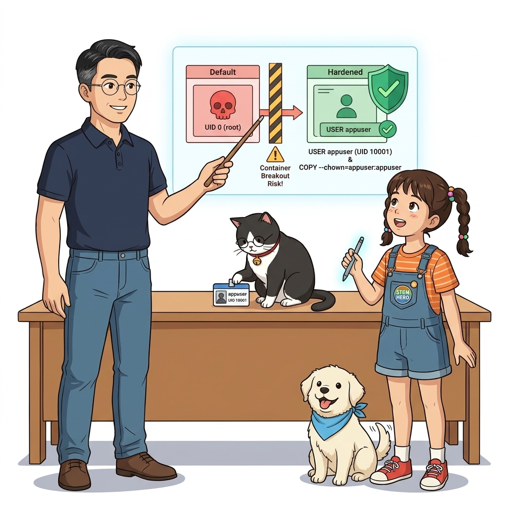
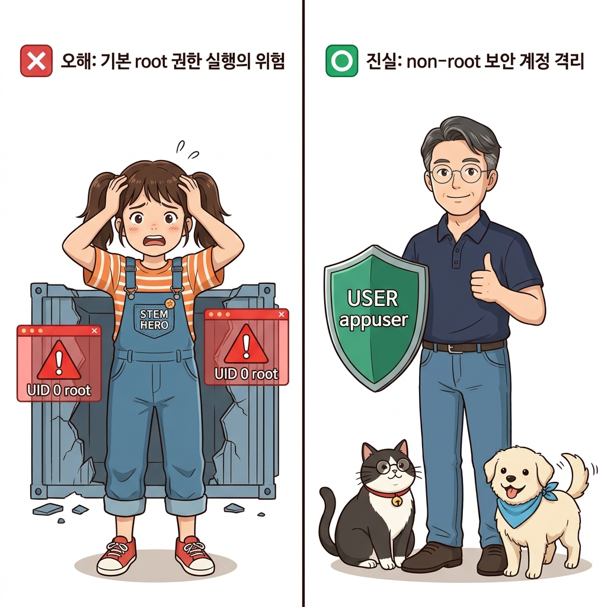
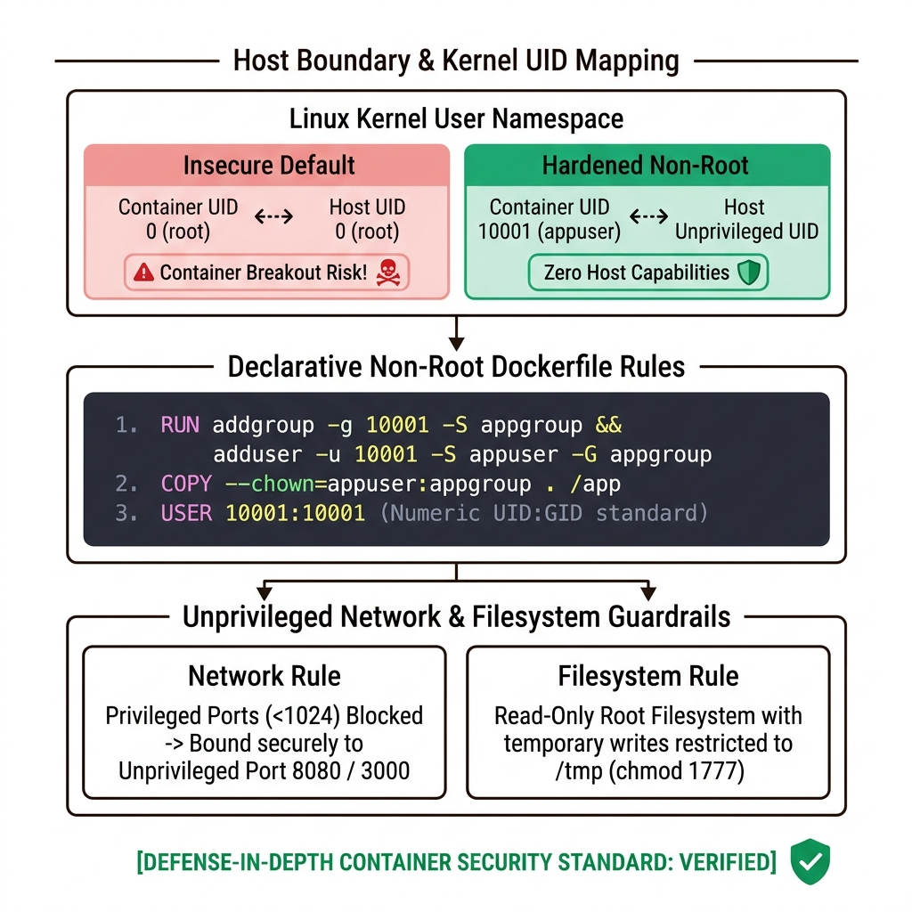
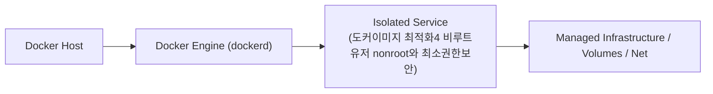
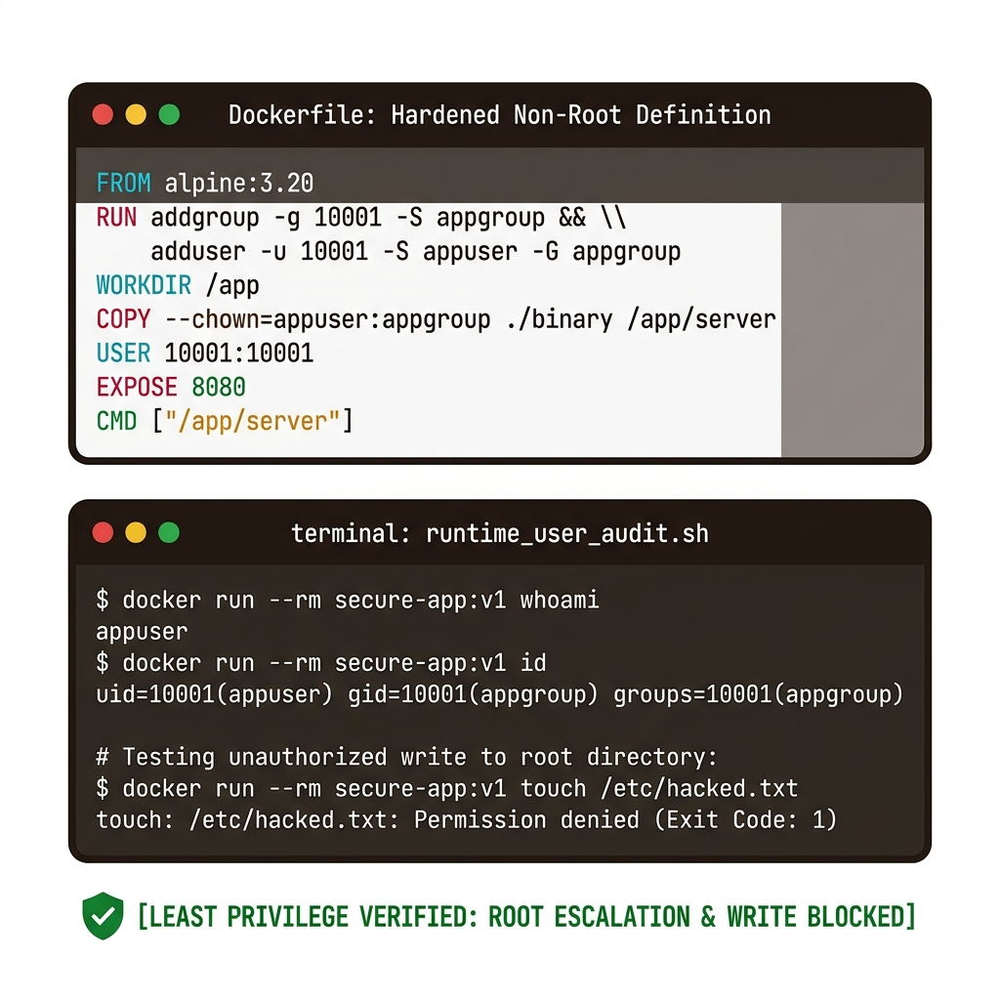
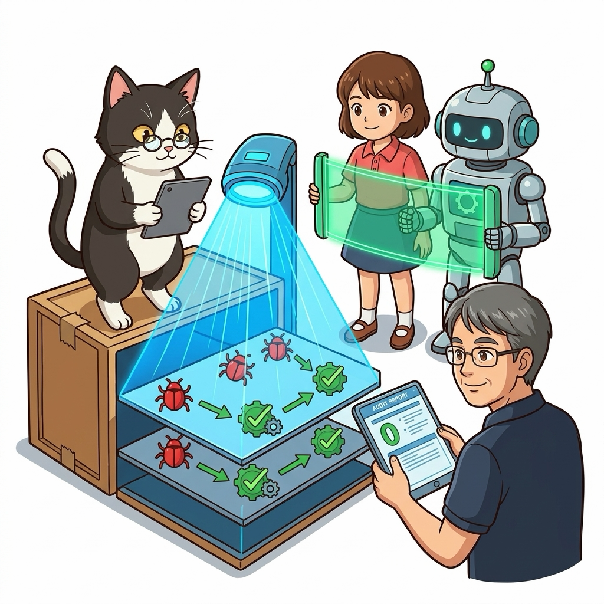
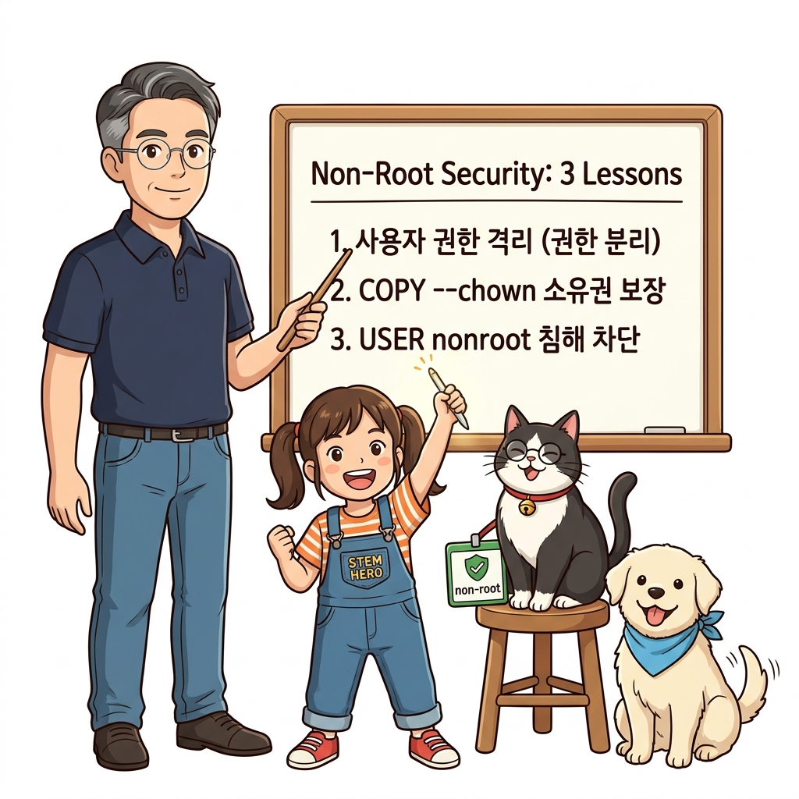
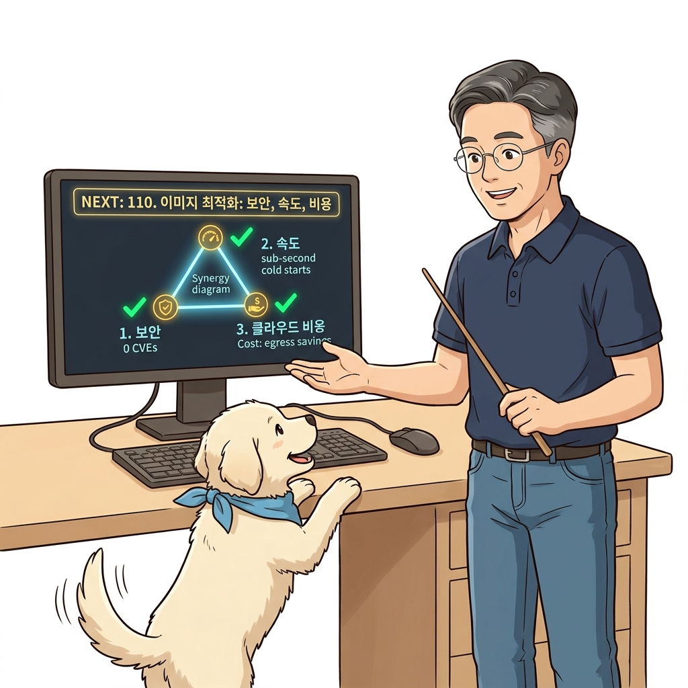

# 109. 도커이미지 최적화4 비루트유저 nonroot와 최소권한보안

기본 설정대로 컨테이너를 실행하면 프로세스가 `root`(UID 0) 권한으로 동작합니다. 만약 애플리케이션에 원격 코드 실행 취약점이 발생하면 공격자가 컨테이너의 루트 권한을 얻고 나아가 호스트 시스템까지 탈출(Container Escape)할 위험이 있습니다.


**그림 07-14-1** 도커이미지 최적화4 비루트유저 nonroot와 최소권한보안의 필요성과 현대 클라우드 아키텍처 관점의 개요

---

### 109.1 왜 도커이미지 최적화4 비루트유저 nonroot와 최소권한보안이(가) 필요한가? (문제 정의와 현실적 배경)

소프트웨어 시스템이 복잡해질수록 설정을 다루는 방식은 전체 인프라의 신뢰성을 결정짓는 핵심 척도가 됩니다. **도커이미지 최적화4 비루트유저 nonroot와 최소권한보안**이(가) 부재하거나 잘못 다루어질 때 현장에서는 다음과 같은 대표적인 병목과 장애가 발생합니다:

1. **하드코딩된 설정과 환경 불일치로 인한 유연성 상실**: 환경이 바뀔 때마다 코드를 다시 빌드해야 하므로 배포 주기가 지연되고 이미지 수가 기하급수적으로 폭증합니다.
2. **보안 민감 데이터의 무분별한 노출**: 비밀번호, 데이터베이스 토큰, 암호화 키가 이미지 레이어에 영구 박제되어 형상관리 시스템이나 외부에 유출될 위험이 커집니다.
3. **재현 불가능한 구성 드리프트**: 스테이징 환경과 프로덕션 환경의 미세한 설정 차이가 예기치 못한 서비스 중단 사고로 직결됩니다.


**그림 07-14-2** 도커이미지 최적화4 비루트유저 nonroot와 최소권한보안에 대한 대표적인 오해와 실제 프로덕션 현장의 엔지니어링 진실

---

### 109.2 핵심 아키텍처와 엔지니어링 메커니즘

`Dockerfile`에서 전용 시스템 계정(예: `appuser`)을 생성하고, 파일 권한을 부여한 뒤 **`USER appuser`**로 전환하여 최소 권한(Least Privilege) 원칙을 적용하는 엔터프라이즈 보안 표준을 실습합니다.


**그림 07-14-3** 도커이미지 최적화4 비루트유저 nonroot와 최소권한보안의 내부 아키텍처 및 데이터 흐름

#### 📊 핵심 비교 및 엔지니어링 표준 분석

| 구분 / 핵심 원리 | 상세 설명 및 동작 메커니즘 | 실무 적용 시 주의점 및 베스트 프랙티스 |
| :--- | :--- | :--- |
| **컨테이너 내부 root의 위험성** | 컨테이너의 UID 0은 호스트 커널의 UID 0(`root`)과 직접 매핑될 수 있어 취약점 발생 시 호스트 전체가 위협받음 | 보안 감사(Audit) 및 금융/공공 클라우드 규격에서 비루트 유저 실행은 필수 요건 |
| **`COPY --chown=사용자:그룹`** | 호스트에서 파일을 복사할 때 소유권을 root가 아닌 애플리케이션 실행 사용자로 즉시 지정 | 별도의 `RUN chown -R` 레이어를 추가하지 않아 이미지 용량도 함께 절약 |
| **권한 거부 에러 예방** | 1024번 이하의 웰노운 포트(예: 80) 바인딩이나 시스템 파일 수정 권한이 없으므로, 비루트 컨테이너는 8080이나 3000번 등 비특권 포트를 사용해야 함 | 보안과 애플리케이션 설정의 정합성 유지 |

---

### 109.3 선언적 실습 및 아키텍처 다이어그램

본 실습은 외부 비공개 패키지에 의존하지 않고, 공식 표준 이미지를 기반으로 즉시 재현 가능한 살아있는 코드로 구성되어 있습니다.

```dockerfile
# 비루트(non-root) 전용 시스템 사용자를 생성하고 실행 권한을 전환하는 보안 Dockerfile
FROM alpine:3.20

# UID 10001의 비루트 사용자 appuser 생성 (로그인 셸 불필요)
RUN addgroup -g 10001 appgroup &&     adduser -u 10001 -G appgroup -s /sbin/nologin -D appuser

WORKDIR /app
COPY --chown=appuser:appgroup app.py ./

# 실행 프로세스를 일반 사용자 권한으로 전환!
USER appuser

CMD ["python3", "app.py"]
```

#### 🔍 아키텍처 흐름도 (Mermaid Diagram)




**그림 07-14-4** 선언적 인프라 명세를 통한 도커이미지 최적화4 비루트유저 nonroot와 최소권한보안 검증 파이프라인

---

<!-- BIBLE_INTEGRATION_book7_deep_109 -->
---

### 109.C 📚 도커 바이블 심화: Trivy 정적 분석기를 활용한 컨테이너 이미지 CVE 보안 취약점 전수 스캐닝
*출처 도서: 『도커 교과서』 핵심 분석 (도커 교과서 제17장 (도커 이미지 최적화하기: 보안, 용량, 속도))*

아무리 최신 기술로 컨테이너를 빌드했더라도, 베이스 이미지(Ubuntu, Debian)의 구버전 라이브러리나 `package.json` 의존성에 알려진 보안 취약점(CVE)이 잠복해 있다면 시스템 전체가 랜섬웨어나 해킹에 뚫리게 됩니다.

#### Trivy를 활용한 프로덕션 보안 스캐닝 3단계:
1. **OS 패키지 취약점 진단**: 베이스 이미지의 `openssl`, `glibc`, `libcrypto` 등 리눅스 패키지 레벨의 취약점 검출.
2. **애플리케이션 종속성 라이브러리 진단**: Node.js, Python, Java, Go 라이브러리의 알려진 CVE 검출.
3. **CI/CD 파이프라인 게이트웨이**:
   * 취약점 심각도(Severity)가 `CRITICAL` 또는 `HIGH`인 경우 빌드 파이프라인을 강제 중단(`--exit-code 1`)하여 배포를 원천 차단.


**그림 109-B-2** Trivy 보안 스캐너가 이미지 레이어 내부의 숨은 CVE 버그를 감지하고 방어벽을 세우는 모습

```bash
# [실습] Trivy 컨테이너를 이용한 무설치 이미지 보안 스캔
# 호스트 도커 소켓을 마운트하여 로컬 이미지의 CRITICAL 취약점 즉시 검사
docker container run --rm -v /var/run/docker.sock:/var/run/docker.sock \
  aquasec/trivy:latest image --severity CRITICAL,HIGH alpine:3.15

# 결과: 취약점이 감지되면 CVE 번호와 패치 버전(Fixed Version)이 상세 출력됨
```

> 👨‍🏫 **이호진 교수님의 바이블 멘토링 노트**:
> "CVE 취약점 점검을 사람이 수동으로 하는 시대는 끝났습니다. CI 파이프라인에서 Trivy 스캔을 통과하지 못한 이미지는 레지스트리에 푸시조차 되지 않도록 차단하는 것이 데브섹옵스(DevSecOps)의 시작입니다."
>
> 👧 **도로시의 깨달음**:
> "공항 검색대에서 엑스레이로 짐 속의 위험한 물건을 찾아내듯, 컨테이너 속 숨겨진 보안 벌레(CVE)들을 미리미리 잡아내는 거군요!"
>
> 🐱 **조교 지니의 아키텍처 체크포인트**:
> "초경량 `alpine`이나 구글의 `distroless` 이미지를 베이스로 쓰면 OS 패키지 자체가 수십 개에 불과하여 Trivy 검사 결과가 99% 깨끗하게 통과합니다."


### 109.4 핵심 정리: 캐릭터 대화와 3대 교훈

> 👧 **도로시**: "교수님! **도커이미지 최적화4 비루트유저 nonroot와 최소권한보안**의 원리를 배우니까, 복잡하게 얽혀 있던 인프라 설정이 레고 블록처럼 질서정연하게 제자리를 찾는 게 보여요!"
> 
> 🐱 **조교 지니**: "야옹~ 맞습니다! 특히 런타임 환경과 불변 인프라의 경계를 명확히 지키는 것이 대규모 클라우드 운영의 제1원칙이랍니다!"
> 
> 🐶 **토토**: "멍멍! 선언적 코드로 한 번 적어두면 언제든 똑같이 복원되니까 정말 든든해요!"
> 
> 👨‍🏫 **이호진 교수님**: "훌륭하구나. 원리를 깊이 이해하고 실습을 통해 손에 익히는 것이 훌륭한 클라우드 엔지니어로 성장하는 가장 빠른 지름길이란다."


**그림 07-14-5** 도커이미지 최적화4 비루트유저 nonroot와 최소권한보안 마스터를 위한 3대 핵심 교훈

1. **설정과 실행의 명확한 분리**:
   * 애플리케이션 코드는 불변으로 유지하고, 가변적인 설정값은 외부에서 주입하여 이식성을 극대화합니다.
2. **선언적 재현성 확보**:
   * 사람이 수작업으로 변경하지 않고 코드 명세를 통해 언제 어디서나 100% 동일한 실행 결과를 보장합니다.
3. **최소 권한 및 보안 모범 사례 준수**:
   * 불필요한 권한과 포트 노출을 최소화하고 민감 데이터를 암호화하여 프로덕션 안정성을 담보합니다.

---

### 109.5 랩노트 피날레와 다음 강의 예고


**그림 07-14-6** 연구실에서 다음 마일스톤인 [왜 이미지최적화가 보안 속도 클라우드비용을 결정하는가] 실습을 예고하는 교수님과 토토

> 💡 **다음 강의 안내**:
> [왜 이미지최적화가 보안 속도 클라우드비용을 결정하는가](../110_왜_이미지최적화가_보안_속도_클라우드비용을_결정하는가/)에서는 더욱 심화된 실전 엔지니어링 실습과 아키텍처를 다룹니다!

---

## 🧭 강의 네비게이션
* [◀️ 이전 강의: 108_도커이미지_최적화3_RUN레이어병합과_패키지캐시청소](../108_도커이미지_최적화3_RUN레이어병합과_패키지캐시청소/)
* [📋 Part 07. 보안 원격 접근(TLS/SSH Context), 다중 아키텍처 이미지(Buildx) & 이미지 최적화 (096 ~ 111) 목차로 돌아가기](../)
* [▶️ 다음 강의: 110_왜_이미지최적화가_보안_속도_클라우드비용을_결정하는가](../110_왜_이미지최적화가_보안_속도_클라우드비용을_결정하는가/)
