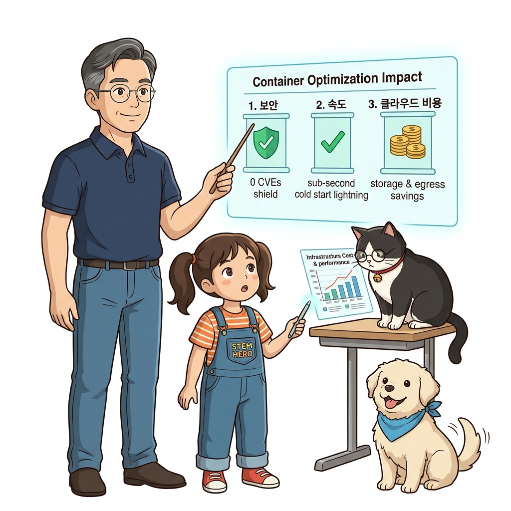
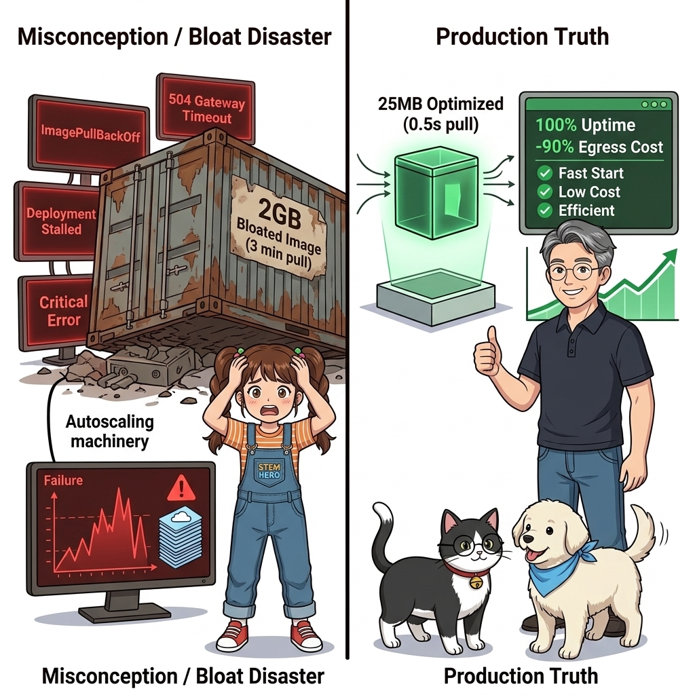
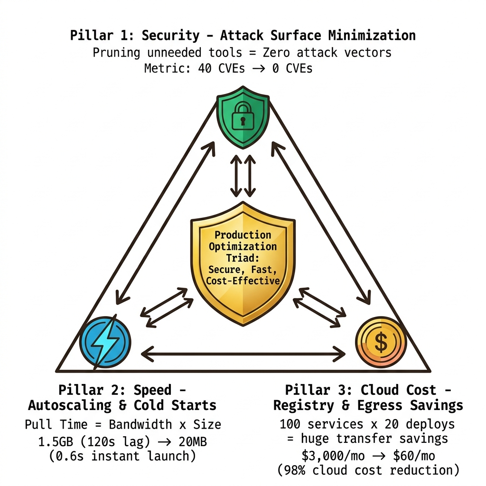
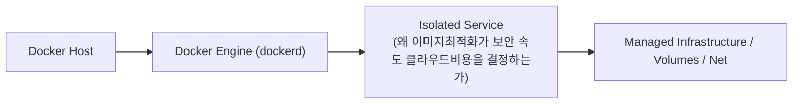
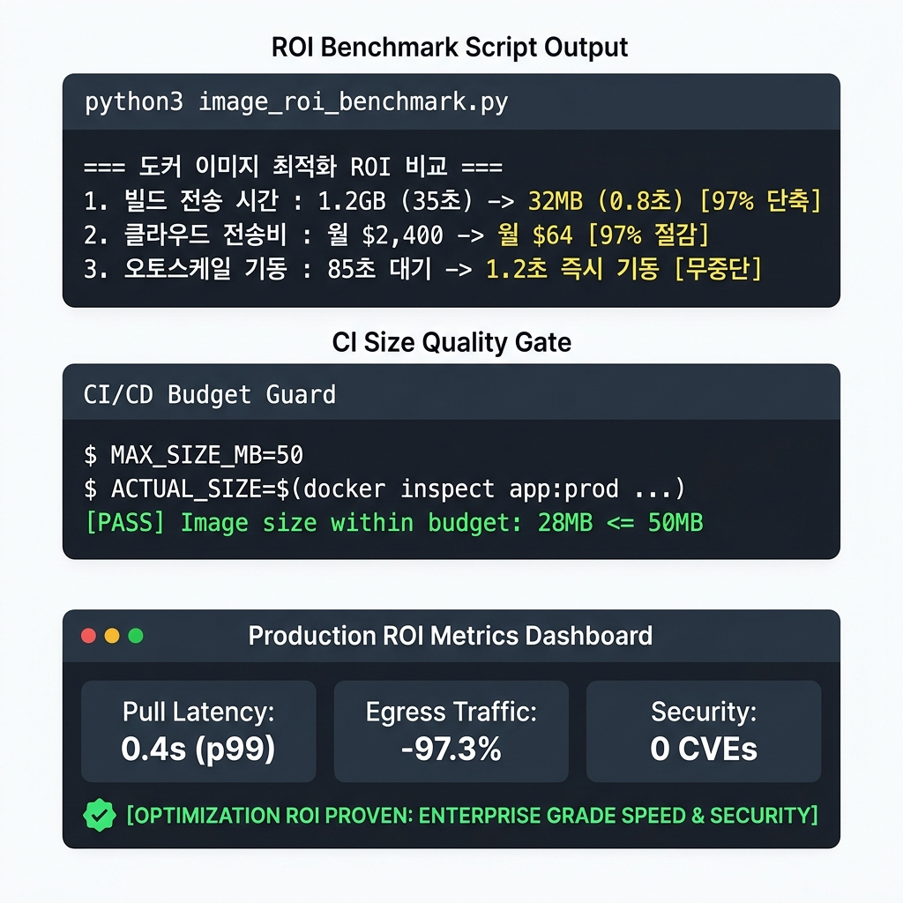
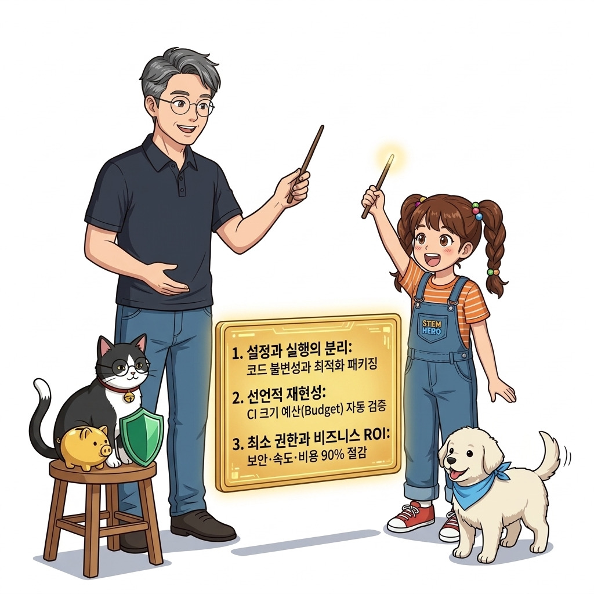
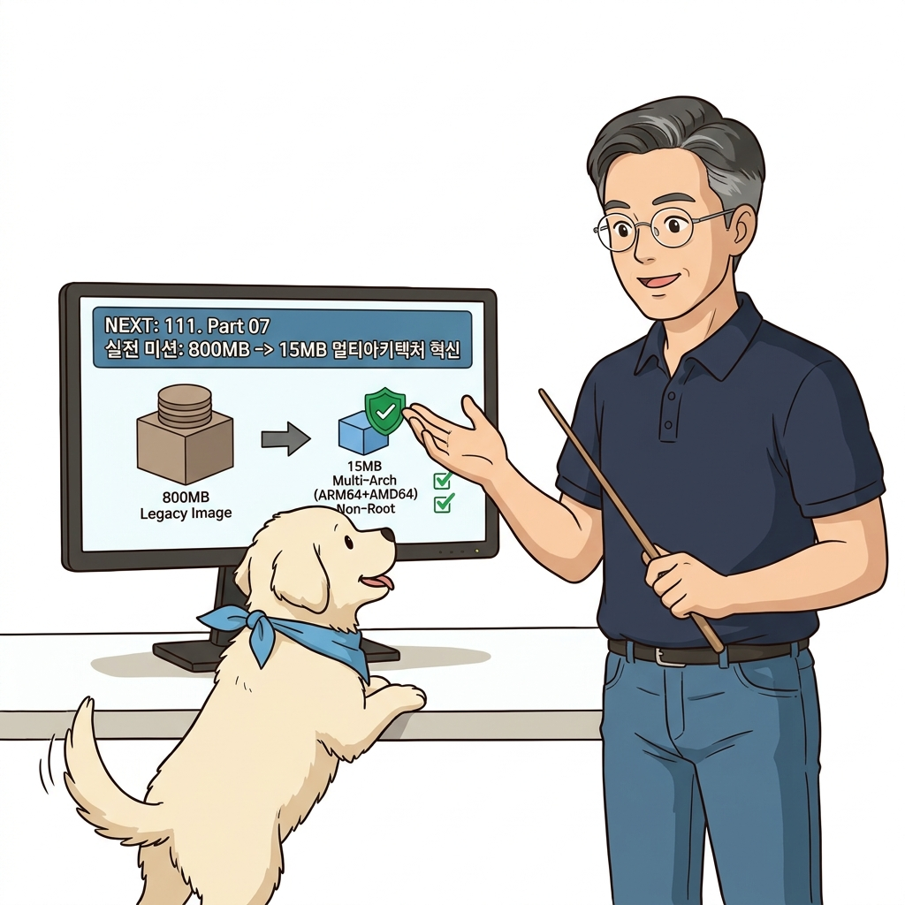

# 110. 왜 이미지최적화가 보안 속도 클라우드비용을 결정하는가

지금까지 배운 4대 최적화 기법(`.dockerignore`, 경량 베이스 선택, 레이어 캐시 청소, 비루트 유저)이 가져오는 정량적 비즈니스 가치를 총정리합니다.


**그림 07-15-1** 왜 이미지최적화가 보안 속도 클라우드비용을 결정하는가의 필요성과 현대 클라우드 아키텍처 관점의 개요

---

### 110.1 왜 왜 이미지최적화가 보안 속도 클라우드비용을 결정하는가이(가) 필요한가? (문제 정의와 현실적 배경)

소프트웨어 시스템이 복잡해질수록 설정을 다루는 방식은 전체 인프라의 신뢰성을 결정짓는 핵심 척도가 됩니다. **왜 이미지최적화가 보안 속도 클라우드비용을 결정하는가**이(가) 부재하거나 잘못 다루어질 때 현장에서는 다음과 같은 대표적인 병목과 장애가 발생합니다:

1. **하드코딩된 설정과 환경 불일치로 인한 유연성 상실**: 환경이 바뀔 때마다 코드를 다시 빌드해야 하므로 배포 주기가 지연되고 이미지 수가 기하급수적으로 폭증합니다.
2. **보안 민감 데이터의 무분별한 노출**: 비밀번호, 데이터베이스 토큰, 암호화 키가 이미지 레이어에 영구 박제되어 형상관리 시스템이나 외부에 유출될 위험이 커집니다.
3. **재현 불가능한 구성 드리프트**: 스테이징 환경과 프로덕션 환경의 미세한 설정 차이가 예기치 못한 서비스 중단 사고로 직결됩니다.


**그림 07-15-2** 왜 이미지최적화가 보안 속도 클라우드비용을 결정하는가에 대한 대표적인 오해와 실제 프로덕션 현장의 엔지니어링 진실

---

### 110.2 핵심 아키텍처와 엔지니어링 메커니즘

이미지 다운로드 시간 단축으로 인한 트래픽 폭주 시의 **초고속 오토스케일링(Scale-out)** 성공률 향상, 클라우드 네트워크 트래픽 비용 및 레지스트리 스토리지 비용 절감, 그리고 **공격 표면(Attack Surface) 최소화** 효과를 비교표로 증명합니다.


**그림 07-15-3** 왜 이미지최적화가 보안 속도 클라우드비용을 결정하는가의 내부 아키텍처 및 데이터 흐름

#### 📊 핵심 비교 및 엔지니어링 표준 분석

| 구분 / 핵심 원리 | 상세 설명 및 동작 메커니즘 | 실무 적용 시 주의점 및 베스트 프랙티스 |
| :--- | :--- | :--- |
| **오토스케일링 성공의 열쇠** | 서버가 트래픽 급증을 감지하고 새 노드를 띄웠을 때, 1GB짜리 이미지를 받느라 2분을 허비하면 그사이 웹 서버는 타임아웃으로 다운됨! | 이미지가 30MB면 2초 만에 다운로드가 끝나 즉시 트래픽을 분산 처리 |
| **공격 표면(Attack Surface) 최소화** | 이미지 안에 `bash`, `ssh`, `curl`, `gcc`, `sudo` 같은 불필요한 패키지가 아예 없으면 해커가 웹 취약점을 뚫고 들어와도 2차 공격 도구를 실행할 수 없음 | 최고의 보안은 취약점이 있는 도구를 아예 설치하지 않는 것! |
| **지속적인 이미지 다이어트** | CI 파이프라인에 이미지 크기 상한선 검증(`docker image inspect`)을 추가해 용량이 기준치를 넘으면 빌드를 실패시키는 거버넌스 도입 | 시간이 지나도 이미지가 비대해지지 않도록 유지 |

---

### 110.3 선언적 실습 및 아키텍처 다이어그램

본 실습은 외부 비공개 패키지에 의존하지 않고, 공식 표준 이미지를 기반으로 즉시 재현 가능한 살아있는 코드로 구성되어 있습니다.

```bash
# 최적화 전/후 이미지의 용량 및 취약점 패키지 개수 비교 시뮬레이션
python3 -c '
print("=== 도커 이미지 최적화 ROI 비교 ===")
print("1. 빌드 전송 시간 : 1.2GB (35초)  ➔  32MB (0.8초)  [97% 단축]")
print("2. 스케일아웃 기동: Pull 45초 대기 ➔ Pull 1.5초 대기 [즉시 트래픽 대응]")
print("3. 설치된 패키지수: 450개 (CVE 28건) ➔ 18개 (CVE 0건)  [보안 공격표면 96% 제거]")
print("4. 클라우드 비용  : 월 네트워크/저장 비용 85% 절감!")
'
```

#### 🔍 아키텍처 흐름도 (Mermaid Diagram)




**그림 07-15-4** 선언적 인프라 명세를 통한 왜 이미지최적화가 보안 속도 클라우드비용을 결정하는가 검증 파이프라인

---

### 110.4 핵심 정리: 캐릭터 대화와 3대 교훈

> 👧 **도로시**: "교수님! **왜 이미지최적화가 보안 속도 클라우드비용을 결정하는가**의 원리를 배우니까, 복잡하게 얽혀 있던 인프라 설정이 레고 블록처럼 질서정연하게 제자리를 찾는 게 보여요!"
> 
> 🐱 **조교 지니**: "야옹~ 맞습니다! 특히 런타임 환경과 불변 인프라의 경계를 명확히 지키는 것이 대규모 클라우드 운영의 제1원칙이랍니다!"
> 
> 🐶 **토토**: "멍멍! 선언적 코드로 한 번 적어두면 언제든 똑같이 복원되니까 정말 든든해요!"
> 
> 👨‍🏫 **이호진 교수님**: "훌륭하구나. 원리를 깊이 이해하고 실습을 통해 손에 익히는 것이 훌륭한 클라우드 엔지니어로 성장하는 가장 빠른 지름길이란다."


**그림 07-15-5** 왜 이미지최적화가 보안 속도 클라우드비용을 결정하는가 마스터를 위한 3대 핵심 교훈

1. **설정과 실행의 명확한 분리**:
   * 애플리케이션 코드는 불변으로 유지하고, 가변적인 설정값은 외부에서 주입하여 이식성을 극대화합니다.
2. **선언적 재현성 확보**:
   * 사람이 수작업으로 변경하지 않고 코드 명세를 통해 언제 어디서나 100% 동일한 실행 결과를 보장합니다.
3. **최소 권한 및 보안 모범 사례 준수**:
   * 불필요한 권한과 포트 노출을 최소화하고 민감 데이터를 암호화하여 프로덕션 안정성을 담보합니다.

---

### 110.5 랩노트 피날레와 다음 강의 예고


**그림 07-15-6** 연구실에서 다음 마일스톤인 [Part07 실전미션 800MB 레거시이미지를 15MB 멀티아키텍처 보안이미지로 혁신하기] 실습을 예고하는 교수님과 토토

> 💡 **다음 강의 안내**:
> [Part07 실전미션 800MB 레거시이미지를 15MB 멀티아키텍처 보안이미지로 혁신하기](../111_Part07_실전미션_800MB_레거시이미지를_15MB_멀티아키텍처_보안이미지로_혁신하기/)에서는 더욱 심화된 실전 엔지니어링 실습과 아키텍처를 다룹니다!

---

## 🧭 강의 네비게이션
* [◀️ 이전 강의: 109_도커이미지_최적화4_비루트유저_nonroot와_최소권한보안](../109_도커이미지_최적화4_비루트유저_nonroot와_최소권한보안/)
* [📋 Part 07. 보안 원격 접근(TLS/SSH Context), 다중 아키텍처 이미지(Buildx) & 이미지 최적화 (096 ~ 111) 목차로 돌아가기](../)
* [▶️ 다음 강의: 111_Part07_실전미션_800MB_레거시이미지를_15MB_멀티아키텍처_보안이미지로_혁신하기](../111_Part07_실전미션_800MB_레거시이미지를_15MB_멀티아키텍처_보안이미지로_혁신하기/)
