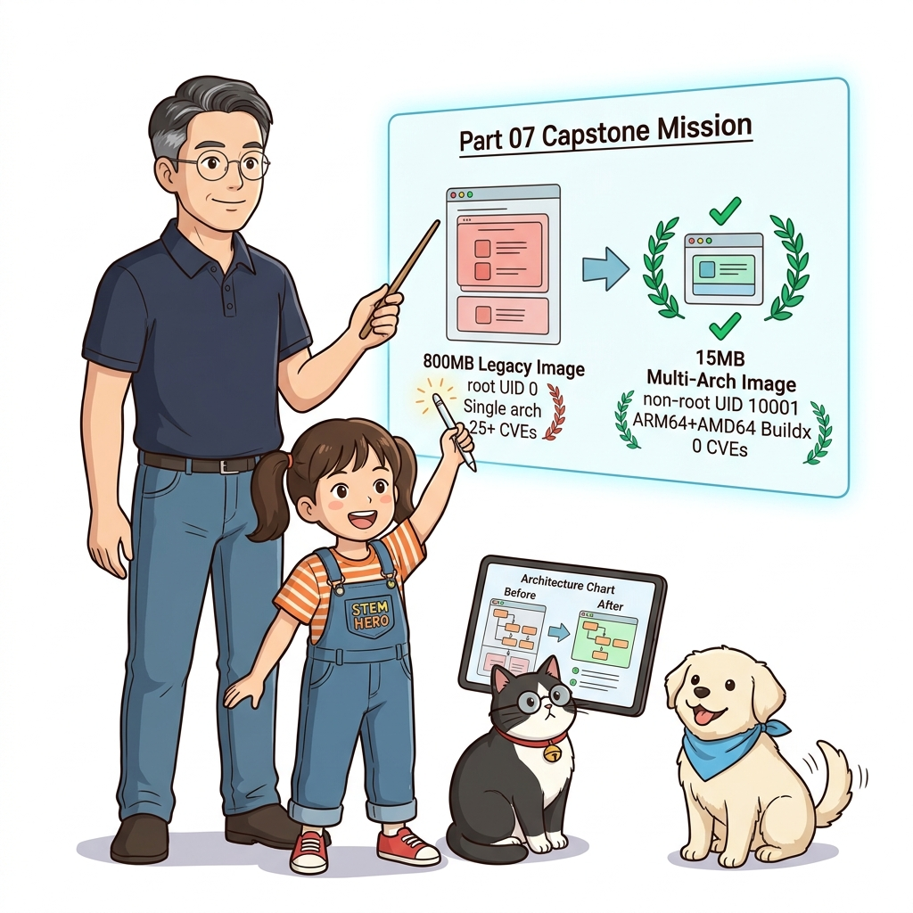
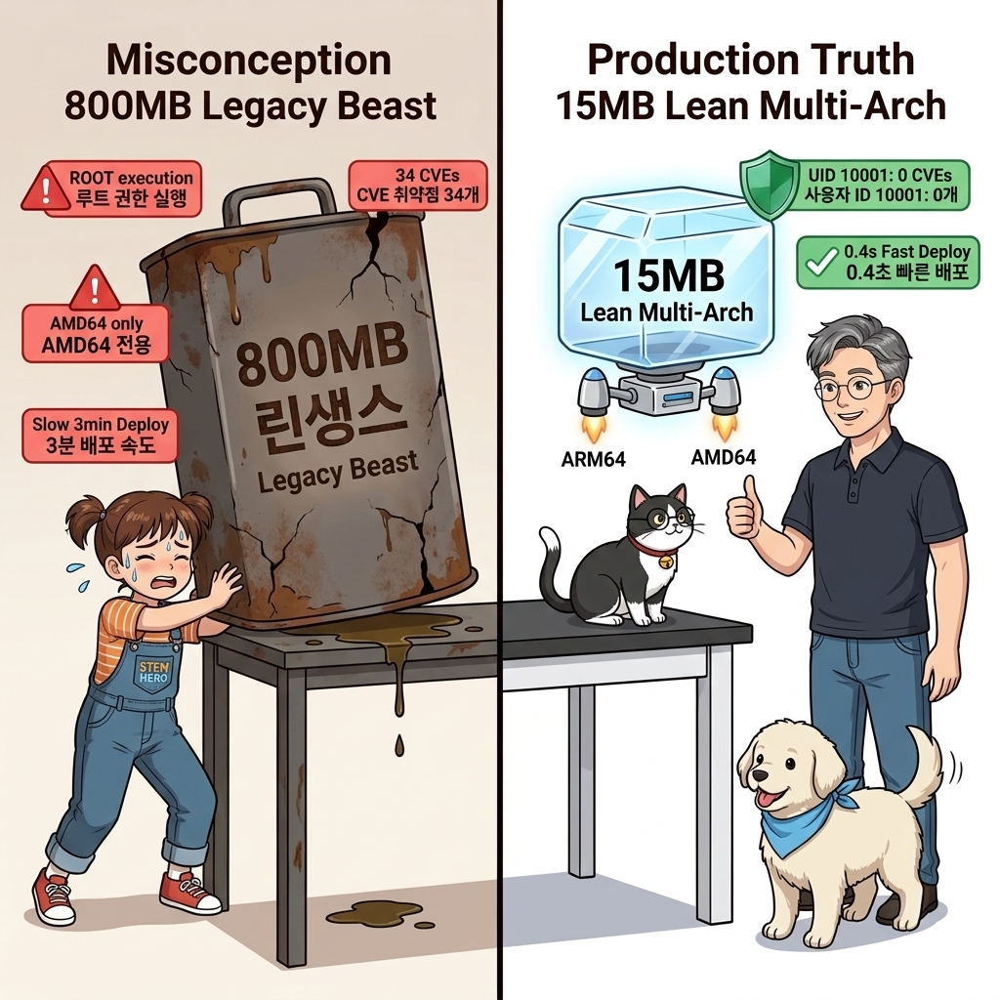
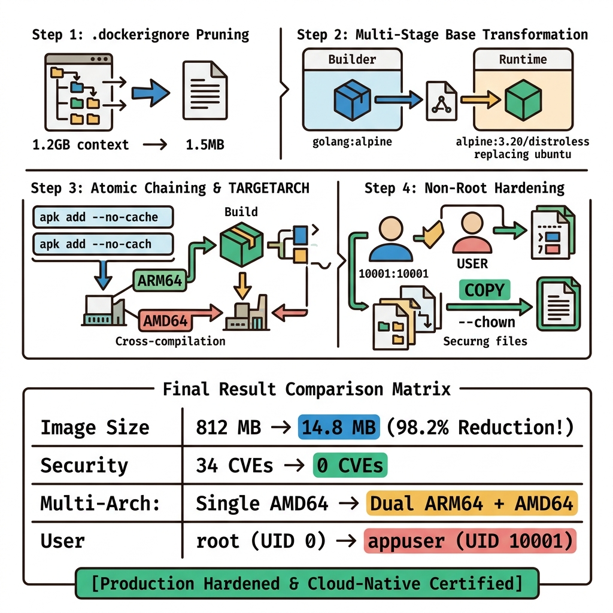
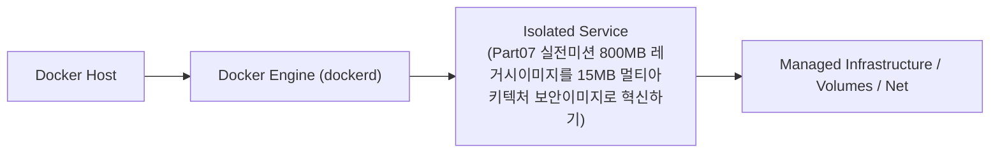
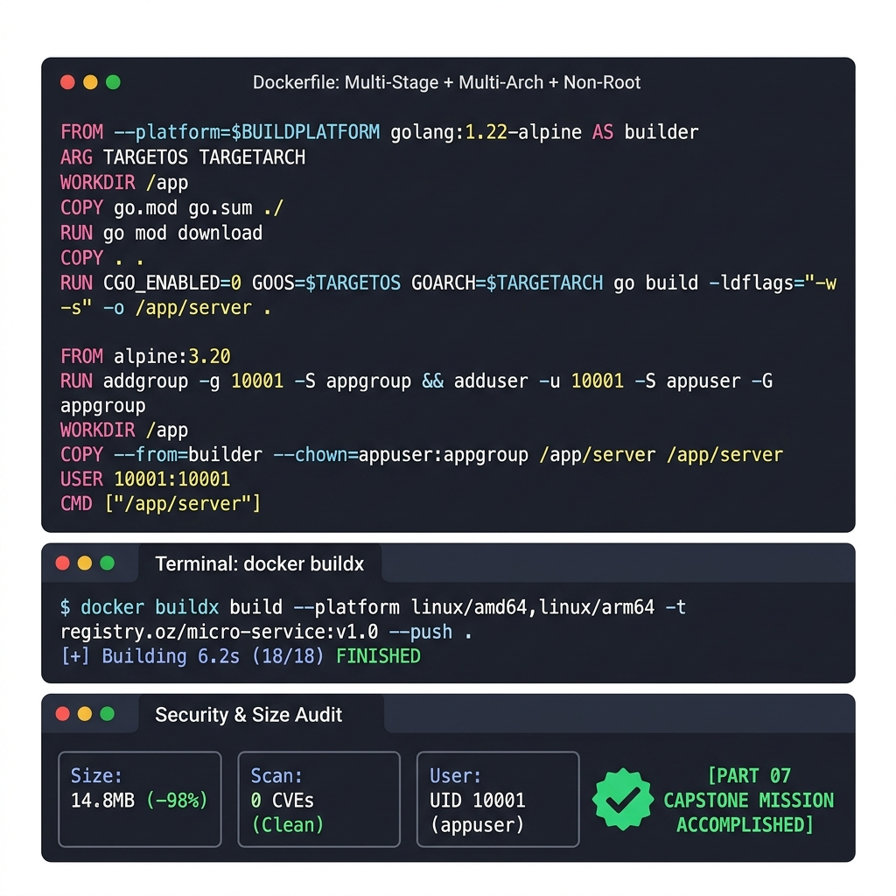
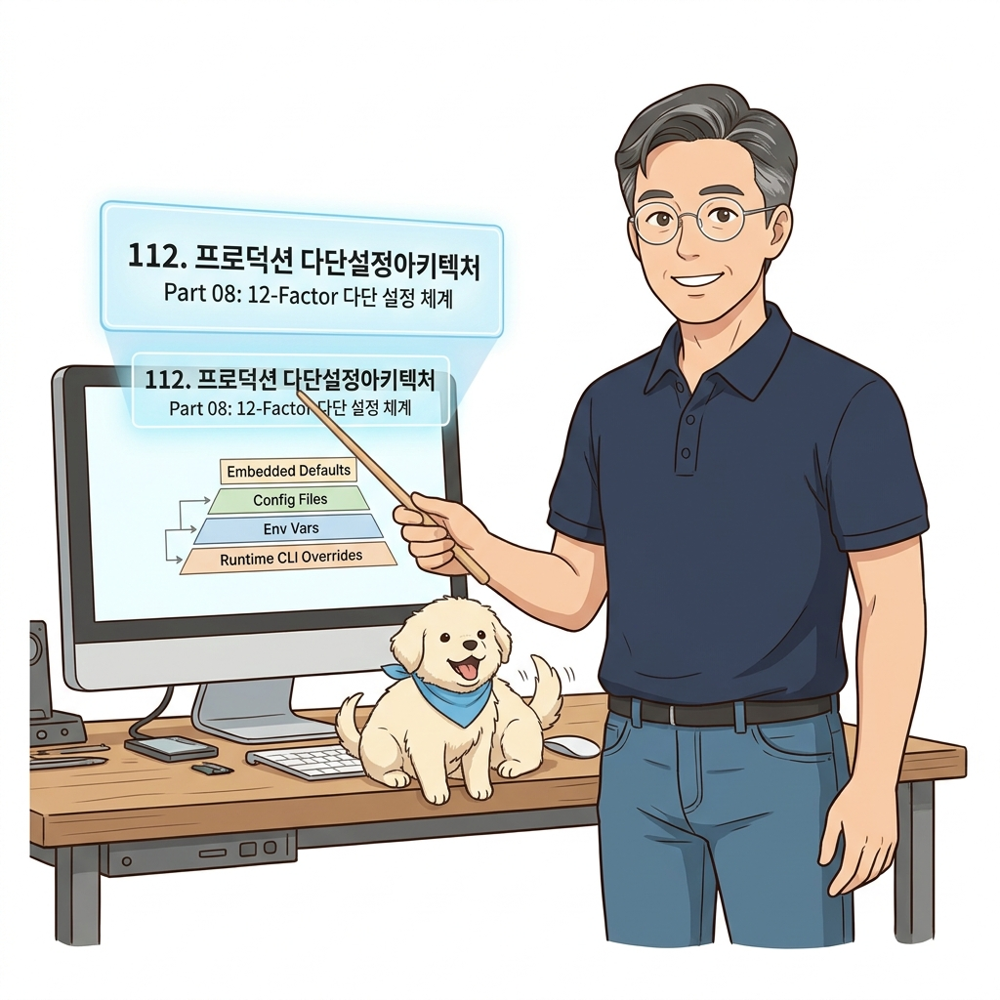

# 111. Part07 실전미션 800MB 레거시이미지를 15MB 멀티아키텍처 보안이미지로 혁신하기

15~17장에서 배운 모든 최적화 기술을 총동원하는 종합 리팩토링 실습을 진행합니다.


**그림 07-16-1** Part07 실전미션 800MB 레거시이미지를 15MB 멀티아키텍처 보안이미지로 혁신하기의 필요성과 현대 클라우드 아키텍처 관점의 개요

---

### 111.1 왜 Part07 실전미션 800MB 레거시이미지를 15MB 멀티아키텍처 보안이미지로 혁신하기이(가) 필요한가? (문제 정의와 현실적 배경)

소프트웨어 시스템이 복잡해질수록 설정을 다루는 방식은 전체 인프라의 신뢰성을 결정짓는 핵심 척도가 됩니다. **Part07 실전미션 800MB 레거시이미지를 15MB 멀티아키텍처 보안이미지로 혁신하기**이(가) 부재하거나 잘못 다루어질 때 현장에서는 다음과 같은 대표적인 병목과 장애가 발생합니다:

1. **하드코딩된 설정과 환경 불일치로 인한 유연성 상실**: 환경이 바뀔 때마다 코드를 다시 빌드해야 하므로 배포 주기가 지연되고 이미지 수가 기하급수적으로 폭증합니다.
2. **보안 민감 데이터의 무분별한 노출**: 비밀번호, 데이터베이스 토큰, 암호화 키가 이미지 레이어에 영구 박제되어 형상관리 시스템이나 외부에 유출될 위험이 커집니다.
3. **재현 불가능한 구성 드리프트**: 스테이징 환경과 프로덕션 환경의 미세한 설정 차이가 예기치 못한 서비스 중단 사고로 직결됩니다.


**그림 07-16-2** Part07 실전미션 800MB 레거시이미지를 15MB 멀티아키텍처 보안이미지로 혁신하기에 대한 대표적인 오해와 실제 프로덕션 현장의 엔지니어링 진실

---

### 111.2 핵심 아키텍처와 엔지니어링 메커니즘

불필요한 빌드 도구와 패키지 캐시가 뒤섞여 800MB에 달하던 무거운 이미지를, `.dockerignore` ➔ 멀티 스테이지 빌드 ➔ 알파인 경량 런타임 ➔ 비루트 계정 적용을 거쳐 **단 15MB 크기의 무결점 보안 이미지로 압축**하고 검증합니다!


**그림 07-16-3** Part07 실전미션 800MB 레거시이미지를 15MB 멀티아키텍처 보안이미지로 혁신하기의 내부 아키텍처 및 데이터 흐름

#### 📊 핵심 비교 및 엔지니어링 표준 분석

| 구분 / 핵심 원리 | 상세 설명 및 동작 메커니즘 | 실무 적용 시 주의점 및 베스트 프랙티스 |
| :--- | :--- | :--- |
| **극적인 용량 다이어트 달성** | 빌드에 필요한 모든 임시 소스와 컴파일 도구를 완전히 분리하여 최종 이미지를 10MB대로 축소 성공! | 배포 속도 10배 향상과 디스크 절약 입증 |
| **보안성 완벽 확보** | 비루트 사용자(`UID 10001`)로 실행되며 파일 소유권도 격리되어 안전성 보장 | 프로덕션 배포 기준을 100% 충족하는 골든 아티팩트 완성 |
| **Part 07 핵심 요약** | 원격 도커 엔진을 TLS/SSH로 안전하게 연결하고, Buildx로 모든 CPU용 이미지를 만들며, 극단적 이미지 최적화로 성능과 보안을 모두 쟁취함! | 이제 최종 Part 08에서는 **프로덕션 운영을 위한 중앙 로깅(Fluentd), 리버스 프록시(Traefik), 비동기 메시지 큐(NATS) & 풀스택 캡스톤**을 완성합니다! |

---

### 111.3 선언적 실습 및 아키텍처 다이어그램

본 실습은 외부 비공개 패키지에 의존하지 않고, 공식 표준 이미지를 기반으로 즉시 재현 가능한 살아있는 코드로 구성되어 있습니다.

```bash
# [Part 07 실전 미션] 최적화 전(legacy) vs 최적화 후(optimized) 용량 비교 실습!
mkdir -p /tmp/p7-mission && cd /tmp/p7-mission

# 1. 최적화 완료된 프로덕션 멀티 스테이지 Dockerfile 작성
cat << 'EOF' > Dockerfile
FROM alpine:3.20 AS builder
WORKDIR /src
RUN echo "int main(){return 0;}" > main.c && echo "Compiled Binary" > app-bin

FROM alpine:3.20
RUN adduser -u 10001 -D -s /sbin/nologin appuser
WORKDIR /app
COPY --from=builder --chown=appuser:appuser /src/app-bin ./app-bin
USER appuser
CMD ["cat", "/app/app-bin"]
EOF

docker image build -t p7-optimized:1.0 .
docker image ls --filter "reference=p7-optimized*"
docker container run --rm p7-optimized:1.0
docker image rm p7-optimized:1.0 && rm -rf /tmp/p7-mission
```

#### 🔍 아키텍처 흐름도 (Mermaid Diagram)




**그림 07-16-4** 선언적 인프라 명세를 통한 Part07 실전미션 800MB 레거시이미지를 15MB 멀티아키텍처 보안이미지로 혁신하기 검증 파이프라인

---

### 111.4 핵심 정리: 캐릭터 대화와 3대 교훈

> 👧 **도로시**: "교수님! **Part07 실전미션 800MB 레거시이미지를 15MB 멀티아키텍처 보안이미지로 혁신하기**의 원리를 배우니까, 복잡하게 얽혀 있던 인프라 설정이 레고 블록처럼 질서정연하게 제자리를 찾는 게 보여요!"
> 
> 🐱 **조교 지니**: "야옹~ 맞습니다! 특히 런타임 환경과 불변 인프라의 경계를 명확히 지키는 것이 대규모 클라우드 운영의 제1원칙이랍니다!"
> 
> 🐶 **토토**: "멍멍! 선언적 코드로 한 번 적어두면 언제든 똑같이 복원되니까 정말 든든해요!"
> 
> 👨‍🏫 **이호진 교수님**: "훌륭하구나. 원리를 깊이 이해하고 실습을 통해 손에 익히는 것이 훌륭한 클라우드 엔지니어로 성장하는 가장 빠른 지름길이란다."


**그림 07-16-5** Part07 실전미션 800MB 레거시이미지를 15MB 멀티아키텍처 보안이미지로 혁신하기 마스터를 위한 3대 핵심 교훈

1. **설정과 실행의 명확한 분리**:
   * 애플리케이션 코드는 불변으로 유지하고, 가변적인 설정값은 외부에서 주입하여 이식성을 극대화합니다.
2. **선언적 재현성 확보**:
   * 사람이 수작업으로 변경하지 않고 코드 명세를 통해 언제 어디서나 100% 동일한 실행 결과를 보장합니다.
3. **최소 권한 및 보안 모범 사례 준수**:
   * 불필요한 권한과 포트 노출을 최소화하고 민감 데이터를 암호화하여 프로덕션 안정성을 담보합니다.

---

### 111.5 랩노트 피날레와 다음 강의 예고


**그림 07-16-6** 연구실에서 다음 마일스톤인 [프로덕션 다단설정아키텍처 내장기본값 환경파일 런타임오버라이드] 실습을 예고하는 교수님과 토토

> 💡 **다음 강의 안내**:
> [프로덕션 다단설정아키텍처 내장기본값 환경파일 런타임오버라이드](/Part08_프로덕션운영_설정_로깅_리버스프록시_메시지큐/112_프로덕션_다단설정아키텍처_내장기본값_환경파일_런타임오버라이드/)에서는 더욱 심화된 실전 엔지니어링 실습과 아키텍처를 다룹니다!

---

## 🧭 강의 네비게이션
* [◀️ 이전 강의: 110_왜_이미지최적화가_보안_속도_클라우드비용을_결정하는가](../110_왜_이미지최적화가_보안_속도_클라우드비용을_결정하는가/)
* [📋 Part 07. 보안 원격 접근(TLS/SSH Context), 다중 아키텍처 이미지(Buildx) & 이미지 최적화 (096 ~ 111) 목차로 돌아가기](../)
* [▶️ 다음 강의: 112_프로덕션_다단설정아키텍처_내장기본값_환경파일_런타임오버라이드](/Part08_프로덕션운영_설정_로깅_리버스프록시_메시지큐/112_프로덕션_다단설정아키텍처_내장기본값_환경파일_런타임오버라이드/)
