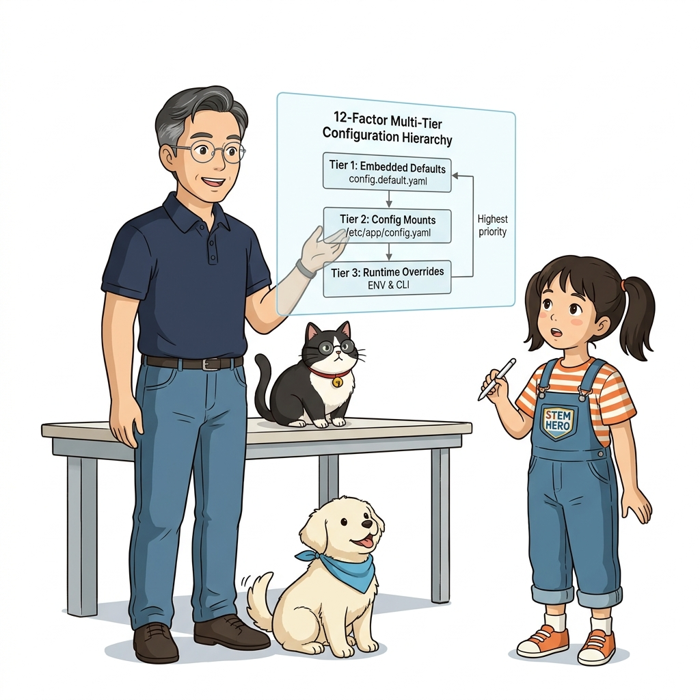
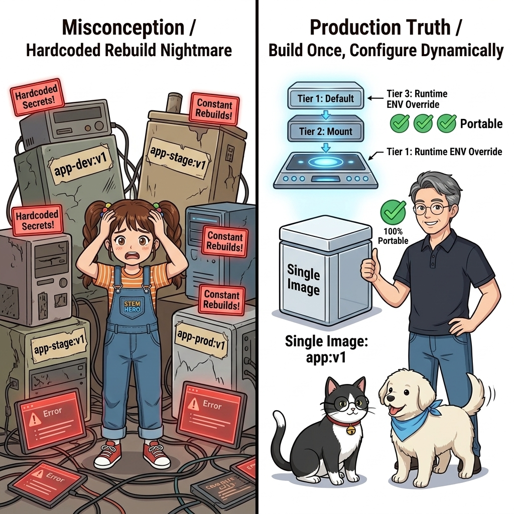
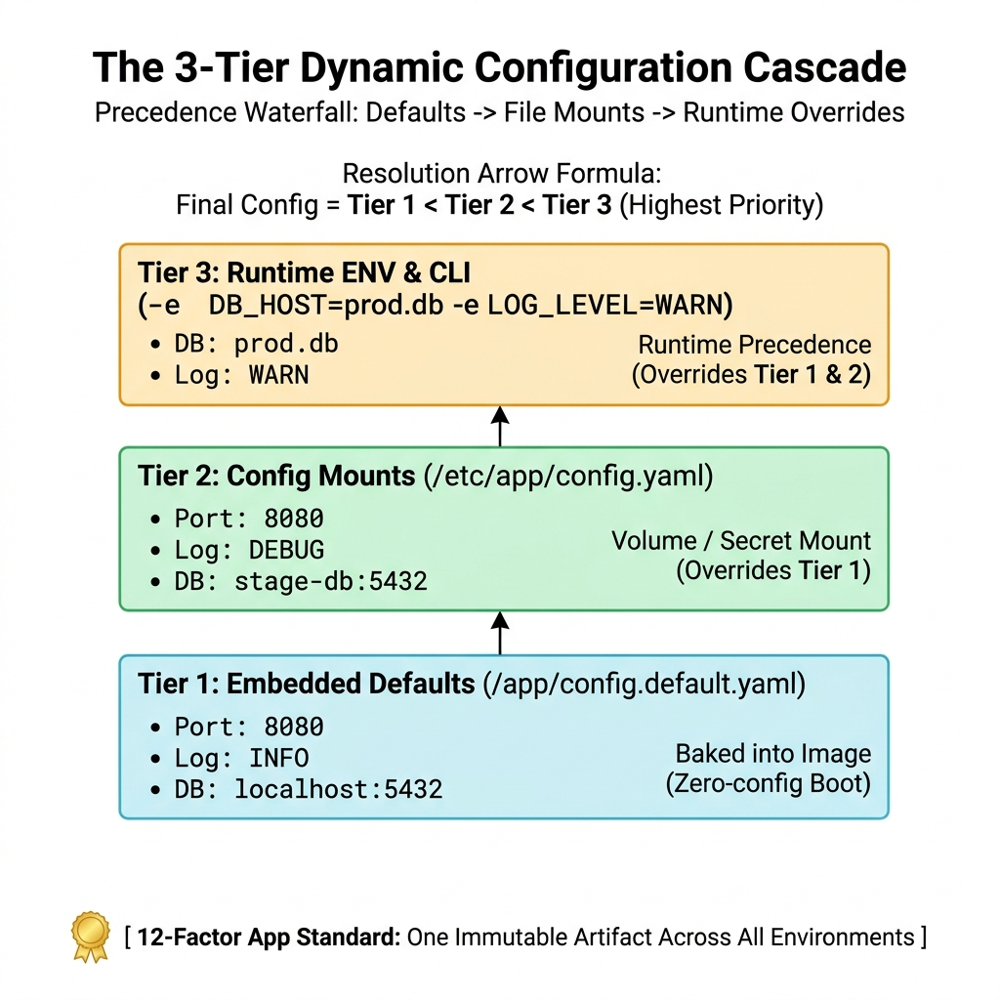
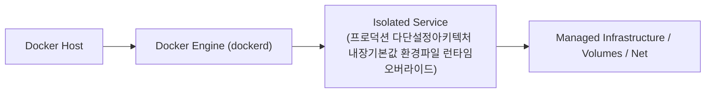
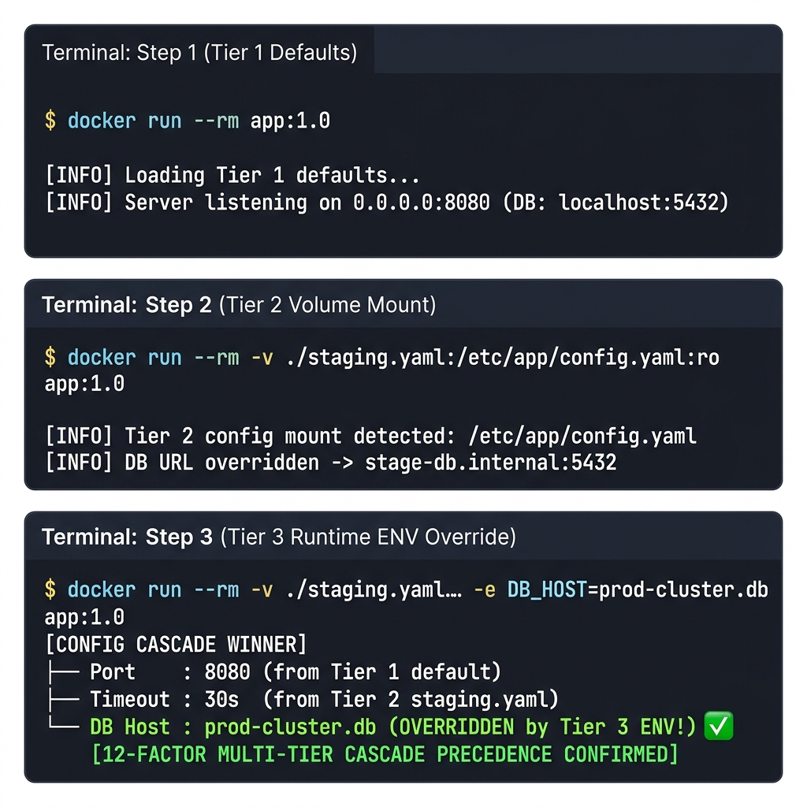
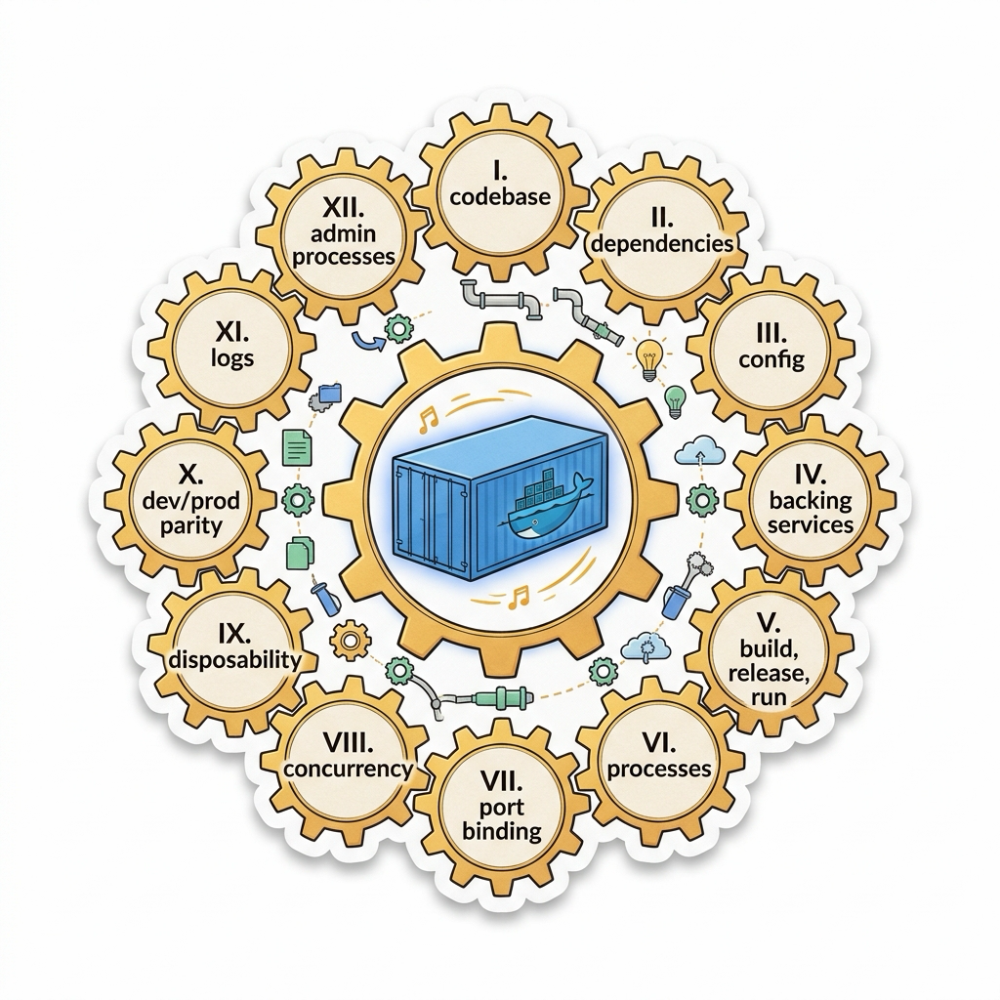
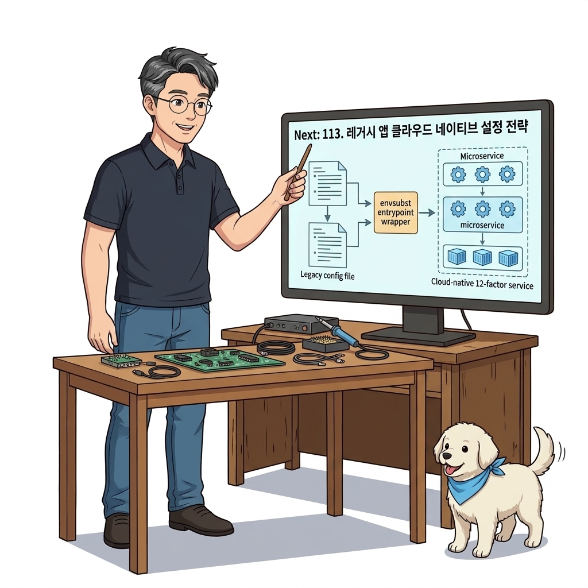

# 112. 프로덕션 다단설정아키텍처 내장기본값 환경파일 런타임오버라이드

잘 만들어진 컨테이너 이미지는 단 한 번만 빌드되며, 개발·스테이징·운영 서버 어디서나 **이미지 재빌드 없이 오직 외부 설정 주입만으로 동작을 바꿀 수 있어야(12-Factor App)** 합니다.


**그림 08-1-1** 프로덕션 다단설정아키텍처 내장기본값 환경파일 런타임오버라이드의 필요성과 현대 클라우드 아키텍처 관점의 개요

---

### 112.1 왜 프로덕션 다단설정아키텍처 내장기본값 환경파일 런타임오버라이드이(가) 필요한가? (문제 정의와 현실적 배경)

소프트웨어 시스템이 복잡해질수록 설정을 다루는 방식은 전체 인프라의 신뢰성을 결정짓는 핵심 척도가 됩니다. **프로덕션 다단설정아키텍처 내장기본값 환경파일 런타임오버라이드**이(가) 부재하거나 잘못 다루어질 때 현장에서는 다음과 같은 대표적인 병목과 장애가 발생합니다:

1. **하드코딩된 설정과 환경 불일치로 인한 유연성 상실**: 환경이 바뀔 때마다 코드를 다시 빌드해야 하므로 배포 주기가 지연되고 이미지 수가 기하급수적으로 폭증합니다.
2. **보안 민감 데이터의 무분별한 노출**: 비밀번호, 데이터베이스 토큰, 암호화 키가 이미지 레이어에 영구 박제되어 형상관리 시스템이나 외부에 유출될 위험이 커집니다.
3. **재현 불가능한 구성 드리프트**: 스테이징 환경과 프로덕션 환경의 미세한 설정 차이가 예기치 못한 서비스 중단 사고로 직결됩니다.


**그림 08-1-2** 프로덕션 다단설정아키텍처 내장기본값 환경파일 런타임오버라이드에 대한 대표적인 오해와 실제 프로덕션 현장의 엔지니어링 진실

---

### 112.2 핵심 아키텍처와 엔지니어링 메커니즘

**[1계층: 이미지 내장 기본값 설정] ➔ [2계층: 환경별 설정 파일 마운트] ➔ [3계층: 런타임 환경 변수 최우선 오버라이드]**로 이어지는 3단계 우선순위 병합 계층을 애플리케이션 코드로 구현하고 검증합니다.


**그림 08-1-3** 프로덕션 다단설정아키텍처 내장기본값 환경파일 런타임오버라이드의 내부 아키텍처 및 데이터 흐름

#### 📊 핵심 비교 및 엔지니어링 표준 분석

| 구분 / 핵심 원리 | 상세 설명 및 동작 메커니즘 | 실무 적용 시 주의점 및 베스트 프랙티스 |
| :--- | :--- | :--- |
| **1계층: 이미지 내장 기본값** | 별도의 외부 설정이 주입되지 않아도 컨테이너가 기본값(안전한 로컬 개발 설정)으로 즉시 켜질 수 있도록 보장 | 신규 개발자가 다운받아 바로 실행할 수 있는 자립성 부여 |
| **2계층: 설정 파일 마운트 (Config/Secret)** | 복잡한 구조화 설정(JSON/YAML)을 도커 볼륨이나 스웜 Config/Secret으로 주입 | 수백 줄의 데이터베이스 연결 풀, 라우팅 규칙 등을 깔끔하게 관리 |
| **3계층: 런타임 환경 변수 (최우선)** | 긴급 장애 대응 시 설정 파일을 다시 만들지 않고 `docker run -e APP_LOG_LEVEL=DEBUG`로 특정 값만 즉시 오버라이드! | 가장 유연하고 강력한 최종 제어 수단 |

---

### 112.3 선언적 실습 및 아키텍처 다이어그램

본 실습은 외부 비공개 패키지에 의존하지 않고, 공식 표준 이미지를 기반으로 즉시 재현 가능한 살아있는 코드로 구성되어 있습니다.

```python
# 3단계 다단 설정(내장 기본값 -> 설정 파일 -> 환경 변수) 병합 원리를 구현한 파이썬 설정 로더
import os, json

default_config = {"app_name": "OzPortal", "port": 8080, "log_level": "INFO"}
file_config = {"log_level": "WARN", "max_conn": 100}  # 마운트된 설정 파일에서 로드
env_override = {}
if "APP_LOG_LEVEL" in os.environ:
    env_override["log_level"] = os.environ["APP_LOG_LEVEL"]

# 3계층 병합 (오른쪽이 왼쪽을 덮어씀)
final_config = {**default_config, **file_config, **env_override}
print("Final Production Config:", final_config)
```

#### 🔍 아키텍처 흐름도 (Mermaid Diagram)




**그림 08-1-4** 선언적 인프라 명세를 통한 프로덕션 다단설정아키텍처 내장기본값 환경파일 런타임오버라이드 검증 파이프라인

---

<!-- BIBLE_INTEGRATION_book2_deep_112 -->
---

### 112.C 📚 도커 바이블 심화: The 12-Factor App과 도커 컨테이너 엔지니어링 1:1 전수 매핑
*출처 도서: 『Docker Up and Running』 핵심 분석 (Docker Up and Running 제11장 (앱의 12요소))*

현대 클라우드 네이티브 아키텍처의 바이블인 **'The Twelve-Factor App(앱의 12요소)'**은 도커 컨테이너 기술과 만났을 때 비로소 완전한 기술적 실체로 구현됩니다:

| 12-Factor 원칙 | 핵심 개념 | 도커(Docker) 엔지니어링 구현 방식 |
| :--- | :--- | :--- |
| **I. 코드베이스 (Codebase)** | 버전 관리되는 하나의 코드, 여러 번 배포 | 단일 Git 저장소에서 단일 Dockerfile로 베이스 이미지 빌드 |
| **II. 의존성 (Dependencies)** | 명시적으로 선언되고 격리된 의존성 | Dockerfile 내에 패키지 설치(`npm install`, `pip install`)를 완전히 격리 |
| **III. 설정 (Config)** | 환경(dev/prod)에 따른 설정을 환경 변수에 저장 | `ENV`, `-e`, `.env`, 도커 컴포즈 `environment` 주입 |
| **IV. 백킹 서비스 (Backing Services)**| DB, 캐시, 큐를 연결된 리소스로 취급 | DB를 로컬 파일이 아닌 독립 컨테이너 URL(`db:5432`)로 느슨하게 결합 |
| **V. 빌드, 릴리스, 실행** | 빌드와 실행 단계의 엄격한 분리 | `docker build`(빌드) -> `docker tag`(릴리스) -> `docker run`(실행) |
| **VI. 프로세스 (Processes)** | 앱을 하나 이상의 무상태(Stateless) 프로세스로 실행 | 컨테이너 로컬 디스크에 상태를 저장하지 않고 외부 볼륨/DB에 위임 |
| **VII. 포트 바인딩 (Port Binding)** | 자체 완결형 포트 바인딩으로 서비스 공개 | 내장 웹 서버(Kestrel, Express)를 구동하고 `-p 8080:80`으로 직접 바인딩 |
| **VIII. 동시성 (Concurrency)** | 프로세스 모델을 통한 수평 확장(Scale-out) | 단일 컨테이너의 스레드를 늘리기보다 컨테이너 복제본(Replicas) 수평 증설 |
| **IX. 폐기 가능성 (Disposability)**| 빠른 시작과 우아한 종료로 안정성 극대화 | 밀리초 단위 컨테이너 기동 및 `SIGTERM` 수신 후 10초 내 정상 종료 |
| **X. 환경 일치 (Dev/Prod Parity)**| 개발, 스테이징, 프로덕션을 최대한 유사하게 유지 | 전 세계 어디서나 비트 단위로 100% 동일하게 실행되는 불변 이미지 |
| **XI. 로그 (Logs)** | 로그를 이벤트 스트림으로 취급 | 파일에 쓰지 않고 `stdout`/`stderr`로 출력하여 도커 로그 드라이버에 위임 |
| **XII. 관리 프로세스 (Admin Processes)**| 일회성 관리 태스크를 동일 환경에서 실행 | DB 마이그레이션 등을 `docker run --rm myapp npm run db:migrate`로 일회성 수행 |


**그림 112-B-2** The Twelve-Factor App의 12대 원칙이 도커 컨테이너 라이프사이클과 1:1로 맞물리는 아키텍처

```bash
# [실습] 12-Factor를 준수하는 완벽한 런타임 환경 구성 실습
# 1. 설정을 환경 변수로 주입 (Factor III)
# 2. 백킹 서비스를 독립 네트워크로 연결 (Factor IV)
# 3. 일회성 마이그레이션 컨테이너 기동 후 즉시 폐기 (Factor XII)
docker network create twelve-factor-net

docker container run -d --name redis-backing --network twelve-factor-net redis:alpine
docker container run -d --name api-service --network twelve-factor-net \
  -e PORT=8080 \
  -e REDIS_URL=redis://redis-backing:6379 \
  -p 8080:8080 \
  nginx:alpine

# 일회성 점검 태스크 실행 후 자동 삭제 (--rm)
docker container run --rm --network twelve-factor-net alpine ping -c 2 redis-backing
```

> 👨‍🏫 **이호진 교수님의 바이블 멘토링 노트**:
> "12-Factor App은 도커가 세상에 나오기 전에 정립된 이론이지만, 도커는 마치 12-Factor를 물리적으로 구현하기 위해 태어난 도구처럼 완벽하게 맞아떨어집니다. 이 12개 원칙만 지키면 여러분의 시스템은 어떤 클라우드로 옮겨도 단 1초 만에 동작합니다."
>
> 👧 **도로시의 깨달음**:
> "12개의 튼튼한 톱니바퀴가 하나로 맞물려 돌아가듯, 도커의 모든 기능이 클라우드 네이티브 설계 원칙과 완벽하게 연결되어 있었네요!"
>
> 🐱 **조교 지니의 아키텍처 체크포인트**:
> "특히 Factor XI(로그를 이벤트 스트림으로 취급)를 지키지 않고 컨테이너 안에 log4j 파일로 남기면 컨테이너가 죽었을 때 로그도 함께 사라져 영원한 미제가 됩니다."


### 112.4 핵심 정리: 캐릭터 대화와 3대 교훈

> 👧 **도로시**: "교수님! **프로덕션 다단설정아키텍처 내장기본값 환경파일 런타임오버라이드**의 원리를 배우니까, 복잡하게 얽혀 있던 인프라 설정이 레고 블록처럼 질서정연하게 제자리를 찾는 게 보여요!"
> 
> 🐱 **조교 지니**: "야옹~ 맞습니다! 특히 런타임 환경과 불변 인프라의 경계를 명확히 지키는 것이 대규모 클라우드 운영의 제1원칙이랍니다!"
> 
> 🐶 **토토**: "멍멍! 선언적 코드로 한 번 적어두면 언제든 똑같이 복원되니까 정말 든든해요!"
> 
> 👨‍🏫 **이호진 교수님**: "훌륭하구나. 원리를 깊이 이해하고 실습을 통해 손에 익히는 것이 훌륭한 클라우드 엔지니어로 성장하는 가장 빠른 지름길이란다."


**그림 08-1-5** 프로덕션 다단설정아키텍처 내장기본값 환경파일 런타임오버라이드 마스터를 위한 3대 핵심 교훈

1. **설정과 실행의 명확한 분리**:
   * 애플리케이션 코드는 불변으로 유지하고, 가변적인 설정값은 외부에서 주입하여 이식성을 극대화합니다.
2. **선언적 재현성 확보**:
   * 사람이 수작업으로 변경하지 않고 코드 명세를 통해 언제 어디서나 100% 동일한 실행 결과를 보장합니다.
3. **최소 권한 및 보안 모범 사례 준수**:
   * 불필요한 권한과 포트 노출을 최소화하고 민감 데이터를 암호화하여 프로덕션 안정성을 담보합니다.

---

### 112.5 랩노트 피날레와 다음 강의 예고


**그림 08-1-6** 연구실에서 다음 마일스톤인 [레거시애플리케이션에 클라우드네이티브 설정전략 적용하기] 실습을 예고하는 교수님과 토토

> 💡 **다음 강의 안내**:
> [레거시애플리케이션에 클라우드네이티브 설정전략 적용하기](../113_레거시애플리케이션에_클라우드네이티브_설정전략_적용하기/)에서는 더욱 심화된 실전 엔지니어링 실습과 아키텍처를 다룹니다!

---

## 🧭 강의 네비게이션
* [◀️ 이전 강의: 111_Part07_실전미션_800MB_레거시이미지를_15MB_멀티아키텍처_보안이미지로_혁신하기](/Part07_보안원격접근_다중아키텍처_이미지최적화/111_Part07_실전미션_800MB_레거시이미지를_15MB_멀티아키텍처_보안이미지로_혁신하기/)
* [📋 Part 08. 프로덕션 운영 마스터: 설정 관리, 중앙 로깅(Fluentd), 리버스 프록시(Nginx/Traefik), 비동기 메시지 큐(Redis/NATS) & 최종 캡스톤 (112 ~ 129) 목차로 돌아가기](../)
* [▶️ 다음 강의: 113_레거시애플리케이션에_클라우드네이티브_설정전략_적용하기](../113_레거시애플리케이션에_클라우드네이티브_설정전략_적용하기/)
