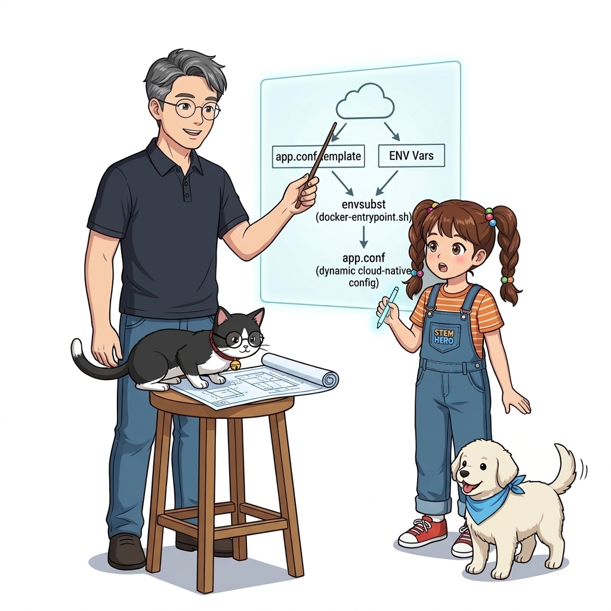
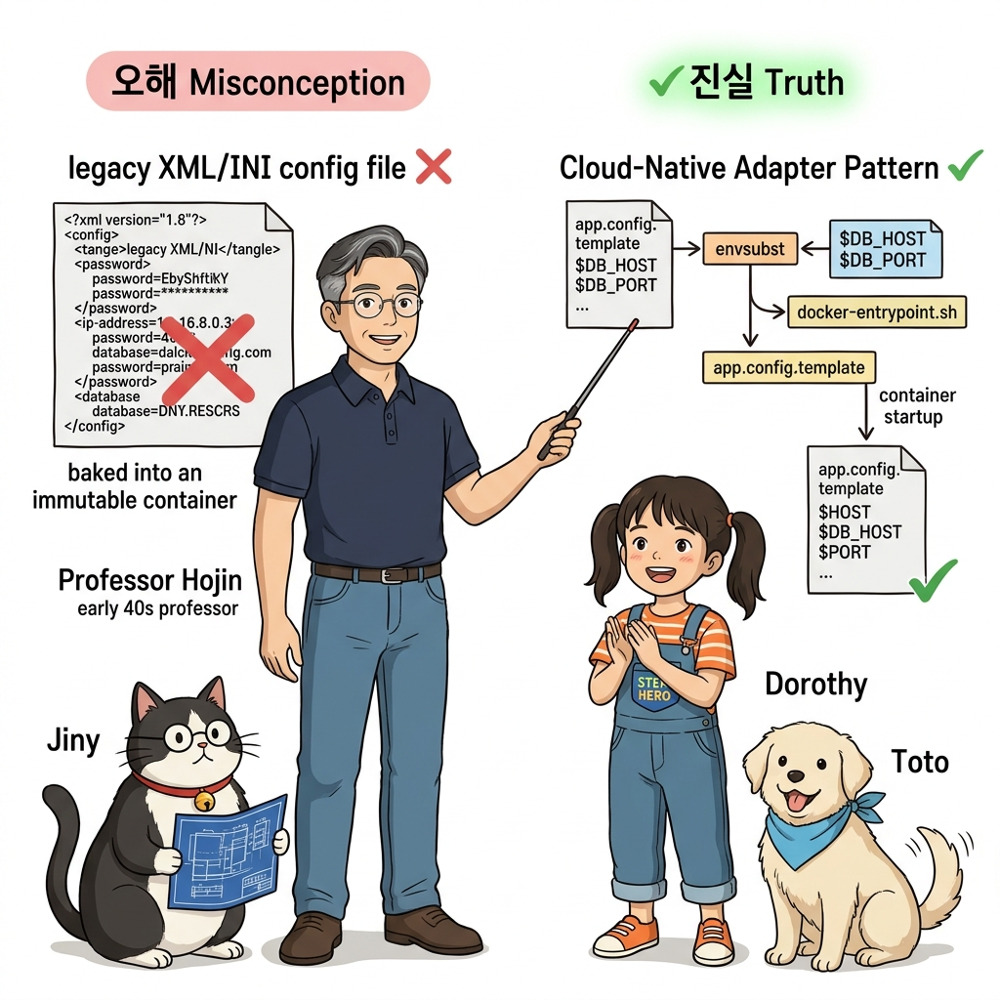
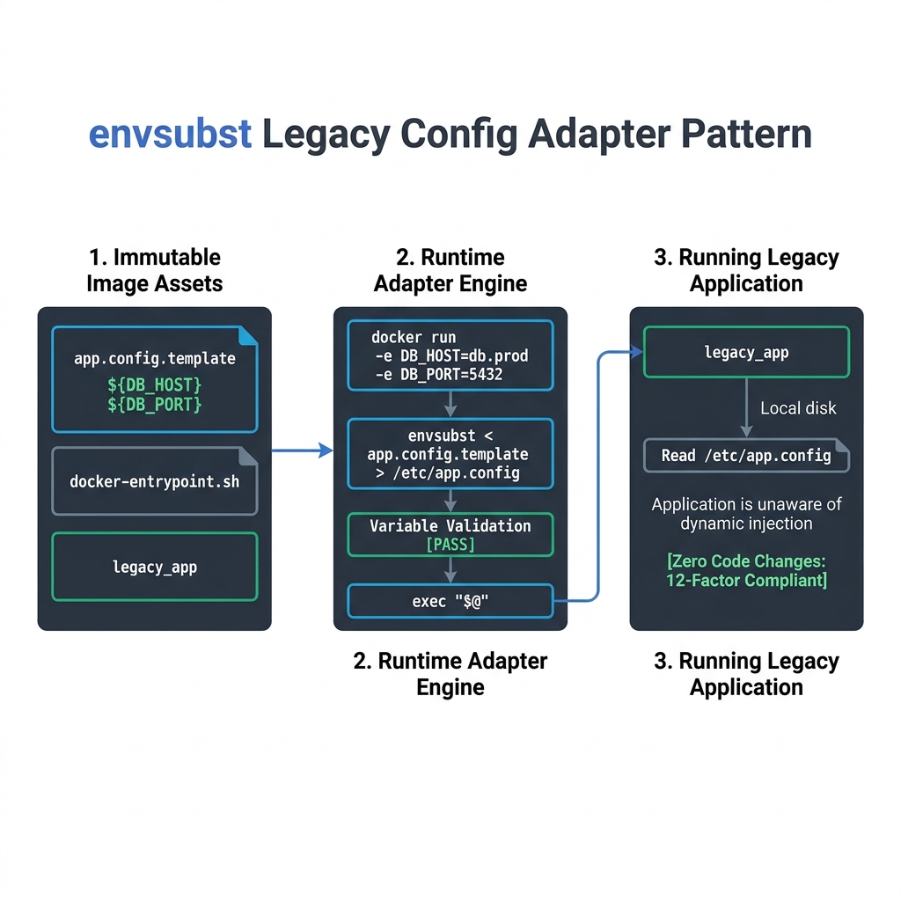
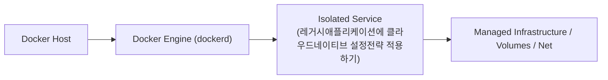
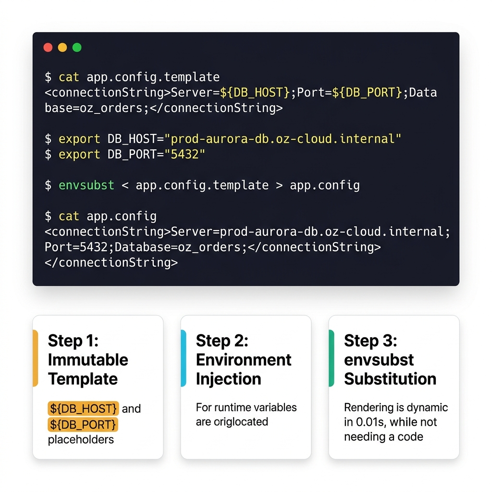
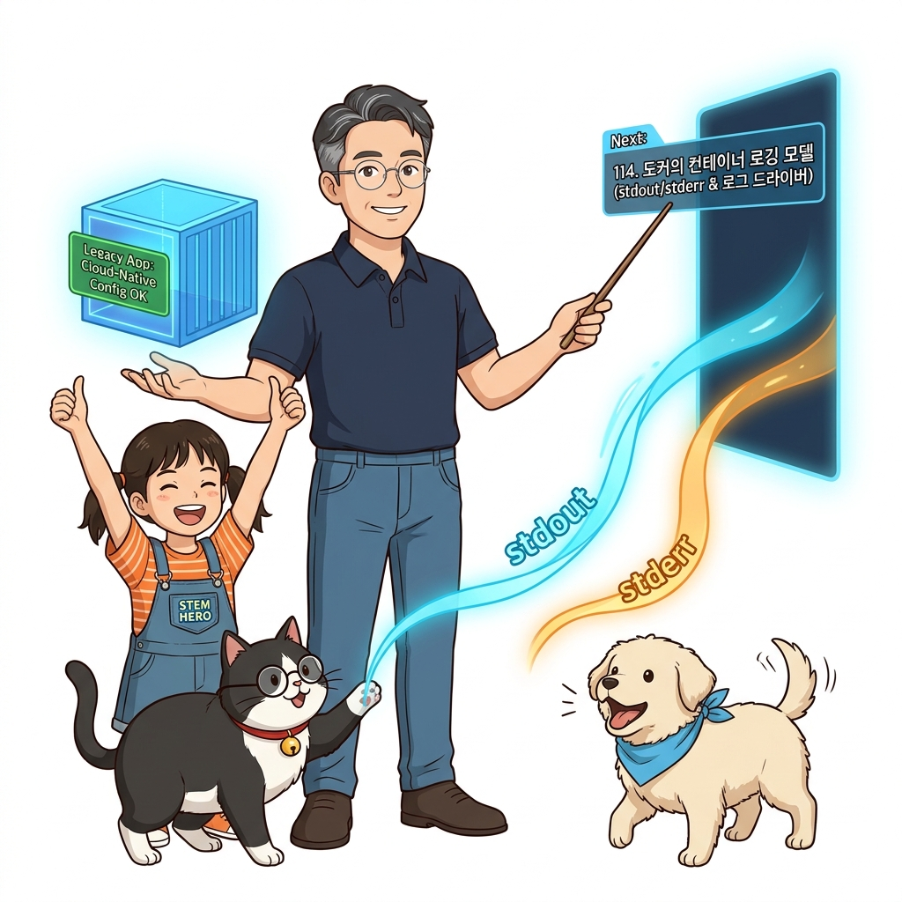

# 113. 레거시애플리케이션에 클라우드네이티브 설정전략 적용하기

오래된 레거시 시스템이나 기성 COTS(Commercial Off-The-Shelf) 소프트웨어는 환경 변수를 읽는 코드가 없고 오직 로컬 디스크의 XML/INI/JSON 파일만 읽도록 하드코딩되어 있는 경우가 많습니다.


**그림 08-2-1** 레거시애플리케이션에 클라우드네이티브 설정전략 적용하기의 필요성과 현대 클라우드 아키텍처 관점의 개요

---

### 113.1 왜 레거시애플리케이션에 클라우드네이티브 설정전략 적용하기이(가) 필요한가? (문제 정의와 현실적 배경)

소프트웨어 시스템이 복잡해질수록 설정을 다루는 방식은 전체 인프라의 신뢰성을 결정짓는 핵심 척도가 됩니다. **레거시애플리케이션에 클라우드네이티브 설정전략 적용하기**이(가) 부재하거나 잘못 다루어질 때 현장에서는 다음과 같은 대표적인 병목과 장애가 발생합니다:

1. **하드코딩된 설정과 환경 불일치로 인한 유연성 상실**: 환경이 바뀔 때마다 코드를 다시 빌드해야 하므로 배포 주기가 지연되고 이미지 수가 기하급수적으로 폭증합니다.
2. **보안 민감 데이터의 무분별한 노출**: 비밀번호, 데이터베이스 토큰, 암호화 키가 이미지 레이어에 영구 박제되어 형상관리 시스템이나 외부에 유출될 위험이 커집니다.
3. **재현 불가능한 구성 드리프트**: 스테이징 환경과 프로덕션 환경의 미세한 설정 차이가 예기치 못한 서비스 중단 사고로 직결됩니다.


**그림 08-2-2** 레거시애플리케이션에 클라우드네이티브 설정전략 적용하기에 대한 대표적인 오해와 실제 프로덕션 현장의 엔지니어링 진실

---

### 113.2 핵심 아키텍처와 엔지니어링 메커니즘

소스 코드를 한 줄도 수정하지 않고, **컨테이너 시작 스크립트(`entrypoint.sh`)에서 `envsubst` 유틸리티를 사용해 설정 템플릿의 변수(`${DB_HOST}`)를 런타임 환경 변수 값으로 실시간 치환하여 설정 파일을 동적 생성**한 뒤 메인 앱을 실행하는 실무 어댑터 패턴을 배웁니다!


**그림 08-2-3** 레거시애플리케이션에 클라우드네이티브 설정전략 적용하기의 내부 아키텍처 및 데이터 흐름

#### 📊 핵심 비교 및 엔지니어링 표준 분석

| 구분 / 핵심 원리 | 상세 설명 및 동작 메커니즘 | 실무 적용 시 주의점 및 베스트 프랙티스 |
| :--- | :--- | :--- |
| **`envsubst` 템플릿 치환** | GNU gettext 패키지에 포함된 표준 리눅스 도구로, 텍스트 파일 안의 `${환경변수}`를 현재 셸의 실제 값으로 0.01초 만에 치환 | Nginx의 `nginx.conf.template`에서도 공식 지원하는 가장 검증된 패턴! |
| **어댑터 엔트리포인트 (`docker-entrypoint.sh`)** | `Dockerfile`의 `ENTRYPOINT ["/docker-entrypoint.sh"]`에서 템플릿 치환을 먼저 수행한 뒤 `exec "$@"`로 원래 애플리케이션 바이너리 실행 | 레거시 애플리케이션을 완벽한 클라우드 네이티브 12-Factor 컨테이너로 둔갑시키는 마법 |
| **설정 검증 로직 추가** | 치환 후 필수 설정값이 비어 있는지 셸 스크립트로 검증하고, 빠졌다면 친절한 안내 메시지와 함께 Fail-Fast 종료 | 원인 불명의 런타임 크래시를 기동 단계에서 사전에 완벽 차단 |

---

### 113.3 선언적 실습 및 아키텍처 다이어그램

본 실습은 외부 비공개 패키지에 의존하지 않고, 공식 표준 이미지를 기반으로 즉시 재현 가능한 살아있는 코드로 구성되어 있습니다.

```bash
# envsubst를 이용해 템플릿 파일의 ${DB_HOST}를 런타임 환경 변수로 실시간 치환하는 시연
export DB_HOST="prod-aurora-db.oz-cloud.internal"
export DB_PORT="5432"

mkdir -p /tmp/oz-template && cd /tmp/oz-template
cat << 'EOF' > app.config.template
<configuration>
  <connectionString>Server=${DB_HOST};Port=${DB_PORT};Database=oz_orders;</connectionString>
</configuration>
EOF

# 시작 스크립트에서 envsubst 실행으로 최종 app.config 생성!
envsubst < app.config.template > app.config
cat app.config
rm -rf /tmp/oz-template
```

#### 🔍 아키텍처 흐름도 (Mermaid Diagram)




**그림 08-2-4** 선언적 인프라 명세를 통한 레거시애플리케이션에 클라우드네이티브 설정전략 적용하기 검증 파이프라인

---

### 113.4 핵심 정리: 캐릭터 대화와 3대 교훈

> 👧 **도로시**: "교수님! **레거시애플리케이션에 클라우드네이티브 설정전략 적용하기**의 원리를 배우니까, 복잡하게 얽혀 있던 인프라 설정이 레고 블록처럼 질서정연하게 제자리를 찾는 게 보여요!"
> 
> 🐱 **조교 지니**: "야옹~ 맞습니다! 특히 런타임 환경과 불변 인프라의 경계를 명확히 지키는 것이 대규모 클라우드 운영의 제1원칙이랍니다!"
> 
> 🐶 **토토**: "멍멍! 선언적 코드로 한 번 적어두면 언제든 똑같이 복원되니까 정말 든든해요!"
> 
> 👨‍🏫 **이호진 교수님**: "훌륭하구나. 원리를 깊이 이해하고 실습을 통해 손에 익히는 것이 훌륭한 클라우드 엔지니어로 성장하는 가장 빠른 지름길이란다."


**그림 08-2-5** 레거시애플리케이션에 클라우드네이티브 설정전략 적용하기 마스터를 위한 3대 핵심 교훈

1. **설정과 실행의 명확한 분리**:
   * 애플리케이션 코드는 불변으로 유지하고, 가변적인 설정값은 외부에서 주입하여 이식성을 극대화합니다.
2. **선언적 재현성 확보**:
   * 사람이 수작업으로 변경하지 않고 코드 명세를 통해 언제 어디서나 100% 동일한 실행 결과를 보장합니다.
3. **최소 권한 및 보안 모범 사례 준수**:
   * 불필요한 권한과 포트 노출을 최소화하고 민감 데이터를 암호화하여 프로덕션 안정성을 담보합니다.

---

### 113.5 랩노트 피날레와 다음 강의 예고


**그림 08-2-6** 연구실에서 다음 마일스톤인 [도커의 컨테이너로깅모델 stdout stderr와 로그드라이버] 실습을 예고하는 교수님과 토토

> 💡 **다음 강의 안내**:
> [도커의 컨테이너로깅모델 stdout stderr와 로그드라이버](../114_도커의_컨테이너로깅모델_stdout_stderr와_로그드라이버/)에서는 더욱 심화된 실전 엔지니어링 실습과 아키텍처를 다룹니다!

---

## 🧭 강의 네비게이션
* [◀️ 이전 강의: 112_프로덕션_다단설정아키텍처_내장기본값_환경파일_런타임오버라이드](../112_프로덕션_다단설정아키텍처_내장기본값_환경파일_런타임오버라이드/)
* [📋 Part 08. 프로덕션 운영 마스터: 설정 관리, 중앙 로깅(Fluentd), 리버스 프록시(Nginx/Traefik), 비동기 메시지 큐(Redis/NATS) & 최종 캡스톤 (112 ~ 129) 목차로 돌아가기](../)
* [▶️ 다음 강의: 114_도커의_컨테이너로깅모델_stdout_stderr와_로그드라이버](../114_도커의_컨테이너로깅모델_stdout_stderr와_로그드라이버/)
