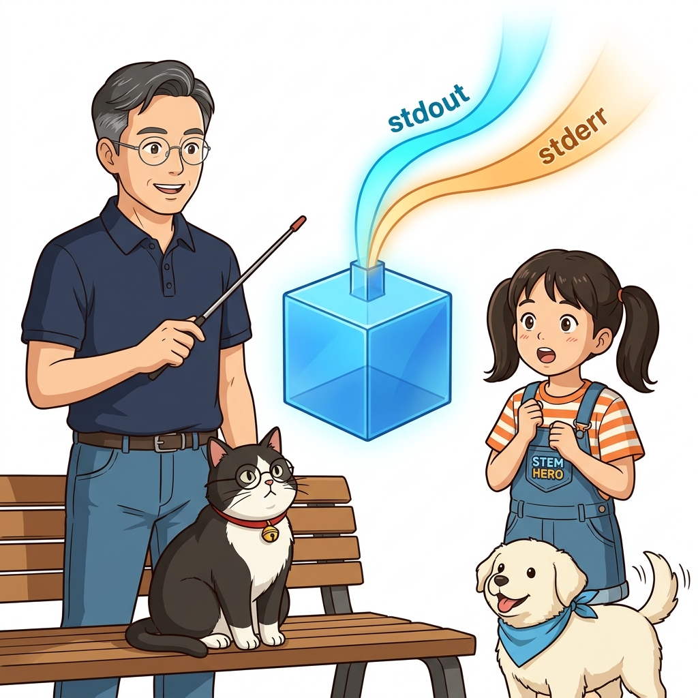
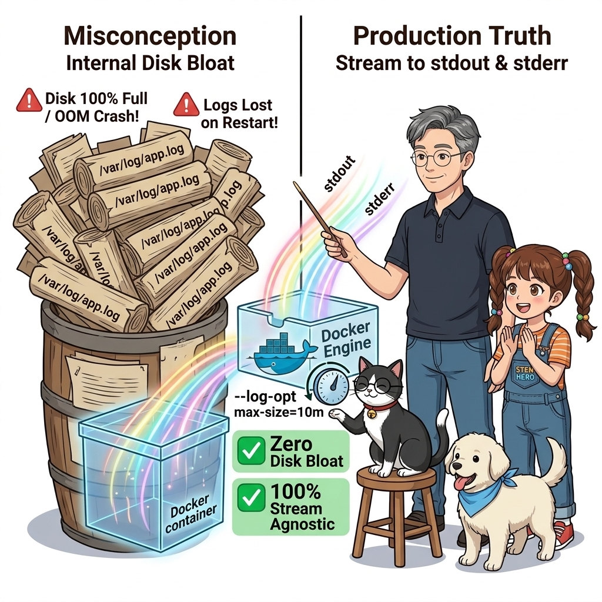
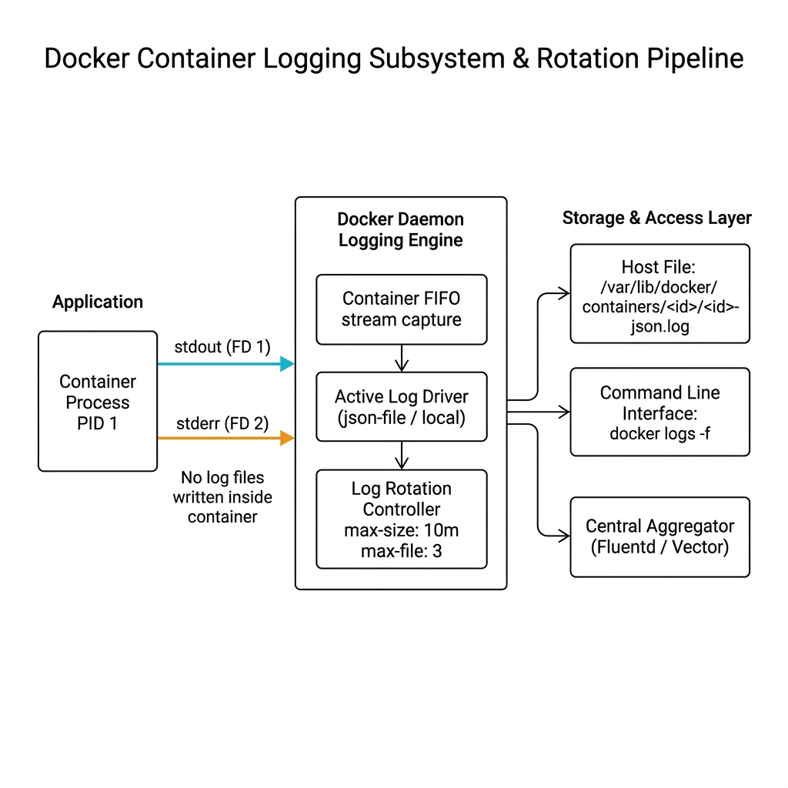
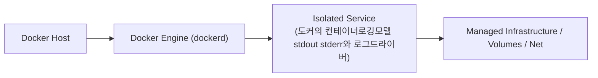
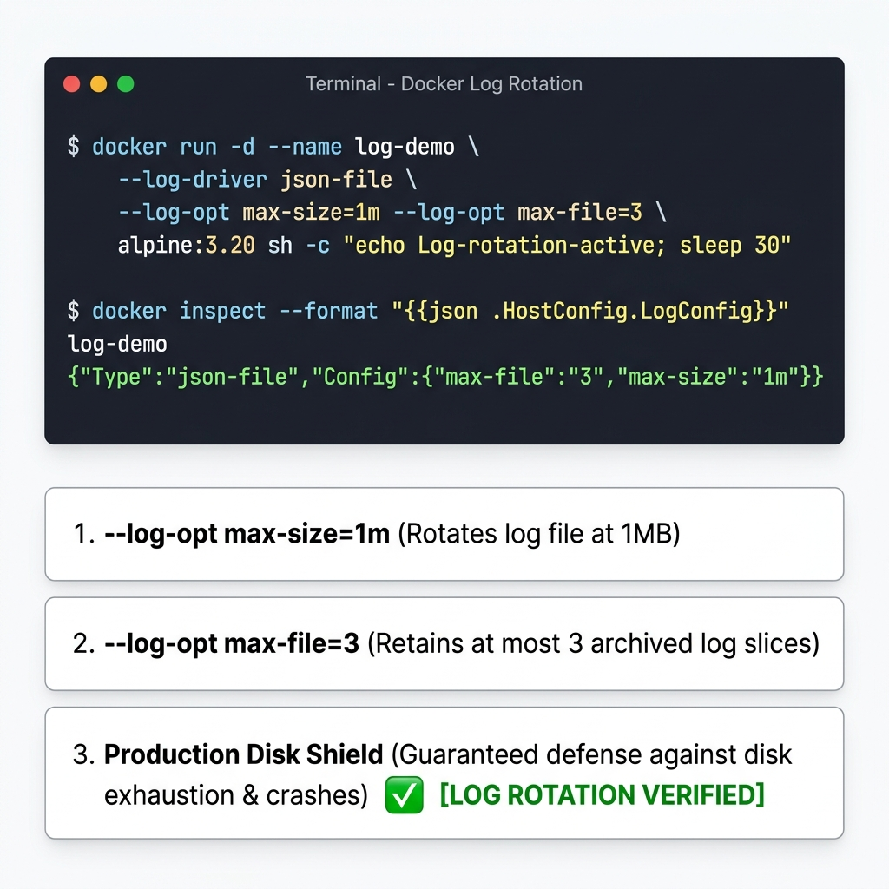
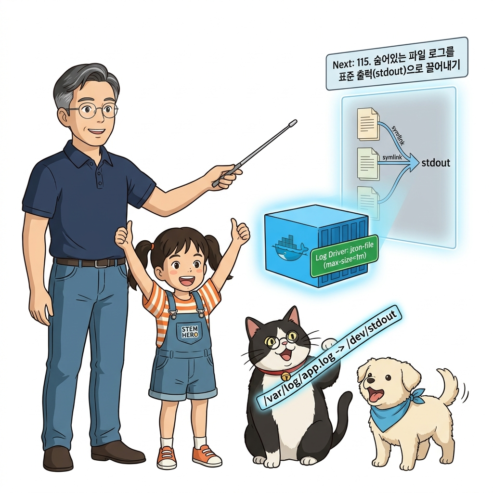

# 114. 도커의 컨테이너로깅모델 stdout stderr와 로그드라이버

도커의 표준 로깅 모델은 컨테이너 내부의 메인 프로세스가 **표준 출력(`stdout`)과 표준 에러(`stderr`)**로 뿜어내는 텍스트 스트림을 도커 데몬이 가로채어 호스트 파일에 JSON으로 기록하는 구조입니다.


**그림 08-3-1** 도커의 컨테이너로깅모델 stdout stderr와 로그드라이버의 필요성과 현대 클라우드 아키텍처 관점의 개요

---

### 114.1 왜 도커의 컨테이너로깅모델 stdout stderr와 로그드라이버이(가) 필요한가? (문제 정의와 현실적 배경)

소프트웨어 시스템이 복잡해질수록 설정을 다루는 방식은 전체 인프라의 신뢰성을 결정짓는 핵심 척도가 됩니다. **도커의 컨테이너로깅모델 stdout stderr와 로그드라이버**이(가) 부재하거나 잘못 다루어질 때 현장에서는 다음과 같은 대표적인 병목과 장애가 발생합니다:

1. **하드코딩된 설정과 환경 불일치로 인한 유연성 상실**: 환경이 바뀔 때마다 코드를 다시 빌드해야 하므로 배포 주기가 지연되고 이미지 수가 기하급수적으로 폭증합니다.
2. **보안 민감 데이터의 무분별한 노출**: 비밀번호, 데이터베이스 토큰, 암호화 키가 이미지 레이어에 영구 박제되어 형상관리 시스템이나 외부에 유출될 위험이 커집니다.
3. **재현 불가능한 구성 드리프트**: 스테이징 환경과 프로덕션 환경의 미세한 설정 차이가 예기치 못한 서비스 중단 사고로 직결됩니다.


**그림 08-3-2** 도커의 컨테이너로깅모델 stdout stderr와 로그드라이버에 대한 대표적인 오해와 실제 프로덕션 현장의 엔지니어링 진실

---

### 114.2 핵심 아키텍처와 엔지니어링 메커니즘

기본 설정대로 두면 로그 파일이 수십 GB로 끝없이 비대해져 호스트 디스크를 고갈시키는 대참사가 발생합니다. **`daemon.json` 또는 컴포즈 `logging:` 옵션에서 `max-size: "20m"`과 `max-file: "5"` 로테이션을 강제 설정**하는 필수 인프라 지침을 실습합니다!


**그림 08-3-3** 도커의 컨테이너로깅모델 stdout stderr와 로그드라이버의 내부 아키텍처 및 데이터 흐름

#### 📊 핵심 비교 및 엔지니어링 표준 분석

| 구분 / 핵심 원리 | 상세 설명 및 동작 메커니즘 | 실무 적용 시 주의점 및 베스트 프랙티스 |
| :--- | :--- | :--- |
| **컨테이너 로깅의 제1원칙** | 컨테이너 내부의 파일(`/app/app.log`)에 로그를 쓰면 안 됨! 파일시스템이 불필요하게 커지고 컨테이너 삭제 시 로그가 유실됨 | 애플리케이션은 무조건 콘솔(`stdout`/`stderr`)로만 출력하고, 보관과 전달은 도커 로깅 서브시스템에 위임해야 함 |
| **로그 로테이션 (`max-size` & `max-file`)** | 로그 파일 크기가 `10m`에 도달하면 압축 백업하고, 오래된 파일이 `max-file: 3`개를 넘으면 가장 오래된 것부터 자동 삭제 | 서버 디스크가 로그로 가득 차서 서버가 멈추는 인재(Human Error)를 100% 영구 차단! |
| **전역 설정 (`/etc/docker/daemon.json`)** | 개별 컨테이너마다 설정할 필요 없이 `daemon.json`에 `log-driver`와 `log-opts`를 전역 등록하면 새로 뜨는 모든 컨테이너에 자동 적용 | 엔터프라이즈 서버 구축 시 1순위 기본 설정 |

---

### 114.3 선언적 실습 및 아키텍처 다이어그램

본 실습은 외부 비공개 패키지에 의존하지 않고, 공식 표준 이미지를 기반으로 즉시 재현 가능한 살아있는 코드로 구성되어 있습니다.

```bash
# 컨테이너 로그 드라이버 확인 및 max-size 로그 로테이션 옵션 적용 실행
docker container run -d --name log-demo   --log-driver json-file   --log-opt max-size=1m   --log-opt max-file=3   alpine:3.20 sh -c "echo 'Log rotation protected!'; sleep 30"

docker container inspect --format 'Log Driver: {{.HostConfig.LogConfig.Type}} | Opts: {{json .HostConfig.LogConfig.Config}}' log-demo
docker container rm -f log-demo
```

#### 🔍 아키텍처 흐름도 (Mermaid Diagram)




**그림 08-3-4** 선언적 인프라 명세를 통한 도커의 컨테이너로깅모델 stdout stderr와 로그드라이버 검증 파이프라인

---

<!-- BIBLE_INTEGRATION_book2_logging_drivers_buffering -->
---

### 114.B 📚 도커 바이블 심화: 도커 로깅 드라이버(json-file, journald, syslog, fluentd) 성능과 버퍼링
*출처 도서: 『Docker Up and Running』 핵심 분석*

도커의 표준 출력(`stdout`) 로깅 모델은 직관적이지만, 대규모 트래픽 환경에서는 심각한 성능 병목을 유발할 수 있습니다. 기본 설정인 `json-file` 드라이버는 **동기식 블로킹(Blocking) I/O**로 동작하기 때문입니다.

#### 로깅 성능 병목 해결 2대 원칙:
1. **논블로킹(Non-blocking) 버퍼링 모드 활성화**:
   * 로깅 드라이버의 모드를 `mode: non-blocking`으로 설정하면, 도커 데몬은 링 버퍼(Ring Buffer)를 중간에 두어 로그 디스크 기록이 지연되더라도 애플리케이션의 본래 작업이 멈추지 않도록 보호합니다.
   * `max-buffer-size: 4m` 옵션으로 버퍼 크기를 지정합니다.
2. **로그 파일 로테이션 필수 적용**:
   * 기본 json-file은 로그 크기 제한이 없어 방치하면 디스크가 100% 가득 차 서버가 다운됩니다.
   * 반드시 `max-size: 10m`, `max-file: 3`과 같이 로테이션 파라미터를 강제해야 합니다.


**그림 114-B-1** 블로킹 I/O와 논블로킹 링버퍼 기반 로그 스트리밍의 성능 차이를 비교하는 도식

```bash
# [실습] 프로덕션용 논블로킹 로깅 설정이 적용된 컨테이너 가동
docker container run -d --name fast-logger \
  --log-driver json-file \
  --log-opt mode=non-blocking \
  --log-opt max-buffer-size=4m \
  --log-opt max-size=10m \
  --log-opt max-file=3 \
  alpine sh -c 'while true; do echo "$(date) High-throughput transaction payload"; usleep 10000; done'

# 컨테이너 로그 드라이버 및 옵션 상태 검증
docker container inspect fast-logger --format '{{json .HostConfig.LogConfig}}' | python3 -m json.tool
```

> 👨‍🏫 **이호진 교수님의 바이블 멘토링 노트**:
> "초당 수만 건의 요청을 처리하는 고성능 서비스에서 로그를 console.log로 무심코 찍다가 서버 전체가 멈추는 참사를 겪는 팀이 많습니다. 논블로킹 로깅 모드는 고부하 백엔드의 필수 보험입니다."
>
> 👧 **도로시의 깨달음**:
> "로그를 파일에 적는 손이 느려도, 중간에 버퍼라는 바구니에 담아두고 앱은 다음 일을 빠르게 처리하러 가는 원리군요!"
>
> 🐱 **조교 지니의 아키텍처 체크포인트**:
> "버퍼가 가득 차면 오래된 로그가 유실될 수 있지만, 로그 때문에 본 서비스 결제가 멈추는 것보다는 훨씬 안전한 트레이드오프랍니다."

---

### 114.C 📚 도커 바이블 심화: 구조화된 단일행 JSON 로깅과 멀티라인(Multiline) 스택트레이스 파편화 방지

> 📖 **참고 도서 심층 연계**:
> * 《도커를 활용한 마이크로서비스》 제6장 (중앙 집중식 로깅 아키텍처와 구조화된 이벤트 스트림)
> * 《완벽한 IT 인프라 구축을 위한 Docker》 제3장 (엔터프라이즈 통합 로깅 파이프라인)

도커 컨테이너 로깅에서 가장 빈번하게 발생하는 데이터 왜곡 현상은 바로 **멀티라인(Multiline) 스택 트레이스 파편화**입니다. 자바 Spring의 50줄짜리 예외 에러나 파이썬의 Traceback이 발생했을 때, 도커 데몬은 개행 문자(`\n`)마다 이를 별도의 독립된 로그 레코드로 분할하여 기록합니다.

#### 1. 평문 로그 vs 구조화된 단일행 JSON 로그 비교

```
[나쁜 예: 쪼개진 평문 에러 로그]
Log 1: 2026-11-06 14:00:00 ERROR NullPointerException
Log 2:     at com.mycorp.order.service(OrderService.java:42)
Log 3:     at org.springframework.web...
==> 중앙 로그 수집기(Loki/Elastic)에서 50개의 무의미한 로그 조각으로 흩어져 검색 불가!
```

```json
// [좋은 예: 바이블 표준 단일행 구조화 JSON]
{"timestamp":"2026-11-06T14:00:00Z","level":"ERROR","service":"payment-api","trace_id":"a8b3c-4d5e","error":"NullPointerException","stack_trace":"at com.mycorp.order.service(OrderService.java:42)\n    at org.springframework.web..."}
```

* **단일 원자성(Atomicity)**: 개행 문자를 `\n`으로 이스케이프하여 한 줄의 완전한 JSON 객체로 `stdout`에 출력합니다.
* **Grok 정규식 파싱 오버헤드 0%**: 수집 에이전트(Fluent Bit, Promtail)가 CPU를 낭비하는 무거운 정규표현식 파싱 없이 즉시 키-값 인덱싱을 완수합니다.

```bash
# [실습] 파이썬 구조화된 JSON 로깅 컨테이너 테스트
docker run --rm alpine:3.20 sh -c '
echo "{\"time\": \"$(date -u +%FT%TZ)\", \"level\": \"INFO\", \"event\": \"user_checkout\", \"amount\": 45000, \"currency\": \"KRW\"}"
'
```

> 👧 **도로시**: "에러 스택트레이스가 50줄로 쪼개져서 여기저기 흩어지면 도저히 찾을 수가 없었는데, JSON 안에 `\n`으로 예쁘게 포장해서 한 줄로 쏘아 올리니 검색이 정말 깔끔하겠어요!"
> 
> 👨‍🏫 **이호진 교수님**: "정확하단다, 도로시! 컨테이너 환경의 중앙 집중 로깅은 '무조건 단일행 구조화 JSON(Single-line JSON)'으로 출력하는 것이 전 세계 모든 클라우드 엔지니어들의 암묵적인 철칙이란다."
> 
> 🐶 **토토**: "멍멍! `jq` 명령어 한 줄이면 콘솔에서도 알록달록하게 예쁜 포맷으로 바로 파싱해볼 수 있어!"


### 114.4 핵심 정리: 캐릭터 대화와 3대 교훈

> 👧 **도로시**: "교수님! **도커의 컨테이너로깅모델 stdout stderr와 로그드라이버**의 원리를 배우니까, 복잡하게 얽혀 있던 인프라 설정이 레고 블록처럼 질서정연하게 제자리를 찾는 게 보여요!"
> 
> 🐱 **조교 지니**: "야옹~ 맞습니다! 특히 런타임 환경과 불변 인프라의 경계를 명확히 지키는 것이 대규모 클라우드 운영의 제1원칙이랍니다!"
> 
> 🐶 **토토**: "멍멍! 선언적 코드로 한 번 적어두면 언제든 똑같이 복원되니까 정말 든든해요!"
> 
> 👨‍🏫 **이호진 교수님**: "훌륭하구나. 원리를 깊이 이해하고 실습을 통해 손에 익히는 것이 훌륭한 클라우드 엔지니어로 성장하는 가장 빠른 지름길이란다."


**그림 08-3-5** 도커의 컨테이너로깅모델 stdout stderr와 로그드라이버 마스터를 위한 3대 핵심 교훈

1. **설정과 실행의 명확한 분리**:
   * 애플리케이션 코드는 불변으로 유지하고, 가변적인 설정값은 외부에서 주입하여 이식성을 극대화합니다.
2. **선언적 재현성 확보**:
   * 사람이 수작업으로 변경하지 않고 코드 명세를 통해 언제 어디서나 100% 동일한 실행 결과를 보장합니다.
3. **최소 권한 및 보안 모범 사례 준수**:
   * 불필요한 권한과 포트 노출을 최소화하고 민감 데이터를 암호화하여 프로덕션 안정성을 담보합니다.

---

### 114.5 랩노트 피날레와 다음 강의 예고


**그림 08-3-6** 연구실에서 다음 마일스톤인 [숨어있는 파일로그를 표준출력 stdout으로 끌어내기] 실습을 예고하는 교수님과 토토

> 💡 **다음 강의 안내**:
> [숨어있는 파일로그를 표준출력 stdout으로 끌어내기](../115_숨어있는_파일로그를_표준출력_stdout으로_끌어내기/)에서는 더욱 심화된 실전 엔지니어링 실습과 아키텍처를 다룹니다!

---

## 🧭 강의 네비게이션
* [◀️ 이전 강의: 113_레거시애플리케이션에_클라우드네이티브_설정전략_적용하기](../113_레거시애플리케이션에_클라우드네이티브_설정전략_적용하기/)
* [📋 Part 08. 프로덕션 운영 마스터: 설정 관리, 중앙 로깅(Fluentd), 리버스 프록시(Nginx/Traefik), 비동기 메시지 큐(Redis/NATS) & 최종 캡스톤 (112 ~ 129) 목차로 돌아가기](../)
* [▶️ 다음 강의: 115_숨어있는_파일로그를_표준출력_stdout으로_끌어내기](../115_숨어있는_파일로그를_표준출력_stdout으로_끌어내기/)
