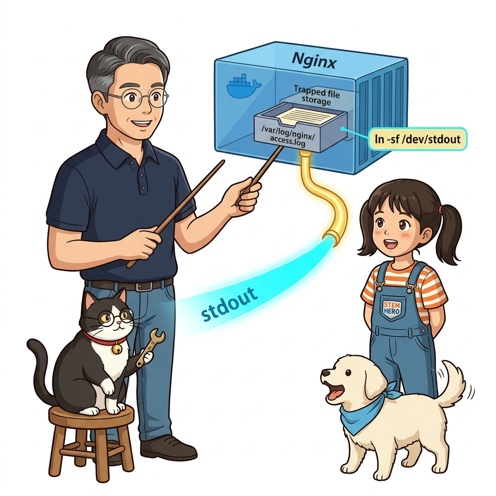
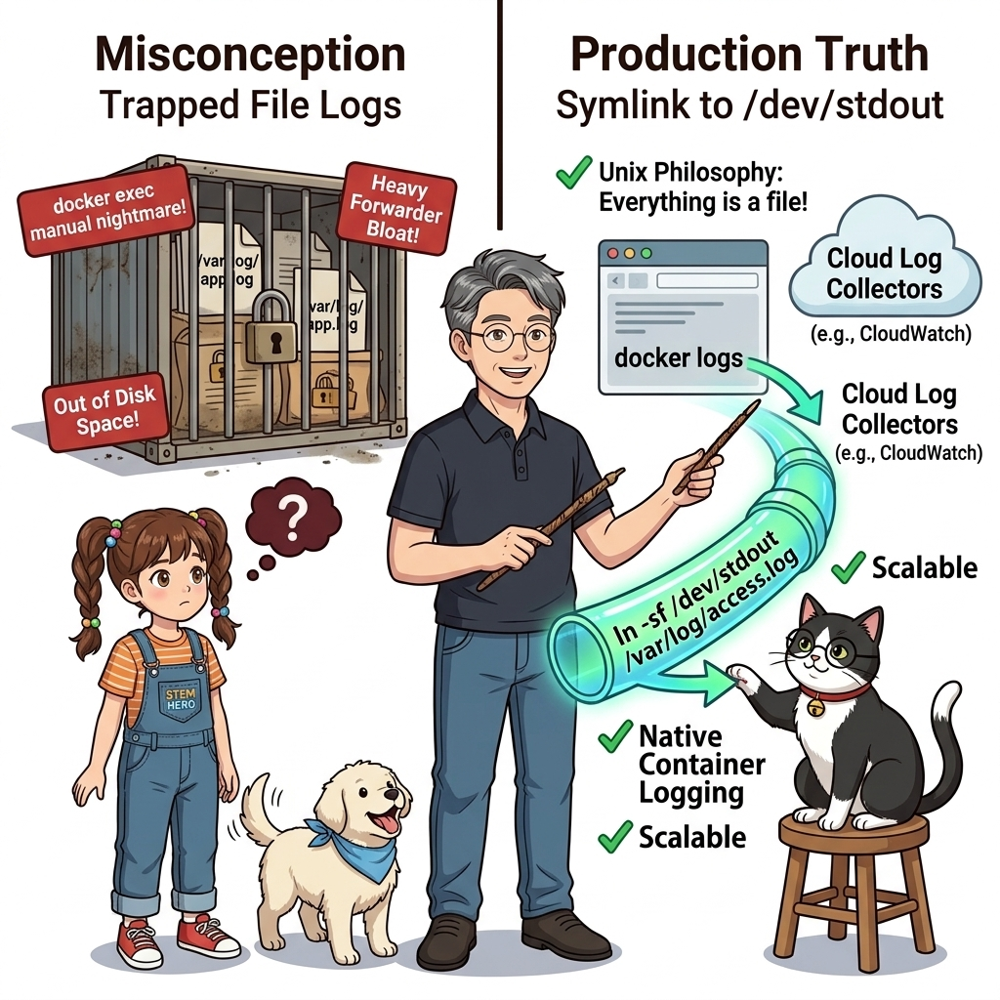
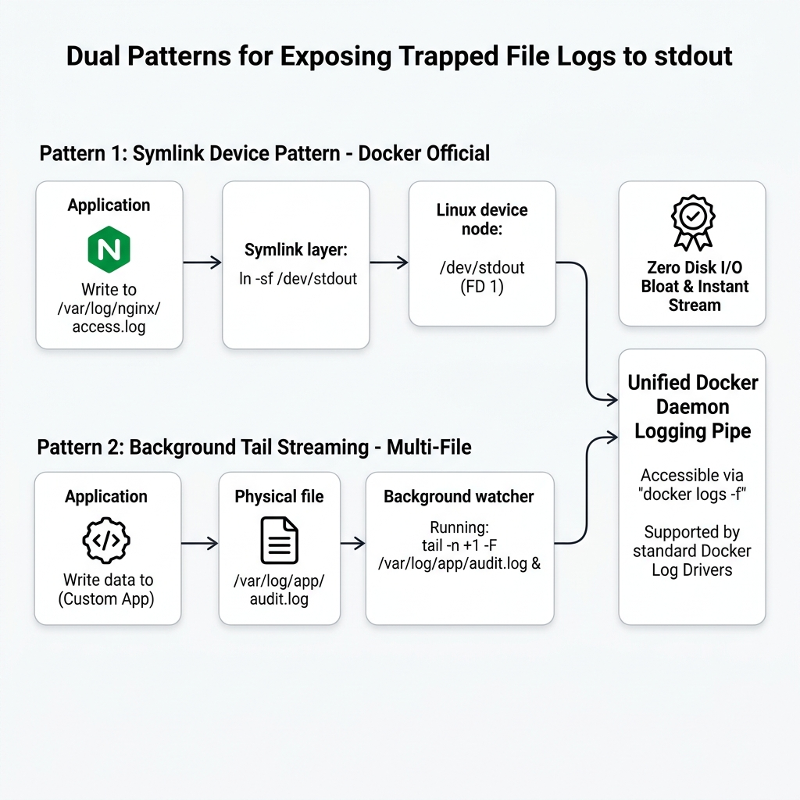
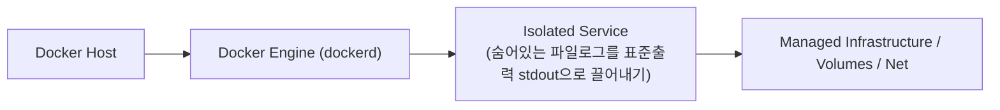
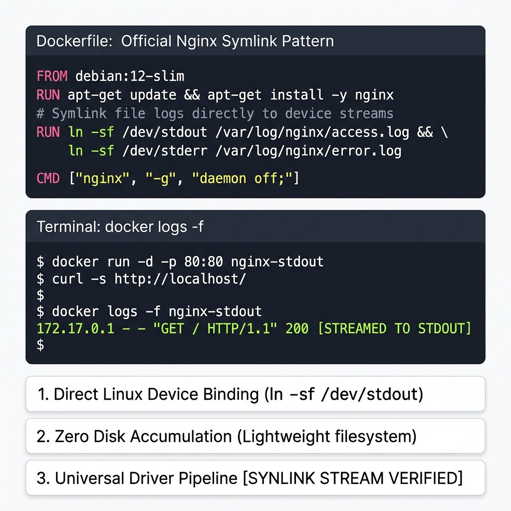
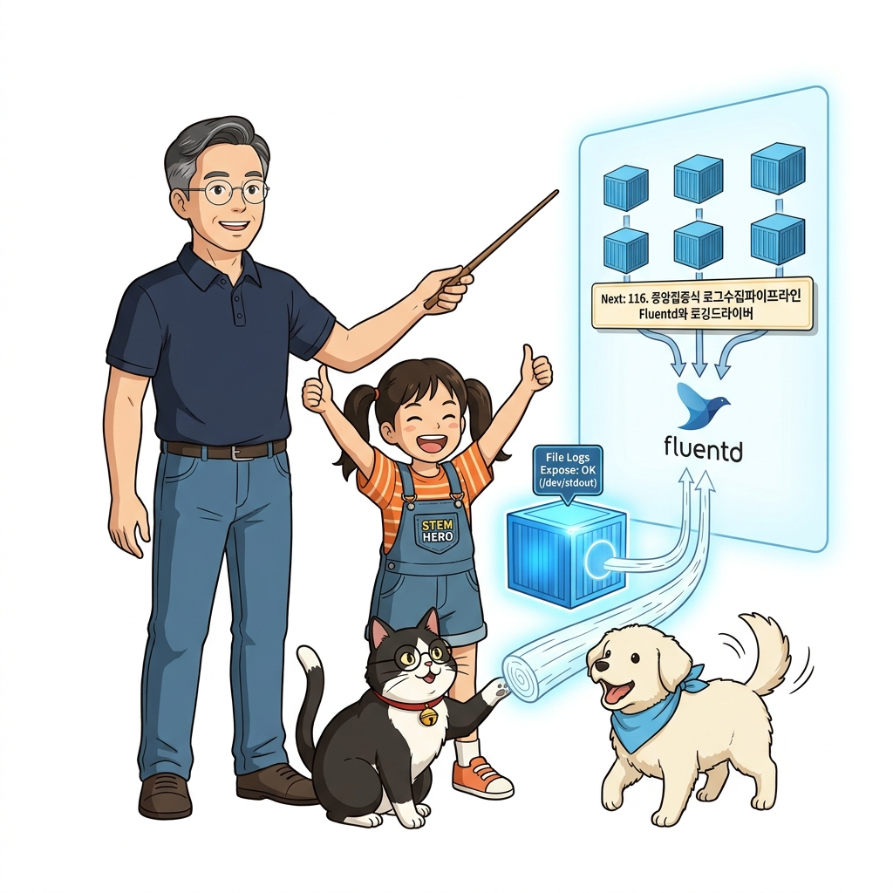

# 115. 숨어있는 파일로그를 표준출력 stdout으로 끌어내기

Nginx, Apache, Tomcat이나 구형 프레임워크들은 로그를 화면(`stdout`)으로 뱉지 않고 특정 디렉터리의 로컬 파일에 기록하도록 기본 설계된 경우가 많습니다.


**그림 08-4-1** 숨어있는 파일로그를 표준출력 stdout으로 끌어내기의 필요성과 현대 클라우드 아키텍처 관점의 개요

---

### 115.1 왜 숨어있는 파일로그를 표준출력 stdout으로 끌어내기이(가) 필요한가? (문제 정의와 현실적 배경)

소프트웨어 시스템이 복잡해질수록 설정을 다루는 방식은 전체 인프라의 신뢰성을 결정짓는 핵심 척도가 됩니다. **숨어있는 파일로그를 표준출력 stdout으로 끌어내기**이(가) 부재하거나 잘못 다루어질 때 현장에서는 다음과 같은 대표적인 병목과 장애가 발생합니다:

1. **하드코딩된 설정과 환경 불일치로 인한 유연성 상실**: 환경이 바뀔 때마다 코드를 다시 빌드해야 하므로 배포 주기가 지연되고 이미지 수가 기하급수적으로 폭증합니다.
2. **보안 민감 데이터의 무분별한 노출**: 비밀번호, 데이터베이스 토큰, 암호화 키가 이미지 레이어에 영구 박제되어 형상관리 시스템이나 외부에 유출될 위험이 커집니다.
3. **재현 불가능한 구성 드리프트**: 스테이징 환경과 프로덕션 환경의 미세한 설정 차이가 예기치 못한 서비스 중단 사고로 직결됩니다.


**그림 08-4-2** 숨어있는 파일로그를 표준출력 stdout으로 끌어내기에 대한 대표적인 오해와 실제 프로덕션 현장의 엔지니어링 진실

---

### 115.2 핵심 아키텍처와 엔지니어링 메커니즘

도커 공식 Nginx 이미지가 사용하는 기발한 트릭인 **심볼릭 링크(`ln -sf /dev/stdout /var/log/nginx/access.log`)** 기법과, 백그라운드 파일에 기록되는 로그를 **`tail -f` 사이드카 프로세스로 읽어 표준 출력으로 실시간 스트리밍**하는 2대 통합 패턴을 실습합니다!


**그림 08-4-3** 숨어있는 파일로그를 표준출력 stdout으로 끌어내기의 내부 아키텍처 및 데이터 흐름

#### 📊 핵심 비교 및 엔지니어링 표준 분석

| 구분 / 핵심 원리 | 상세 설명 및 동작 메커니즘 | 실무 적용 시 주의점 및 베스트 프랙티스 |
| :--- | :--- | :--- |
| **심볼릭 링크 트릭 (`/dev/stdout`)** | 리눅스의 모든 것은 파일! 로그 파일 경로를 특수 디바이스 파일인 `/dev/stdout`과 `/dev/stderr`로 심볼릭 링크 연결 | 앱 소스나 설정을 건드리지 않고도 `docker logs` 한곳에서 모든 로그를 확인 가능! |
| **`tail -n +1 -F 파일경로` 백그라운드 패턴** | 심볼릭 링크를 걸 수 없는 특수한 애플리케이션의 경우, 시작 스크립트에서 앱 실행과 동시에 `tail -F /path/to/log &`를 띄워 콘솔로 뿜어내게 구성 | 기존 파일 로깅 체계를 유지하면서 도커 표준 로깅 모델과 완벽 호환 달성 |
| **중앙 로깅으로의 연결** | 모든 컨테이너 로그가 `stdout`으로 통일되면, 다음 강의에서 배울 **Fluentd** 수집기가 아무런 추가 설정 없이 클러스터 전체 로그를 한곳으로 흡수 가능! | 표준화가 가져오는 강력한 시너지 |

---

### 115.3 선언적 실습 및 아키텍처 다이어그램

본 실습은 외부 비공개 패키지에 의존하지 않고, 공식 표준 이미지를 기반으로 즉시 재현 가능한 살아있는 코드로 구성되어 있습니다.

```dockerfile
# [공식 Nginx가 사용하는 심볼릭 링크 마법] 파일 경로를 /dev/stdout 장치로 직결!
FROM debian:12-slim
RUN apt-get update && apt-get install -y nginx && rm -rf /var/lib/apt/lists/*

# 파일에 쓰이는 모든 로그가 도커 엔진의 stdout/stderr로 즉시 바이패스됨!
RUN ln -sf /dev/stdout /var/log/nginx/access.log  && ln -sf /dev/stderr /var/log/nginx/error.log

CMD ["nginx", "-g", "daemon off;"]
```

#### 🔍 아키텍처 흐름도 (Mermaid Diagram)




**그림 08-4-4** 선언적 인프라 명세를 통한 숨어있는 파일로그를 표준출력 stdout으로 끌어내기 검증 파이프라인

---

<!-- BIBLE_INTEGRATION_book4_sidecar_logging_container -->
---

### 115.B 📚 도커 바이블 심화: 사이드카 컨테이너 패턴을 이용한 전용 로그 수집 및 격리 아키텍처
*출처 도서: 『완벽한 IT 인프라 구축을 위한 Docker』 핵심 분석*

레거시 애플리케이션 중에는 로그를 표준 출력(`stdout`)으로 보내지 않고 특정 파일 경로(`/var/log/app/access.log`)에 직접 저장하는 프로그램들이 많습니다. 소스 코드를 수정할 수 없을 때 이를 클라우드 네이티브 로깅 파이프라인으로 승화시키는 기법이 바로 **사이드카 로깅 컨테이너(Sidecar Logging Container)**입니다:

* **공유 볼륨 마운트**: 메인 애플리케이션 컨테이너와 사이드카 컨테이너가 동일한 도커 볼륨(`/var/log/app`)을 공유합니다.
* **역할 분담**:
  * 메인 컨테이너는 원래 하던 대로 파일에 로그를 기록합니다.
  * 사이드카 컨테이너는 가벼운 `tail -F`나 Fluentbit 프로세스를 실행하여 파일에 추가되는 로그를 즉시 읽어 표준 출력(`stdout`)으로 스트리밍하거나 원격 ElasticSearch/Loki로 릴레이합니다.


**그림 115-B-1** 메인 애플리케이션 컨테이너 옆에 바짝 붙어 공유 볼륨의 파일 로그를 실시간 중계하는 사이드카 컨테이너

```bash
# [실습] 사이드카 패턴을 이용한 파일 로그 스트리밍 파이프라인
# 1. 공유 로그 볼륨 생성
docker volume create shared-log-vol

# 2. 메인 앱 컨테이너: 파일에 주기적으로 로그 기록
docker container run -d --name legacy-app -v shared-log-vol:/var/log/app alpine \
  sh -c 'while true; do echo "$(date) [APP_PAYLOAD] Success" >> /var/log/app/service.log; sleep 2; done'

# 3. 사이드카 컨테이너: 공유 볼륨의 로그를 실시간 감시하여 stdout으로 뿜어냄
docker container run -d --name sidecar-streamer -v shared-log-vol:/var/log/app:ro alpine \
  tail -F /var/log/app/service.log

# 4. 사이드카 로그 확인 (이제 docker logs로 완벽 관제 가능!)
docker container logs -f sidecar-streamer
```

> 👨‍🏫 **이호진 교수님의 바이블 멘토링 노트**:
> "사이드카 패턴은 코드 한 줄 고칠 수 없는 10년 된 레거시 시스템을 5분 만에 현대적인 클라우드 네이티브 관제 시스템으로 탈바꿈시키는 마법의 지팡이입니다."
>
> 👧 **도로시의 깨달음**:
> "오토바이 옆에 보조 의자(사이드카)를 달아서 짐을 나르는 것처럼, 메인 프로그램은 일만 하고 로그 배달은 옆 컨테이너가 전담하는군요!"
>
> 🐱 **조교 지니의 아키텍처 체크포인트**:
> "사이드카 컨테이너는 반드시 `:ro`(Read-Only)로 마운트하세요. 사이드카의 오작동으로 메인 앱의 로그 파일이 훼손되는 일을 완벽히 차단할 수 있습니다."


### 115.4 핵심 정리: 캐릭터 대화와 3대 교훈

> 👧 **도로시**: "교수님! **숨어있는 파일로그를 표준출력 stdout으로 끌어내기**의 원리를 배우니까, 복잡하게 얽혀 있던 인프라 설정이 레고 블록처럼 질서정연하게 제자리를 찾는 게 보여요!"
> 
> 🐱 **조교 지니**: "야옹~ 맞습니다! 특히 런타임 환경과 불변 인프라의 경계를 명확히 지키는 것이 대규모 클라우드 운영의 제1원칙이랍니다!"
> 
> 🐶 **토토**: "멍멍! 선언적 코드로 한 번 적어두면 언제든 똑같이 복원되니까 정말 든든해요!"
> 
> 👨‍🏫 **이호진 교수님**: "훌륭하구나. 원리를 깊이 이해하고 실습을 통해 손에 익히는 것이 훌륭한 클라우드 엔지니어로 성장하는 가장 빠른 지름길이란다."


**그림 08-4-5** 숨어있는 파일로그를 표준출력 stdout으로 끌어내기 마스터를 위한 3대 핵심 교훈

1. **설정과 실행의 명확한 분리**:
   * 애플리케이션 코드는 불변으로 유지하고, 가변적인 설정값은 외부에서 주입하여 이식성을 극대화합니다.
2. **선언적 재현성 확보**:
   * 사람이 수작업으로 변경하지 않고 코드 명세를 통해 언제 어디서나 100% 동일한 실행 결과를 보장합니다.
3. **최소 권한 및 보안 모범 사례 준수**:
   * 불필요한 권한과 포트 노출을 최소화하고 민감 데이터를 암호화하여 프로덕션 안정성을 담보합니다.

---

### 115.5 랩노트 피날레와 다음 강의 예고


**그림 08-4-6** 연구실에서 다음 마일스톤인 [중앙집중식 로그수집파이프라인 Fluentd와 로깅드라이버] 실습을 예고하는 교수님과 토토

> 💡 **다음 강의 안내**:
> [중앙집중식 로그수집파이프라인 Fluentd와 로깅드라이버](../116_중앙집중식_로그수집파이프라인_Fluentd와_로깅드라이버/)에서는 더욱 심화된 실전 엔지니어링 실습과 아키텍처를 다룹니다!

---

## 🧭 강의 네비게이션
* [◀️ 이전 강의: 114_도커의_컨테이너로깅모델_stdout_stderr와_로그드라이버](../114_도커의_컨테이너로깅모델_stdout_stderr와_로그드라이버/)
* [📋 Part 08. 프로덕션 운영 마스터: 설정 관리, 중앙 로깅(Fluentd), 리버스 프록시(Nginx/Traefik), 비동기 메시지 큐(Redis/NATS) & 최종 캡스톤 (112 ~ 129) 목차로 돌아가기](../)
* [▶️ 다음 강의: 116_중앙집중식_로그수집파이프라인_Fluentd와_로깅드라이버](../116_중앙집중식_로그수집파이프라인_Fluentd와_로깅드라이버/)
