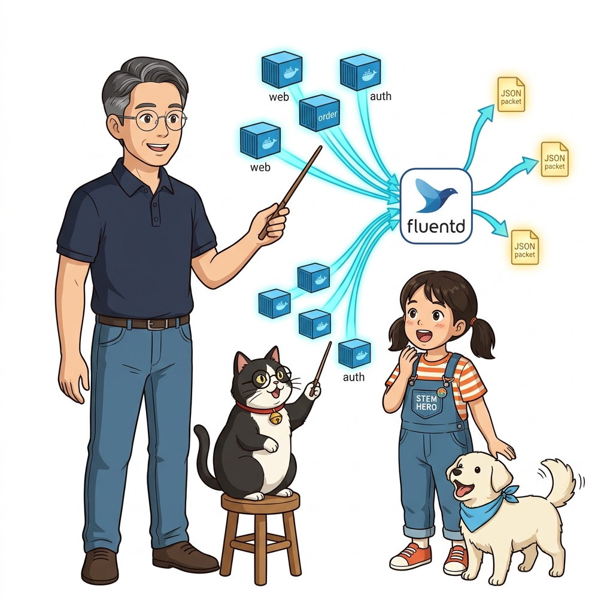
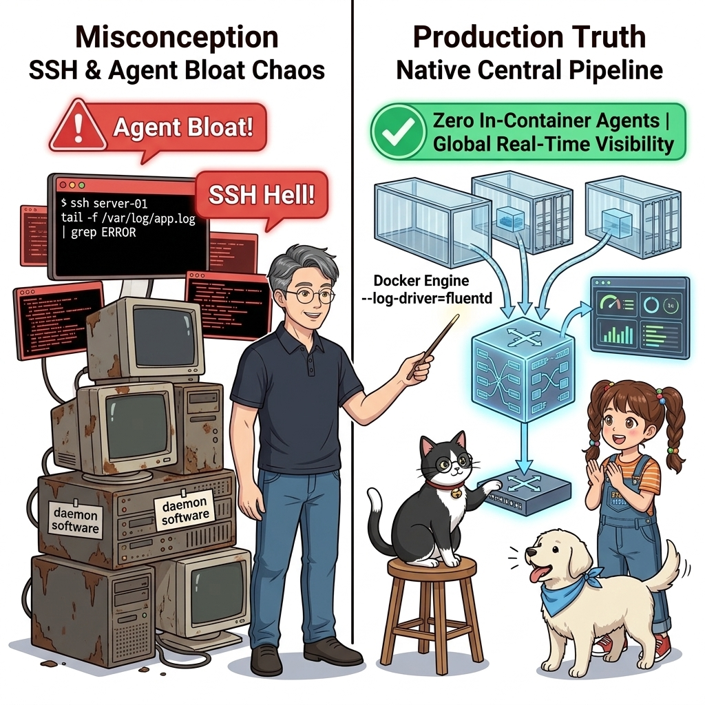
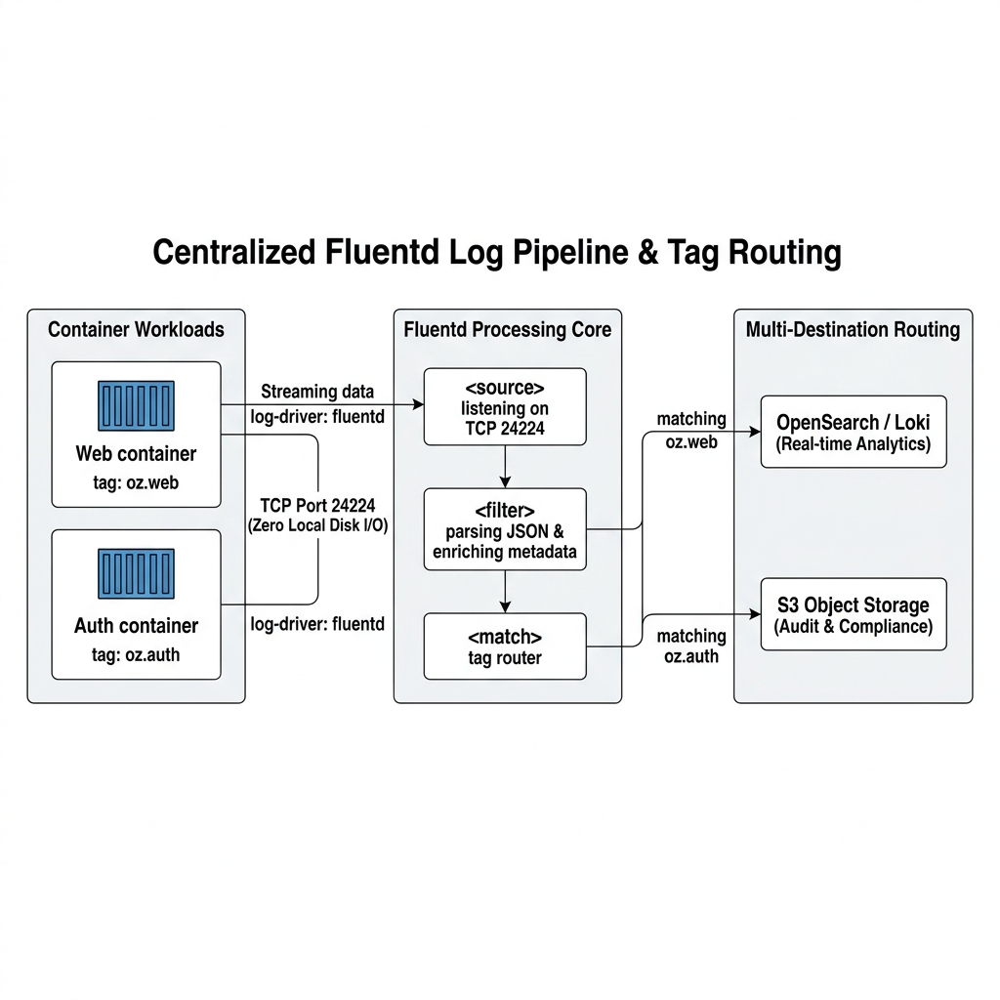
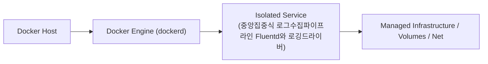
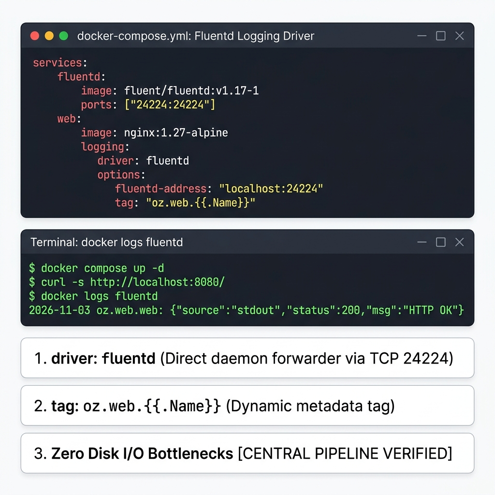
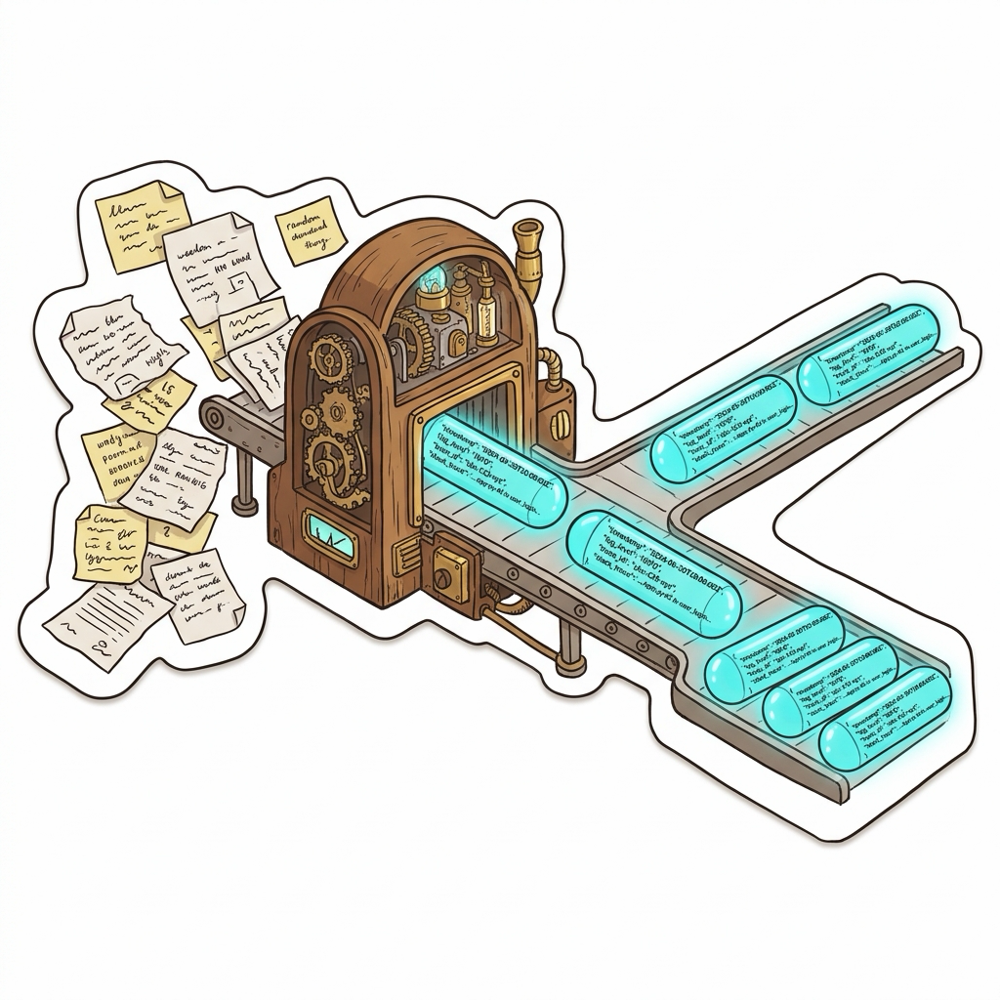
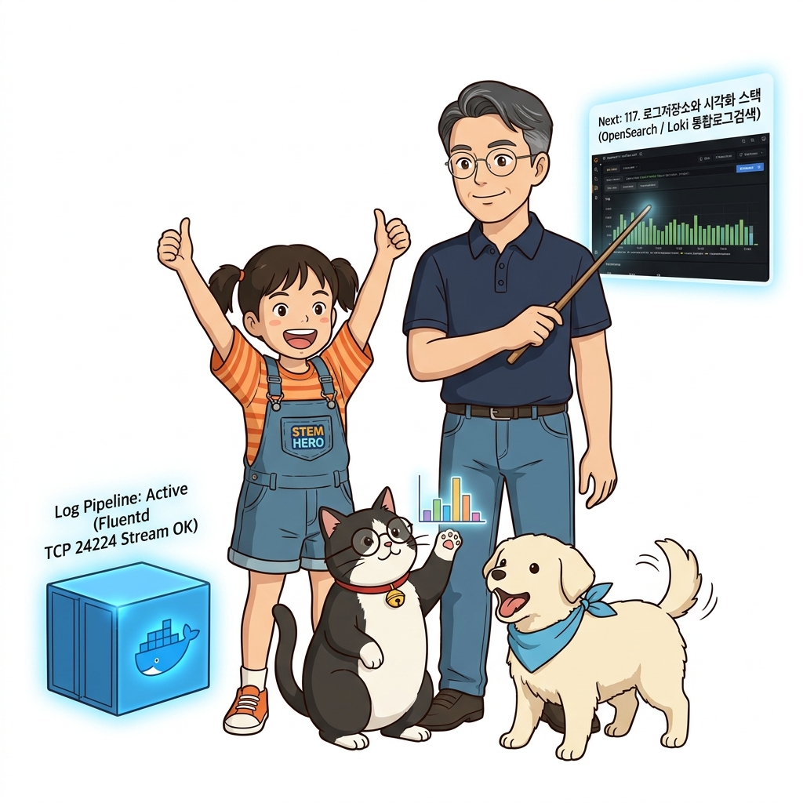

# 116. 중앙집중식 로그수집파이프라인 Fluentd와 로깅드라이버

각 서버의 로컬 디스크에 흩어져 있는 컨테이너 로그들을 네트워크를 통해 한곳으로 실시간 스트리밍하는 **중앙 집중식 로깅 아키텍처**를 배웁니다.


**그림 08-5-1** 중앙집중식 로그수집파이프라인 Fluentd와 로깅드라이버의 필요성과 현대 클라우드 아키텍처 관점의 개요

---

### 116.1 왜 중앙집중식 로그수집파이프라인 Fluentd와 로깅드라이버이(가) 필요한가? (문제 정의와 현실적 배경)

소프트웨어 시스템이 복잡해질수록 설정을 다루는 방식은 전체 인프라의 신뢰성을 결정짓는 핵심 척도가 됩니다. **중앙집중식 로그수집파이프라인 Fluentd와 로깅드라이버**이(가) 부재하거나 잘못 다루어질 때 현장에서는 다음과 같은 대표적인 병목과 장애가 발생합니다:

1. **하드코딩된 설정과 환경 불일치로 인한 유연성 상실**: 환경이 바뀔 때마다 코드를 다시 빌드해야 하므로 배포 주기가 지연되고 이미지 수가 기하급수적으로 폭증합니다.
2. **보안 민감 데이터의 무분별한 노출**: 비밀번호, 데이터베이스 토큰, 암호화 키가 이미지 레이어에 영구 박제되어 형상관리 시스템이나 외부에 유출될 위험이 커집니다.
3. **재현 불가능한 구성 드리프트**: 스테이징 환경과 프로덕션 환경의 미세한 설정 차이가 예기치 못한 서비스 중단 사고로 직결됩니다.


**그림 08-5-2** 중앙집중식 로그수집파이프라인 Fluentd와 로깅드라이버에 대한 대표적인 오해와 실제 프로덕션 현장의 엔지니어링 진실

---

### 116.2 핵심 아키텍처와 엔지니어링 메커니즘

CNCF 공식 졸업 프로젝트인 **플루언트디(Fluentd)** 수집기 컨테이너를 띄우고, 도커 데몬의 **`fluentd` 로깅 드라이버(`--log-driver=fluentd`)**를 연결하여 컨테이너가 출력하는 모든 로그를 JSON 구조화 데이터로 파싱·필터링·중앙 전달하는 실무 환경을 구축합니다!


**그림 08-5-3** 중앙집중식 로그수집파이프라인 Fluentd와 로깅드라이버의 내부 아키텍처 및 데이터 흐름

#### 📊 핵심 비교 및 엔지니어링 표준 분석

| 구분 / 핵심 원리 | 상세 설명 및 동작 메커니즘 | 실무 적용 시 주의점 및 베스트 프랙티스 |
| :--- | :--- | :--- |
| **Fluentd 통합 수집기** | 로그의 수집(Input) ➔ 가공 및 파싱(Filter) ➔ 저장소 전송(Output)을 플러그인 구조로 유연하게 처리하는 로그 파이프라인의 강자 | 다양한 형식의 텍스트 로그를 타임스탬프, 서비스명, 컨테이너 ID가 포함된 정형화 JSON으로 변환 |
| **`fluentd` 로깅 드라이버** | 도커 엔진이 호스트 디스크에 로그 파일을 남기지 않고 메모리에서 Fluentd TCP 포트(`24224`)로 직접 스트리밍 전송 | 호스트 디스크 I/O 병목을 없애고 초당 수만 건의 대규모 트래픽 로그를 안정적으로 처리 |
| **태그 기반 동적 라우팅 (`tag: oz.web.{{.Name}}`)** | 컨테이너 이름과 서비스명을 태그에 주입하여, Fluentd가 결제 로그는 감사 DB로, 웹 로그는 검색 엔진으로 자동 분기 전송 | 엔터프라이즈 로그 거버넌스의 핵심 |

---

### 116.3 선언적 실습 및 아키텍처 다이어그램

본 실습은 외부 비공개 패키지에 의존하지 않고, 공식 표준 이미지를 기반으로 즉시 재현 가능한 살아있는 코드로 구성되어 있습니다.

```yaml
# Fluentd 로깅 드라이버를 통해 컨테이너 로그를 중앙 수집기로 실시간 전송하는 컴포즈 설정
services:
  fluentd:
    image: fluent/fluentd:v1.17-1
    ports: ["24224:24224", "24224:24224/udp"]
    volumes:
      - ./fluentd/fluent.conf:/fluentd/etc/fluent.conf

  app:
    image: nginx:1.27-alpine
    logging:
      driver: fluentd
      options:
        fluentd-address: "localhost:24224"
        tag: "oz.web.{{.Name}}" 
```

#### 🔍 아키텍처 흐름도 (Mermaid Diagram)




**그림 08-5-4** 선언적 인프라 명세를 통한 중앙집중식 로그수집파이프라인 Fluentd와 로깅드라이버 검증 파이프라인

---

<!-- BIBLE_INTEGRATION_book3_deep_116 -->
---

### 116.C 📚 도커 바이블 심화: 엔터프라이즈 구조화 JSON 로깅(Structured Logging)과 공통 로그 포맷(Common Log Format)
*출처 도서: 『도커를 활용한 마이크로서비스』 핵심 분석 (도커를 활용한 마이크로서비스 제7장 (공통 로그 형식 & 모니터링))*

수백 대의 마이크로서비스 컨테이너가 쏟아내는 로그를 사람이 터미널에서 눈으로 읽는 일반 문자열(`2026-11-06 INFO Login success`)로 남기면, 중앙 로그 수집기(Fluentd, Logstash, Vector)가 파싱하는 데 막대한 정규표현식 CPU 연산이 낭비되고 유실이 발생합니다.

클라우드 네이티브 마이크로서비스의 필수 표준은 **구조화된 JSON 로그(Structured JSON Logging)**입니다:
* **고정 필수 필드**: `@timestamp` (ISO8601), `level` (INFO/WARN/ERROR), `service` (마이크로서비스 이름), `environment` (prod/dev).
* **추적 필드**: `trace_id`, `span_id`, `request_id` (Correlation ID 연동).
* **컨텍스트 필드**: `user_id`, `client_ip`, `http_status`, `response_time_ms`, `error_stack`.


**그림 116-B-2** 파편화된 텍스트 로그를 완벽한 기계 판독형 JSON 블록으로 정렬하여 중앙 인덱싱하는 파이프라인

```bash
# [실습] 표준 JSON 구조화 로그 출력 및 jq 필터링 실습
docker container run -d --name json-logger alpine sh -c '
while true; do
  echo "{\"@timestamp\":\"$(date -u +%Y-%m-%dT%H:%M:%SZ)\",\"service\":\"order-api\",\"level\":\"INFO\",\"req_id\":\"req-8f92a\",\"msg\":\"Payment processed\",\"amount\":45000}"
  sleep 3
done'

# docker logs 스트림을 jq로 즉시 분석 (특정 에러나 조건만 1초 만에 추출)
docker container logs --tail 5 json-logger | grep "^{"
docker container rm -f json-logger
```

> 👨‍🏫 **이호진 교수님의 바이블 멘토링 노트**:
> "로그는 사람이 읽기 위해 쓰는 게 아니라 기계가 파싱하고 통계를 내기 위해 쓰는 것입니다. console.log에 문장을 쓰지 말고 JSON 객체를 넘기세요. 그래야 그라파나 대시보드와 알림이 살아 숨 쉬게 됩니다."
>
> 👧 **도로시의 깨달음**:
> "일기장처럼 줄줄이 글을 쓰는 대신, 컴퓨터가 한눈에 알아볼 수 있게 칸칸이 정리된 표(JSON)로 찍어내는 거군요!"
>
> 🐱 **조교 지니의 아키텍처 체크포인트**:
> "JSON 로깅을 도입하면 Fluentd에서 복잡한 무거운 파서를 거칠 필요 없이 바로 ElasticSearch나 ClickHouse로 다이렉트 인덱싱되어 수집 파이프라인의 레이턴시가 10배 빨라집니다."


### 116.4 핵심 정리: 캐릭터 대화와 3대 교훈

> 👧 **도로시**: "교수님! **중앙집중식 로그수집파이프라인 Fluentd와 로깅드라이버**의 원리를 배우니까, 복잡하게 얽혀 있던 인프라 설정이 레고 블록처럼 질서정연하게 제자리를 찾는 게 보여요!"
> 
> 🐱 **조교 지니**: "야옹~ 맞습니다! 특히 런타임 환경과 불변 인프라의 경계를 명확히 지키는 것이 대규모 클라우드 운영의 제1원칙이랍니다!"
> 
> 🐶 **토토**: "멍멍! 선언적 코드로 한 번 적어두면 언제든 똑같이 복원되니까 정말 든든해요!"
> 
> 👨‍🏫 **이호진 교수님**: "훌륭하구나. 원리를 깊이 이해하고 실습을 통해 손에 익히는 것이 훌륭한 클라우드 엔지니어로 성장하는 가장 빠른 지름길이란다."


**그림 08-5-5** 중앙집중식 로그수집파이프라인 Fluentd와 로깅드라이버 마스터를 위한 3대 핵심 교훈

1. **설정과 실행의 명확한 분리**:
   * 애플리케이션 코드는 불변으로 유지하고, 가변적인 설정값은 외부에서 주입하여 이식성을 극대화합니다.
2. **선언적 재현성 확보**:
   * 사람이 수작업으로 변경하지 않고 코드 명세를 통해 언제 어디서나 100% 동일한 실행 결과를 보장합니다.
3. **최소 권한 및 보안 모범 사례 준수**:
   * 불필요한 권한과 포트 노출을 최소화하고 민감 데이터를 암호화하여 프로덕션 안정성을 담보합니다.

---

### 116.5 랩노트 피날레와 다음 강의 예고


**그림 08-5-6** 연구실에서 다음 마일스톤인 [로그저장소와 시각화스택 OpenSearch Loki 통합로그검색] 실습을 예고하는 교수님과 토토

> 💡 **다음 강의 안내**:
> [로그저장소와 시각화스택 OpenSearch Loki 통합로그검색](../117_로그저장소와_시각화스택_OpenSearch_Loki_통합로그검색/)에서는 더욱 심화된 실전 엔지니어링 실습과 아키텍처를 다룹니다!

---

## 🧭 강의 네비게이션
* [◀️ 이전 강의: 115_숨어있는_파일로그를_표준출력_stdout으로_끌어내기](../115_숨어있는_파일로그를_표준출력_stdout으로_끌어내기/)
* [📋 Part 08. 프로덕션 운영 마스터: 설정 관리, 중앙 로깅(Fluentd), 리버스 프록시(Nginx/Traefik), 비동기 메시지 큐(Redis/NATS) & 최종 캡스톤 (112 ~ 129) 목차로 돌아가기](../)
* [▶️ 다음 강의: 117_로그저장소와_시각화스택_OpenSearch_Loki_통합로그검색](../117_로그저장소와_시각화스택_OpenSearch_Loki_통합로그검색/)
