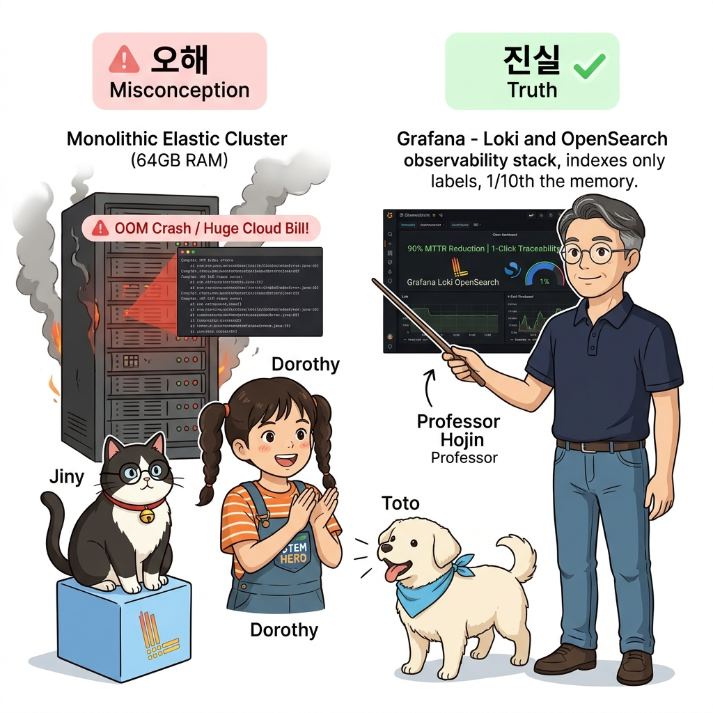
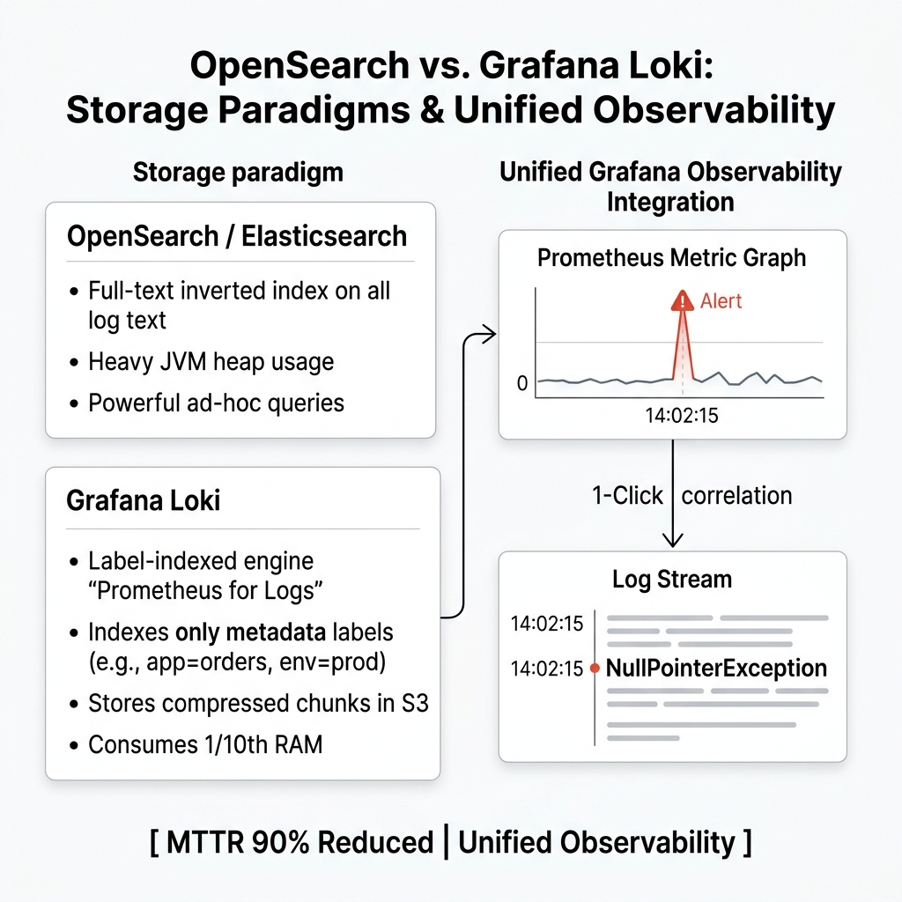
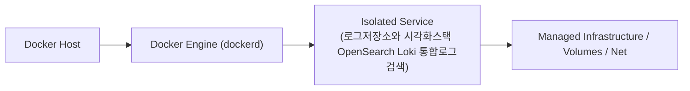
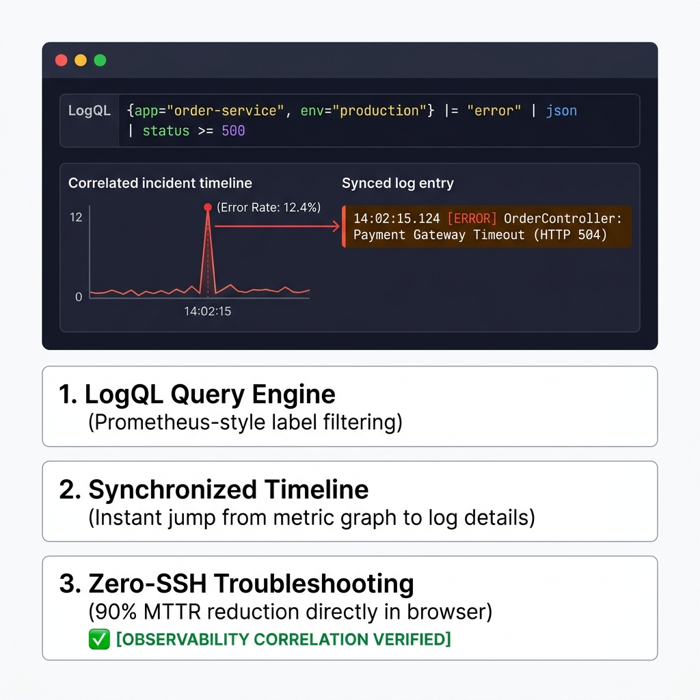
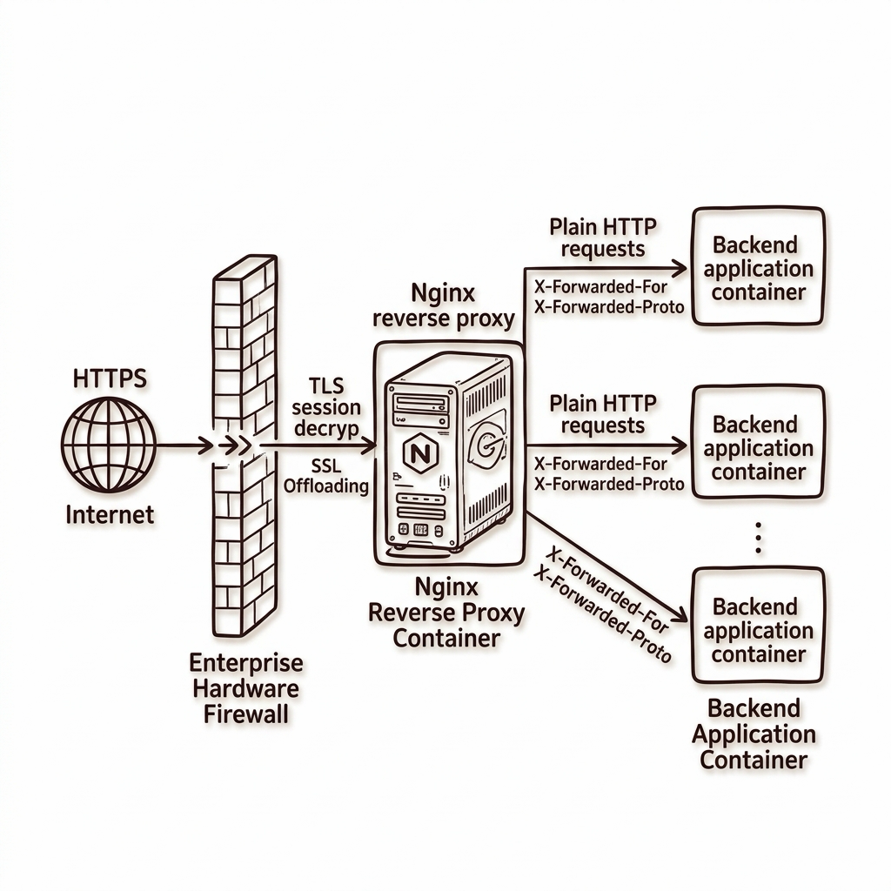
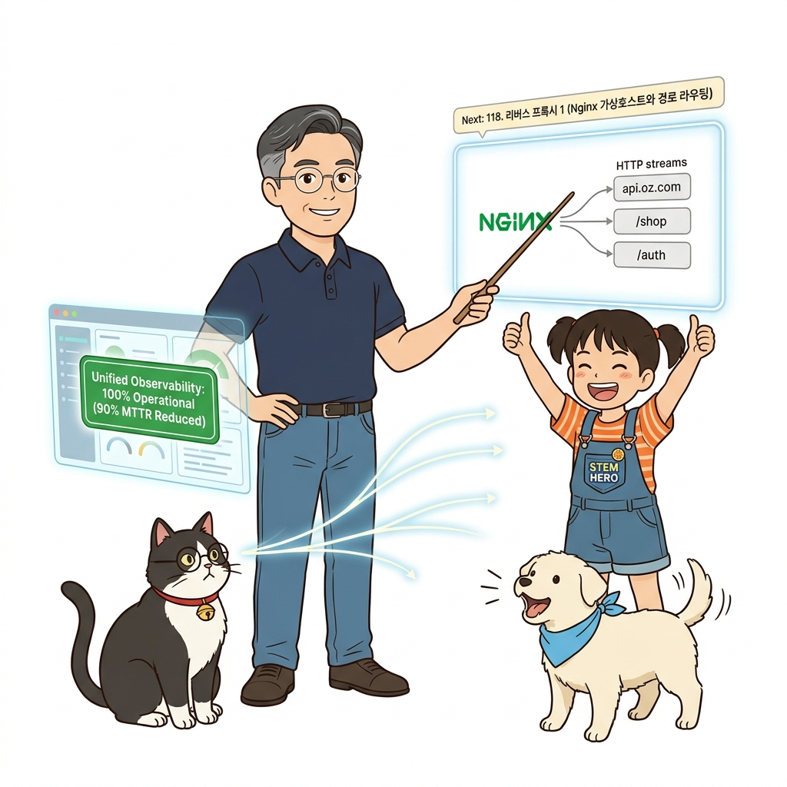

# 117. 로그저장소와 시각화스택 OpenSearch Loki 통합로그검색

Fluentd가 모아온 로그를 영구 저장하고 초고속으로 전문 검색(Full-text Search)할 수 있게 해주는 **Elasticsearch / OpenSearch** 및 초경량 **Grafana Loki** 스택을 비교합니다.


**그림 08-6-1** 로그저장소와 시각화스택 OpenSearch Loki 통합로그검색의 필요성과 현대 클라우드 아키텍처 관점의 개요

---

### 117.1 왜 로그저장소와 시각화스택 OpenSearch Loki 통합로그검색이(가) 필요한가? (문제 정의와 현실적 배경)

소프트웨어 시스템이 복잡해질수록 설정을 다루는 방식은 전체 인프라의 신뢰성을 결정짓는 핵심 척도가 됩니다. **로그저장소와 시각화스택 OpenSearch Loki 통합로그검색**이(가) 부재하거나 잘못 다루어질 때 현장에서는 다음과 같은 대표적인 병목과 장애가 발생합니다:

1. **하드코딩된 설정과 환경 불일치로 인한 유연성 상실**: 환경이 바뀔 때마다 코드를 다시 빌드해야 하므로 배포 주기가 지연되고 이미지 수가 기하급수적으로 폭증합니다.
2. **보안 민감 데이터의 무분별한 노출**: 비밀번호, 데이터베이스 토큰, 암호화 키가 이미지 레이어에 영구 박제되어 형상관리 시스템이나 외부에 유출될 위험이 커집니다.
3. **재현 불가능한 구성 드리프트**: 스테이징 환경과 프로덕션 환경의 미세한 설정 차이가 예기치 못한 서비스 중단 사고로 직결됩니다.


**그림 08-6-2** 로그저장소와 시각화스택 OpenSearch Loki 통합로그검색에 대한 대표적인 오해와 실제 프로덕션 현장의 엔지니어링 진실

---

### 117.2 핵심 아키텍처와 엔지니어링 메커니즘

그라파나 웹 화면에서 앞서 구축했던 프로메테우스 메트릭 그래프(10장)와 동일한 시간대의 컨테이너 로그를 나란히 띄워놓고 클릭 한 번으로 장애 시점의 로그를 추적하는 **통합 관측성(Unified Observability)**을 완성합니다!


**그림 08-6-3** 로그저장소와 시각화스택 OpenSearch Loki 통합로그검색의 내부 아키텍처 및 데이터 흐름

#### 📊 핵심 비교 및 엔지니어링 표준 분석

| 구분 / 핵심 원리 | 상세 설명 및 동작 메커니즘 | 실무 적용 시 주의점 및 베스트 프랙티스 |
| :--- | :--- | :--- |
| **EFK (Elasticsearch + Fluentd + Kibana)** | 전통의 엔터프라이즈 빅데이터 검색 스택으로, 복잡한 통계 분석과 대규모 전문 텍스트 검색에 최적화 | 리소스(RAM)를 많이 소모하므로 중대형 클라우드 환경에 적합 |
| **Grafana Loki (클라우드 네이티브 초경량 로그)** | 로그 본문 전체를 인덱싱하지 않고 오직 컨테이너 레이블(`service`, `env`)만 인덱싱하여 메모리 소모가 Elasticsearch의 1/10에 불과! | Grafana와 완벽하게 통합되어 단일 대시보드에서 메트릭과 로그를 동시에 분석 가능 |
| **장애 해결 시간(MTTR) 90% 단축** | 서버마다 SSH 접속해서 로그 파일을 뒤지던 수작업이 사라지고, 브라우저 창 하나에서 모든 마이크로서비스의 상관관계를 분석 | 고급 데브옵스 엔지니어의 핵심 역량 |

---

### 117.3 선언적 실습 및 아키텍처 다이어그램

본 실습은 외부 비공개 패키지에 의존하지 않고, 공식 표준 이미지를 기반으로 즉시 재현 가능한 살아있는 코드로 구성되어 있습니다.

```bash
# 통합 관측성(Prometheus Metrics + Loki/Fluentd Logs) 상호 연동 개념
cat << 'EOF'
[1. Prometheus Metric 경보 발령] -> 14:02:15 주문 API 에러율 급증 감지!
[2. Grafana 차트에서 장애 구간 클릭] -> 동일한 시간대의 컨테이너 로그 화면으로 1초 만에 점프!
[3. Loki/OpenSearch 로그 검색]     -> "NullPointerException at OrderService.java:142" 근본 원인 3초 만에 발견!
EOF
```

#### 🔍 아키텍처 흐름도 (Mermaid Diagram)




**그림 08-6-4** 선언적 인프라 명세를 통한 로그저장소와 시각화스택 OpenSearch Loki 통합로그검색 검증 파이프라인

---

<!-- BIBLE_INTEGRATION_book7_opensearch_vs_loki -->
---

### 117.B 📚 도커 바이블 심화: OpenSearch(전문 역색인) vs Grafana Loki(레이블 기반 스트리밍) 아키텍처 및 TCO 비용 비교

> 📖 **참고 도서 심층 연계**:
> * 《도커 교과서》 제20장 (클라우드 네이티브 관측성과 분산 로깅 백엔드)
> * 《도커를 활용한 마이크로서비스》 제6장 (대규모 분산 환경에서의 로그 스토리지 TCO 최적화)

컨테이너 로그가 하루에 수억 건씩 쏟아지는 프로덕션 환경에서 백엔드 로그 저장소를 무엇으로 선택하느냐는 인프라 비용(TCO)과 운영 복잡도를 완전히 좌우합니다.

#### 1. 아키텍처 비교: Lucene 역색인 vs Prometheus-like 스트림 레이블링

| 비교 지표 | Elasticsearch / OpenSearch | Grafana Loki |
| :--- | :--- | :--- |
| **인덱싱 방식** | **모든 단어 역색인 (Full Inverted Index)**<br>로그 본문의 모든 단어를 토큰화하여 색인 테이블 구성 | **메타데이터 레이블만 인덱싱 (Labels Only)**<br>로그 본문은 압축 청크(gzip)로 저장하고 스트림 레이블만 색인 |
| **메모리(RAM) 소모** | 매우 높음 (거대한 JVM 힙 메모리와 캐시 필수, OOM 위험) | 극도로 낮음 (OpenSearch 대비 메모리 사용량 1/5~1/10 수준) |
| **스토리지 비용** | 높음 (인덱스 크기가 원본 로그 데이터 크기보다 커질 수 있음) | 매우 낮음 (AWS S3, MinIO 등 초저비용 오브젝트 스토리지 직결) |
| **검색 속도** | 특정 단어 검색 및 복잡한 통계 집계에서 초고속 | 레이블 필터링 후 병렬 스트리밍 검색(`grep` 방식), 범위 검색에 최적 |
| **그라파나 통합성** | 별도 플러그인 연동 필요 | **메트릭(Prometheus)과 100% 동일한 레이블 모델을 공유하여 완벽 통합** |

#### 2. LogQL을 이용한 스트리밍 로그 검색 실전 문법

```bash
# [실습] Grafana Loki 전용 질의어 LogQL 예시
# 1. 프로덕션 환경의 payment-api 서비스에서 발생한 500 에러 실시간 필터링
{env="production", service="payment-api"} |= "status=500"

# 2. 에러 로그 빈도를 초당 메트릭 그래프로 즉시 변환 (Log-to-Metric)
rate({service="payment-api"} |= "ERROR" [1m])
```

> 👧 **도로시**: "OpenSearch는 도서관의 모든 책 속 단어를 전부 색인 카드로 만들어두는 거라면, Loki는 책 표지의 이름표(레이블)만 붙여두고 필요할 때 빠르게 넘겨보는 거군요!"
> 
> 👨‍🏫 **이호진 교수님**: "정확한 혜안이란다, 도로시! 일반적인 개발/운영 환경에서는 메트릭과 완벽하게 짝을 이루는 Grafana Loki를 사용하는 것이 서버 유지 비용을 80% 이상 절감하는 지름길이란다."

---

<!-- BIBLE_INTEGRATION_book4_deep_117 -->
---

### 117.C 📚 도커 바이블 심화: 온프레미스 L4/L7 스위치 연동과 도커 리버스 프록시 SSL 종단(SSL Termination) 아키텍처
*출처 도서: 『완벽한 IT 인프라 구축을 위한 Docker』 핵심 분석 (완벽한 IT 인프라 구축을 위한 Docker 제3장 (응용편: 고가용성 인프라 구축))*

실제 사내 데이터센터(IDC)나 엔터프라이즈 환경에서는 컨테이너가 직접 외부 인터넷에 공인 IP로 노출되지 않습니다. 하드웨어 L4 스위치(로드밸런서) -> 도커 호스트 Nginx L7 리버스 프록시 -> 내부 마이크로서비스로 이어지는 **다단계 SSL 종단(SSL Termination) 구조**를 갖춥니다:

1. **L4 레벨 부하 분산**:
   * F5나 VIP(가상 IP) 기반 하드웨어 스위치가 수십 대의 도커 호스트 노드로 트래픽을 L4(TCP) 레벨에서 1차 분산합니다.
2. **L7 리버스 프록시의 SSL 종단**:
   * Nginx/Traefik 컨테이너가 클라이언트의 HTTPS 암호화 세션을 복호화(SSL Offloading)합니다.
   * 무거운 암호화/복호화 연산을 프록시가 전담하므로, 내부 백엔드 애플리케이션은 순수 고속 HTTP 통신에만 집중할 수 있습니다.
3. **프라이빗 헤더 보존 (`X-Forwarded-For`, `X-Forwarded-Proto`)**:
   * 프록시를 거치면서 클라이언트의 원래 공인 IP가 소실되지 않도록 표준 프록시 헤더를 주입하여 백엔드로 안전하게 전달합니다.


**그림 117-B-2** 하드웨어 L4 로드밸런서와 L7 리버스 프록시 SSL 종단 및 백엔드 고속 통신 아키텍처

```bash
# [실습] Nginx SSL 종단 및 클라이언트 원천 IP 보존 프록시 설정
cat << 'EOF' > ssl-termination.conf
server {
    listen 443 ssl;
    server_name api.mycorp.internal;

    # SSL 인증서 및 비밀키 설정
    ssl_certificate /etc/nginx/certs/fullchain.pem;
    ssl_certificate_key /etc/nginx/certs/privkey.pem;
    ssl_protocols TLSv1.2 TLSv1.3;

    location / {
        proxy_pass http://backend-cluster;
        # 원본 클라이언트 IP 및 프로토콜 헤더 전달
        proxy_set_header Host $host;
        proxy_set_header X-Real-IP $remote_addr;
        proxy_set_header X-Forwarded-For $proxy_add_x_forwarded_for;
        proxy_set_header X-Forwarded-Proto https;
    }
}
EOF
```

> 👨‍🏫 **이호진 교수님의 바이블 멘토링 노트**:
> "모든 백엔드 컨테이너마다 SSL 인증서를 일일이 세팅하고 관리하는 것은 엄청난 리소스 낭비입니다. 리버스 프록시 컨테이너에서 SSL을 일괄 종단(Termination) 처리하고 인증서 갱신을 단일화하세요."
>
> 👧 **도로시의 깨달음**:
> "성문 입구의 경비실(리버스 프록시)에서 신분증(SSL)을 한 번만 철저히 검사하고 나면, 성 안쪽에서는 편안하고 빠르게 이동할 수 있는 것과 같네요!"
>
> 🐱 **조교 지니의 아키텍처 체크포인트**:
> "`X-Forwarded-Proto https` 헤더를 넘겨주지 않으면 백엔드 프레임워크가 자신이 HTTP로 호출된 것으로 오해하여 무한 리다이렉트(301/302 Redirect Loop)에 빠지게 됩니다."


### 117.4 핵심 정리: 캐릭터 대화와 3대 교훈

> 👧 **도로시**: "교수님! **로그저장소와 시각화스택 OpenSearch Loki 통합로그검색**의 원리를 배우니까, 복잡하게 얽혀 있던 인프라 설정이 레고 블록처럼 질서정연하게 제자리를 찾는 게 보여요!"
> 
> 🐱 **조교 지니**: "야옹~ 맞습니다! 특히 런타임 환경과 불변 인프라의 경계를 명확히 지키는 것이 대규모 클라우드 운영의 제1원칙이랍니다!"
> 
> 🐶 **토토**: "멍멍! 선언적 코드로 한 번 적어두면 언제든 똑같이 복원되니까 정말 든든해요!"
> 
> 👨‍🏫 **이호진 교수님**: "훌륭하구나. 원리를 깊이 이해하고 실습을 통해 손에 익히는 것이 훌륭한 클라우드 엔지니어로 성장하는 가장 빠른 지름길이란다."


**그림 08-6-5** 로그저장소와 시각화스택 OpenSearch Loki 통합로그검색 마스터를 위한 3대 핵심 교훈

1. **설정과 실행의 명확한 분리**:
   * 애플리케이션 코드는 불변으로 유지하고, 가변적인 설정값은 외부에서 주입하여 이식성을 극대화합니다.
2. **선언적 재현성 확보**:
   * 사람이 수작업으로 변경하지 않고 코드 명세를 통해 언제 어디서나 100% 동일한 실행 결과를 보장합니다.
3. **최소 권한 및 보안 모범 사례 준수**:
   * 불필요한 권한과 포트 노출을 최소화하고 민감 데이터를 암호화하여 프로덕션 안정성을 담보합니다.

---

### 117.5 랩노트 피날레와 다음 강의 예고


**그림 08-6-6** 연구실에서 다음 마일스톤인 [리버스프록시1 Nginx컨테이너로 가상호스트와 경로라우팅] 실습을 예고하는 교수님과 토토

> 💡 **다음 강의 안내**:
> [리버스프록시1 Nginx컨테이너로 가상호스트와 경로라우팅](../118_리버스프록시1_Nginx컨테이너로_가상호스트와_경로라우팅/)에서는 더욱 심화된 실전 엔지니어링 실습과 아키텍처를 다룹니다!

---

## 🧭 강의 네비게이션
* [◀️ 이전 강의: 116_중앙집중식_로그수집파이프라인_Fluentd와_로깅드라이버](../116_중앙집중식_로그수집파이프라인_Fluentd와_로깅드라이버/)
* [📋 Part 08. 프로덕션 운영 마스터: 설정 관리, 중앙 로깅(Fluentd), 리버스 프록시(Nginx/Traefik), 비동기 메시지 큐(Redis/NATS) & 최종 캡스톤 (112 ~ 129) 목차로 돌아가기](../)
* [▶️ 다음 강의: 118_리버스프록시1_Nginx컨테이너로_가상호스트와_경로라우팅](../118_리버스프록시1_Nginx컨테이너로_가상호스트와_경로라우팅/)
