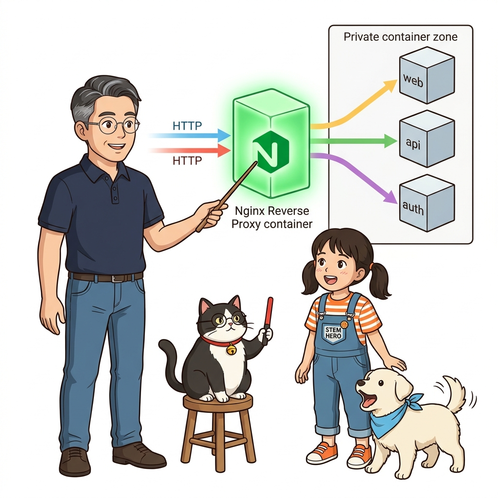
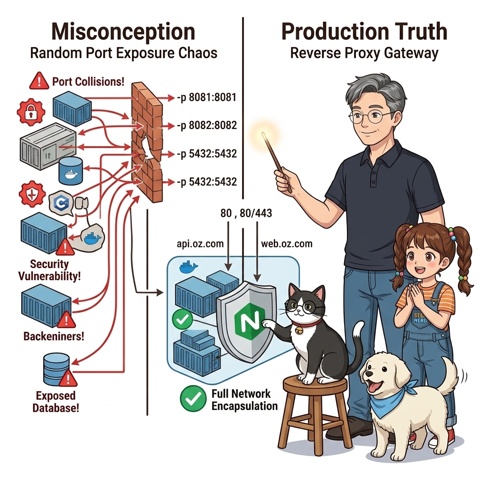
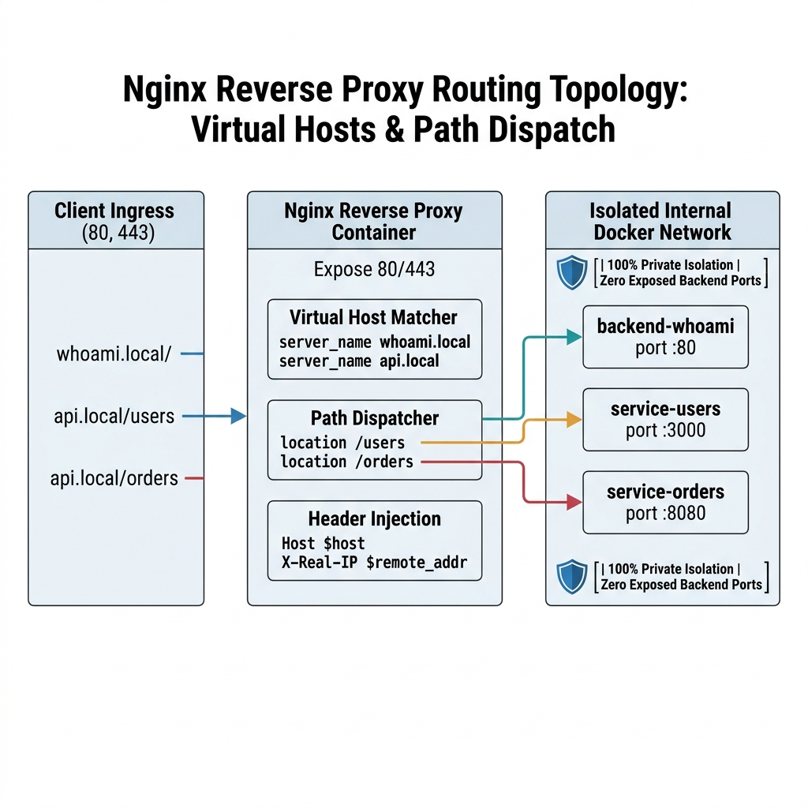
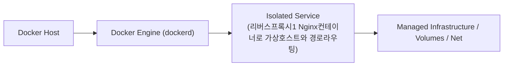
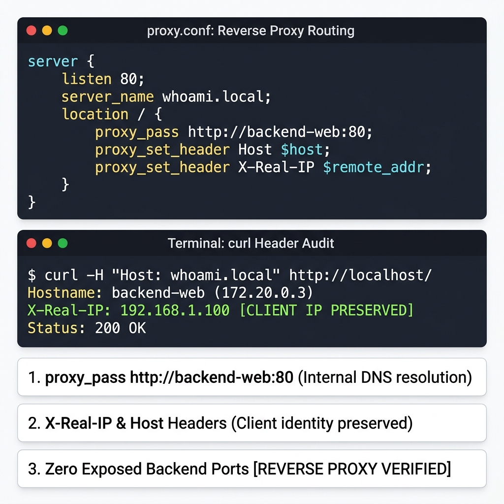
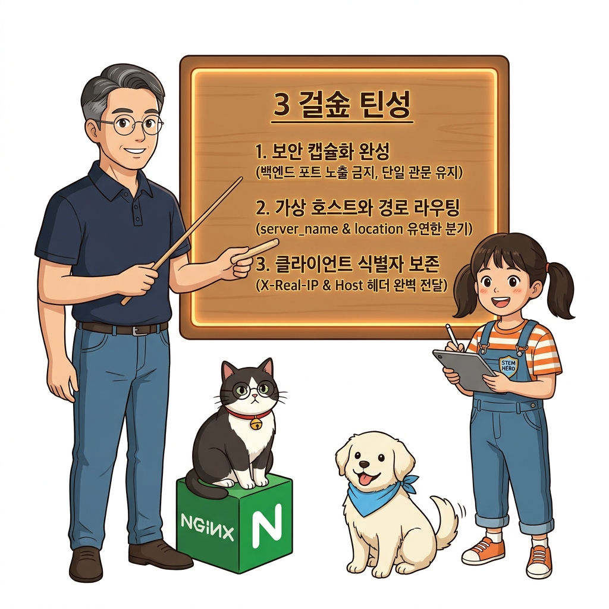
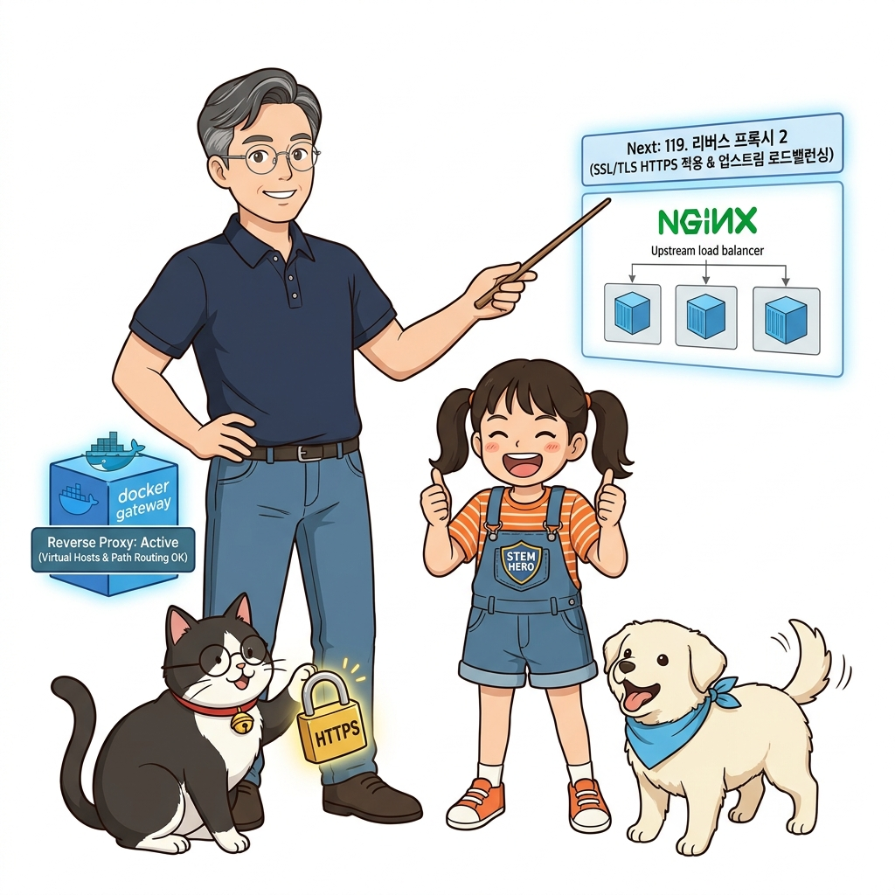

# 118. 리버스프록시1 Nginx컨테이너로 가상호스트와 경로라우팅

클라이언트는 내부 컨테이너의 포트나 IP를 전혀 몰라도 되며, 오직 앞단의 **리버스 프록시(Reverse Proxy)** 단 한 곳으로만 접속하도록 설계하는 엔터프라이즈 네트워크 토폴로지를 배웁니다.


**그림 08-7-1** 리버스프록시1 Nginx컨테이너로 가상호스트와 경로라우팅의 필요성과 현대 클라우드 아키텍처 관점의 개요

---

### 118.1 왜 리버스프록시1 Nginx컨테이너로 가상호스트와 경로라우팅이(가) 필요한가? (문제 정의와 현실적 배경)

소프트웨어 시스템이 복잡해질수록 설정을 다루는 방식은 전체 인프라의 신뢰성을 결정짓는 핵심 척도가 됩니다. **리버스프록시1 Nginx컨테이너로 가상호스트와 경로라우팅**이(가) 부재하거나 잘못 다루어질 때 현장에서는 다음과 같은 대표적인 병목과 장애가 발생합니다:

1. **하드코딩된 설정과 환경 불일치로 인한 유연성 상실**: 환경이 바뀔 때마다 코드를 다시 빌드해야 하므로 배포 주기가 지연되고 이미지 수가 기하급수적으로 폭증합니다.
2. **보안 민감 데이터의 무분별한 노출**: 비밀번호, 데이터베이스 토큰, 암호화 키가 이미지 레이어에 영구 박제되어 형상관리 시스템이나 외부에 유출될 위험이 커집니다.
3. **재현 불가능한 구성 드리프트**: 스테이징 환경과 프로덕션 환경의 미세한 설정 차이가 예기치 못한 서비스 중단 사고로 직결됩니다.


**그림 08-7-2** 리버스프록시1 Nginx컨테이너로 가상호스트와 경로라우팅에 대한 대표적인 오해와 실제 프로덕션 현장의 엔지니어링 진실

---

### 118.2 핵심 아키텍처와 엔지니어링 메커니즘

공식 Nginx 컨테이너를 리버스 프록시로 띄우고, 들어오는 도메인(`whoami.local` vs `api.local`) 및 URL 경로(`/api/` vs `/static/`)에 따라 서로 다른 백엔드 컨테이너로 투명하게 트래픽을 분기 라우팅하는 실습을 진행합니다!


**그림 08-7-3** 리버스프록시1 Nginx컨테이너로 가상호스트와 경로라우팅의 내부 아키텍처 및 데이터 흐름

#### 📊 핵심 비교 및 엔지니어링 표준 분석

| 구분 / 핵심 원리 | 상세 설명 및 동작 메커니즘 | 실무 적용 시 주의점 및 베스트 프랙티스 |
| :--- | :--- | :--- |
| **포워드 프록시 vs 리버스 프록시** | 포워드 프록시는 사내 PC들이 외부 인터넷에 나갈 때 통하는 관문 / **리버스 프록시는 외부 고객들이 내부 백엔드 서버들에 접속할 때 앞단을 지켜주는 수문장**! | 보안, SSL 암복호화, 로드 밸런싱, 캐싱을 한곳에서 전담 |
| **`proxy_set_header` 필수 설정** | 프록시를 거치면 백엔드 서버 입장에서는 접속자 IP가 '프록시 IP'로 보임! 실제 고객의 IP와 원본 도메인을 전달하기 위해 `X-Real-IP`와 `X-Forwarded-For`, `Host` 헤더를 반드시 전달 | 로그 기록과 보안 감사에서 접속자 추적을 위해 필수! |
| **보안 캡슐화** | 내부 백엔드 API와 DB 컨테이너는 호스트 포트를 아예 개방(`ports:`)하지 않고 내부 도커 네트워크에만 격리 | 오직 리버스 프록시만이 외부로 80/443 포트를 열고 트래픽을 중계하므로 외부 해킹 위협 원천 차단! |

---

### 118.3 선언적 실습 및 아키텍처 다이어그램

본 실습은 외부 비공개 패키지에 의존하지 않고, 공식 표준 이미지를 기반으로 즉시 재현 가능한 살아있는 코드로 구성되어 있습니다.

```bash
# Nginx 리버스 프록시 설정(virtual host & proxy_pass) 파일 작성 및 라우팅 검증 실습
mkdir -p /tmp/oz-proxy && cd /tmp/oz-proxy
cat << 'EOF' > proxy.conf
server {
    listen 80;
    server_name whoami.local;
    location / {
        proxy_pass http://backend-web:80;
        proxy_set_header Host $host;
        proxy_set_header X-Real-IP $remote_addr;
    }
}
EOF
grep -E "server_name|proxy_pass" proxy.conf
rm -rf /tmp/oz-proxy
```

#### 🔍 아키텍처 흐름도 (Mermaid Diagram)




**그림 08-7-4** 선언적 인프라 명세를 통한 리버스프록시1 Nginx컨테이너로 가상호스트와 경로라우팅 검증 파이프라인

---

### 118.4 핵심 정리: 캐릭터 대화와 3대 교훈

> 👧 **도로시**: "교수님! **리버스프록시1 Nginx컨테이너로 가상호스트와 경로라우팅**의 원리를 배우니까, 복잡하게 얽혀 있던 인프라 설정이 레고 블록처럼 질서정연하게 제자리를 찾는 게 보여요!"
> 
> 🐱 **조교 지니**: "야옹~ 맞습니다! 특히 런타임 환경과 불변 인프라의 경계를 명확히 지키는 것이 대규모 클라우드 운영의 제1원칙이랍니다!"
> 
> 🐶 **토토**: "멍멍! 선언적 코드로 한 번 적어두면 언제든 똑같이 복원되니까 정말 든든해요!"
> 
> 👨‍🏫 **이호진 교수님**: "훌륭하구나. 원리를 깊이 이해하고 실습을 통해 손에 익히는 것이 훌륭한 클라우드 엔지니어로 성장하는 가장 빠른 지름길이란다."


**그림 08-7-5** 리버스프록시1 Nginx컨테이너로 가상호스트와 경로라우팅 마스터를 위한 3대 핵심 교훈

1. **설정과 실행의 명확한 분리**:
   * 애플리케이션 코드는 불변으로 유지하고, 가변적인 설정값은 외부에서 주입하여 이식성을 극대화합니다.
2. **선언적 재현성 확보**:
   * 사람이 수작업으로 변경하지 않고 코드 명세를 통해 언제 어디서나 100% 동일한 실행 결과를 보장합니다.
3. **최소 권한 및 보안 모범 사례 준수**:
   * 불필요한 권한과 포트 노출을 최소화하고 민감 데이터를 암호화하여 프로덕션 안정성을 담보합니다.

---

### 118.5 랩노트 피날레와 다음 강의 예고


**그림 08-7-6** 연구실에서 다음 마일스톤인 [리버스프록시2 SSL TLS HTTPS적용과 업스트림 로드밸런싱] 실습을 예고하는 교수님과 토토

> 💡 **다음 강의 안내**:
> [리버스프록시2 SSL TLS HTTPS적용과 업스트림 로드밸런싱](../119_리버스프록시2_SSL_TLS_HTTPS적용과_업스트림_로드밸런싱/)에서는 더욱 심화된 실전 엔지니어링 실습과 아키텍처를 다룹니다!

---

## 🧭 강의 네비게이션
* [◀️ 이전 강의: 117_로그저장소와_시각화스택_OpenSearch_Loki_통합로그검색](../117_로그저장소와_시각화스택_OpenSearch_Loki_통합로그검색/)
* [📋 Part 08. 프로덕션 운영 마스터: 설정 관리, 중앙 로깅(Fluentd), 리버스 프록시(Nginx/Traefik), 비동기 메시지 큐(Redis/NATS) & 최종 캡스톤 (112 ~ 129) 목차로 돌아가기](../)
* [▶️ 다음 강의: 119_리버스프록시2_SSL_TLS_HTTPS적용과_업스트림_로드밸런싱](../119_리버스프록시2_SSL_TLS_HTTPS적용과_업스트림_로드밸런싱/)
