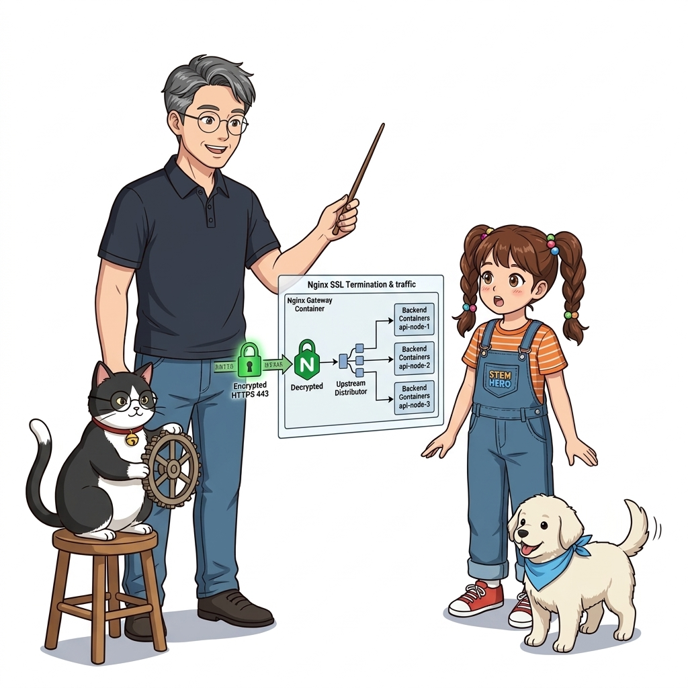
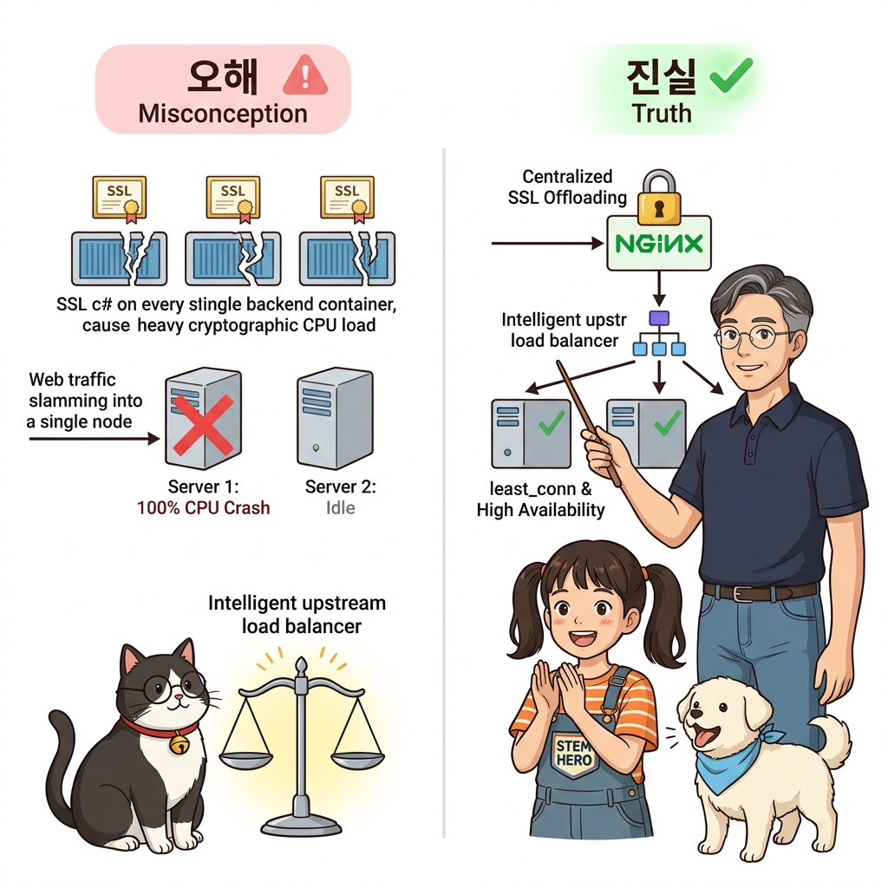
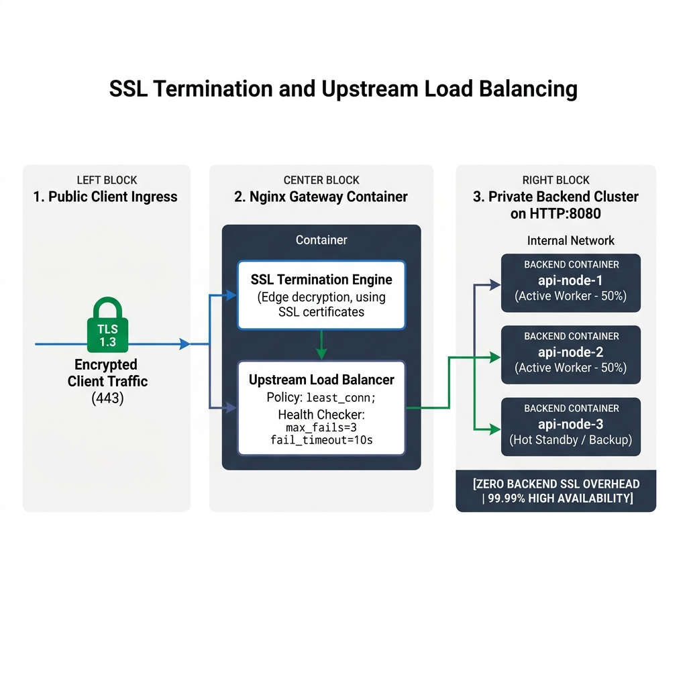
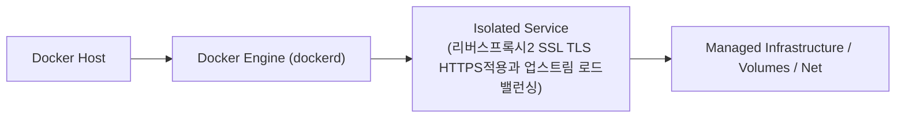
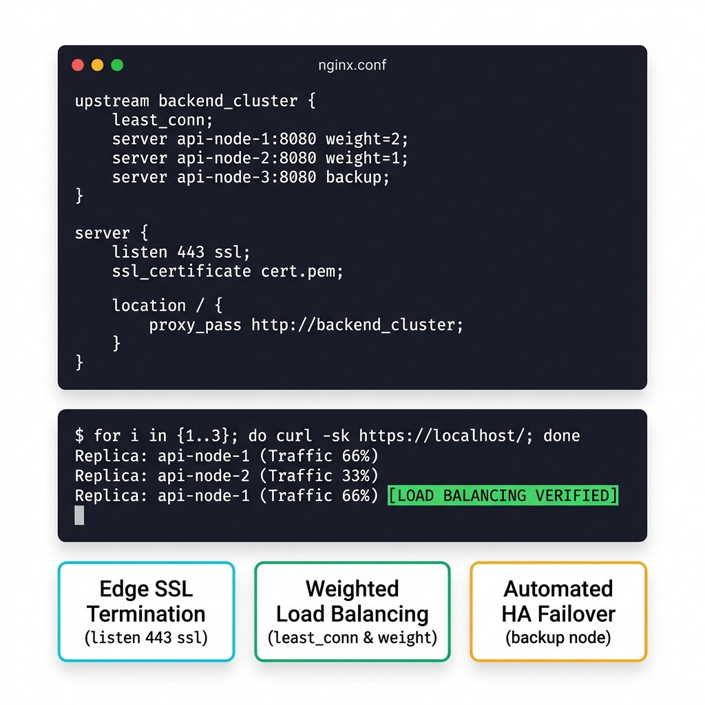
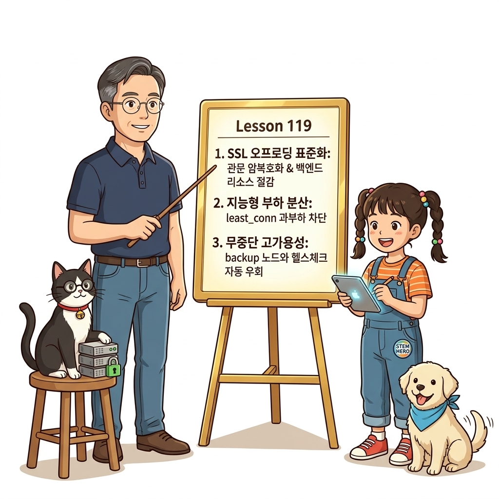
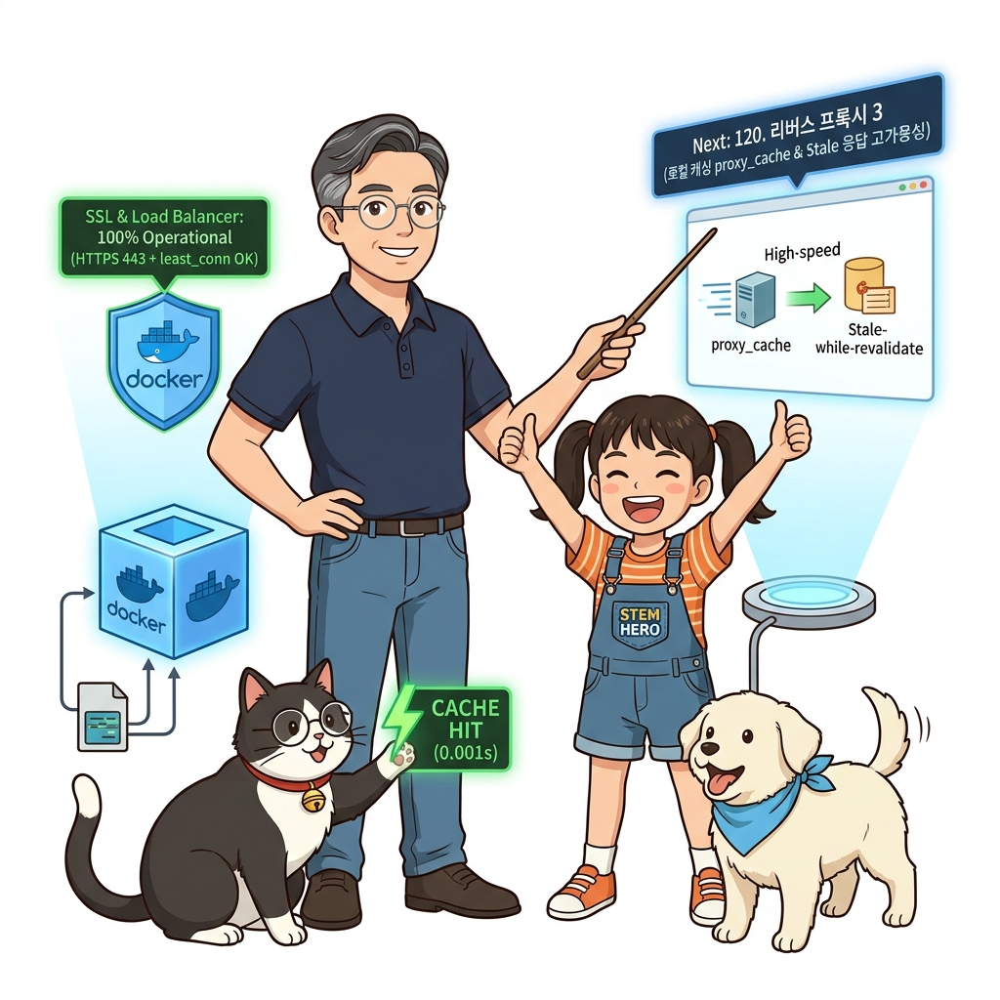

# 119. 리버스프록시2 SSL TLS HTTPS적용과 업스트림 로드밸런싱

백엔드 애플리케이션마다 복잡한 SSL 인증서 파일을 심고 암복호화 연산을 수행하면 개발이 번거롭고 CPU 부하가 분산됩니다.


**그림 08-8-1** 리버스프록시2 SSL TLS HTTPS적용과 업스트림 로드밸런싱의 필요성과 현대 클라우드 아키텍처 관점의 개요

---

### 119.1 왜 리버스프록시2 SSL TLS HTTPS적용과 업스트림 로드밸런싱이(가) 필요한가? (문제 정의와 현실적 배경)

소프트웨어 시스템이 복잡해질수록 설정을 다루는 방식은 전체 인프라의 신뢰성을 결정짓는 핵심 척도가 됩니다. **리버스프록시2 SSL TLS HTTPS적용과 업스트림 로드밸런싱**이(가) 부재하거나 잘못 다루어질 때 현장에서는 다음과 같은 대표적인 병목과 장애가 발생합니다:

1. **하드코딩된 설정과 환경 불일치로 인한 유연성 상실**: 환경이 바뀔 때마다 코드를 다시 빌드해야 하므로 배포 주기가 지연되고 이미지 수가 기하급수적으로 폭증합니다.
2. **보안 민감 데이터의 무분별한 노출**: 비밀번호, 데이터베이스 토큰, 암호화 키가 이미지 레이어에 영구 박제되어 형상관리 시스템이나 외부에 유출될 위험이 커집니다.
3. **재현 불가능한 구성 드리프트**: 스테이징 환경과 프로덕션 환경의 미세한 설정 차이가 예기치 못한 서비스 중단 사고로 직결됩니다.


**그림 08-8-2** 리버스프록시2 SSL TLS HTTPS적용과 업스트림 로드밸런싱에 대한 대표적인 오해와 실제 프로덕션 현장의 엔지니어링 진실

---

### 119.2 핵심 아키텍처와 엔지니어링 메커니즘

앞단의 Nginx 리버스 프록시에서 SSL/TLS 암복호화를 전담(**SSL Termination**)하고, **`upstream` 블록**을 선언해 3개로 스케일 아웃된 백엔드 컨테이너 레플리카들로 트래픽을 가중치/라운드로빈 부하 분산하는 아키텍처를 실습합니다!


**그림 08-8-3** 리버스프록시2 SSL TLS HTTPS적용과 업스트림 로드밸런싱의 내부 아키텍처 및 데이터 흐름

#### 📊 핵심 비교 및 엔지니어링 표준 분석

| 구분 / 핵심 원리 | 상세 설명 및 동작 메커니즘 | 실무 적용 시 주의점 및 베스트 프랙티스 |
| :--- | :--- | :--- |
| **SSL 오프로딩 (SSL Termination)** | 외부 고객과 프록시 사이는 안전한 `https://`(443) 암호화 통신을 하고, 프록시와 내부 백엔드 컨테이너 사이는 고속 사설 HTTP(80)로 통신 | 백엔드 개발자는 복잡한 인증서 처리 코드 없이 순수 비즈니스 로직에만 100% 집중 가능! |
| **Nginx 부하 분산 알고리즘** | 기본 라운드로빈(순환 분배), `least_conn`(연결 수 최소 분배), `ip_hash`(동일 클라이언트는 동일 컨테이너로 고정, 스티키 세션) | 서비스의 특성에 맞춰 최적의 분배 정책 선택 |
| **`backup`과 `max_fails` 헬스 모니터링** | 특정 백엔드 컨테이너가 응답하지 않으면 Nginx가 자동으로 해당 컨테이너를 우회하고 정상 컨테이너로 재요청 전달 | 사용자에게 에러 화면이 노출되지 않는 고가용성 네트워크 계층 완성 |

---

### 119.3 선언적 실습 및 아키텍처 다이어그램

본 실습은 외부 비공개 패키지에 의존하지 않고, 공식 표준 이미지를 기반으로 즉시 재현 가능한 살아있는 코드로 구성되어 있습니다.

```bash
# Nginx의 upstream 블록을 이용한 다중 백엔드 컨테이너 로드 밸런싱 설정 레퍼런스
cat << 'EOF'
upstream backend_cluster {
    least_conn; # 가장 활성 연결이 적은 컨테이너로 트래픽 우선 전달!
    server api-node-1:8080 weight=2;
    server api-node-2:8080 weight=1;
    server api-node-3:8080 backup;
}
EOF
```

#### 🔍 아키텍처 흐름도 (Mermaid Diagram)




**그림 08-8-4** 선언적 인프라 명세를 통한 리버스프록시2 SSL TLS HTTPS적용과 업스트림 로드밸런싱 검증 파이프라인

---

### 119.4 핵심 정리: 캐릭터 대화와 3대 교훈

> 👧 **도로시**: "교수님! **리버스프록시2 SSL TLS HTTPS적용과 업스트림 로드밸런싱**의 원리를 배우니까, 복잡하게 얽혀 있던 인프라 설정이 레고 블록처럼 질서정연하게 제자리를 찾는 게 보여요!"
> 
> 🐱 **조교 지니**: "야옹~ 맞습니다! 특히 런타임 환경과 불변 인프라의 경계를 명확히 지키는 것이 대규모 클라우드 운영의 제1원칙이랍니다!"
> 
> 🐶 **토토**: "멍멍! 선언적 코드로 한 번 적어두면 언제든 똑같이 복원되니까 정말 든든해요!"
> 
> 👨‍🏫 **이호진 교수님**: "훌륭하구나. 원리를 깊이 이해하고 실습을 통해 손에 익히는 것이 훌륭한 클라우드 엔지니어로 성장하는 가장 빠른 지름길이란다."


**그림 08-8-5** 리버스프록시2 SSL TLS HTTPS적용과 업스트림 로드밸런싱 마스터를 위한 3대 핵심 교훈

1. **설정과 실행의 명확한 분리**:
   * 애플리케이션 코드는 불변으로 유지하고, 가변적인 설정값은 외부에서 주입하여 이식성을 극대화합니다.
2. **선언적 재현성 확보**:
   * 사람이 수작업으로 변경하지 않고 코드 명세를 통해 언제 어디서나 100% 동일한 실행 결과를 보장합니다.
3. **최소 권한 및 보안 모범 사례 준수**:
   * 불필요한 권한과 포트 노출을 최소화하고 민감 데이터를 암호화하여 프로덕션 안정성을 담보합니다.

---

### 119.5 랩노트 피날레와 다음 강의 예고


**그림 08-8-6** 연구실에서 다음 마일스톤인 [리버스프록시3 로컬캐싱 proxy cache과 Stale응답 고가용성] 실습을 예고하는 교수님과 토토

> 💡 **다음 강의 안내**:
> [리버스프록시3 로컬캐싱 proxy cache과 Stale응답 고가용성](../120_리버스프록시3_로컬캐싱_proxy_cache과_Stale응답_고가용성/)에서는 더욱 심화된 실전 엔지니어링 실습과 아키텍처를 다룹니다!

---

## 🧭 강의 네비게이션
* [◀️ 이전 강의: 118_리버스프록시1_Nginx컨테이너로_가상호스트와_경로라우팅](../118_리버스프록시1_Nginx컨테이너로_가상호스트와_경로라우팅/)
* [📋 Part 08. 프로덕션 운영 마스터: 설정 관리, 중앙 로깅(Fluentd), 리버스 프록시(Nginx/Traefik), 비동기 메시지 큐(Redis/NATS) & 최종 캡스톤 (112 ~ 129) 목차로 돌아가기](../)
* [▶️ 다음 강의: 120_리버스프록시3_로컬캐싱_proxy_cache과_Stale응답_고가용성](../120_리버스프록시3_로컬캐싱_proxy_cache과_Stale응답_고가용성/)
