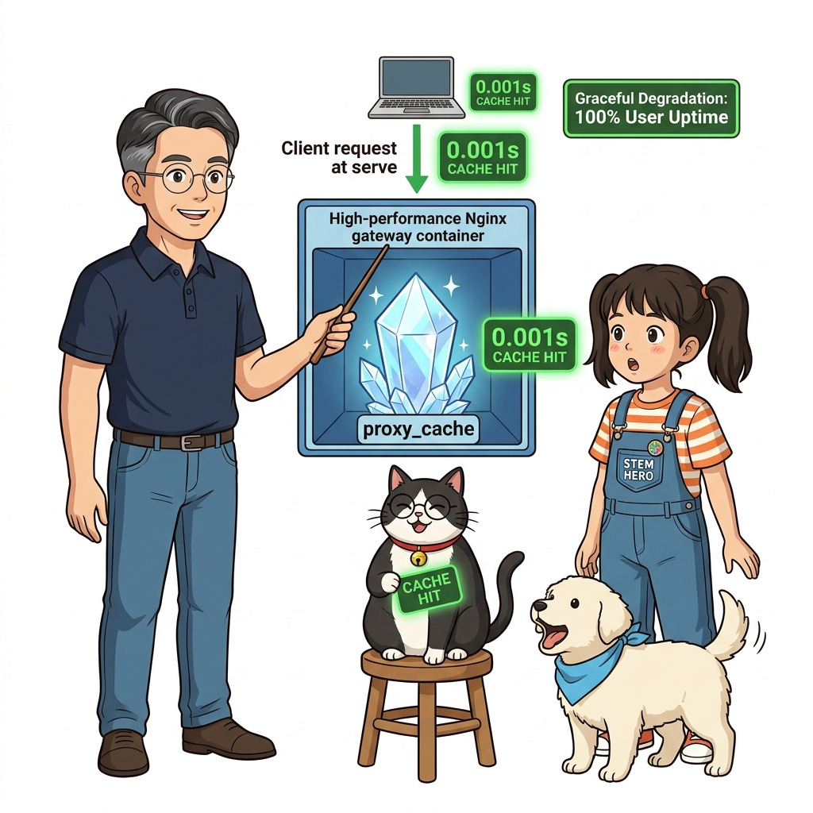
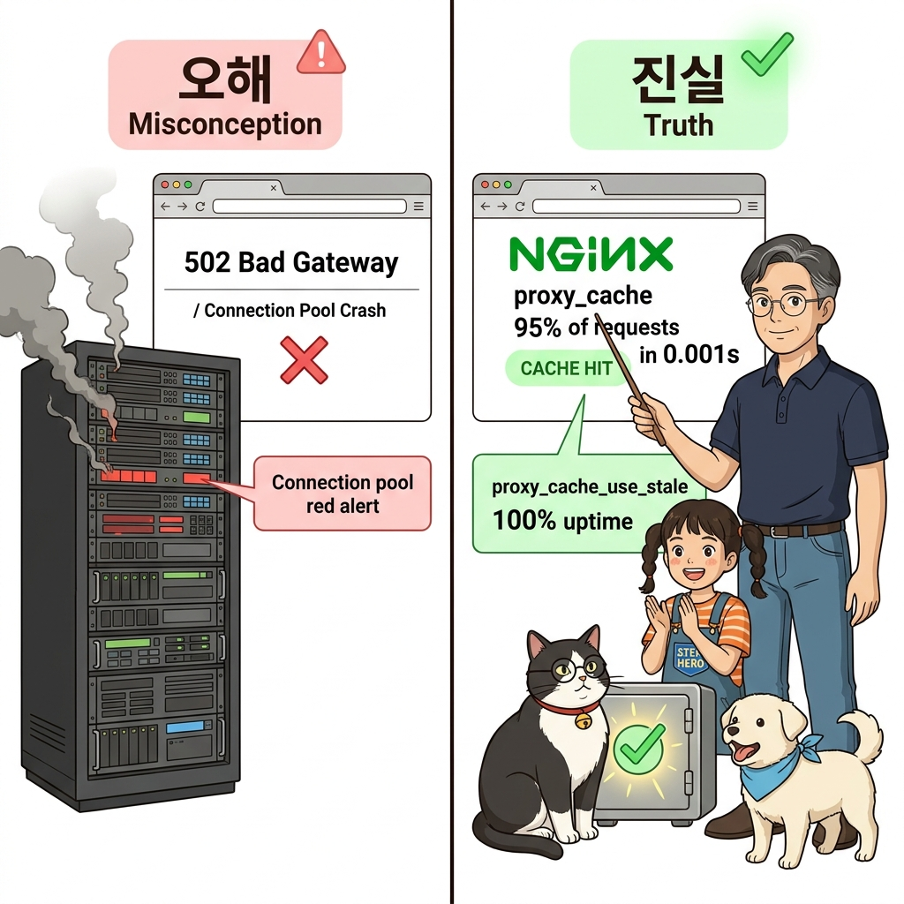
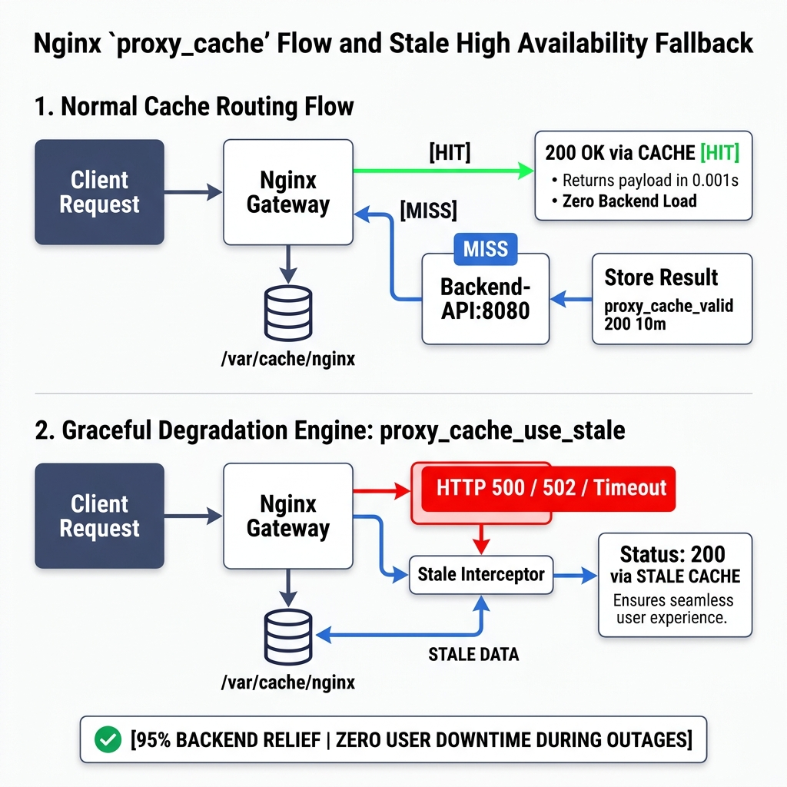
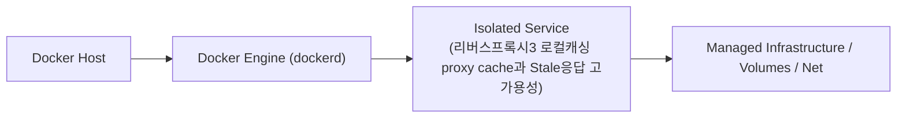
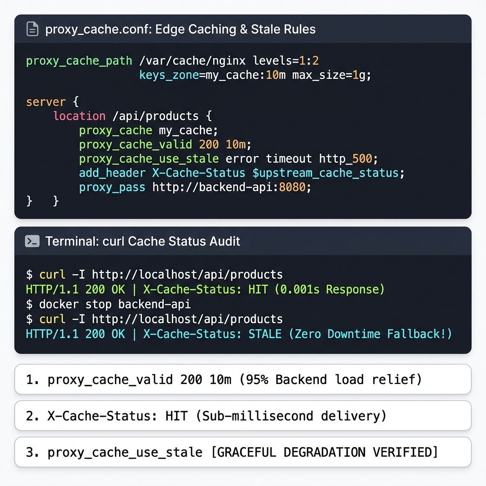
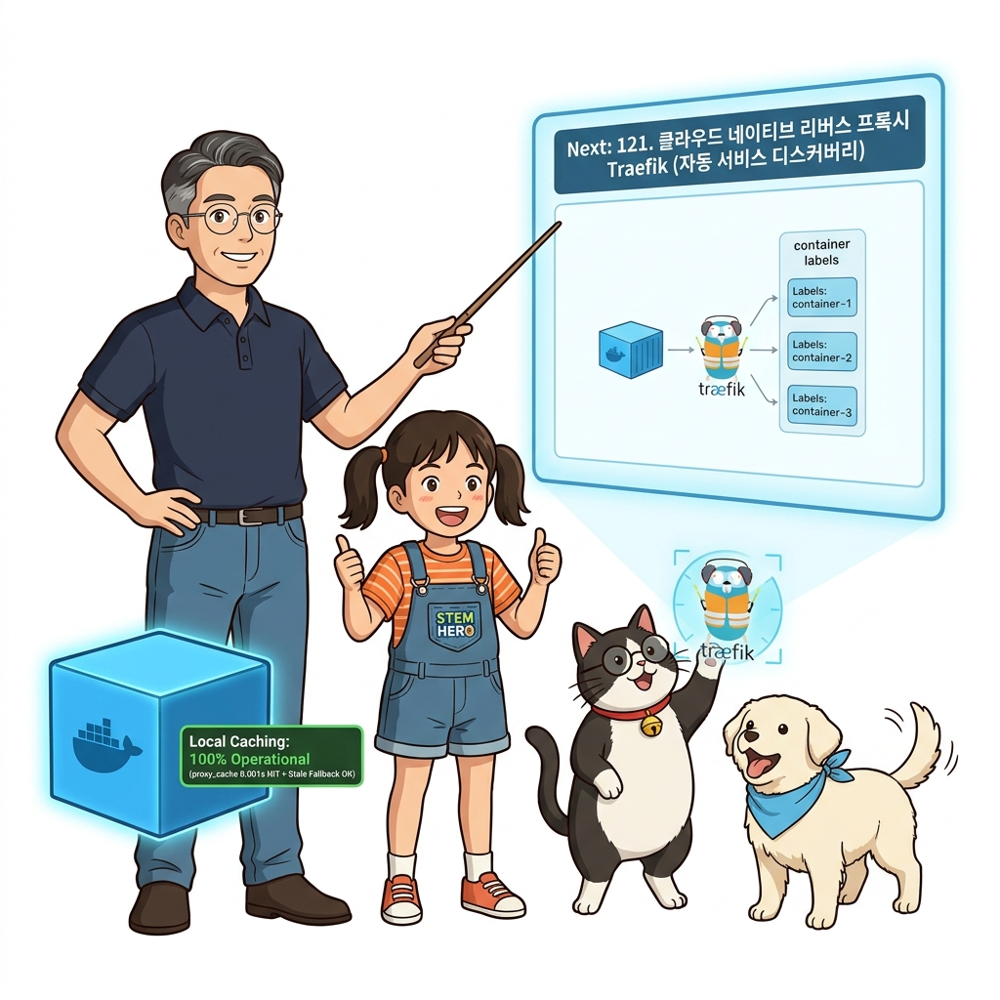

# 120. 리버스프록시3 로컬캐싱 proxy cache과 Stale응답 고가용성

동일한 이미지 갤러리나 인기 상품 목록 요청이 1초에 1만 번 들어올 때, 백엔드 서버를 매번 치지 않고 프록시 디스크 캐시에서 0.001초 만에 즉시 응답하는 **`proxy_cache`**를 구성합니다.


**그림 08-9-1** 리버스프록시3 로컬캐싱 proxy cache과 Stale응답 고가용성의 필요성과 현대 클라우드 아키텍처 관점의 개요

---

### 120.1 왜 리버스프록시3 로컬캐싱 proxy cache과 Stale응답 고가용성이(가) 필요한가? (문제 정의와 현실적 배경)

소프트웨어 시스템이 복잡해질수록 설정을 다루는 방식은 전체 인프라의 신뢰성을 결정짓는 핵심 척도가 됩니다. **리버스프록시3 로컬캐싱 proxy cache과 Stale응답 고가용성**이(가) 부재하거나 잘못 다루어질 때 현장에서는 다음과 같은 대표적인 병목과 장애가 발생합니다:

1. **하드코딩된 설정과 환경 불일치로 인한 유연성 상실**: 환경이 바뀔 때마다 코드를 다시 빌드해야 하므로 배포 주기가 지연되고 이미지 수가 기하급수적으로 폭증합니다.
2. **보안 민감 데이터의 무분별한 노출**: 비밀번호, 데이터베이스 토큰, 암호화 키가 이미지 레이어에 영구 박제되어 형상관리 시스템이나 외부에 유출될 위험이 커집니다.
3. **재현 불가능한 구성 드리프트**: 스테이징 환경과 프로덕션 환경의 미세한 설정 차이가 예기치 못한 서비스 중단 사고로 직결됩니다.


**그림 08-9-2** 리버스프록시3 로컬캐싱 proxy cache과 Stale응답 고가용성에 대한 대표적인 오해와 실제 프로덕션 현장의 엔지니어링 진실

---

### 120.2 핵심 아키텍처와 엔지니어링 메커니즘

나아가 백엔드 API 컨테이너가 점검 중이거나 일시적으로 모두 죽었을 때(`error`, `timeout`, `http_500`), 캐시되어 있던 이전 응답을 사용자에게 대신 반환하여 장애를 감추는 놀라운 **Stale 응답 서빙 기법**을 실습합니다!


**그림 08-9-3** 리버스프록시3 로컬캐싱 proxy cache과 Stale응답 고가용성의 내부 아키텍처 및 데이터 흐름

#### 📊 핵심 비교 및 엔지니어링 표준 분석

| 구분 / 핵심 원리 | 상세 설명 및 동작 메커니즘 | 실무 적용 시 주의점 및 베스트 프랙티스 |
| :--- | :--- | :--- |
| **`proxy_cache_valid 200 10m`** | 백엔드의 정상 응답(HTTP 200)을 10분간 프록시 로컬 스토리지에 캐싱 | 백엔드 CPU와 데이터베이스 쿼리 부하를 95% 이상 경감 |
| **`proxy_cache_use_stale`의 마법** | 백엔드가 500 에러를 뱉거나 타임아웃이 나면 만료된 옛날 캐시(Stale Data)라도 사용자에게 친절하게 제공 | 넷플릭스, 아마존 등 대규모 글로벌 서비스들이 사용하는 대표적인 우아한 기능 저하(Graceful Degradation) 패턴! |
| **Part 03 도커 볼륨과의 결합** | 프록시 캐시 경로(`/var/cache/nginx`)를 도커 볼륨으로 연결해 두면 프록시 컨테이너가 재시작되어도 고속 캐시 데이터가 그대로 유지됨 | 인프라 컴포넌트 간의 완벽한 융합 |

---

### 120.3 선언적 실습 및 아키텍처 다이어그램

본 실습은 외부 비공개 패키지에 의존하지 않고, 공식 표준 이미지를 기반으로 즉시 재현 가능한 살아있는 코드로 구성되어 있습니다.

```bash
# Nginx proxy_cache 설정 및 백엔드 장애 시 캐시 응답 서빙(proxy_cache_use_stale) 설정
cat << 'EOF'
proxy_cache_path /var/cache/nginx levels=1:2 keys_zone=my_cache:10m max_size=1g inactive=60m;
server {
    location /api/products {
        proxy_cache my_cache;
        proxy_cache_valid 200 10m;
        proxy_cache_use_stale error timeout updating http_500 http_502 http_503;
        proxy_pass http://backend-api:8080;
    }
}
EOF
```

#### 🔍 아키텍처 흐름도 (Mermaid Diagram)




**그림 08-9-4** 선언적 인프라 명세를 통한 리버스프록시3 로컬캐싱 proxy cache과 Stale응답 고가용성 검증 파이프라인

---

### 120.4 핵심 정리: 캐릭터 대화와 3대 교훈

> 👧 **도로시**: "교수님! **리버스프록시3 로컬캐싱 proxy cache과 Stale응답 고가용성**의 원리를 배우니까, 복잡하게 얽혀 있던 인프라 설정이 레고 블록처럼 질서정연하게 제자리를 찾는 게 보여요!"
> 
> 🐱 **조교 지니**: "야옹~ 맞습니다! 특히 런타임 환경과 불변 인프라의 경계를 명확히 지키는 것이 대규모 클라우드 운영의 제1원칙이랍니다!"
> 
> 🐶 **토토**: "멍멍! 선언적 코드로 한 번 적어두면 언제든 똑같이 복원되니까 정말 든든해요!"
> 
> 👨‍🏫 **이호진 교수님**: "훌륭하구나. 원리를 깊이 이해하고 실습을 통해 손에 익히는 것이 훌륭한 클라우드 엔지니어로 성장하는 가장 빠른 지름길이란다."


**그림 08-9-5** 리버스프록시3 로컬캐싱 proxy cache과 Stale응답 고가용성 마스터를 위한 3대 핵심 교훈

1. **설정과 실행의 명확한 분리**:
   * 애플리케이션 코드는 불변으로 유지하고, 가변적인 설정값은 외부에서 주입하여 이식성을 극대화합니다.
2. **선언적 재현성 확보**:
   * 사람이 수작업으로 변경하지 않고 코드 명세를 통해 언제 어디서나 100% 동일한 실행 결과를 보장합니다.
3. **최소 권한 및 보안 모범 사례 준수**:
   * 불필요한 권한과 포트 노출을 최소화하고 민감 데이터를 암호화하여 프로덕션 안정성을 담보합니다.

---

### 120.5 랩노트 피날레와 다음 강의 예고


**그림 08-9-6** 연구실에서 다음 마일스톤인 [클라우드네이티브 리버스프록시 Traefik 자동서비스디스커버리] 실습을 예고하는 교수님과 토토

> 💡 **다음 강의 안내**:
> [클라우드네이티브 리버스프록시 Traefik 자동서비스디스커버리](../121_클라우드네이티브_리버스프록시_Traefik_자동서비스디스커버리/)에서는 더욱 심화된 실전 엔지니어링 실습과 아키텍처를 다룹니다!

---

## 🧭 강의 네비게이션
* [◀️ 이전 강의: 119_리버스프록시2_SSL_TLS_HTTPS적용과_업스트림_로드밸런싱](../119_리버스프록시2_SSL_TLS_HTTPS적용과_업스트림_로드밸런싱/)
* [📋 Part 08. 프로덕션 운영 마스터: 설정 관리, 중앙 로깅(Fluentd), 리버스 프록시(Nginx/Traefik), 비동기 메시지 큐(Redis/NATS) & 최종 캡스톤 (112 ~ 129) 목차로 돌아가기](../)
* [▶️ 다음 강의: 121_클라우드네이티브_리버스프록시_Traefik_자동서비스디스커버리](../121_클라우드네이티브_리버스프록시_Traefik_자동서비스디스커버리/)
