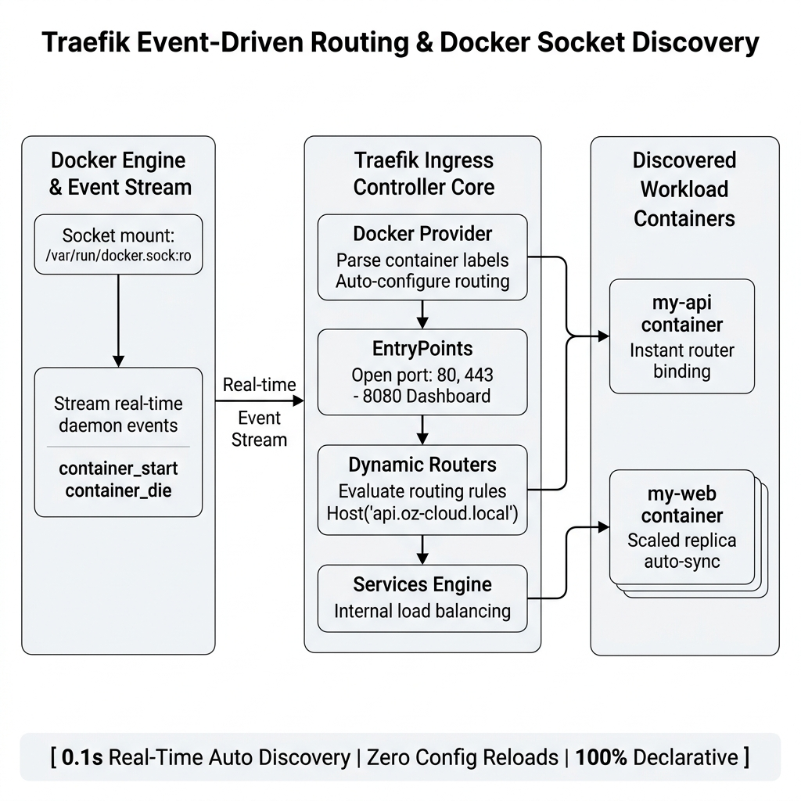
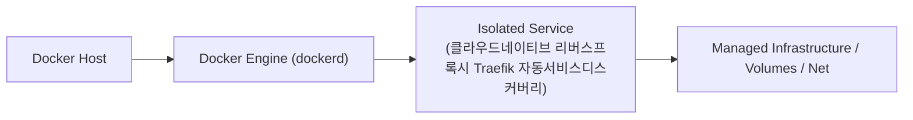
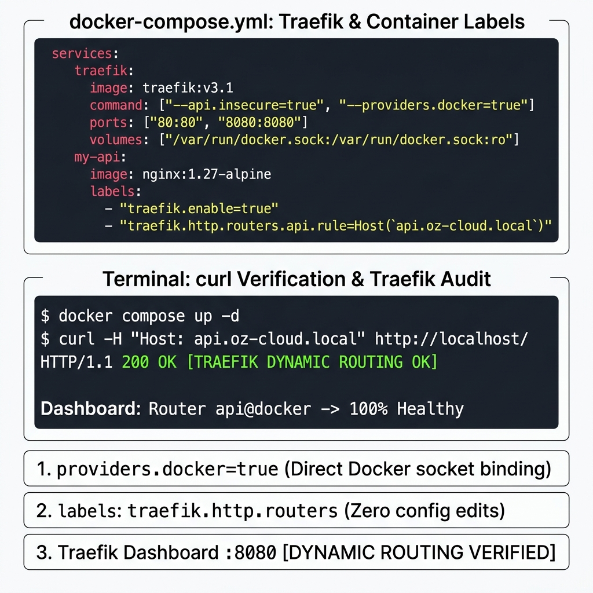

# 121. 클라우드네이티브 리버스프록시 Traefik 자동서비스디스커버리

전통적인 Nginx는 새 컨테이너가 추가될 때마다 설정 파일을 고치고 `nginx -s reload`를 때려야 하지만, 현대 클라우드 네이티브 환경을 위해 탄생한 **트래픽(Traefik)**은 도커 소켓을 직접 감시합니다.


**그림 08-10-1** 클라우드네이티브 리버스프록시 Traefik 자동서비스디스커버리의 필요성과 현대 클라우드 아키텍처 관점의 개요

---

### 121.1 왜 클라우드네이티브 리버스프록시 Traefik 자동서비스디스커버리이(가) 필요한가? (문제 정의와 현실적 배경)

소프트웨어 시스템이 복잡해질수록 설정을 다루는 방식은 전체 인프라의 신뢰성을 결정짓는 핵심 척도가 됩니다. **클라우드네이티브 리버스프록시 Traefik 자동서비스디스커버리**이(가) 부재하거나 잘못 다루어질 때 현장에서는 다음과 같은 대표적인 병목과 장애가 발생합니다:

1. **하드코딩된 설정과 환경 불일치로 인한 유연성 상실**: 환경이 바뀔 때마다 코드를 다시 빌드해야 하므로 배포 주기가 지연되고 이미지 수가 기하급수적으로 폭증합니다.
2. **보안 민감 데이터의 무분별한 노출**: 비밀번호, 데이터베이스 토큰, 암호화 키가 이미지 레이어에 영구 박제되어 형상관리 시스템이나 외부에 유출될 위험이 커집니다.
3. **재현 불가능한 구성 드리프트**: 스테이징 환경과 프로덕션 환경의 미세한 설정 차이가 예기치 못한 서비스 중단 사고로 직결됩니다.


**그림 08-10-2** 클라우드네이티브 리버스프록시 Traefik 자동서비스디스커버리에 대한 대표적인 오해와 실제 프로덕션 현장의 엔지니어링 진실

---

### 121.2 핵심 아키텍처와 엔지니어링 메커니즘

새로운 컨테이너의 `compose.yaml`에 **`labels:`** 몇 줄만 적어두면 Traefik이 컨테이너의 생성과 스케일링을 스스로 감지해 라우팅 규칙, 로드 밸런싱, 대시보드 등록을 100% 전자동으로 구성하는 마법을 체험합니다!


**그림 08-10-3** 클라우드네이티브 리버스프록시 Traefik 자동서비스디스커버리의 내부 아키텍처 및 데이터 흐름

#### 📊 핵심 비교 및 엔지니어링 표준 분석

| 구분 / 핵심 원리 | 상세 설명 및 동작 메커니즘 | 실무 적용 시 주의점 및 베스트 프랙티스 |
| :--- | :--- | :--- |
| **자동 서비스 디스커버리** | 도커 엔진 이벤트 스트림을 감시하다가 새 컨테이너가 뜨면 0.1초 만에 라우터에 등록하고, 죽으면 즉시 라우터에서 제거 | 수동 설정 파일 관리가 완전히 사라지는 진정한 클라우드 네이티브 프록시 |
| **Traefik 웹 대시보드 (`:8080`)** | 현재 연결된 모든 도커 컨테이너의 라우터, 서비스, 미들웨어 상태와 트래픽 흐름을 시각적으로 한눈에 확인 가능 | 네트워크 설정 오류를 직관적으로 디버깅 |
| **Let's Encrypt 무료 SSL 자동 갱신** | 도메인 이름만 지정해 두면 Traefik이 Let's Encrypt CA와 통신해 무료 SSL 인증서를 자동 발급받고 갱신까지 전자동 처리 | 현대 스타트업과 마이크로서비스 팀의 1순위 리버스 프록시 선택 |

---

### 121.3 선언적 실습 및 아키텍처 다이어그램

본 실습은 외부 비공개 패키지에 의존하지 않고, 공식 표준 이미지를 기반으로 즉시 재현 가능한 살아있는 코드로 구성되어 있습니다.

```yaml
# 컨테이너 레이블(labels)만으로 Traefik에 자동 등록되는 마법의 컴포즈 설정!
services:
  traefik:
    image: traefik:v3.1
    command:
      - "--api.insecure=true"
      - "--providers.docker=true"
    ports: ["80:80", "8080:8080"]
    volumes: ["/var/run/docker.sock:/var/run/docker.sock:ro"]

  my-api:
    image: nginx:1.27-alpine
    labels:
      - "traefik.enable=true"
      - "traefik.http.routers.api.rule=Host(`api.oz-cloud.local`)"
      - "traefik.http.services.api.loadbalancer.server.port=80" 
```

#### 🔍 아키텍처 흐름도 (Mermaid Diagram)




**그림 08-10-4** 선언적 인프라 명세를 통한 클라우드네이티브 리버스프록시 Traefik 자동서비스디스커버리 검증 파이프라인

---

### 121.4 핵심 정리: 캐릭터 대화와 3대 교훈

> 👧 **도로시**: "교수님! **클라우드네이티브 리버스프록시 Traefik 자동서비스디스커버리**의 원리를 배우니까, 복잡하게 얽혀 있던 인프라 설정이 레고 블록처럼 질서정연하게 제자리를 찾는 게 보여요!"
> 
> 🐱 **조교 지니**: "야옹~ 맞습니다! 특히 런타임 환경과 불변 인프라의 경계를 명확히 지키는 것이 대규모 클라우드 운영의 제1원칙이랍니다!"
> 
> 🐶 **토토**: "멍멍! 선언적 코드로 한 번 적어두면 언제든 똑같이 복원되니까 정말 든든해요!"
> 
> 👨‍🏫 **이호진 교수님**: "훌륭하구나. 원리를 깊이 이해하고 실습을 통해 손에 익히는 것이 훌륭한 클라우드 엔지니어로 성장하는 가장 빠른 지름길이란다."


**그림 08-10-5** 클라우드네이티브 리버스프록시 Traefik 자동서비스디스커버리 마스터를 위한 3대 핵심 교훈

1. **설정과 실행의 명확한 분리**:
   * 애플리케이션 코드는 불변으로 유지하고, 가변적인 설정값은 외부에서 주입하여 이식성을 극대화합니다.
2. **선언적 재현성 확보**:
   * 사람이 수작업으로 변경하지 않고 코드 명세를 통해 언제 어디서나 100% 동일한 실행 결과를 보장합니다.
3. **최소 권한 및 보안 모범 사례 준수**:
   * 불필요한 권한과 포트 노출을 최소화하고 민감 데이터를 암호화하여 프로덕션 안정성을 담보합니다.

---

### 121.5 랩노트 피날레와 다음 강의 예고


**그림 08-10-6** 연구실에서 다음 마일스톤인 [비동기메시징1 동기HTTP의 한계와 Redis Pub Sub 기초] 실습을 예고하는 교수님과 토토

> 💡 **다음 강의 안내**:
> [비동기메시징1 동기HTTP의 한계와 Redis Pub Sub 기초](../122_비동기메시징1_동기HTTP의_한계와_Redis_Pub_Sub_기초/)에서는 더욱 심화된 실전 엔지니어링 실습과 아키텍처를 다룹니다!

---

## 🧭 강의 네비게이션
* [◀️ 이전 강의: 120_리버스프록시3_로컬캐싱_proxy_cache과_Stale응답_고가용성](../120_리버스프록시3_로컬캐싱_proxy_cache과_Stale응답_고가용성/)
* [📋 Part 08. 프로덕션 운영 마스터: 설정 관리, 중앙 로깅(Fluentd), 리버스 프록시(Nginx/Traefik), 비동기 메시지 큐(Redis/NATS) & 최종 캡스톤 (112 ~ 129) 목차로 돌아가기](../)
* [▶️ 다음 강의: 122_비동기메시징1_동기HTTP의_한계와_Redis_Pub_Sub_기초](../122_비동기메시징1_동기HTTP의_한계와_Redis_Pub_Sub_기초/)
