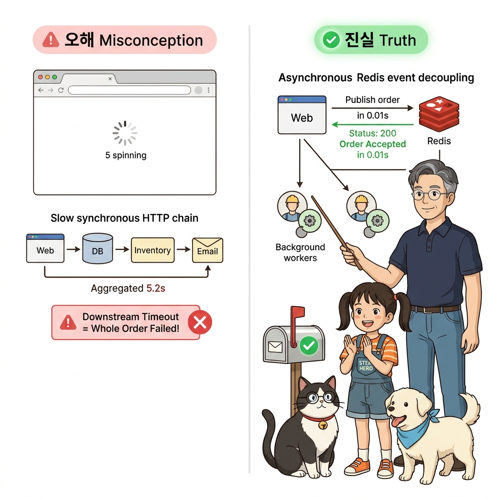
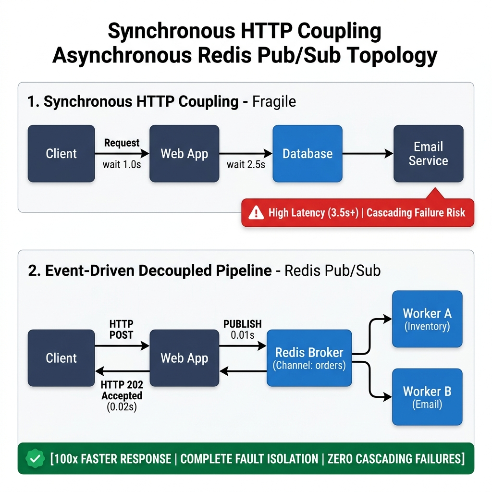
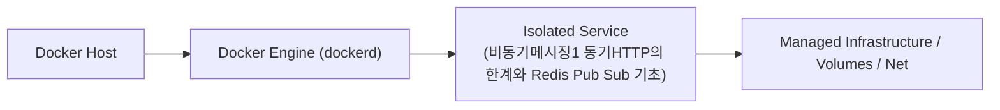
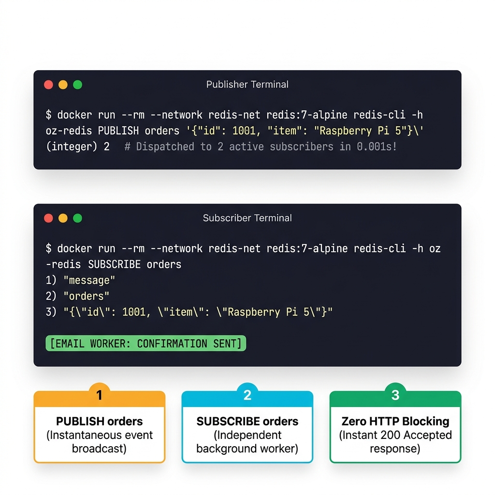
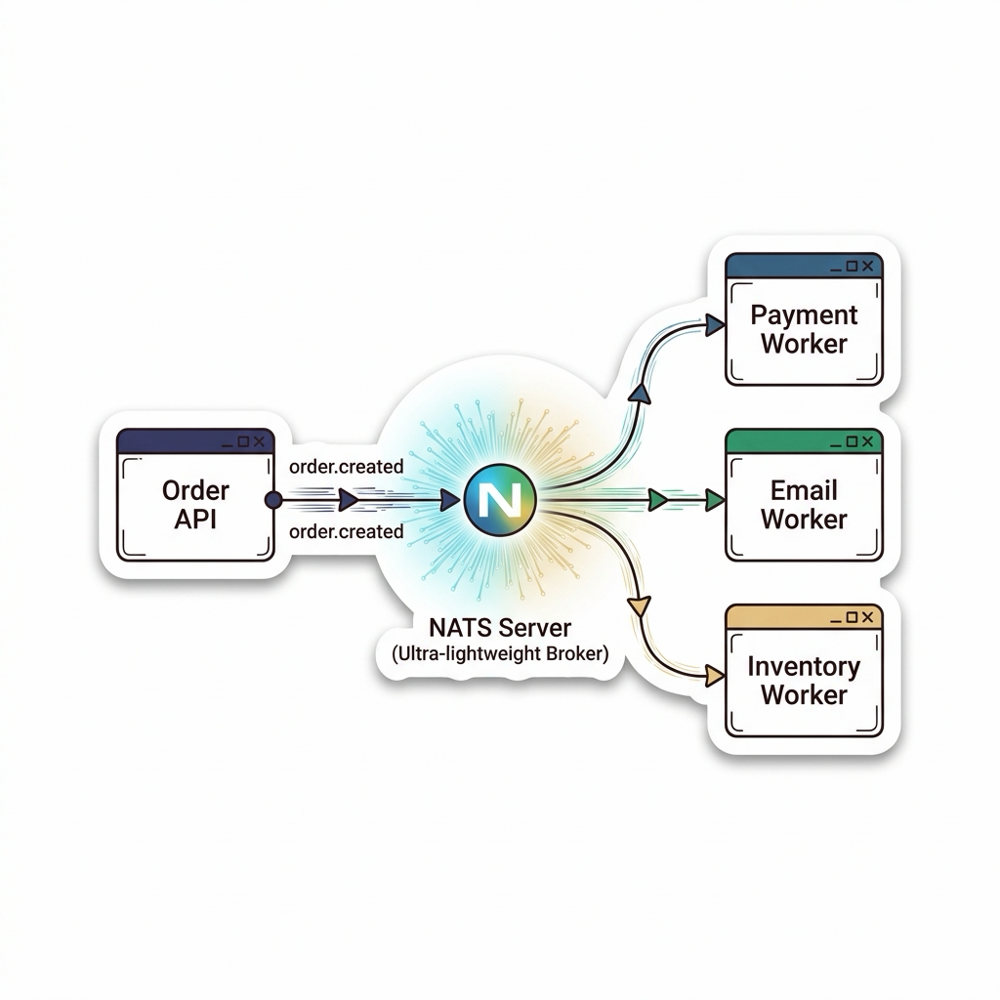
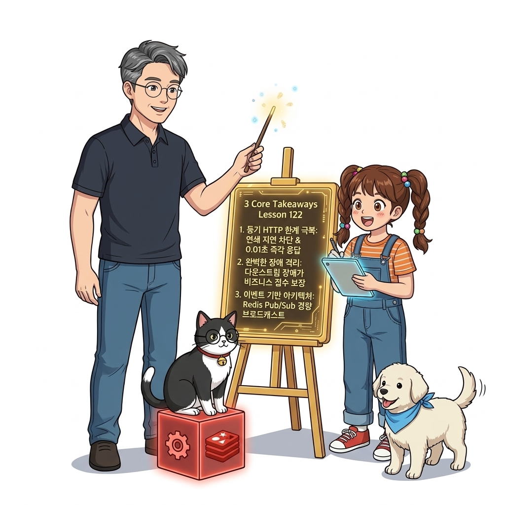
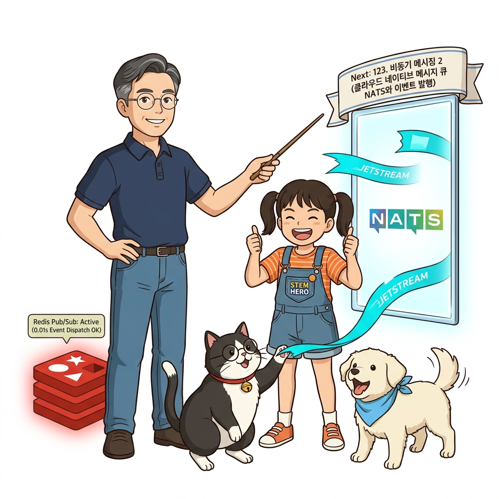

# 122. 비동기메시징1 동기HTTP의 한계와 Redis Pub Sub 기초

클라이언트가 요청을 보내고 백엔드의 모든 작업이 끝날 때까지 연결을 붙잡고 기다려야 하는 **동기식(Synchronous) HTTP REST API**의 연쇄 지연과 장애 전파(Cascading Failure) 문제를 분석합니다.


**그림 08-11-1** 비동기메시징1 동기HTTP의 한계와 Redis Pub Sub 기초의 필요성과 현대 클라우드 아키텍처 관점의 개요

---

### 122.1 왜 비동기메시징1 동기HTTP의 한계와 Redis Pub Sub 기초이(가) 필요한가? (문제 정의와 현실적 배경)

소프트웨어 시스템이 복잡해질수록 설정을 다루는 방식은 전체 인프라의 신뢰성을 결정짓는 핵심 척도가 됩니다. **비동기메시징1 동기HTTP의 한계와 Redis Pub Sub 기초**이(가) 부재하거나 잘못 다루어질 때 현장에서는 다음과 같은 대표적인 병목과 장애가 발생합니다:

1. **하드코딩된 설정과 환경 불일치로 인한 유연성 상실**: 환경이 바뀔 때마다 코드를 다시 빌드해야 하므로 배포 주기가 지연되고 이미지 수가 기하급수적으로 폭증합니다.
2. **보안 민감 데이터의 무분별한 노출**: 비밀번호, 데이터베이스 토큰, 암호화 키가 이미지 레이어에 영구 박제되어 형상관리 시스템이나 외부에 유출될 위험이 커집니다.
3. **재현 불가능한 구성 드리프트**: 스테이징 환경과 프로덕션 환경의 미세한 설정 차이가 예기치 못한 서비스 중단 사고로 직결됩니다.


**그림 08-11-2** 비동기메시징1 동기HTTP의 한계와 Redis Pub Sub 기초에 대한 대표적인 오해와 실제 프로덕션 현장의 엔지니어링 진실

---

### 122.2 핵심 아키텍처와 엔지니어링 메커니즘

요청을 받자마자 **이벤트(Event) 메시지를 발행(Publish)하고 클라이언트에게 0.05초 만에 응답을 돌려준 뒤, 백그라운드 워커들이 메시지를 구독(Subscribe)하여 느긋하게 처리하는 비동기 메시징 아키텍처**와 공식 Redis 컨테이너를 이용한 Pub/Sub 실습을 진행합니다!


**그림 08-11-3** 비동기메시징1 동기HTTP의 한계와 Redis Pub Sub 기초의 내부 아키텍처 및 데이터 흐름

#### 📊 핵심 비교 및 엔지니어링 표준 분석

| 구분 / 핵심 원리 | 상세 설명 및 동작 메커니즘 | 실무 적용 시 주의점 및 베스트 프랙티스 |
| :--- | :--- | :--- |
| **동기(Sync) vs 비동기(Async) 아키텍처** | 동기: `웹 요청 ➔ DB 저장(1초) ➔ 이메일 발송(3초) ➔ 응답(총 4초 대기)` / 비동기: `웹 요청 ➔ 큐에 이벤트 발행(0.01초) ➔ '접수 완료' 즉시 응답 ➔ 워커가 이메일 백그라운드 발송` | 고객이 체감하는 웹 사이트 반응 속도가 100배 빨라짐! |
| **장애 격리 (Fault Isolation)** | 이메일 발송 서버가 장애로 죽어있더라도 고객의 주문 접수 자체는 전혀 멈추지 않고 큐에 안전하게 쌓임 | 이메일 서버가 복구되는 순간 밀려있던 작업을 순서대로 처리하므로 데이터 유실 제로! |
| **Redis Pub/Sub의 특징** | 초경량·초고속 인메모리 브로커로 실시간 채팅이나 단순 알림 브로드캐스트에 적합 / 주의: 수신자가 없을 때 메시지가 큐에 영구 보존되지 않는 한계가 있어 본격적인 비동기 작업 큐에는 전용 메시지 큐(NATS/RabbitMQ)를 사용! | 다음 강의에서 CNCF 표준 NATS를 만납니다! |

---

### 122.3 선언적 실습 및 아키텍처 다이어그램

본 실습은 외부 비공개 패키지에 의존하지 않고, 공식 표준 이미지를 기반으로 즉시 재현 가능한 살아있는 코드로 구성되어 있습니다.

```bash
# Redis 컨테이너를 띄우고 전용 CLI로 채널(orders)에 메시지를 발행하고 실시간 수신(Pub/Sub)하기!
docker network create redis-net
docker container run -d --name oz-redis --network redis-net redis:7-alpine
sleep 2

# 백그라운드에서 메시지를 발행 (실제 환경에서는 웹 서버가 이벤트 발행!)
docker container run --rm --network redis-net redis:7-alpine   redis-cli -h oz-redis PUBLISH orders '{"id": 1001, "item": "Raspberry Pi 5"}'

docker container rm -f oz-redis && docker network rm redis-net
```

#### 🔍 아키텍처 흐름도 (Mermaid Diagram)




**그림 08-11-4** 선언적 인프라 명세를 통한 비동기메시징1 동기HTTP의 한계와 Redis Pub Sub 기초 검증 파이프라인

---

<!-- BIBLE_INTEGRATION_book7_deep_122 -->
---

### 122.C 📚 도커 바이블 심화: NATS 메시징 시스템과 이벤트 주도(Event-Driven) 분산 컨테이너 아키텍처
*출처 도서: 『도커 교과서』 핵심 분석 (도커 교과서 제21장 (메시지 큐를 이용한 비동기 통신))*

마이크로서비스 간에 동기식 REST API(`HTTP POST/GET`)로만 통신하면, 결제 서비스가 느려질 때 주문 서비스와 프런트엔드까지 줄줄이 멈춰 서는 **동기식 블로킹 병목(Cascading Latency)**이 발생합니다.

이를 해결하는 분산 클라우드의 핵심은 **NATS 초경량 메시지 큐** 기반의 이벤트 주도(Event-Driven) 아키텍처입니다:
1. **발행-구독 (Pub/Sub) 모델**:
   * 주문 서비스는 주문이 접수되면 메시지 브로커(NATS)에 `orders.created` 이벤트를 0.1밀리초 만에 발행(Publish)하고 즉시 사용자에게 응답합니다.
2. **비동기 작업자(Worker) 컨테이너 풀**:
   * 결제, 이메일 발송, 재고 차감 서비스 컨테이너들은 NATS 큐를 구독(Subscribe)하고 있다가, 자신의 처리 속도에 맞추어(Backpressure 제어) 안전하게 순차 처리합니다.
3. **독립적 수평 스케일링**:
   * 이벤트가 밀리면 주문 서비스는 건드릴 필요 없이 오직 이메일 워커 컨테이너만 `replicas=10`으로 일시 증설하여 밀린 큐를 해소할 수 있습니다.


**그림 122-B-2** NATS 중앙 메시지 브로커를 통해 주문 이벤트가 결제/배송/알림 워커로 매끄럽게 전달되는 이벤트 주도 아키텍처

```bash
# [실습] 초경량 NATS 메시지 브로커 기동 및 Pub/Sub 이벤트 통신
docker network create msg-net

# 1. NATS 공식 메시지 브로커 가동 (메모리 단 10MB 소비)
docker container run -d --name nats-broker --network msg-net -p 4222:4222 nats:alpine

# 2. 메시지 구독자(워커) 컨테이너 대기
# docker container run --rm -it --network msg-net natsio/nats-box nats sub -s nats-broker "orders.>"

# 3. 메시지 발행자(API) 컨테이너에서 이벤트 발송
# docker container run --rm --network msg-net natsio/nats-box nats pub -s nats-broker "orders.new" '{"id": 101, "item": "Dorothy Doll"}'
```

> 👨‍🏫 **이호진 교수님의 바이블 멘토링 노트**:
> "HTTP로 모든 것을 연결하려는 욕심을 버리세요. 즉시 결과가 필요 없는 모든 백엔드 작업(알림 발송, 정산, 로그 수집, 통계 집계)은 NATS나 Redis 큐로 비동기 분리하는 순간 서버의 동시 접속 처리량이 10배 이상 치솟습니다."
>
> 👧 **도로시의 깨달음**:
> "우체부 아저씨(NATS)에게 편지를 건네주고 나는 곧바로 내 일을 하러 가니, 손님이 기다리느라 발을 동동 구를 일이 전혀 없겠어요!"
>
> 🐱 **조교 지니의 아키텍처 체크포인트**:
> "Kafka는 무겁고 대규모 데이터 스트리밍에 적합하지만, 컨테이너 기반 마이크로서비스 간 가벼운 IPC에는 수 MB 메모리만 쓰는 NATS가 최고의 궁합입니다."


### 122.4 핵심 정리: 캐릭터 대화와 3대 교훈

> 👧 **도로시**: "교수님! **비동기메시징1 동기HTTP의 한계와 Redis Pub Sub 기초**의 원리를 배우니까, 복잡하게 얽혀 있던 인프라 설정이 레고 블록처럼 질서정연하게 제자리를 찾는 게 보여요!"
> 
> 🐱 **조교 지니**: "야옹~ 맞습니다! 특히 런타임 환경과 불변 인프라의 경계를 명확히 지키는 것이 대규모 클라우드 운영의 제1원칙이랍니다!"
> 
> 🐶 **토토**: "멍멍! 선언적 코드로 한 번 적어두면 언제든 똑같이 복원되니까 정말 든든해요!"
> 
> 👨‍🏫 **이호진 교수님**: "훌륭하구나. 원리를 깊이 이해하고 실습을 통해 손에 익히는 것이 훌륭한 클라우드 엔지니어로 성장하는 가장 빠른 지름길이란다."


**그림 08-11-5** 비동기메시징1 동기HTTP의 한계와 Redis Pub Sub 기초 마스터를 위한 3대 핵심 교훈

1. **설정과 실행의 명확한 분리**:
   * 애플리케이션 코드는 불변으로 유지하고, 가변적인 설정값은 외부에서 주입하여 이식성을 극대화합니다.
2. **선언적 재현성 확보**:
   * 사람이 수작업으로 변경하지 않고 코드 명세를 통해 언제 어디서나 100% 동일한 실행 결과를 보장합니다.
3. **최소 권한 및 보안 모범 사례 준수**:
   * 불필요한 권한과 포트 노출을 최소화하고 민감 데이터를 암호화하여 프로덕션 안정성을 담보합니다.

---

### 122.5 랩노트 피날레와 다음 강의 예고


**그림 08-11-6** 연구실에서 다음 마일스톤인 [비동기메시징2 클라우드네이티브 메시지큐 NATS와 이벤트발행] 실습을 예고하는 교수님과 토토

> 💡 **다음 강의 안내**:
> [비동기메시징2 클라우드네이티브 메시지큐 NATS와 이벤트발행](../123_비동기메시징2_클라우드네이티브_메시지큐_NATS와_이벤트발행/)에서는 더욱 심화된 실전 엔지니어링 실습과 아키텍처를 다룹니다!

---

## 🧭 강의 네비게이션
* [◀️ 이전 강의: 121_클라우드네이티브_리버스프록시_Traefik_자동서비스디스커버리](../121_클라우드네이티브_리버스프록시_Traefik_자동서비스디스커버리/)
* [📋 Part 08. 프로덕션 운영 마스터: 설정 관리, 중앙 로깅(Fluentd), 리버스 프록시(Nginx/Traefik), 비동기 메시지 큐(Redis/NATS) & 최종 캡스톤 (112 ~ 129) 목차로 돌아가기](../)
* [▶️ 다음 강의: 123_비동기메시징2_클라우드네이티브_메시지큐_NATS와_이벤트발행](../123_비동기메시징2_클라우드네이티브_메시지큐_NATS와_이벤트발행/)
