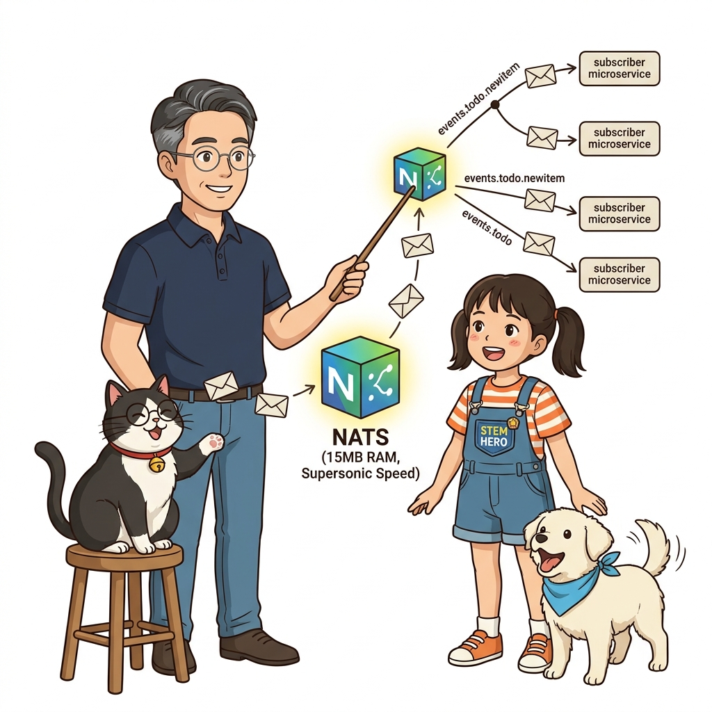
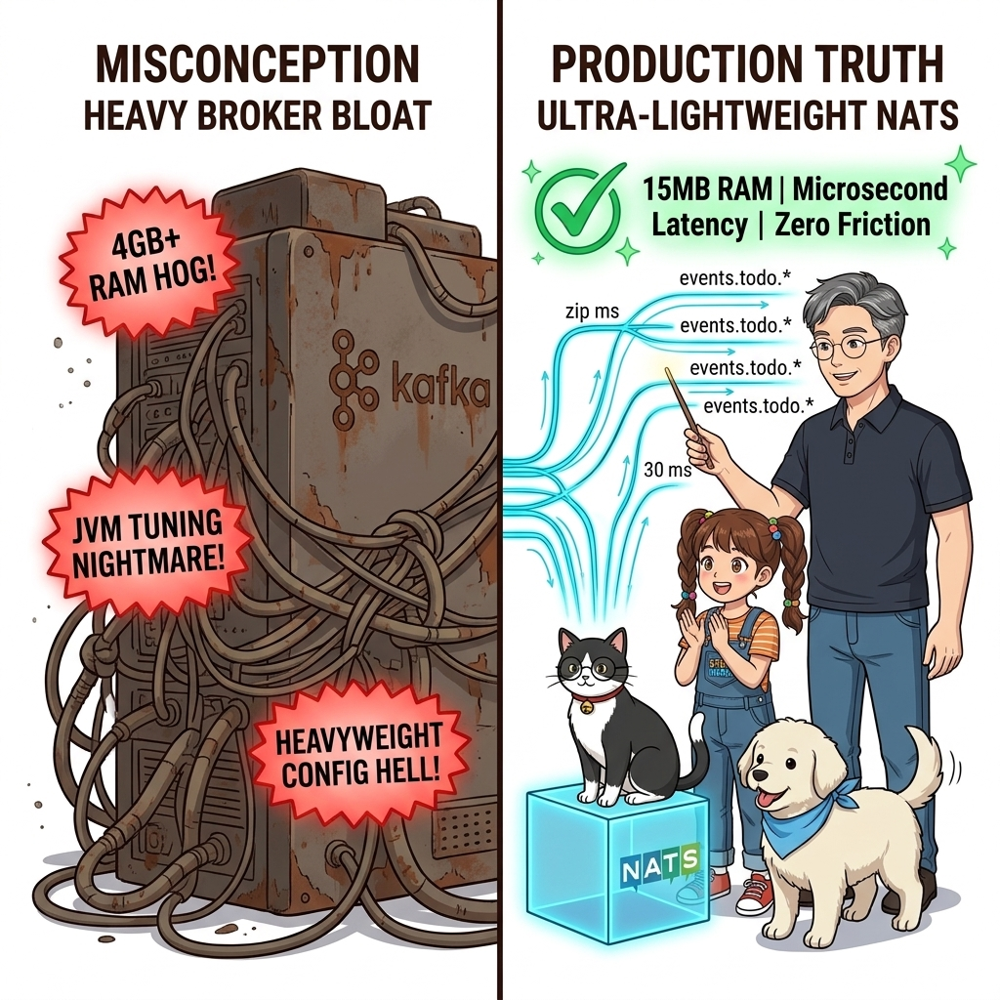
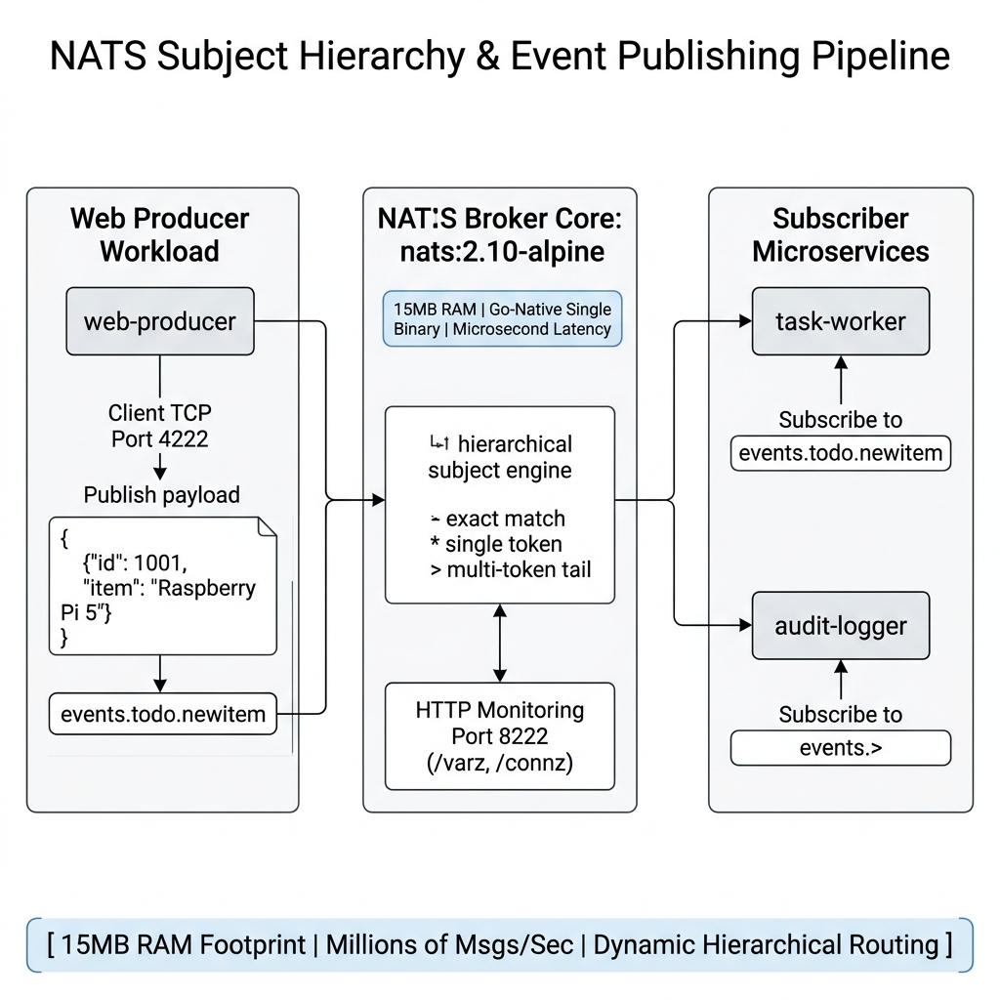
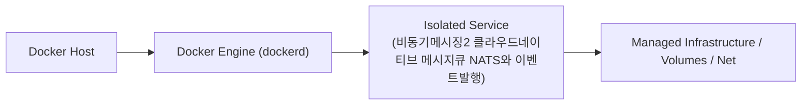
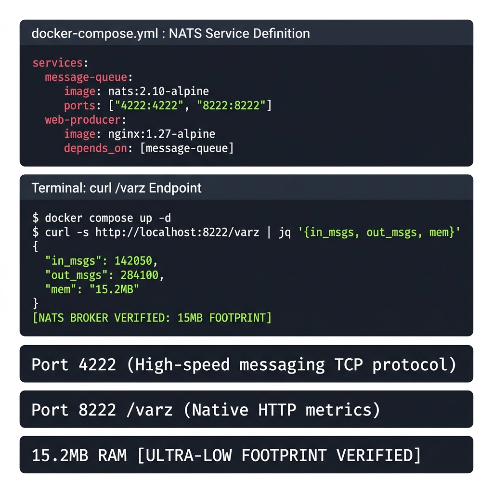
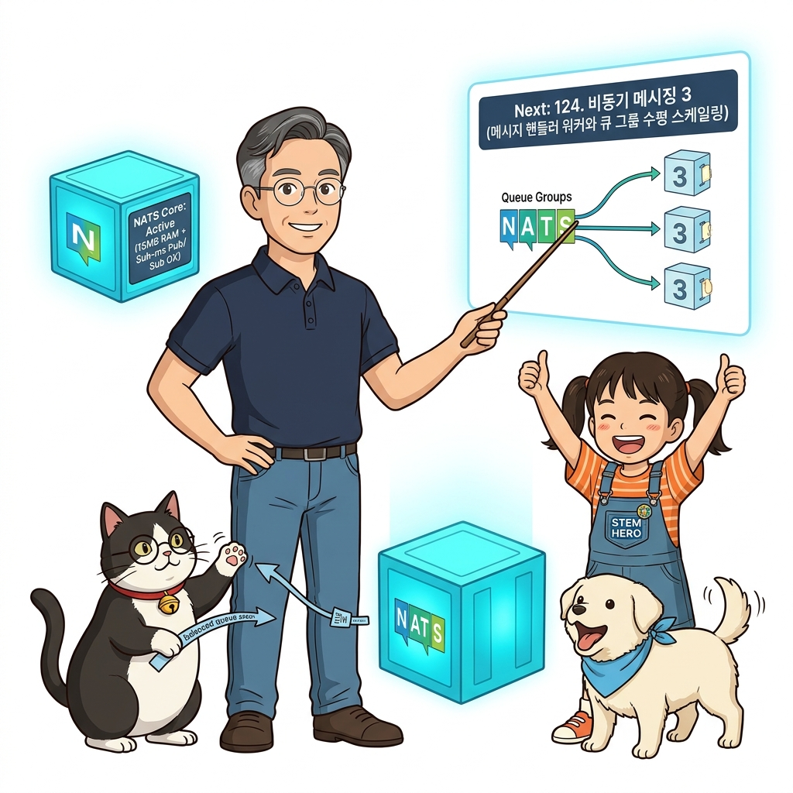

# 123. 비동기메시징2 클라우드네이티브 메시지큐 NATS와 이벤트발행

클라우드 네이티브 마이크로서비스 생태계에서 가장 각광받는 초경량 고성능 메시지 브로커인 **NATS(nats.io)**를 배웁니다.


**그림 08-12-1** 비동기메시징2 클라우드네이티브 메시지큐 NATS와 이벤트발행의 필요성과 현대 클라우드 아키텍처 관점의 개요

---

### 123.1 왜 비동기메시징2 클라우드네이티브 메시지큐 NATS와 이벤트발행이(가) 필요한가? (문제 정의와 현실적 배경)

소프트웨어 시스템이 복잡해질수록 설정을 다루는 방식은 전체 인프라의 신뢰성을 결정짓는 핵심 척도가 됩니다. **비동기메시징2 클라우드네이티브 메시지큐 NATS와 이벤트발행**이(가) 부재하거나 잘못 다루어질 때 현장에서는 다음과 같은 대표적인 병목과 장애가 발생합니다:

1. **하드코딩된 설정과 환경 불일치로 인한 유연성 상실**: 환경이 바뀔 때마다 코드를 다시 빌드해야 하므로 배포 주기가 지연되고 이미지 수가 기하급수적으로 폭증합니다.
2. **보안 민감 데이터의 무분별한 노출**: 비밀번호, 데이터베이스 토큰, 암호화 키가 이미지 레이어에 영구 박제되어 형상관리 시스템이나 외부에 유출될 위험이 커집니다.
3. **재현 불가능한 구성 드리프트**: 스테이징 환경과 프로덕션 환경의 미세한 설정 차이가 예기치 못한 서비스 중단 사고로 직결됩니다.


**그림 08-12-2** 비동기메시징2 클라우드네이티브 메시지큐 NATS와 이벤트발행에 대한 대표적인 오해와 실제 프로덕션 현장의 엔지니어링 진실

---

### 123.2 핵심 아키텍처와 엔지니어링 메커니즘

공식 `nats:alpine` 컨테이너를 가동하고, 웹 애플리케이션(Node.js/Python/Go)이 새로운 할 일(To-Do)이나 주문 생성 시 `events.todo.newitem` 토픽 서브젝트로 JSON 이벤트를 발행하는 논블로킹(Non-blocking) 파이프라인을 구축합니다!


**그림 08-12-3** 비동기메시징2 클라우드네이티브 메시지큐 NATS와 이벤트발행의 내부 아키텍처 및 데이터 흐름

#### 📊 핵심 비교 및 엔지니어링 표준 분석

| 구분 / 핵심 원리 | 상세 설명 및 동작 메커니즘 | 실무 적용 시 주의점 및 베스트 프랙티스 |
| :--- | :--- | :--- |
| **NATS의 압도적 효율성** | 무거운 Java 기반 Kafka/ActiveMQ와 달리 Go로 작성되어 단 15MB 메모리만으로 컨테이너 즉시 가동 | 초당 수백만 건의 메시지 라우팅 성능을 자랑하며 클라우드 네이티브 마이크로서비스에 최적 |
| **서브젝트 계층 (`events.todo.newitem`)** | 점(`.`)으로 구분된 계층형 토픽 네이밍과 와일드카드(`*` 한 단어, `>` 하위 전체) 지원 | 구독자가 원하는 세부 이벤트만 정밀하게 골라서 수신 가능 |
| **NATS 내장 모니터링 (`:8222`)** | `http://localhost:8222/varz` 및 `/connz` 엔드포인트를 통해 현재 연결된 클라이언트 수, 처리된 메시지 바이트 수를 JSON으로 실시간 확인 가능 | 운영 모니터링과의 결합이 매우 용이 |

---

### 123.3 선언적 실습 및 아키텍처 다이어그램

본 실습은 외부 비공개 패키지에 의존하지 않고, 공식 표준 이미지를 기반으로 즉시 재현 가능한 살아있는 코드로 구성되어 있습니다.

```yaml
# 초경량 NATS 메시지 브로커와 이벤트 발행 웹 애플리케이션 컴포즈 아키텍처
services:
  message-queue:
    image: nats:2.10-alpine
    ports: ["4222:4222", "8222:8222"] # 4222: 클라이언트 포트, 8222: 모니터링 HTTP

  web-producer:
    image: nginx:1.27-alpine
    depends_on: [message-queue]
```

#### 🔍 아키텍처 흐름도 (Mermaid Diagram)




**그림 08-12-4** 선언적 인프라 명세를 통한 비동기메시징2 클라우드네이티브 메시지큐 NATS와 이벤트발행 검증 파이프라인

---

### 123.4 핵심 정리: 캐릭터 대화와 3대 교훈

> 👧 **도로시**: "교수님! **비동기메시징2 클라우드네이티브 메시지큐 NATS와 이벤트발행**의 원리를 배우니까, 복잡하게 얽혀 있던 인프라 설정이 레고 블록처럼 질서정연하게 제자리를 찾는 게 보여요!"
> 
> 🐱 **조교 지니**: "야옹~ 맞습니다! 특히 런타임 환경과 불변 인프라의 경계를 명확히 지키는 것이 대규모 클라우드 운영의 제1원칙이랍니다!"
> 
> 🐶 **토토**: "멍멍! 선언적 코드로 한 번 적어두면 언제든 똑같이 복원되니까 정말 든든해요!"
> 
> 👨‍🏫 **이호진 교수님**: "훌륭하구나. 원리를 깊이 이해하고 실습을 통해 손에 익히는 것이 훌륭한 클라우드 엔지니어로 성장하는 가장 빠른 지름길이란다."


**그림 08-12-5** 비동기메시징2 클라우드네이티브 메시지큐 NATS와 이벤트발행 마스터를 위한 3대 핵심 교훈

1. **설정과 실행의 명확한 분리**:
   * 애플리케이션 코드는 불변으로 유지하고, 가변적인 설정값은 외부에서 주입하여 이식성을 극대화합니다.
2. **선언적 재현성 확보**:
   * 사람이 수작업으로 변경하지 않고 코드 명세를 통해 언제 어디서나 100% 동일한 실행 결과를 보장합니다.
3. **최소 권한 및 보안 모범 사례 준수**:
   * 불필요한 권한과 포트 노출을 최소화하고 민감 데이터를 암호화하여 프로덕션 안정성을 담보합니다.

---

### 123.5 랩노트 피날레와 다음 강의 예고


**그림 08-12-6** 연구실에서 다음 마일스톤인 [비동기메시징3 메시지핸들러 워커와 큐그룹 수평스케일링] 실습을 예고하는 교수님과 토토

> 💡 **다음 강의 안내**:
> [비동기메시징3 메시지핸들러 워커와 큐그룹 수평스케일링](../124_비동기메시징3_메시지핸들러_워커와_큐그룹_수평스케일링/)에서는 더욱 심화된 실전 엔지니어링 실습과 아키텍처를 다룹니다!

---

## 🧭 강의 네비게이션
* [◀️ 이전 강의: 122_비동기메시징1_동기HTTP의_한계와_Redis_Pub_Sub_기초](../122_비동기메시징1_동기HTTP의_한계와_Redis_Pub_Sub_기초/)
* [📋 Part 08. 프로덕션 운영 마스터: 설정 관리, 중앙 로깅(Fluentd), 리버스 프록시(Nginx/Traefik), 비동기 메시지 큐(Redis/NATS) & 최종 캡스톤 (112 ~ 129) 목차로 돌아가기](../)
* [▶️ 다음 강의: 124_비동기메시징3_메시지핸들러_워커와_큐그룹_수평스케일링](../124_비동기메시징3_메시지핸들러_워커와_큐그룹_수평스케일링/)
