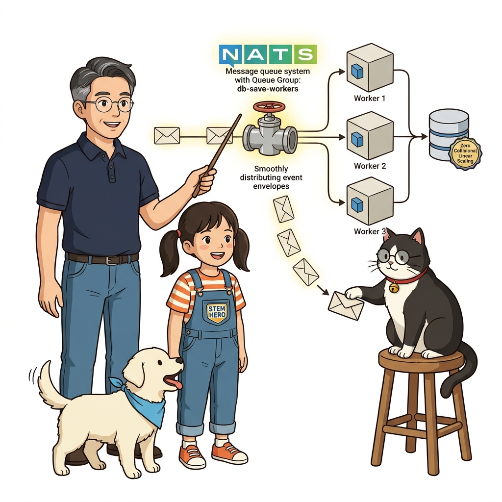
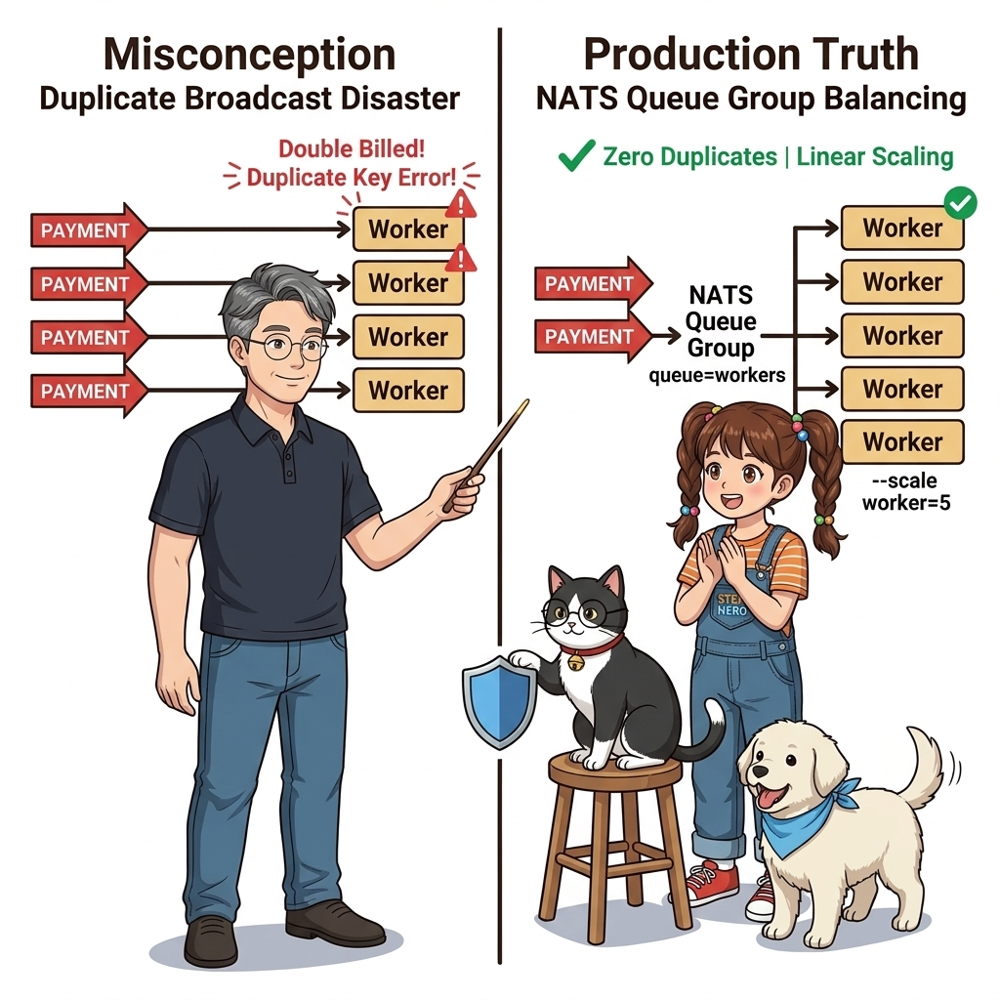
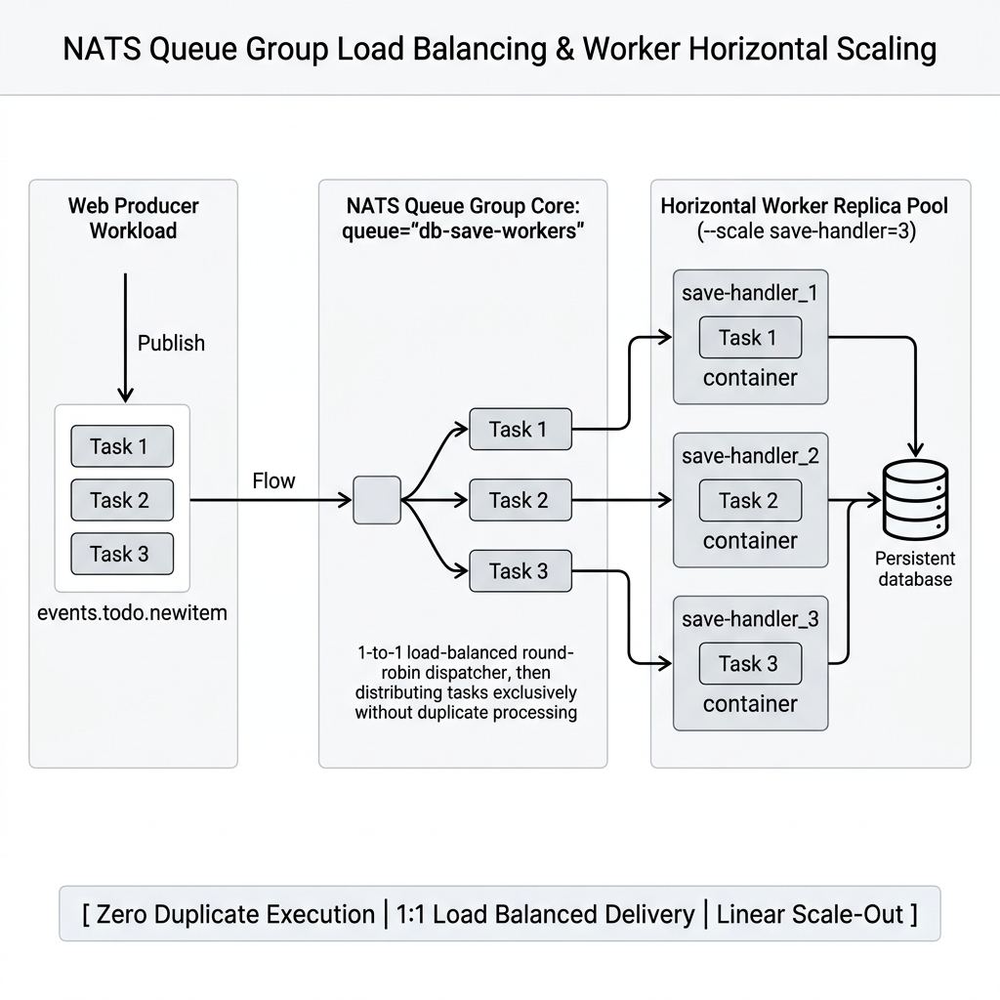
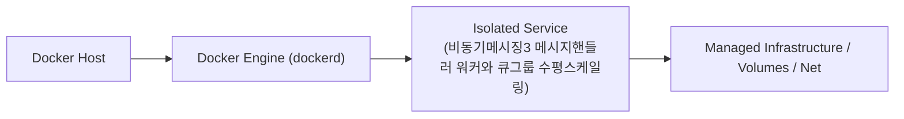
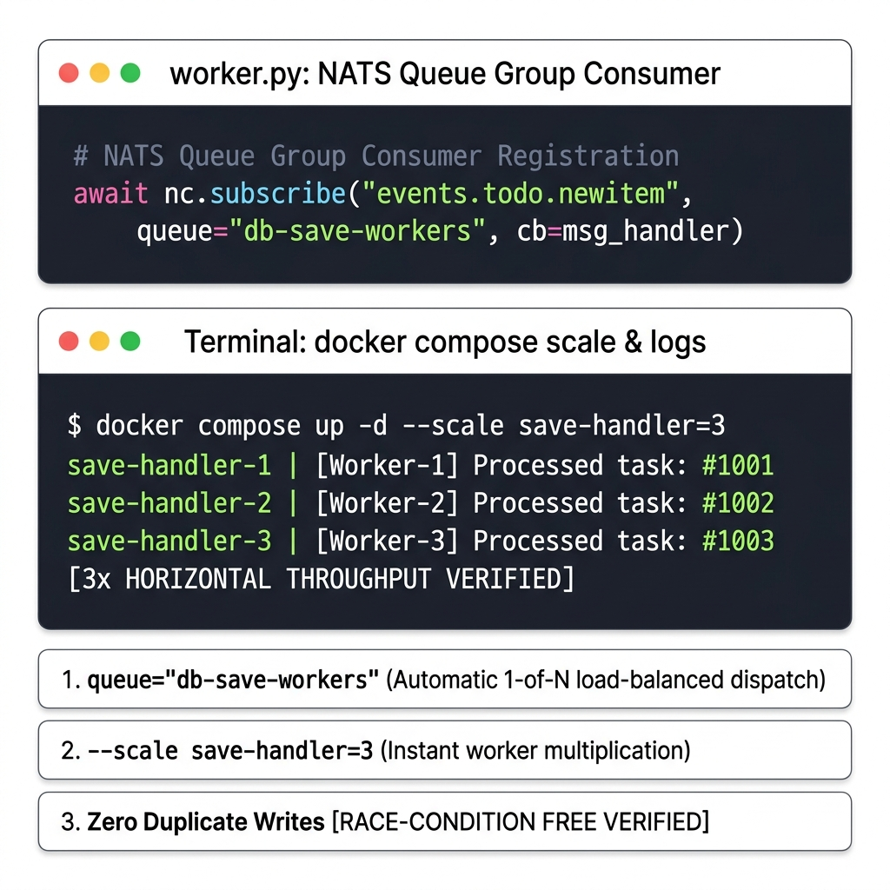

# 124. 비동기메시징3 메시지핸들러 워커와 큐그룹 수평스케일링

NATS 큐에서 메시지를 꺼내 실제 데이터베이스에 영구 저장하는 백그라운드 **메시지 핸들러(Message Handler) 워커 컨테이너**를 구현합니다.


**그림 08-13-1** 비동기메시징3 메시지핸들러 워커와 큐그룹 수평스케일링의 필요성과 현대 클라우드 아키텍처 관점의 개요

---

### 124.1 왜 비동기메시징3 메시지핸들러 워커와 큐그룹 수평스케일링이(가) 필요한가? (문제 정의와 현실적 배경)

소프트웨어 시스템이 복잡해질수록 설정을 다루는 방식은 전체 인프라의 신뢰성을 결정짓는 핵심 척도가 됩니다. **비동기메시징3 메시지핸들러 워커와 큐그룹 수평스케일링**이(가) 부재하거나 잘못 다루어질 때 현장에서는 다음과 같은 대표적인 병목과 장애가 발생합니다:

1. **하드코딩된 설정과 환경 불일치로 인한 유연성 상실**: 환경이 바뀔 때마다 코드를 다시 빌드해야 하므로 배포 주기가 지연되고 이미지 수가 기하급수적으로 폭증합니다.
2. **보안 민감 데이터의 무분별한 노출**: 비밀번호, 데이터베이스 토큰, 암호화 키가 이미지 레이어에 영구 박제되어 형상관리 시스템이나 외부에 유출될 위험이 커집니다.
3. **재현 불가능한 구성 드리프트**: 스테이징 환경과 프로덕션 환경의 미세한 설정 차이가 예기치 못한 서비스 중단 사고로 직결됩니다.


**그림 08-13-2** 비동기메시징3 메시지핸들러 워커와 큐그룹 수평스케일링에 대한 대표적인 오해와 실제 프로덕션 현장의 엔지니어링 진실

---

### 124.2 핵심 아키텍처와 엔지니어링 메커니즘

작업량이 폭주할 때 워커 컨테이너를 `--scale save-handler=3`으로 늘리더라도 메시지가 3번 중복 실행되지 않고 3대의 워커가 하나씩 공평하게 나눠 처리하도록 보장하는 **큐 그룹(Queue Group / Consumer Group)**의 핵심 메커니즘을 마스터합니다!


**그림 08-13-3** 비동기메시징3 메시지핸들러 워커와 큐그룹 수평스케일링의 내부 아키텍처 및 데이터 흐름

#### 📊 핵심 비교 및 엔지니어링 표준 분석

| 구분 / 핵심 원리 | 상세 설명 및 동작 메커니즘 | 실무 적용 시 주의점 및 베스트 프랙티스 |
| :--- | :--- | :--- |
| **일반 Pub/Sub vs 큐 그룹 (Queue Group)** | 일반 구독은 브로드캐스트되어 모든 구독자가 복사본을 받음(1:N) / **큐 그룹은 동일 그룹에 속한 여러 워커 중 정확히 1개의 워커만 메시지를 받음(1:1 부하 분산)**! | 데이터베이스 저장이나 결제 처리처럼 중복 실행되면 안 되는 비즈니스 작업에 필수 |
| **워커의 완전 무중단 스케일 아웃** | 블랙 프라이데이 주문 폭주시 웹 서버는 건드리지 않고 백그라운드 워커 컨테이너만 `docker compose up -d --scale save-handler=10`으로 즉시 증설! | 이벤트가 큐에 안전하게 완충(Buffering)되어 있으므로 DB 과부하 속도에 맞춰 안정적으로 소화 |
| **역할의 명확한 분리** | 웹 컨테이너는 오직 '이벤트 발행'만 전담하고, 워커 컨테이너는 '비즈니스 처리 및 DB 저장'만 전담 | 프론트엔드와 백엔드의 완전한 비동기 디커플링(Decoupling) 완성 |

---

### 124.3 선언적 실습 및 아키텍처 다이어그램

본 실습은 외부 비공개 패키지에 의존하지 않고, 공식 표준 이미지를 기반으로 즉시 재현 가능한 살아있는 코드로 구성되어 있습니다.

```python
# NATS 큐 그룹(Queue Group)을 이용해 중복 없이 로드 밸런싱을 수행하는 워커 로직 개념
# queue_group="db-save-workers" 로 구독하면 NATS가 여러 워커 중 딱 1개에만 메시지를 라운드로빈 전달!
async def run_worker(worker_id: str):
    print(f"[{worker_id}] Ready to process events from queue group 'db-save-workers'")
    # await nc.subscribe("events.todo.newitem", queue="db-save-workers", cb=message_handler)

import asyncio
asyncio.run(run_worker("Worker-01"))
```

#### 🔍 아키텍처 흐름도 (Mermaid Diagram)




**그림 08-13-4** 선언적 인프라 명세를 통한 비동기메시징3 메시지핸들러 워커와 큐그룹 수평스케일링 검증 파이프라인

---

### 124.4 핵심 정리: 캐릭터 대화와 3대 교훈

> 👧 **도로시**: "교수님! **비동기메시징3 메시지핸들러 워커와 큐그룹 수평스케일링**의 원리를 배우니까, 복잡하게 얽혀 있던 인프라 설정이 레고 블록처럼 질서정연하게 제자리를 찾는 게 보여요!"
> 
> 🐱 **조교 지니**: "야옹~ 맞습니다! 특히 런타임 환경과 불변 인프라의 경계를 명확히 지키는 것이 대규모 클라우드 운영의 제1원칙이랍니다!"
> 
> 🐶 **토토**: "멍멍! 선언적 코드로 한 번 적어두면 언제든 똑같이 복원되니까 정말 든든해요!"
> 
> 👨‍🏫 **이호진 교수님**: "훌륭하구나. 원리를 깊이 이해하고 실습을 통해 손에 익히는 것이 훌륭한 클라우드 엔지니어로 성장하는 가장 빠른 지름길이란다."


**그림 08-13-5** 비동기메시징3 메시지핸들러 워커와 큐그룹 수평스케일링 마스터를 위한 3대 핵심 교훈

1. **설정과 실행의 명확한 분리**:
   * 애플리케이션 코드는 불변으로 유지하고, 가변적인 설정값은 외부에서 주입하여 이식성을 극대화합니다.
2. **선언적 재현성 확보**:
   * 사람이 수작업으로 변경하지 않고 코드 명세를 통해 언제 어디서나 100% 동일한 실행 결과를 보장합니다.
3. **최소 권한 및 보안 모범 사례 준수**:
   * 불필요한 권한과 포트 노출을 최소화하고 민감 데이터를 암호화하여 프로덕션 안정성을 담보합니다.

---

### 124.5 랩노트 피날레와 다음 강의 예고


**그림 08-13-6** 연구실에서 다음 마일스톤인 [비동기메시징4 코드수정없는 기능확장 팬아웃과 감사로그핸들러] 실습을 예고하는 교수님과 토토

> 💡 **다음 강의 안내**:
> [비동기메시징4 코드수정없는 기능확장 팬아웃과 감사로그핸들러](../125_비동기메시징4_코드수정없는_기능확장_팬아웃과_감사로그핸들러/)에서는 더욱 심화된 실전 엔지니어링 실습과 아키텍처를 다룹니다!

---

## 🧭 강의 네비게이션
* [◀️ 이전 강의: 123_비동기메시징2_클라우드네이티브_메시지큐_NATS와_이벤트발행](../123_비동기메시징2_클라우드네이티브_메시지큐_NATS와_이벤트발행/)
* [📋 Part 08. 프로덕션 운영 마스터: 설정 관리, 중앙 로깅(Fluentd), 리버스 프록시(Nginx/Traefik), 비동기 메시지 큐(Redis/NATS) & 최종 캡스톤 (112 ~ 129) 목차로 돌아가기](../)
* [▶️ 다음 강의: 125_비동기메시징4_코드수정없는_기능확장_팬아웃과_감사로그핸들러](../125_비동기메시징4_코드수정없는_기능확장_팬아웃과_감사로그핸들러/)
