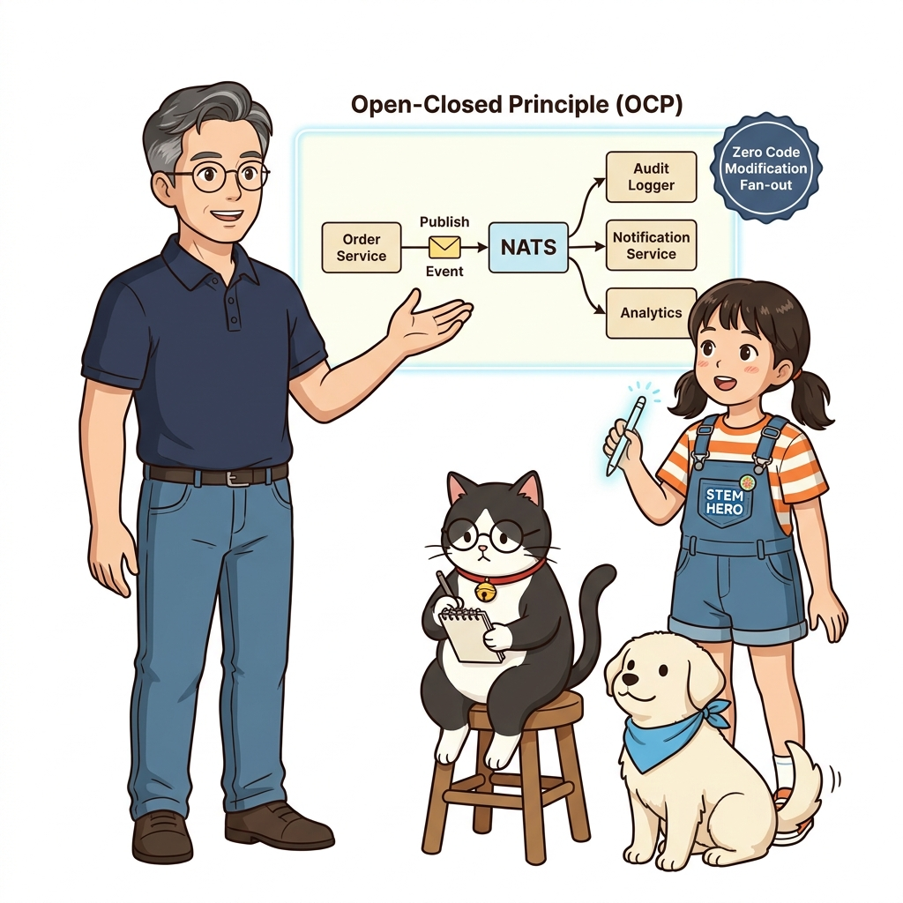
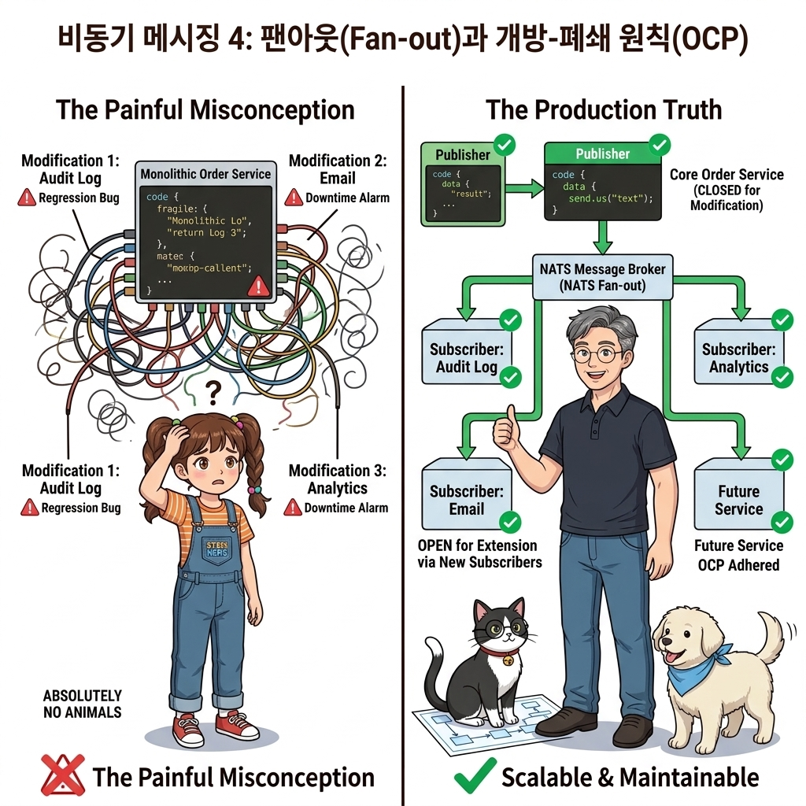
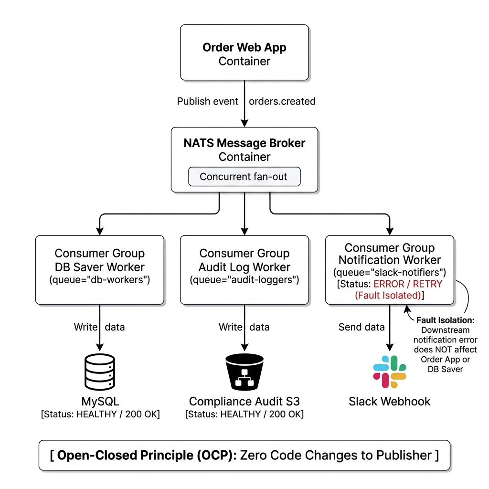
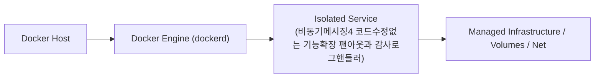
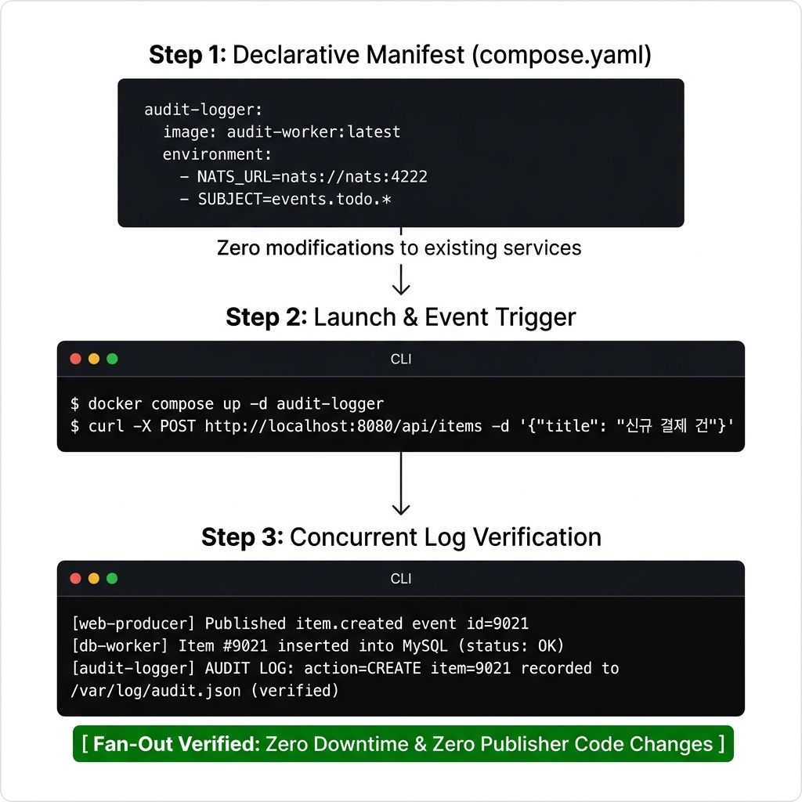
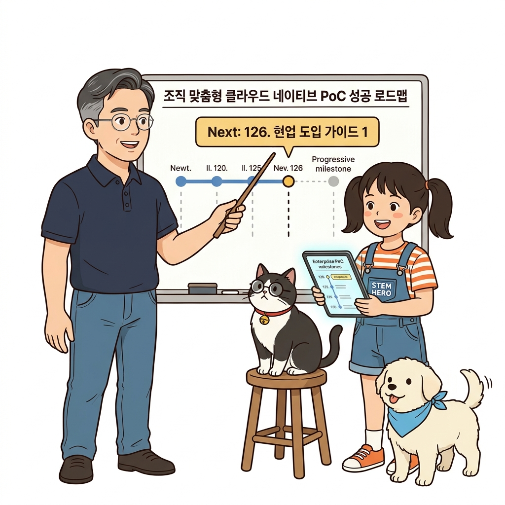

# 125. 비동기메시징4 코드수정없는 기능확장 팬아웃과 감사로그핸들러

이벤트 기반 아키텍처(EDA, Event-Driven Architecture)의 진정한 위력인 **팬아웃(Fan-out, 1:N 동시 전파)** 패턴을 배웁니다.


**그림 08-14-1** 비동기메시징4 코드수정없는 기능확장 팬아웃과 감사로그핸들러의 필요성과 현대 클라우드 아키텍처 관점의 개요

---

### 125.1 왜 비동기메시징4 코드수정없는 기능확장 팬아웃과 감사로그핸들러이(가) 필요한가? (문제 정의와 현실적 배경)

소프트웨어 시스템이 복잡해질수록 설정을 다루는 방식은 전체 인프라의 신뢰성을 결정짓는 핵심 척도가 됩니다. **비동기메시징4 코드수정없는 기능확장 팬아웃과 감사로그핸들러**이(가) 부재하거나 잘못 다루어질 때 현장에서는 다음과 같은 대표적인 병목과 장애가 발생합니다:

1. **하드코딩된 설정과 환경 불일치로 인한 유연성 상실**: 환경이 바뀔 때마다 코드를 다시 빌드해야 하므로 배포 주기가 지연되고 이미지 수가 기하급수적으로 폭증합니다.
2. **보안 민감 데이터의 무분별한 노출**: 비밀번호, 데이터베이스 토큰, 암호화 키가 이미지 레이어에 영구 박제되어 형상관리 시스템이나 외부에 유출될 위험이 커집니다.
3. **재현 불가능한 구성 드리프트**: 스테이징 환경과 프로덕션 환경의 미세한 설정 차이가 예기치 못한 서비스 중단 사고로 직결됩니다.


**그림 08-14-2** 비동기메시징4 코드수정없는 기능확장 팬아웃과 감사로그핸들러에 대한 대표적인 오해와 실제 프로덕션 현장의 엔지니어링 진실

---

### 125.2 핵심 아키텍처와 엔지니어링 메커니즘

새로운 요구사항(예: 주문 발생 시 실시간 슬랙 알림 발송 및 이상 금융 거래 감사 로깅)이 들어왔을 때, **기존에 잘 돌고 있는 웹 서버와 DB 저장 워커를 전혀 수정하지 않고 새로운 알림 핸들러 컨테이너를 NATS 큐에 슬쩍 연결하는 것만으로 기능을 무중단 확장**하는 실무 확장 패턴을 실습합니다!


**그림 08-14-3** 비동기메시징4 코드수정없는 기능확장 팬아웃과 감사로그핸들러의 내부 아키텍처 및 데이터 흐름

#### 📊 핵심 비교 및 엔지니어링 표준 분석

| 구분 / 핵심 원리 | 상세 설명 및 동작 메커니즘 | 실무 적용 시 주의점 및 베스트 프랙티스 |
| :--- | :--- | :--- |
| **개방 폐쇄 원칙 (OCP, Open-Closed Principle)** | 기존 코드는 수정에 닫혀 있고(안전), 새로운 기능 확장은 언제든 열려 있는 소프트웨어 공학의 이상향 | 기존 서비스에 사이드 이펙트(버그)를 일으킬 위험이 0% |
| **독립적 장애 격리** | 슬랙 알림 서버가 네트워크 오류로 다운되더라도, 옆의 DB 저장 핸들러와 웹 서버는 완벽하게 정상 동작을 유지 | 시스템의 전체 가용성이 개별 외부 서비스 장애에 흔들리지 않음 |
| **마이크로서비스 진화의 종착역** | 모든 컴포넌트가 작고 독립적인 컨테이너로 쪼개져 메시지 큐를 통해 느슨하게 결합(Loose Coupling)된 최첨단 클라우드 네이티브 아키텍처 완성! | 글로벌 테크 기업들의 백엔드 아키텍처 표준 |

---

### 125.3 선언적 실습 및 아키텍처 다이어그램

본 실습은 외부 비공개 패키지에 의존하지 않고, 공식 표준 이미지를 기반으로 즉시 재현 가능한 살아있는 코드로 구성되어 있습니다.

```bash
# 팬아웃(Fan-out) 이벤트 흐름 구조 요약
cat << 'EOF'
[Web Producer]  --(발행: events.todo.newitem)-->  [NATS Message Queue]
                                                         |
        +------------------------------------------------+--------------------------------+
        |                                                |                                |
  (Queue: db-group)                              (Queue: audit-group)             (Queue: notify-group)
[DB Save Handler]                                [Audit Log Handler]              [Slack Alert Handler]
(PostgreSQL DB에 영구 저장)                       (보안 감사 로그에 기록)             (관리자 슬랙 채널에 알림)
EOF
```

#### 🔍 아키텍처 흐름도 (Mermaid Diagram)




**그림 08-14-4** 선언적 인프라 명세를 통한 비동기메시징4 코드수정없는 기능확장 팬아웃과 감사로그핸들러 검증 파이프라인

---

### 125.4 핵심 정리: 캐릭터 대화와 3대 교훈

> 👧 **도로시**: "교수님! **비동기메시징4 코드수정없는 기능확장 팬아웃과 감사로그핸들러**의 원리를 배우니까, 복잡하게 얽혀 있던 인프라 설정이 레고 블록처럼 질서정연하게 제자리를 찾는 게 보여요!"
> 
> 🐱 **조교 지니**: "야옹~ 맞습니다! 특히 런타임 환경과 불변 인프라의 경계를 명확히 지키는 것이 대규모 클라우드 운영의 제1원칙이랍니다!"
> 
> 🐶 **토토**: "멍멍! 선언적 코드로 한 번 적어두면 언제든 똑같이 복원되니까 정말 든든해요!"
> 
> 👨‍🏫 **이호진 교수님**: "훌륭하구나. 원리를 깊이 이해하고 실습을 통해 손에 익히는 것이 훌륭한 클라우드 엔지니어로 성장하는 가장 빠른 지름길이란다."


**그림 08-14-5** 비동기메시징4 코드수정없는 기능확장 팬아웃과 감사로그핸들러 마스터를 위한 3대 핵심 교훈

1. **설정과 실행의 명확한 분리**:
   * 애플리케이션 코드는 불변으로 유지하고, 가변적인 설정값은 외부에서 주입하여 이식성을 극대화합니다.
2. **선언적 재현성 확보**:
   * 사람이 수작업으로 변경하지 않고 코드 명세를 통해 언제 어디서나 100% 동일한 실행 결과를 보장합니다.
3. **최소 권한 및 보안 모범 사례 준수**:
   * 불필요한 권한과 포트 노출을 최소화하고 민감 데이터를 암호화하여 프로덕션 안정성을 담보합니다.

---

### 125.5 랩노트 피날레와 다음 강의 예고


**그림 08-14-6** 연구실에서 다음 마일스톤인 [현업도입가이드1 우리조직의 애플리케이션으로 PoC성공시키기] 실습을 예고하는 교수님과 토토

> 💡 **다음 강의 안내**:
> [현업도입가이드1 우리조직의 애플리케이션으로 PoC성공시키기](../126_현업도입가이드1_우리조직의_애플리케이션으로_PoC성공시키기/)에서는 더욱 심화된 실전 엔지니어링 실습과 아키텍처를 다룹니다!

---

## 🧭 강의 네비게이션
* [◀️ 이전 강의: 124_비동기메시징3_메시지핸들러_워커와_큐그룹_수평스케일링](../124_비동기메시징3_메시지핸들러_워커와_큐그룹_수평스케일링/)
* [📋 Part 08. 프로덕션 운영 마스터: 설정 관리, 중앙 로깅(Fluentd), 리버스 프록시(Nginx/Traefik), 비동기 메시지 큐(Redis/NATS) & 최종 캡스톤 (112 ~ 129) 목차로 돌아가기](../)
* [▶️ 다음 강의: 126_현업도입가이드1_우리조직의_애플리케이션으로_PoC성공시키기](../126_현업도입가이드1_우리조직의_애플리케이션으로_PoC성공시키기/)
