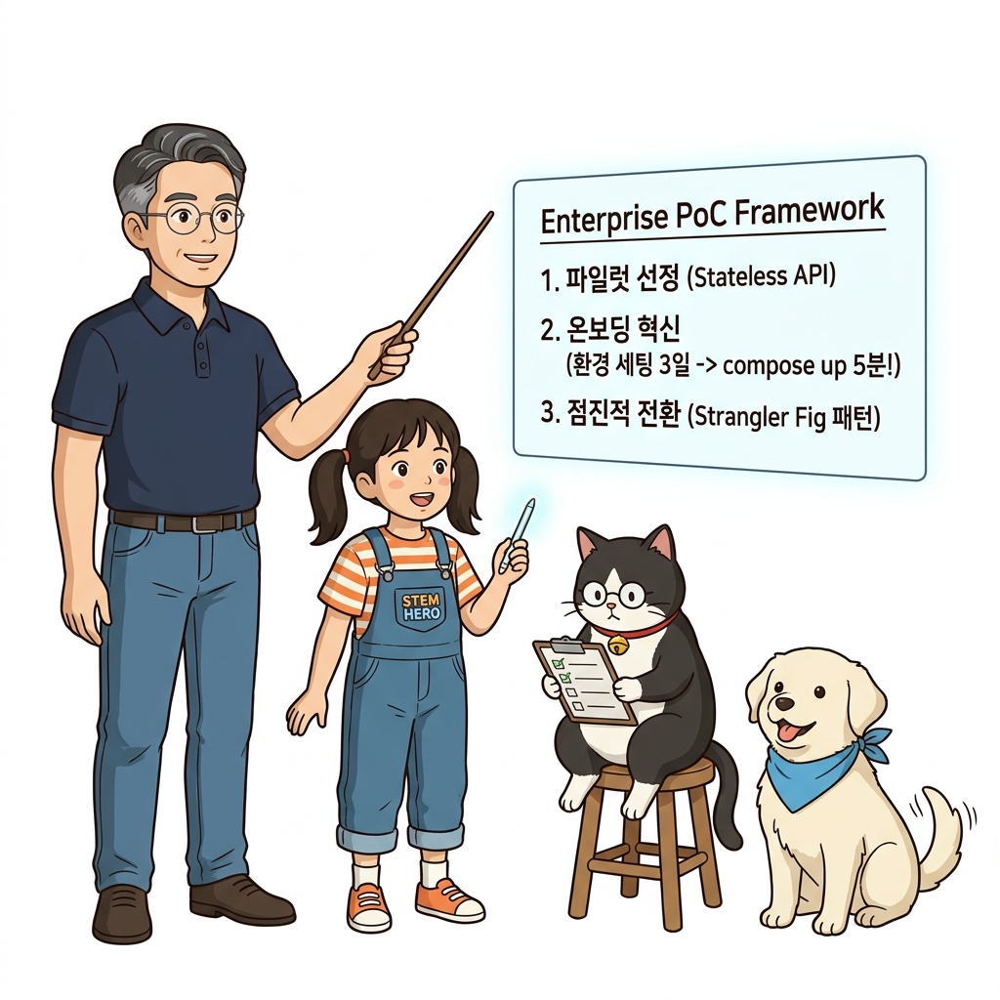
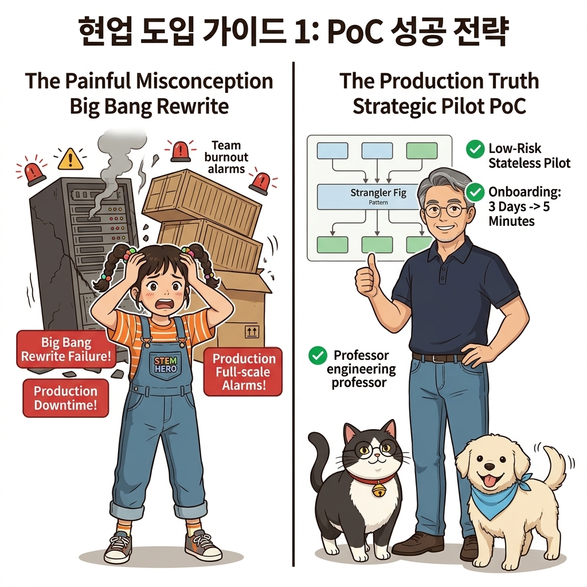
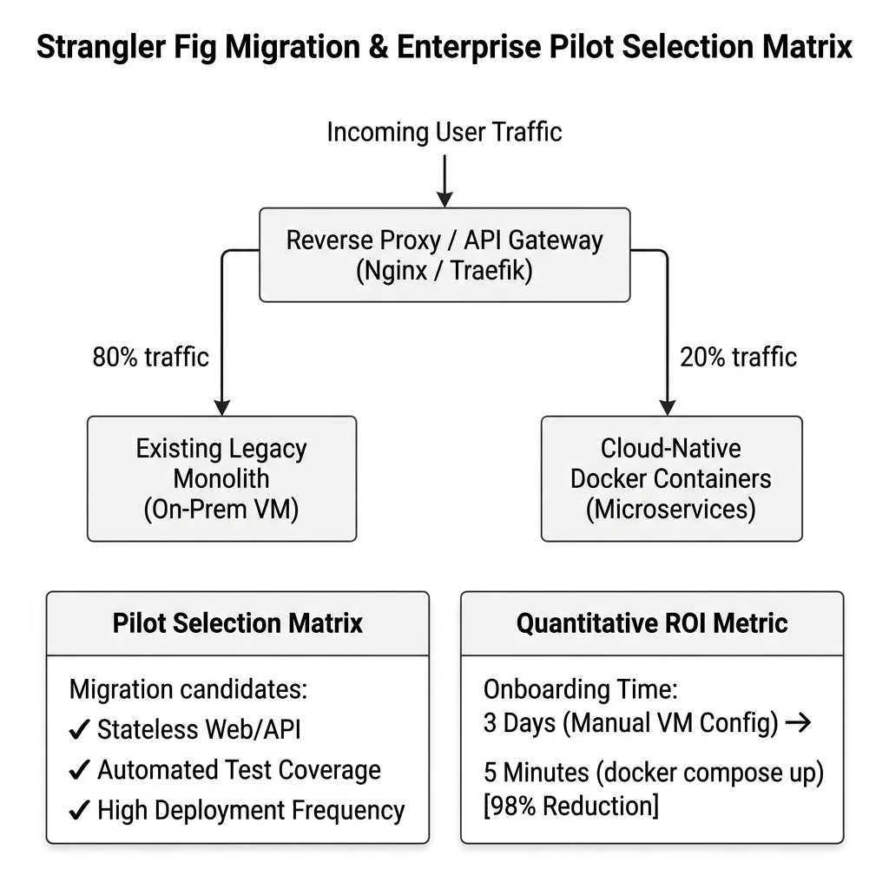
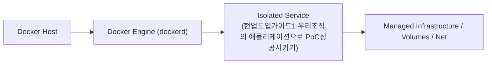
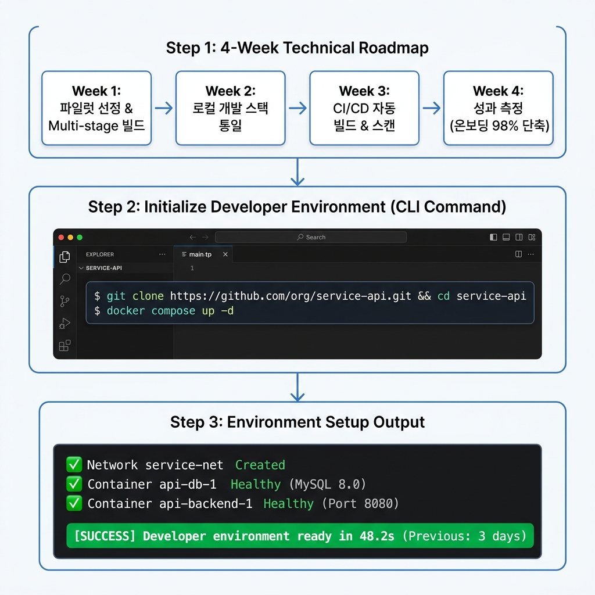
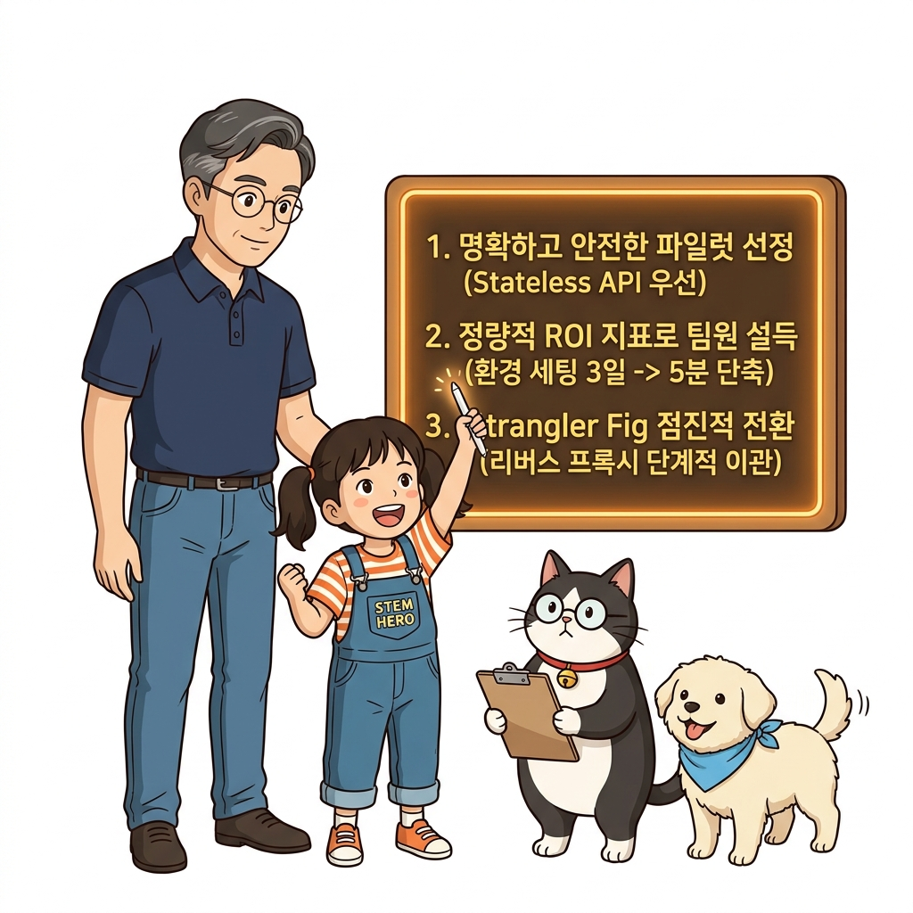
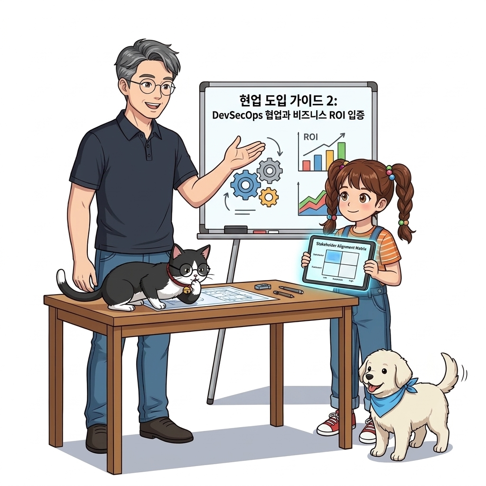

# 126. 현업도입가이드1 우리조직의 애플리케이션으로 PoC성공시키기

책이나 강의의 토이 프로젝트를 넘어, 실제 내가 속한 조직의 복잡하고 오래된 애플리케이션을 도커 컨테이너로 성공적으로 전환하기 위한 단계별 로드맵을 배웁니다.


**그림 08-15-1** 현업도입가이드1 우리조직의 애플리케이션으로 PoC성공시키기의 필요성과 현대 클라우드 아키텍처 관점의 개요

---

### 126.1 왜 현업도입가이드1 우리조직의 애플리케이션으로 PoC성공시키기이(가) 필요한가? (문제 정의와 현실적 배경)

소프트웨어 시스템이 복잡해질수록 설정을 다루는 방식은 전체 인프라의 신뢰성을 결정짓는 핵심 척도가 됩니다. **현업도입가이드1 우리조직의 애플리케이션으로 PoC성공시키기**이(가) 부재하거나 잘못 다루어질 때 현장에서는 다음과 같은 대표적인 병목과 장애가 발생합니다:

1. **하드코딩된 설정과 환경 불일치로 인한 유연성 상실**: 환경이 바뀔 때마다 코드를 다시 빌드해야 하므로 배포 주기가 지연되고 이미지 수가 기하급수적으로 폭증합니다.
2. **보안 민감 데이터의 무분별한 노출**: 비밀번호, 데이터베이스 토큰, 암호화 키가 이미지 레이어에 영구 박제되어 형상관리 시스템이나 외부에 유출될 위험이 커집니다.
3. **재현 불가능한 구성 드리프트**: 스테이징 환경과 프로덕션 환경의 미세한 설정 차이가 예기치 못한 서비스 중단 사고로 직결됩니다.


**그림 08-15-2** 현업도입가이드1 우리조직의 애플리케이션으로 PoC성공시키기에 대한 대표적인 오해와 실제 프로덕션 현장의 엔지니어링 진실

---

### 126.2 핵심 아키텍처와 엔지니어링 메커니즘

처음부터 전체 시스템을 뒤엎으려다 실패하는 우를 범하지 않고, **가장 위험이 적고 효과가 큰 파일럿 대상을 선정하는 기준(Stateless 웹 컴포넌트, 배치 작업기)과 4주 완성 PoC(Proof of Concept) 마일스톤**을 수립합니다.


**그림 08-15-3** 현업도입가이드1 우리조직의 애플리케이션으로 PoC성공시키기의 내부 아키텍처 및 데이터 흐름

#### 📊 핵심 비교 및 엔지니어링 표준 분석

| 구분 / 핵심 원리 | 상세 설명 및 동작 메커니즘 | 실무 적용 시 주의점 및 베스트 프랙티스 |
| :--- | :--- | :--- |
| **파일럿 대상 선정 기준** | 1) 상태가 없는(Stateless) 웹/API 서비스, 2) 테스트 코드가 갖춰진 프로젝트, 3) 릴리스 주기가 잦은 프로젝트 | DB나 파일 스토리지가 얽힌 무거운 코어 레거시는 2단계 이후로 미루는 것이 안전 |
| **팀원 온보딩 효과 입증** | "신규 입사자가 개발 환경을 세팅하는 데 3일 걸리던 것을 `docker compose up` 5분으로 단축했습니다!"라는 정량적 수치를 제시 | 조직 내에서 도커 도입의 가장 강력한 지지자를 얻는 방법 |
| **점진적 마이그레이션 (Strangler Fig 패턴)** | 기존 모놀리식 서버 앞단에 20장에서 배운 Nginx/Traefik 리버스 프록시를 두고, 신규 기능이나 분리된 기능만 컨테이너로 띄워 트래픽을 조금씩 전환 | 무중단으로 안전하게 레거시 탈출 |

---

### 126.3 선언적 실습 및 아키텍처 다이어그램

본 실습은 외부 비공개 패키지에 의존하지 않고, 공식 표준 이미지를 기반으로 즉시 재현 가능한 살아있는 코드로 구성되어 있습니다.

```bash
# 현업 도커 도입을 위한 4단계 PoC 마일스톤 체크리스트
cat << 'EOF'
[Week 1: 파일럿 선정] -> 의존성이 적은 프론트엔드 또는 독립 배치 API 1개 선정, Dockerfile 초안 작성
[Week 2: 로컬 환경 통일] -> docker compose로 팀원들의 로컬 개발 환경(소스코드 바인드 마운트) 일치화
[Week 3: CI 자동화]    -> Git Push 시 Dockerfile 멀티 스테이지 빌드 및 단위 테스트 자동화 구축
[Week 4: 스테이징 배포] -> 스테이징 서버에 컨테이너 배포 후 헬스 체크 및 모니터링 지표 수집 검증!
EOF
```

#### 🔍 아키텍처 흐름도 (Mermaid Diagram)




**그림 08-15-4** 선언적 인프라 명세를 통한 현업도입가이드1 우리조직의 애플리케이션으로 PoC성공시키기 검증 파이프라인

---

### 126.4 핵심 정리: 캐릭터 대화와 3대 교훈

> 👧 **도로시**: "교수님! **현업도입가이드1 우리조직의 애플리케이션으로 PoC성공시키기**의 원리를 배우니까, 복잡하게 얽혀 있던 인프라 설정이 레고 블록처럼 질서정연하게 제자리를 찾는 게 보여요!"
> 
> 🐱 **조교 지니**: "야옹~ 맞습니다! 특히 런타임 환경과 불변 인프라의 경계를 명확히 지키는 것이 대규모 클라우드 운영의 제1원칙이랍니다!"
> 
> 🐶 **토토**: "멍멍! 선언적 코드로 한 번 적어두면 언제든 똑같이 복원되니까 정말 든든해요!"
> 
> 👨‍🏫 **이호진 교수님**: "훌륭하구나. 원리를 깊이 이해하고 실습을 통해 손에 익히는 것이 훌륭한 클라우드 엔지니어로 성장하는 가장 빠른 지름길이란다."


**그림 08-15-5** 현업도입가이드1 우리조직의 애플리케이션으로 PoC성공시키기 마스터를 위한 3대 핵심 교훈

1. **설정과 실행의 명확한 분리**:
   * 애플리케이션 코드는 불변으로 유지하고, 가변적인 설정값은 외부에서 주입하여 이식성을 극대화합니다.
2. **선언적 재현성 확보**:
   * 사람이 수작업으로 변경하지 않고 코드 명세를 통해 언제 어디서나 100% 동일한 실행 결과를 보장합니다.
3. **최소 권한 및 보안 모범 사례 준수**:
   * 불필요한 권한과 포트 노출을 최소화하고 민감 데이터를 암호화하여 프로덕션 안정성을 담보합니다.

---

### 126.5 랩노트 피날레와 다음 강의 예고


**그림 08-15-6** 연구실에서 다음 마일스톤인 [현업도입가이드2 개발 보안 운영팀 설득과 비즈니스ROI입증] 실습을 예고하는 교수님과 토토

> 💡 **다음 강의 안내**:
> [현업도입가이드2 개발 보안 운영팀 설득과 비즈니스ROI입증](../127_현업도입가이드2_개발_보안_운영팀_설득과_비즈니스ROI입증/)에서는 더욱 심화된 실전 엔지니어링 실습과 아키텍처를 다룹니다!

---

## 🧭 강의 네비게이션
* [◀️ 이전 강의: 125_비동기메시징4_코드수정없는_기능확장_팬아웃과_감사로그핸들러](../125_비동기메시징4_코드수정없는_기능확장_팬아웃과_감사로그핸들러/)
* [📋 Part 08. 프로덕션 운영 마스터: 설정 관리, 중앙 로깅(Fluentd), 리버스 프록시(Nginx/Traefik), 비동기 메시지 큐(Redis/NATS) & 최종 캡스톤 (112 ~ 129) 목차로 돌아가기](../)
* [▶️ 다음 강의: 127_현업도입가이드2_개발_보안_운영팀_설득과_비즈니스ROI입증](../127_현업도입가이드2_개발_보안_운영팀_설득과_비즈니스ROI입증/)
