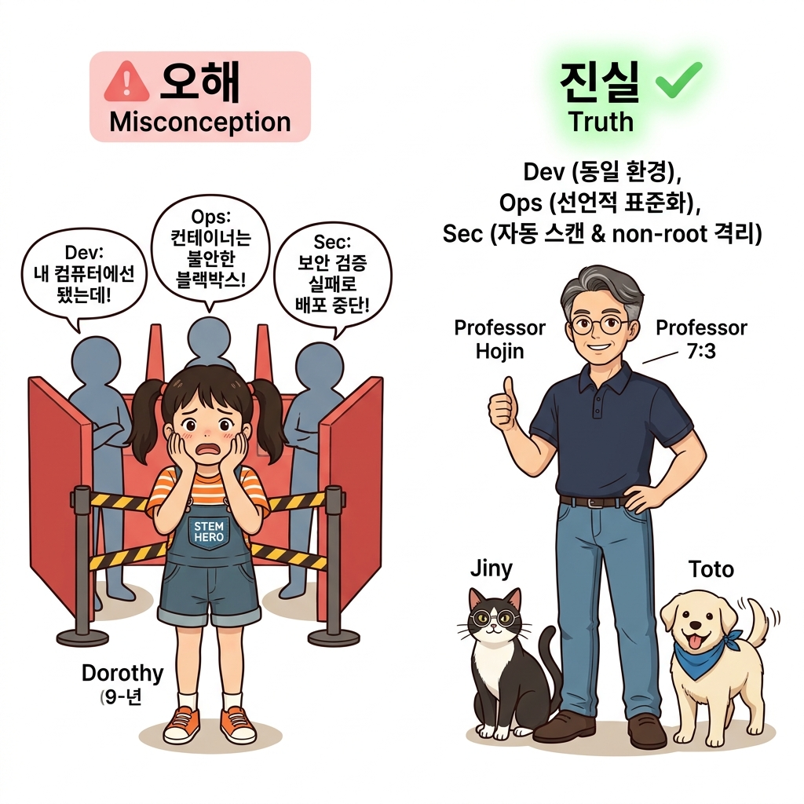
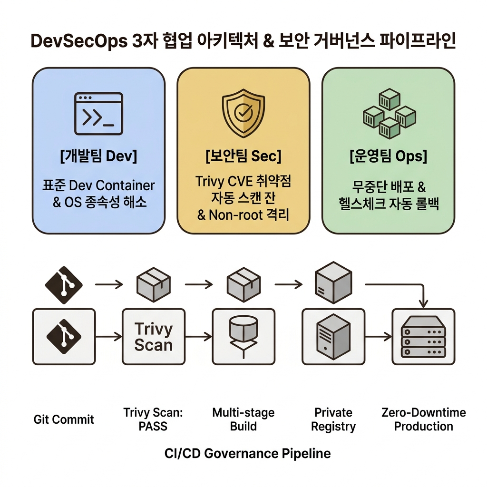
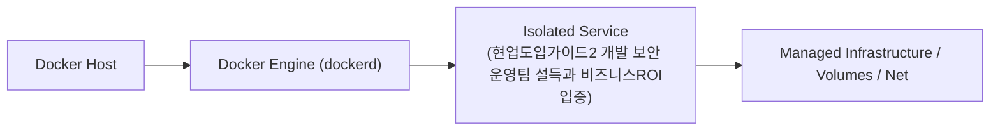
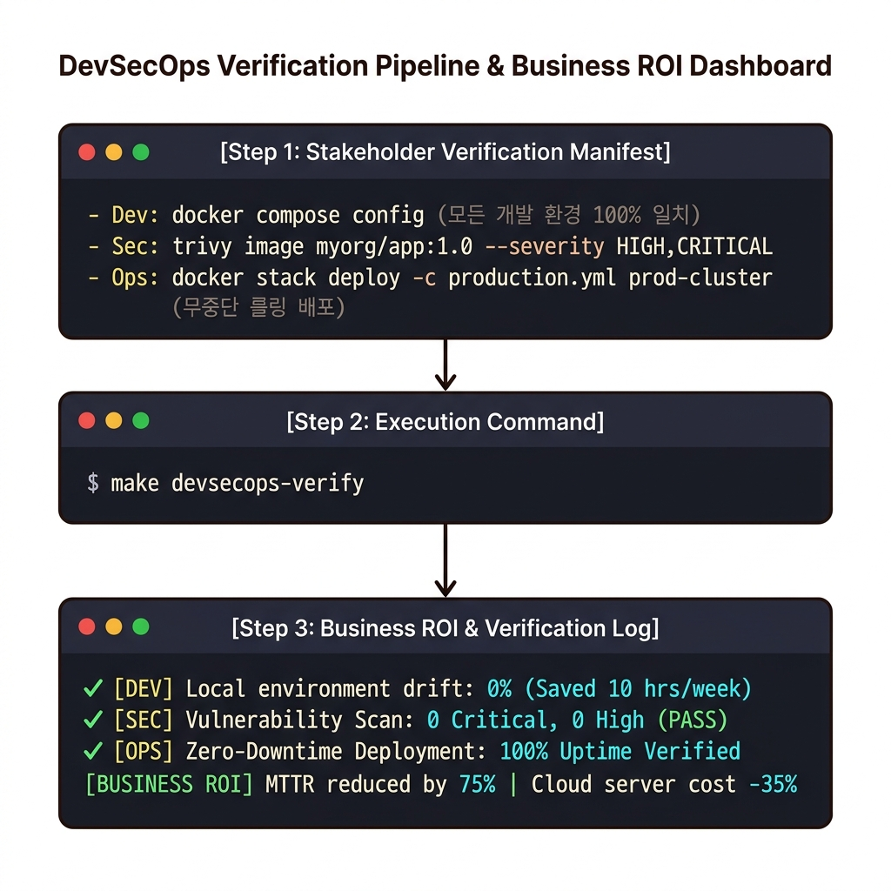
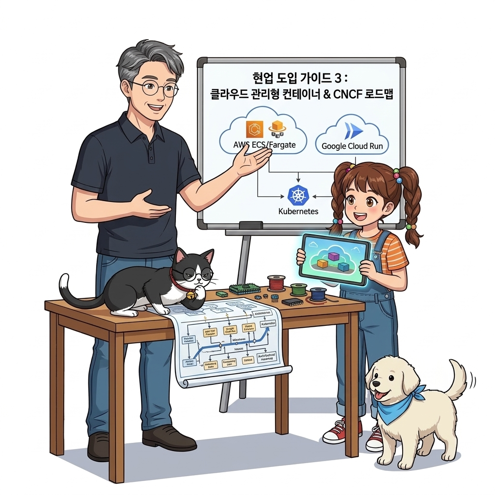

# 127. 현업도입가이드2 개발 보안 운영팀 설득과 비즈니스ROI입증

도커를 도입할 때 각 팀이 우려하는 포인트(운영팀: "새로운 도구 관리 부담", 보안팀: "컨테이너 보안 취약점", 경영진: "도입 비용")를 명쾌하게 해소하는 커뮤니케이션 전략을 배웁니다.


**그림 08-16-1** 현업도입가이드2 개발 보안 운영팀 설득과 비즈니스ROI입증의 필요성과 현대 클라우드 아키텍처 관점의 개요

---

### 127.1 왜 현업도입가이드2 개발 보안 운영팀 설득과 비즈니스ROI입증이(가) 필요한가? (문제 정의와 현실적 배경)

소프트웨어 시스템이 복잡해질수록 설정을 다루는 방식은 전체 인프라의 신뢰성을 결정짓는 핵심 척도가 됩니다. **현업도입가이드2 개발 보안 운영팀 설득과 비즈니스ROI입증**이(가) 부재하거나 잘못 다루어질 때 현장에서는 다음과 같은 대표적인 병목과 장애가 발생합니다:

1. **하드코딩된 설정과 환경 불일치로 인한 유연성 상실**: 환경이 바뀔 때마다 코드를 다시 빌드해야 하므로 배포 주기가 지연되고 이미지 수가 기하급수적으로 폭증합니다.
2. **보안 민감 데이터의 무분별한 노출**: 비밀번호, 데이터베이스 토큰, 암호화 키가 이미지 레이어에 영구 박제되어 형상관리 시스템이나 외부에 유출될 위험이 커집니다.
3. **재현 불가능한 구성 드리프트**: 스테이징 환경과 프로덕션 환경의 미세한 설정 차이가 예기치 못한 서비스 중단 사고로 직결됩니다.


**그림 08-16-2** 현업도입가이드2 개발 보안 운영팀 설득과 비즈니스ROI입증에 대한 대표적인 오해와 실제 프로덕션 현장의 엔지니어링 진실

---

### 127.2 핵심 아키텍처와 엔지니어링 메커니즘

배포 빈도(Deployment Frequency) 증가, 장애 복구 시간(MTTR) 단축, 서버 인프라 가상머신 비용 50% 절감 등 **경영진의 마음을 움직이는 정량적 비즈니스 투자 대비 효과(ROI) 보고서 작성법**을 정리합니다.


**그림 08-16-3** 현업도입가이드2 개발 보안 운영팀 설득과 비즈니스ROI입증의 내부 아키텍처 및 데이터 흐름

#### 📊 핵심 비교 및 엔지니어링 표준 분석

| 구분 / 핵심 원리 | 상세 설명 및 동작 메커니즘 | 실무 적용 시 주의점 및 베스트 프랙티스 |
| :--- | :--- | :--- |
| **개발팀 설득 포인트** | OS 차이나 로컬 라이브러리 충돌로 인한 스트레스 완전 해소, Thonny/VS Code Remote와 결합된 최상의 개발 환경 | 개발자는 순수 비즈니스 로직 코딩에만 집중 |
| **운영팀 설득 포인트** | 서버마다 제각각이던 수동 배포 스크립트가 표준 `compose.yaml` 및 `docker stack` 단 한 가지 방식으로 통일 | 인프라 인수인계와 유지보수 비용 극적 감소 |
| **보안 거버넌스 제시** | 모든 이미지가 사내 사설 레지스트리를 통해서만 배포되고, OCI 레이블로 작성자가 100% 추적되며, 최소 권한 원칙이 코드로 강제됨을 증명 | 보안팀을 든든한 아군으로 전환 |

---

### 127.3 선언적 실습 및 아키텍처 다이어그램

본 실습은 외부 비공개 패키지에 의존하지 않고, 공식 표준 이미지를 기반으로 즉시 재현 가능한 살아있는 코드로 구성되어 있습니다.

```bash
# 팀별 이해관계 충돌 해소 및 핵심 가치 매핑표
cat << 'EOF'
[개발팀 (Dev)]  -> "내 PC에서 잘 되던 코드가 운영에서도 100% 똑같이 동작합니다!" (환경 불일치 야근 0시간)
[운영팀 (Ops)]  -> "모든 앱의 배포와 모니터링 방식이 도커 표준으로 통일됩니다!" (새벽 장애 긴급 호출 80% 감소)
[보안팀 (Sec)]  -> "비루트 계정과 Trivy 취약점 자동 스캔으로 검증된 골든 이미지만 배포됩니다!" (공급망 보안 인증)
[경영진 (Biz)]  -> "컨테이너 고밀도 집적화로 클라우드 서버 VM 비용이 연간 40% 절감됩니다!" (비용 절감과 빠른 출시)
EOF
```

#### 🔍 아키텍처 흐름도 (Mermaid Diagram)




**그림 08-16-4** 선언적 인프라 명세를 통한 현업도입가이드2 개발 보안 운영팀 설득과 비즈니스ROI입증 검증 파이프라인

---

### 127.4 핵심 정리: 캐릭터 대화와 3대 교훈

> 👧 **도로시**: "교수님! **현업도입가이드2 개발 보안 운영팀 설득과 비즈니스ROI입증**의 원리를 배우니까, 복잡하게 얽혀 있던 인프라 설정이 레고 블록처럼 질서정연하게 제자리를 찾는 게 보여요!"
> 
> 🐱 **조교 지니**: "야옹~ 맞습니다! 특히 런타임 환경과 불변 인프라의 경계를 명확히 지키는 것이 대규모 클라우드 운영의 제1원칙이랍니다!"
> 
> 🐶 **토토**: "멍멍! 선언적 코드로 한 번 적어두면 언제든 똑같이 복원되니까 정말 든든해요!"
> 
> 👨‍🏫 **이호진 교수님**: "훌륭하구나. 원리를 깊이 이해하고 실습을 통해 손에 익히는 것이 훌륭한 클라우드 엔지니어로 성장하는 가장 빠른 지름길이란다."


**그림 08-16-5** 현업도입가이드2 개발 보안 운영팀 설득과 비즈니스ROI입증 마스터를 위한 3대 핵심 교훈

1. **설정과 실행의 명확한 분리**:
   * 애플리케이션 코드는 불변으로 유지하고, 가변적인 설정값은 외부에서 주입하여 이식성을 극대화합니다.
2. **선언적 재현성 확보**:
   * 사람이 수작업으로 변경하지 않고 코드 명세를 통해 언제 어디서나 100% 동일한 실행 결과를 보장합니다.
3. **최소 권한 및 보안 모범 사례 준수**:
   * 불필요한 권한과 포트 노출을 최소화하고 민감 데이터를 암호화하여 프로덕션 안정성을 담보합니다.

---

### 127.5 랩노트 피날레와 다음 강의 예고


**그림 08-16-6** 연구실에서 다음 마일스톤인 [현업도입가이드3 프로덕션으로가는길 클라우드관리형컨테이너와 CNCF] 실습을 예고하는 교수님과 토토

> 💡 **다음 강의 안내**:
> [현업도입가이드3 프로덕션으로가는길 클라우드관리형컨테이너와 CNCF](../128_현업도입가이드3_프로덕션으로가는길_클라우드관리형컨테이너와_CNCF/)에서는 더욱 심화된 실전 엔지니어링 실습과 아키텍처를 다룹니다!

---

## 🧭 강의 네비게이션
* [◀️ 이전 강의: 126_현업도입가이드1_우리조직의_애플리케이션으로_PoC성공시키기](../126_현업도입가이드1_우리조직의_애플리케이션으로_PoC성공시키기/)
* [📋 Part 08. 프로덕션 운영 마스터: 설정 관리, 중앙 로깅(Fluentd), 리버스 프록시(Nginx/Traefik), 비동기 메시지 큐(Redis/NATS) & 최종 캡스톤 (112 ~ 129) 목차로 돌아가기](../)
* [▶️ 다음 강의: 128_현업도입가이드3_프로덕션으로가는길_클라우드관리형컨테이너와_CNCF](../128_현업도입가이드3_프로덕션으로가는길_클라우드관리형컨테이너와_CNCF/)
