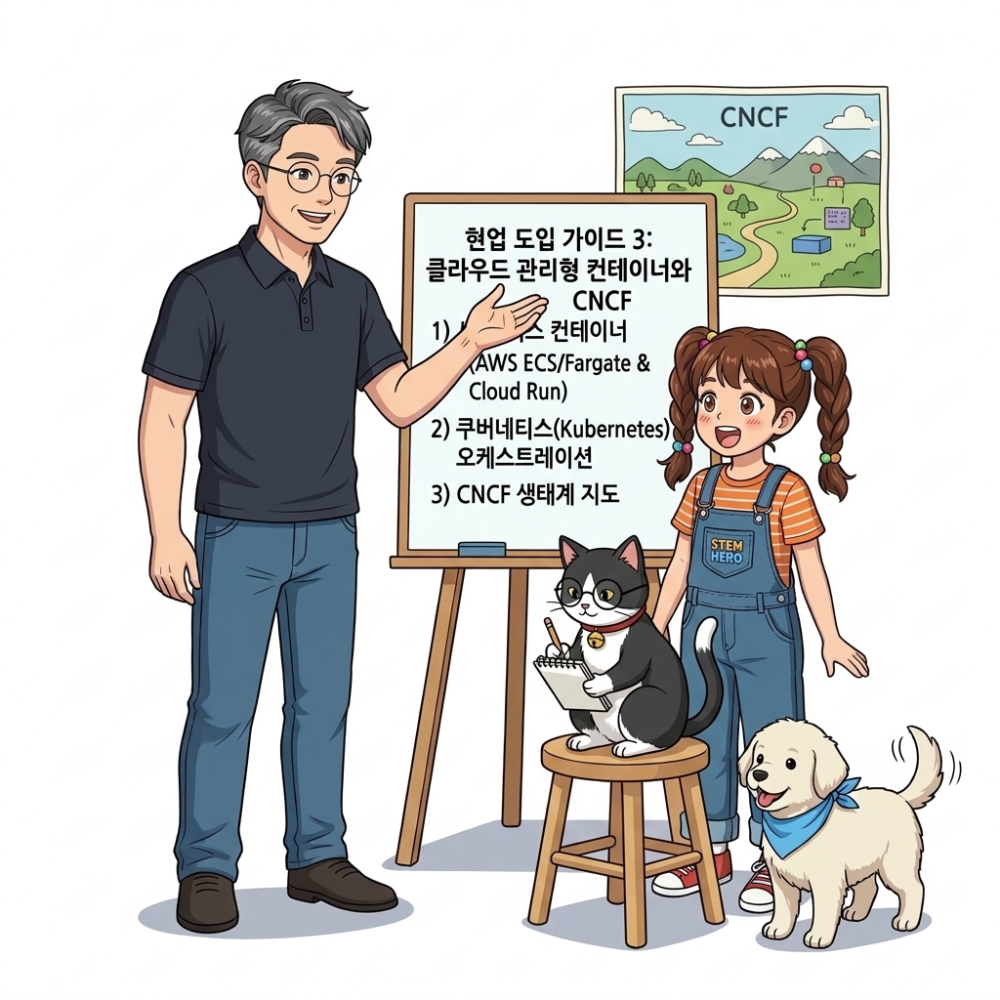
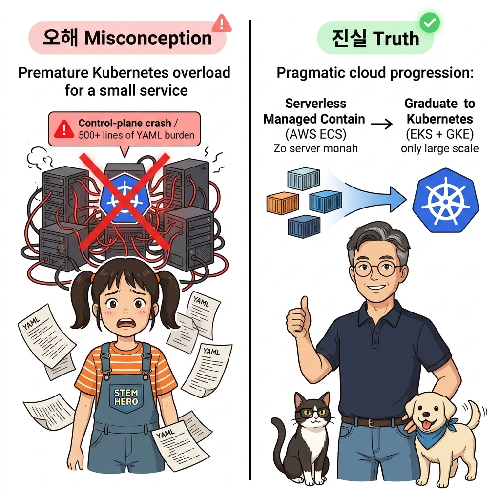
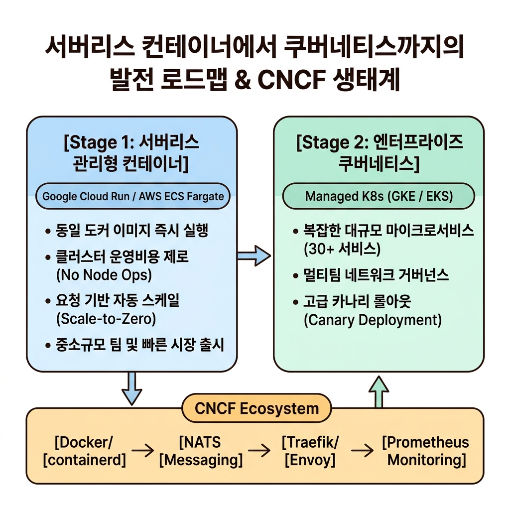
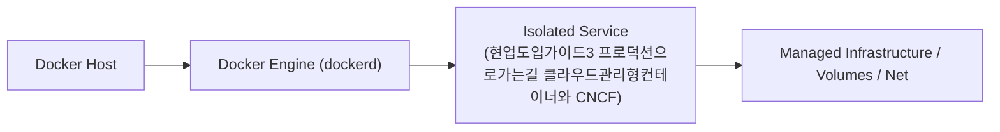
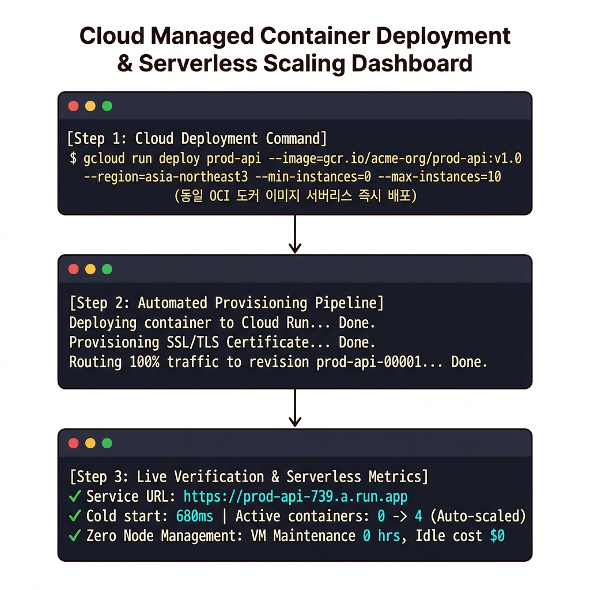
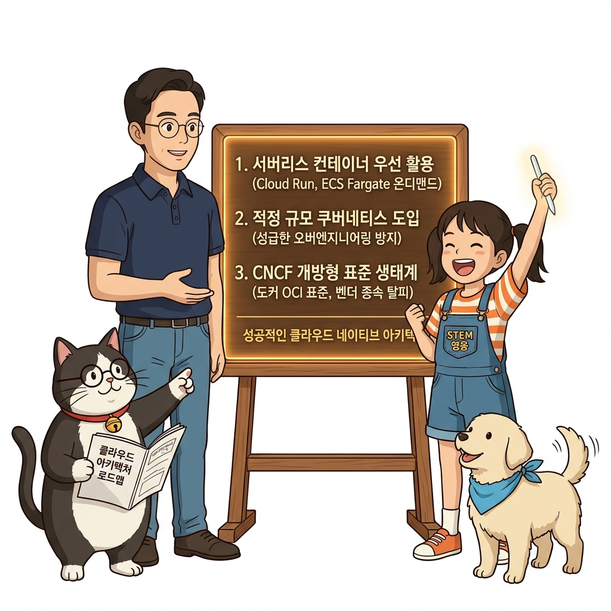
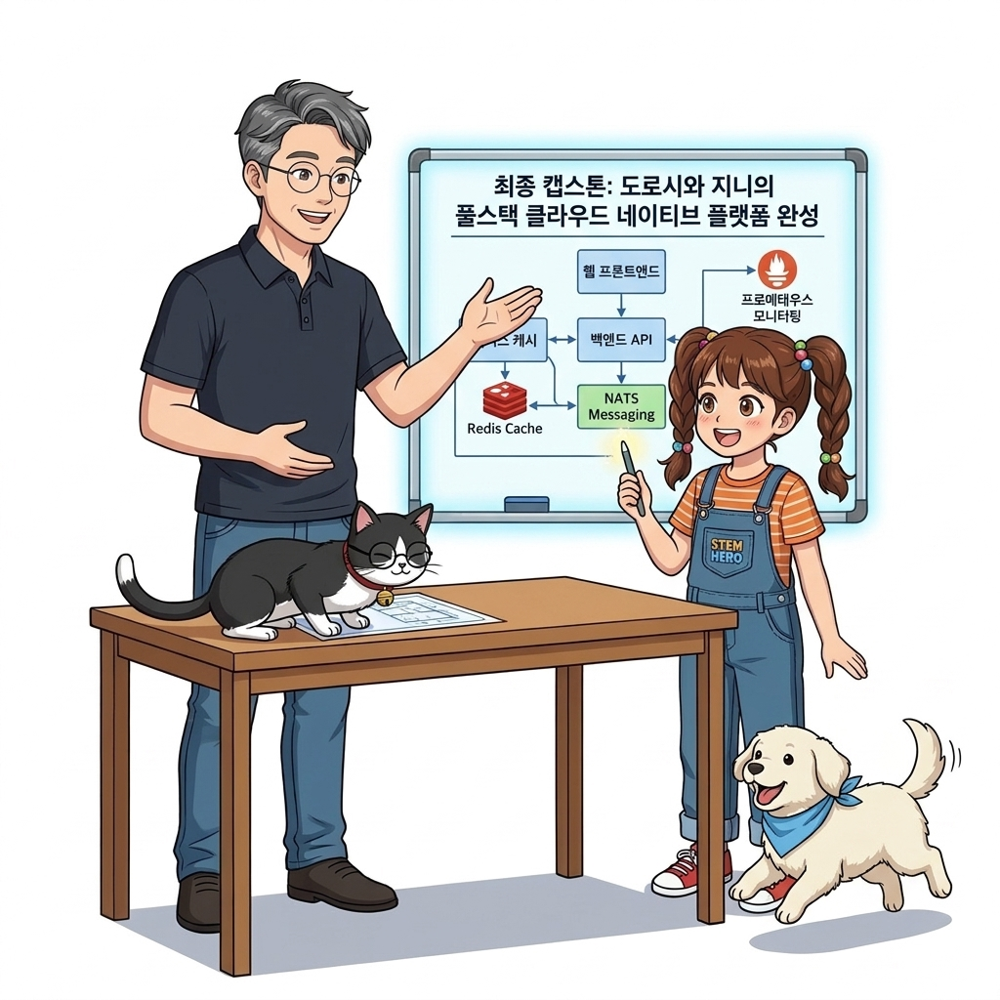

# 128. 현업도입가이드3 프로덕션으로가는길 클라우드관리형컨테이너와 CNCF

도커 컨테이너 기술을 완전히 익힌 엔지니어가 현업 클라우드 인프라로 나아갈 때 마주하는 다양한 컨테이너 호스팅 옵션들을 명쾌하게 분류합니다.


**그림 08-17-1** 현업도입가이드3 프로덕션으로가는길 클라우드관리형컨테이너와 CNCF의 필요성과 현대 클라우드 아키텍처 관점의 개요

---

### 128.1 왜 현업도입가이드3 프로덕션으로가는길 클라우드관리형컨테이너와 CNCF이(가) 필요한가? (문제 정의와 현실적 배경)

소프트웨어 시스템이 복잡해질수록 설정을 다루는 방식은 전체 인프라의 신뢰성을 결정짓는 핵심 척도가 됩니다. **현업도입가이드3 프로덕션으로가는길 클라우드관리형컨테이너와 CNCF**이(가) 부재하거나 잘못 다루어질 때 현장에서는 다음과 같은 대표적인 병목과 장애가 발생합니다:

1. **하드코딩된 설정과 환경 불일치로 인한 유연성 상실**: 환경이 바뀔 때마다 코드를 다시 빌드해야 하므로 배포 주기가 지연되고 이미지 수가 기하급수적으로 폭증합니다.
2. **보안 민감 데이터의 무분별한 노출**: 비밀번호, 데이터베이스 토큰, 암호화 키가 이미지 레이어에 영구 박제되어 형상관리 시스템이나 외부에 유출될 위험이 커집니다.
3. **재현 불가능한 구성 드리프트**: 스테이징 환경과 프로덕션 환경의 미세한 설정 차이가 예기치 못한 서비스 중단 사고로 직결됩니다.


**그림 08-17-2** 현업도입가이드3 프로덕션으로가는길 클라우드관리형컨테이너와 CNCF에 대한 대표적인 오해와 실제 프로덕션 현장의 엔지니어링 진실

---

### 128.2 핵심 아키텍처와 엔지니어링 메커니즘

서버리스 컨테이너(AWS App Runner, GCP Cloud Run), 관리형 컨테이너 서비스(AWS ECS), 엔터프라이즈 쿠버네티스(AWS EKS, GCP GKE, Azure AKS)의 특성을 비교하고, CNCF(Cloud Native Computing Foundation) 랜드스케이프를 탐색하는 안목을 기릅니다.


**그림 08-17-3** 현업도입가이드3 프로덕션으로가는길 클라우드관리형컨테이너와 CNCF의 내부 아키텍처 및 데이터 흐름

#### 📊 핵심 비교 및 엔지니어링 표준 분석

| 구분 / 핵심 원리 | 상세 설명 및 동작 메커니즘 | 실무 적용 시 주의점 및 베스트 프랙티스 |
| :--- | :--- | :--- |
| **서버리스 컨테이너의 시대** | 우리가 빌드한 도커 이미지를 그대로 구글 클라우드 런(Cloud Run)이나 AWS App Runner에 올리면, 서버 인프라 관리 없이 자동 HTTPS와 무한 오토스케일링 제공! | 소규모 팀이나 신규 서비스 론칭에 가장 추천하는 방식 |
| **쿠버네티스를 도입해야 할 때** | 서비스 컴포넌트가 30개 이상으로 늘어나고, 팀이 여러 개로 나뉘며, 복잡한 서비스 메시(Istio)나 카나리 배포가 필요할 때 도입 | 기초 체력(도커 이미지 최적화, 헬스 체크, 모니터링)이 탄탄한 팀만이 쿠버네티스 운영에 성공함! |
| **CNCF 생태계 지도의 중심** | 우리가 이 책에서 배운 Docker, containerd, Prometheus, Fluentd, NATS, Traefik은 모두 CNCF의 핵심 주축 프로젝트들! | 이미 여러분은 글로벌 클라우드 네이티브 표준의 중심에 서 있습니다 |

---

### 128.3 선언적 실습 및 아키텍처 다이어그램

본 실습은 외부 비공개 패키지에 의존하지 않고, 공식 표준 이미지를 기반으로 즉시 재현 가능한 살아있는 코드로 구성되어 있습니다.

```bash
# 클라우드 관리형 컨테이너 서비스 3단계 선택 가이드 요약
cat << 'EOF'
1단계: 서버리스 컨테이너 (GCP Cloud Run / AWS App Runner)
  -> 서버 관리 0%, 트래픽 없을 때 0원으로 축소, 단일 웹/API 및 이벤트 처리에 최적!
2단계: 관리형 오케스트레이션 (AWS ECS)
  -> 쿠버네티스의 복잡성 없이 도커 컴포즈와 유사한 Task Definition으로 안정적 운영!
3단계: 관리형 쿠버네티스 (AWS EKS / GCP GKE / Azure AKS)
  -> 대규모 엔터프라이즈 마이크로서비스, 멀티 클라우드 이식성, 방대한 CNCF 생태계 연동!
EOF
```

#### 🔍 아키텍처 흐름도 (Mermaid Diagram)




**그림 08-17-4** 선언적 인프라 명세를 통한 현업도입가이드3 프로덕션으로가는길 클라우드관리형컨테이너와 CNCF 검증 파이프라인

---

### 128.4 핵심 정리: 캐릭터 대화와 3대 교훈

> 👧 **도로시**: "교수님! **현업도입가이드3 프로덕션으로가는길 클라우드관리형컨테이너와 CNCF**의 원리를 배우니까, 복잡하게 얽혀 있던 인프라 설정이 레고 블록처럼 질서정연하게 제자리를 찾는 게 보여요!"
> 
> 🐱 **조교 지니**: "야옹~ 맞습니다! 특히 런타임 환경과 불변 인프라의 경계를 명확히 지키는 것이 대규모 클라우드 운영의 제1원칙이랍니다!"
> 
> 🐶 **토토**: "멍멍! 선언적 코드로 한 번 적어두면 언제든 똑같이 복원되니까 정말 든든해요!"
> 
> 👨‍🏫 **이호진 교수님**: "훌륭하구나. 원리를 깊이 이해하고 실습을 통해 손에 익히는 것이 훌륭한 클라우드 엔지니어로 성장하는 가장 빠른 지름길이란다."


**그림 08-17-5** 현업도입가이드3 프로덕션으로가는길 클라우드관리형컨테이너와 CNCF 마스터를 위한 3대 핵심 교훈

1. **설정과 실행의 명확한 분리**:
   * 애플리케이션 코드는 불변으로 유지하고, 가변적인 설정값은 외부에서 주입하여 이식성을 극대화합니다.
2. **선언적 재현성 확보**:
   * 사람이 수작업으로 변경하지 않고 코드 명세를 통해 언제 어디서나 100% 동일한 실행 결과를 보장합니다.
3. **최소 권한 및 보안 모범 사례 준수**:
   * 불필요한 권한과 포트 노출을 최소화하고 민감 데이터를 암호화하여 프로덕션 안정성을 담보합니다.

---

### 128.5 랩노트 피날레와 다음 강의 예고


**그림 08-17-6** 연구실에서 다음 마일스톤인 [최종캡스톤 도로시와 지니의 풀스택 클라우드네이티브 플랫폼완성] 실습을 예고하는 교수님과 토토

> 💡 **다음 강의 안내**:
> [최종캡스톤 도로시와 지니의 풀스택 클라우드네이티브 플랫폼완성](../129_최종캡스톤_도로시와_지니의_풀스택_클라우드네이티브_플랫폼완성/)에서는 더욱 심화된 실전 엔지니어링 실습과 아키텍처를 다룹니다!

---

## 🧭 강의 네비게이션
* [◀️ 이전 강의: 127_현업도입가이드2_개발_보안_운영팀_설득과_비즈니스ROI입증](../127_현업도입가이드2_개발_보안_운영팀_설득과_비즈니스ROI입증/)
* [📋 Part 08. 프로덕션 운영 마스터: 설정 관리, 중앙 로깅(Fluentd), 리버스 프록시(Nginx/Traefik), 비동기 메시지 큐(Redis/NATS) & 최종 캡스톤 (112 ~ 129) 목차로 돌아가기](../)
* [▶️ 다음 강의: 129_최종캡스톤_도로시와_지니의_풀스택_클라우드네이티브_플랫폼완성](../129_최종캡스톤_도로시와_지니의_풀스택_클라우드네이티브_플랫폼완성/)
