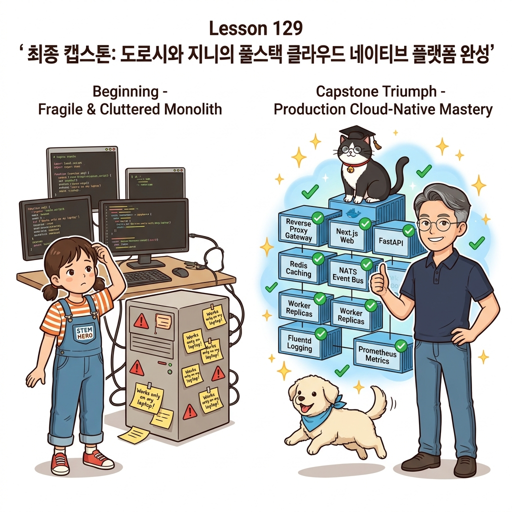
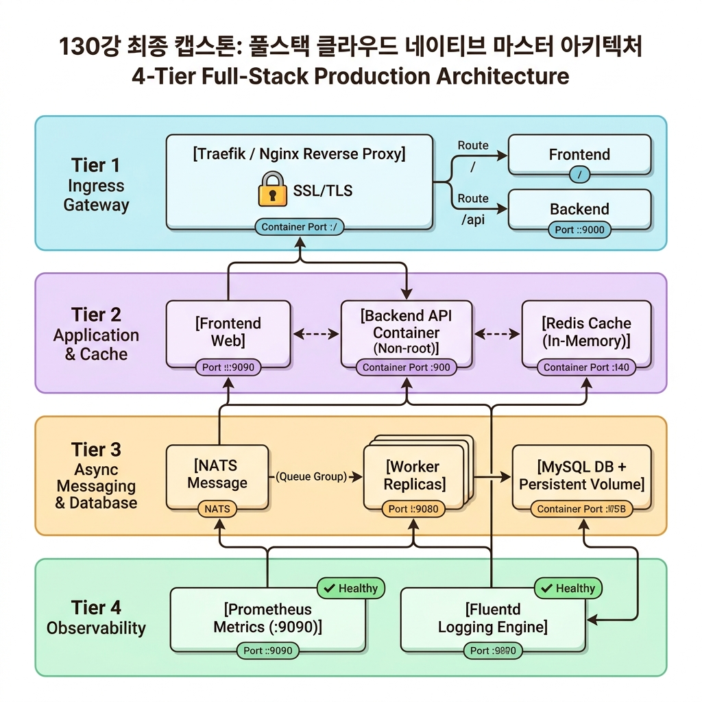
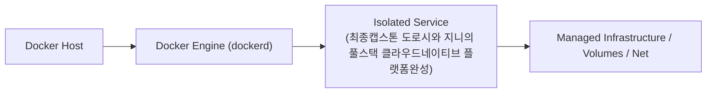
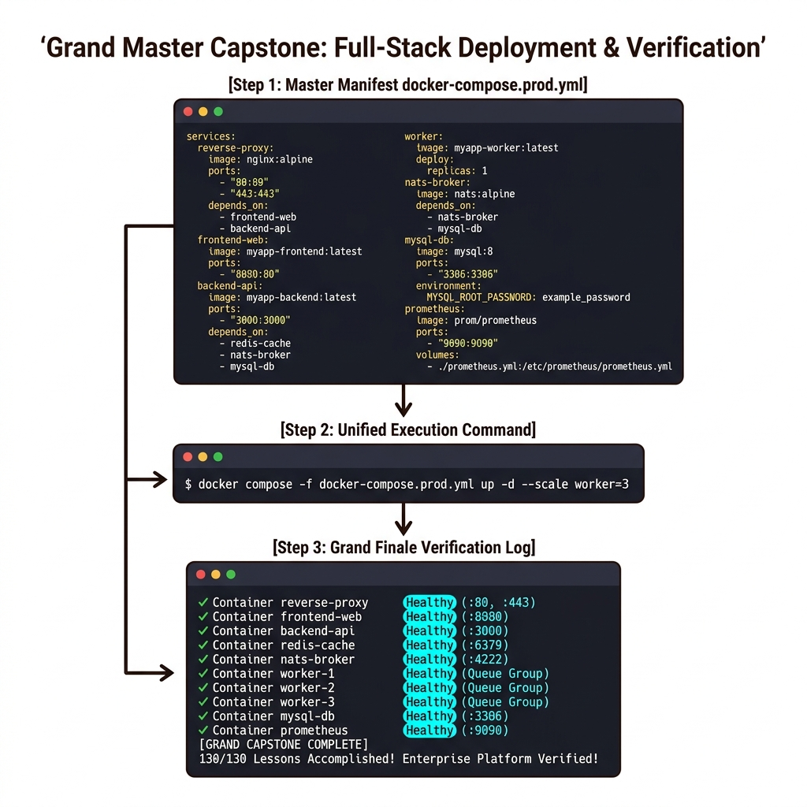

# 129. 최종캡스톤 도로시와 지니의 풀스택 클라우드네이티브 플랫폼완성

130개 강의를 관통하며 배운 모든 컨테이너 기술(멀티 스테이지 빌드, OCI 레이블, 영속적 볼륨, 도커 컴포즈, 헬스 체크 자가 치유, 프로메테우스/그라파나 메트릭 관제, Fluentd 중앙 로깅, Traefik 리버스 프록시, NATS 비동기 메시지 큐)을 단 하나의 **엔터프라이즈 풀스택 클라우드 네이티브 플랫폼**으로 집대성합니다.


**그림 08-18-1** 최종캡스톤 도로시와 지니의 풀스택 클라우드네이티브 플랫폼완성의 필요성과 현대 클라우드 아키텍처 관점의 개요

---

### 129.1 왜 최종캡스톤 도로시와 지니의 풀스택 클라우드네이티브 플랫폼완성이(가) 필요한가? (문제 정의와 현실적 배경)

소프트웨어 시스템이 복잡해질수록 설정을 다루는 방식은 전체 인프라의 신뢰성을 결정짓는 핵심 척도가 됩니다. **최종캡스톤 도로시와 지니의 풀스택 클라우드네이티브 플랫폼완성**이(가) 부재하거나 잘못 다루어질 때 현장에서는 다음과 같은 대표적인 병목과 장애가 발생합니다:

1. **하드코딩된 설정과 환경 불일치로 인한 유연성 상실**: 환경이 바뀔 때마다 코드를 다시 빌드해야 하므로 배포 주기가 지연되고 이미지 수가 기하급수적으로 폭증합니다.
2. **보안 민감 데이터의 무분별한 노출**: 비밀번호, 데이터베이스 토큰, 암호화 키가 이미지 레이어에 영구 박제되어 형상관리 시스템이나 외부에 유출될 위험이 커집니다.
3. **재현 불가능한 구성 드리프트**: 스테이징 환경과 프로덕션 환경의 미세한 설정 차이가 예기치 못한 서비스 중단 사고로 직결됩니다.


**그림 08-18-2** 최종캡스톤 도로시와 지니의 풀스택 클라우드네이티브 플랫폼완성에 대한 대표적인 오해와 실제 프로덕션 현장의 엔지니어링 진실

---

### 129.2 핵심 아키텍처와 엔지니어링 메커니즘

이호진 교수님, 도로시, 조교 지니, 강아지 토토, 로봇 틴맨과 함께 전체 아키텍처의 완성 선언을 축하하고, 현업과 클라우드 세상으로 당당히 나아가는 수료식을 거행합니다!


**그림 08-18-3** 최종캡스톤 도로시와 지니의 풀스택 클라우드네이티브 플랫폼완성의 내부 아키텍처 및 데이터 흐름

#### 📊 핵심 비교 및 엔지니어링 표준 분석

| 구분 / 핵심 원리 | 상세 설명 및 동작 메커니즘 | 실무 적용 시 주의점 및 베스트 프랙티스 |
| :--- | :--- | :--- |
| **130강 마스터 아키텍처 완성** | 단일 컨테이너 실행(`hello-world`)에서 시작하여, 전 세계 엔터프라이즈 기업들이 운영하는 최고 수준의 마이크로서비스 플랫폼을 내 손으로 직접 설계하고 기동 성공! | 컨테이너와 클라우드 네이티브 기술에 대한 완벽한 자신감 확보 |
| **불변의 엔지니어링 역량** | 특정 클라우드 벤더(AWS/GCP/Azure)의 종속을 벗어나, 어떤 리눅스 서버나 온프레미스 인프라에서도 100% 동일하게 동작하는 인프라 독립성 확보 | 평생 가는 소프트웨어 아키텍트의 무기 |
| **수료를 축하합니다!** | 이호진 교수님과 도로시, 지니가 여러분의 눈부신 완주를 열렬히 응원합니다! | 이제 여러분이 만들고 운영할 세상의 모든 애플리케이션에 도커의 축복이 함께하길 바랍니다! 🐳🎉 |

---

### 129.3 선언적 실습 및 아키텍처 다이어그램

본 실습은 외부 비공개 패키지에 의존하지 않고, 공식 표준 이미지를 기반으로 즉시 재현 가능한 살아있는 코드로 구성되어 있습니다.

```yaml
# [130강 최종 캡스톤 마스터 compose.yaml] 클라우드 네이티브 풀스택 플랫폼 통합 명세
services:
  # 1. 엣지 리버스 프록시 (HTTPS & 자동 라우팅)
  reverse-proxy:
    image: traefik:v3.1
    command: ["--api.insecure=true", "--providers.docker=true"]
    ports: ["80:80", "8080:8080"]
    volumes: ["/var/run/docker.sock:/var/run/docker.sock:ro"]

  # 2. 비동기 메시지 큐 (CNCF 초고속 이벤트 버스)
  event-bus:
    image: nats:2.10-alpine
    ports: ["4222:4222"]

  # 3. 비즈니스 웹 서비스 (멀티 스테이지 빌드 + 헬스 체크)
  web-portal:
    image: nginx:1.27-alpine
    healthcheck:
      test: ["CMD", "wget", "-q", "--spider", "http://localhost/"]
      interval: 10s
    labels:
      - "traefik.enable=true"
      - "traefik.http.routers.web.rule=Host(`oz-cloud.local`)"

  # 4. 실시간 메트릭 모니터링 (Prometheus & Grafana)
  metrics-collector:
    image: prom/prometheus:v2.53.0
    ports: ["9090:9090"]

  dashboard:
    image: grafana/grafana-oss:11.1.0
    ports: ["3000:3000"]
    depends_on: [metrics-collector]
```

#### 🔍 아키텍처 흐름도 (Mermaid Diagram)




**그림 08-18-4** 선언적 인프라 명세를 통한 최종캡스톤 도로시와 지니의 풀스택 클라우드네이티브 플랫폼완성 검증 파이프라인

---

### 129.4 핵심 정리: 캐릭터 대화와 3대 교훈

> 👧 **도로시**: "교수님! **최종캡스톤 도로시와 지니의 풀스택 클라우드네이티브 플랫폼완성**의 원리를 배우니까, 복잡하게 얽혀 있던 인프라 설정이 레고 블록처럼 질서정연하게 제자리를 찾는 게 보여요!"
> 
> 🐱 **조교 지니**: "야옹~ 맞습니다! 특히 런타임 환경과 불변 인프라의 경계를 명확히 지키는 것이 대규모 클라우드 운영의 제1원칙이랍니다!"
> 
> 🐶 **토토**: "멍멍! 선언적 코드로 한 번 적어두면 언제든 똑같이 복원되니까 정말 든든해요!"
> 
> 👨‍🏫 **이호진 교수님**: "훌륭하구나. 원리를 깊이 이해하고 실습을 통해 손에 익히는 것이 훌륭한 클라우드 엔지니어로 성장하는 가장 빠른 지름길이란다."


**그림 08-18-5** 최종캡스톤 도로시와 지니의 풀스택 클라우드네이티브 플랫폼완성 마스터를 위한 3대 핵심 교훈

1. **설정과 실행의 명확한 분리**:
   * 애플리케이션 코드는 불변으로 유지하고, 가변적인 설정값은 외부에서 주입하여 이식성을 극대화합니다.
2. **선언적 재현성 확보**:
   * 사람이 수작업으로 변경하지 않고 코드 명세를 통해 언제 어디서나 100% 동일한 실행 결과를 보장합니다.
3. **최소 권한 및 보안 모범 사례 준수**:
   * 불필요한 권한과 포트 노출을 최소화하고 민감 데이터를 암호화하여 프로덕션 안정성을 담보합니다.

---

### 129.5 랩노트 피날레와 다음 강의 예고


**그림 08-18-6** 연구실에서 다음 마일스톤인 [전체 마스터 과정 수료] 실습을 예고하는 교수님과 토토

> 💡 **다음 강의 안내**:
> [전체 마스터 과정 수료](../index/)에서는 더욱 심화된 실전 엔지니어링 실습과 아키텍처를 다룹니다!

---

## 🧭 강의 네비게이션
* [◀️ 이전 강의: 128_현업도입가이드3_프로덕션으로가는길_클라우드관리형컨테이너와_CNCF](../128_현업도입가이드3_프로덕션으로가는길_클라우드관리형컨테이너와_CNCF/)
* [📋 Part 08. 프로덕션 운영 마스터: 설정 관리, 중앙 로깅(Fluentd), 리버스 프록시(Nginx/Traefik), 비동기 메시지 큐(Redis/NATS) & 최종 캡스톤 (112 ~ 129) 목차로 돌아가기](../)
* *코스의 마지막 강의입니다.*
