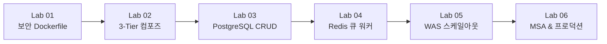

# 🎯 실전 프로젝트 실습 랩: 라라벨 기반 도커 웹사이트 완성하기
## "이 과정을 마치면 나만의 4-Tier 클라우드 웹사이트가 실제로 동작합니다!"

> **"Hello World만 찍어보는 실습은 이제 그만!"**  
> 본 실전 랩에서는 학생들이 직접 한 줄씩 코드를 작성하며, 현대 웹 개발의 표준인 **PHP 8.5 & 라라벨(Laravel)**, **Nginx 웹서버**, **PostgreSQL 데이터베이스**, **Redis 캐시/큐**를 결합하여 **실제 동작하는 웹사이트('도커 원정대 커뮤니티 보드')**를 구축하고, 대규모 트래픽을 처리하는 **수평 스케일아웃 및 MSA 분산 구조**까지 완성합니다.

---

## 🌟 우리가 함께 만들 완성작 미리보기: "도커 원정대 커뮤니티 보드"

학생들이 본 실습 과정을 완주하면 로컬 브라우저(`http://localhost:8080`) 및 클라우드 서버에서 다음과 같은 실제 서비스가 동작하게 됩니다.

```
┌────────────────────────────────────────────────────────────────────────┐
│  🧭 도커 원정대 커뮤니티 (Docker Expedition Board)                     │
│  [호스트 노드: was-container-02 | 처리 응답 시간: 12ms | DB: pgsql-01]  │
├────────────────────────────────────────────────────────────────────────┤
│  📝 [새 탐험일지 작성하기]                                            │
│  작성자: [ 도로시           ]                                          │
│  메시지: [ 드디어 Nginx와 PHP-FPM, PostgreSQL 컨테이너를 연결했어요! ] │
│  [ 🚀 탐험일지 등록 ]                                                  │
├────────────────────────────────────────────────────────────────────────┤
│  📋 실시간 탐험일지 피드 (PostgreSQL 영속 저장 & Redis 비동기 알림)    │
│  • #3 도로시: "FPM 5대로 스케일아웃하니 1,000명 동시 접속도 거뜬해요!" │
│  • #2 지니: "PostgreSQL 볼륨 덕분에 컨테이너를 재시작해도 글이 남아요!"│
│  • #1 이호진 교수님: "도커 원정대에 오신 모든 학생 여러분을 환영합니다!"│
└────────────────────────────────────────────────────────────────────────┘
```

* **주요 기능**:
  1. **실시간 방명록 / 게시판 CRUD**: PostgreSQL 데이터베이스에 영구 보존되는 게시글 등록, 조회, 삭제.
  2. **서빙 인스턴스 호스트네임 실시간 표시 (`gethostname()`)**: 새로고침할 때마다 Nginx가 다수의 WAS 인스턴스(`was-1`, `was-2`, `was-3`...)로 요청을 균등 분산하는 모습을 화면에서 직접 육안 확인.
  3. **비동기 큐 작업 처리**: 게시글 등록 시 Redis를 통해 백그라운드 Worker 컨테이너가 이메일 알림 시뮬레이션 및 데이터 집계를 비동기 처리.
  4. **무중단 핫리로드 개발 환경**: 내 PC의 소스코드를 고치고 브라우저를 새로고침하면 컨테이너 재빌드 없이 1초 만에 반영.

---

## 📚 실습 랩 6단계 커리큘럼 구성

각 랩은 복사해서 바로 실행할 수 있는 완성형 코드(`Dockerfile`, `compose.yaml`, `nginx.conf`, `web.php` 등)와 함께, 왜 그렇게 작성해야 하는지에 대한 친절한 엔지니어링 원리 해설을 담고 있습니다.



| 실습 랩 | 실습 주제 | 핵심 학습 내용 및 구현 산출물 | 바로가기 |
| :---: | :--- | :--- | :---: |
| **Lab 01** | **PHP 8.5 라라벨 보안 Dockerfile 제작** | • 최신 PHP 8.5 알파인 베이스 & non-root 격리<br>• 멀티스테이지 빌드로 800MB ➔ 50MB 초경량화<br>• `pdo_pgsql`, `redis`, OPcache 필수 모듈 컴파일 | [Lab 01 시작하기](./01_dockerfile_and_php85/) |
| **Lab 02** | **Nginx + PHP-FPM + PostgreSQL 3-Tier 컴포즈** | • Nginx FastCGI 프록시 설정 (`fastcgi_pass was:9000`)<br>• `compose.yaml` 단 한 줄로 전체 인프라 기동<br>• 로컬 소스코드 바인드 마운트 핫리로드 구축 | [Lab 02 시작하기](./02_compose_nginx_pgsql/) |
| **Lab 03** | **PostgreSQL 연동 CRUD 웹앱 완성** | • PostgreSQL 컨테이너 데이터 볼륨 영속화<br>• `php artisan migrate` 데이터베이스 스키마 생성<br>• 블레이드 템플릿과 Eloquent ORM 방명록 완성 | [Lab 03 시작하기](./03_crud_and_database/) |
| **Lab 04** | **Redis 캐시 & 비동기 큐 워커 분리** | • 동일 이미지 기반 웹 WAS vs 큐 워커 컨테이너 분리<br>• Redis 세션 클러스터링 및 비동기 작업 큐 연동<br>• 게시글 등록 시 백그라운드 이벤트 비동기 처리 | [Lab 04 시작하기](./04_redis_queue_worker/) |
| **Lab 05** | **Nginx 부하분산 & WAS 5대 수평 스케일아웃** | • `docker compose up -d --scale was=5` 수평 증설<br>• Nginx Upstream 로드밸런싱 & 호스트네임 시각화<br>• ApacheBench 동시 1,000명 부하 테스트 성능 입증 | [Lab 05 시작하기](./05_scale_out_load_balancing/) |
| **Lab 06** | **모놀리스에서 MSA 분리 & 프로덕션 배포** | • Nginx Gateway ↔ Auth 서비스 ↔ Post 서비스 분리<br>• 서비스별 독립 PostgreSQL 데이터베이스(Database per Service)<br>• 실제 리눅스 클라우드 서버에 도메인 및 HTTPS 배포 | [Lab 06 시작하기](./06_msa_and_production/) |

---

## 🛠️ 실습 전 준비사항

1. **Docker Desktop 또는 Docker Engine 24.0+** 설치 완료
2. **Docker Compose V2** (`docker compose version` 확인)
3. 텍스트 에디터 (VS Code 권장)
4. 본 실습은 호스트 PC에 **PHP, Composer, PostgreSQL을 일절 설치할 필요가 없습니다.** 모든 도구와 런타임은 오직 **도커 컨테이너 내부**에서 완벽하게 구동됩니다!

👉 준비되셨다면 **[Lab 01. PHP 8.5 라라벨 보안 Dockerfile 제작](./01_dockerfile_and_php85/)**부터 본격적으로 시작해 보겠습니다!

